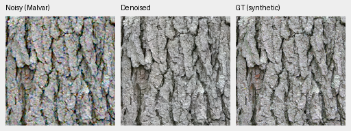
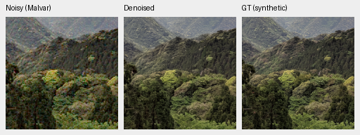
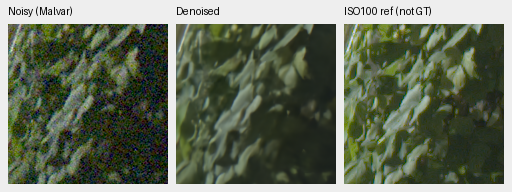

# demosaic

Joint Bayer demosaicing and denoising in linear camera RGB, with physical noise
conditioning, frozen DINOv3 features and tiled 16-bit TIFF output on NVIDIA GB10.
**V102 final20k is the current quality baseline**, continuing V84's pretrained
DRUNet RGB trunk and frozen DINOv3 ConvNeXt-Tiny pyramid. It reaches **36.680dB**
on the full427-photo panel: +.176dB over V101 and about+1.78dB over V43,
with higher known/unseen measured-camera means. V103 has nearly identical photo
quality; V102 has lower ADC flat-color error and stronger tested weak texture.
[Completed results, native comparisons and tradeoffs](docs/v102-v103-quality-review.md).

The zero-blur/detail recipe improves425/427 photographic source means over V101.
Fine high-noise texture and real foliage still need work. V104 is training on the reviewed larger
corpus:2,395 eligible additions,bringing training to90,872 sources.
The next [matched Tiny/Small quality recipes](docs/convnext-small-capacity.md#prepared-matched-quality-trial)
are prepared on a separately cleaned cohort; training has not launched.
[Current models](docs/current-model.md) · [Source-quality review](docs/incoming-commons-quality.md) ·
[Historical diary](diary/index.md).
For explicit zero-shot/read inputs, [optional site consistency](docs/adc-consistency.md)
adds **.40dB ADC-only PSNR** with unchanged V84 weights across all427 photos/four
CFAs; positive-noise inputs bypass it. The report includes native crops and color tradeoffs.


[PSNR history and full values](docs/performance-history.md). Versions have unequal
training budgets and data; this describes available models rather than an
isolated architecture ablation.

## Current 100% crops

Noisy observation → **V102 final20k** → exact synthetic GT, at the ISO100 prior.
These are unchanged 160×160 crops at the 8×-binned evaluation resolution, with
shared coordinates and display transforms. Low-noise bark/canopy gains are
small; fine-detail loss remains at high noise.
[Compare V84,V100,V101,V102,V103 and RawNIND](docs/heldout-detail.md) ·
[source/ROI/checkpoint/noise/display metadata](docs/images/current-detail/iso100-prior/manifest.json).





Sources: [Derek Ramsey](https://commons.wikimedia.org/wiki/File:Kentucky_Coffee-tree_Gymnocladus_dioicus_3264px.jpg),
[CC BY-SA 2.5](https://creativecommons.org/licenses/by-sa/2.5/), and
[Grendelkhan](https://commons.wikimedia.org/wiki/File:Forest_covered_hills_on_Yakushima.jpg),
[CC BY-SA 4.0](https://creativecommons.org/licenses/by-sa/4.0/), modified by binning,
cropping, simulated noise and restoration.

Real GFX100S: DSCF3879 ISO 6400 → **V102 final20k** → DSCF3880 ISO 100 f/5.6. Native160
sensor-pixel crops from complete102MP blended outputs, with shared +2EV display. The last
panel is a separately captured qualitative reference, **not GT**.
[Compare complete102MP V101/V102/V103/RawNIND outputs](docs/gfx-qualitative.md).
Real-photo changes remain small; fine foliage and saturated-light detail still need work.
The [Q2, Sony a7R II and GFX50R gallery](docs/cross-camera-qualitative.md)
also compares V100/V102/V103 on six fixed native regions.




## Setup and inference

Linux, Python 3.12+, `uv` and a CUDA 13-compatible NVIDIA driver are required for
the lockfile. DINOv3 requires approved Hugging Face access through `HF_TOKEN`.

```bash
source scripts/env.sh
uv sync --extra dev
uv run demosaic infer /mnt/external/demosaic/models/v102-final20000.pt photo.raf \
  /mnt/external/demosaic/output/photo-linear.tiff \
  --preview /mnt/external/demosaic/output/photo-srgb.tiff \
  --shot 0.001 --read 0.000001 \
  --tile 512 --overlap 64 --batch-size 4 --precision float32 --cudnn-benchmark
PYTHONPATH=.:src:scripts uv run pytest -q
```

Noise values are examples; use suitable camera/input priors.
[Linear DNG + full-resolution JPEG batch export](docs/dng-export.md) preserves
camera RGB and adapts existing darktable XMP edits. Add `--hot-pixels` to repair
isolated Bayer defects before restoration.
[Usage](docs/usage.md) · [current training](docs/quality-first-training.md) ·
[data pipeline](docs/training-pipeline.md) · [experiments](docs/experiments.md) ·
[documentation guide](docs/index.md). Quality takes priority. State-of-the-art
quality and 100MP within 10s remain project goals; full-frame timing is
checkpoint-specific.
