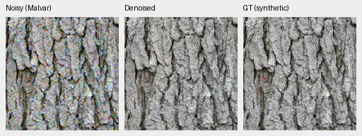

# demosaic

Joint Bayer demosaicing and denoising in linear camera RGB, with physical noise
conditioning, frozen DINOv3 features and tiled 16-bit TIFF output on NVIDIA GB10.
**V101 is the current quality and training baseline**, continuing V84's
pretrained DRUNet RGB trunk and frozen DINOv3 ConvNeXt-Tiny pyramid. It reaches
**36.503 dB** on the full photographic panel: +0.064 dB over V84 and about
+1.60 dB over V43. Camera means remain close to V84.
[Completed results, gains and tradeoffs](docs/v84-curated-quality-review.md).

The cleaned 88,484-source continuation removes optical blur and adds weak/fine
detail examples. V101 improves source-averaged PSNR on 418/427 photos; high-noise
texture still needs work. The [current models](docs/current-model.md) and image
galleries reflect useful progress; the [diary](diary/index.md) retains history.
**V102 at 5,000 updates adds +0.15 dB at low noise** on the four-source detail
panel, with smaller high-noise gains. Its native crops are shown below while
the original 20k V102/V103 comparison continues.
For explicit zero-shot/read inputs, [optional site consistency](docs/adc-consistency.md)
adds **.40dB ADC-only PSNR** with unchanged V84 weights across all427 photos/four
CFAs; positive-noise inputs bypass it. The report includes native crops and color tradeoffs.


[PSNR history and full values](docs/performance-history.md). Versions have unequal
training budgets and data; this describes available models rather than an
isolated architecture ablation.

## Current 100% crops

Noisy observation → **V102 at 5,000 updates** → exact synthetic GT, at the ISO100 prior.
These are unchanged 160×160 crops at the 8×-binned evaluation resolution, with
shared coordinates and display transforms. Low-noise bark/canopy gains are
small; fine-detail loss remains at high noise.
[Compare V84, V100, V101, V102 and RawNIND](docs/heldout-detail.md) ·
[source/ROI/checkpoint/noise/display metadata](docs/images/current-detail/iso100-prior/manifest.json).




Sources: [Derek Ramsey](https://commons.wikimedia.org/wiki/File:Kentucky_Coffee-tree_Gymnocladus_dioicus_3264px.jpg),
[CC BY-SA 2.5](https://creativecommons.org/licenses/by-sa/2.5/), and
[Grendelkhan](https://commons.wikimedia.org/wiki/File:Forest_covered_hills_on_Yakushima.jpg),
[CC BY-SA 4.0](https://creativecommons.org/licenses/by-sa/4.0/), modified by binning,
cropping, simulated noise and restoration.

Real GFX100S: DSCF3879 ISO 6400 → **V101** → DSCF3880 ISO 100 f/5.6. Native 160
sensor-pixel crops from complete102MP blended restorations, with shared +2 EV display. The last
panel is a separately captured qualitative reference, **not GT**.
[Compare V84, V100, V101 and RawNIND on six regions](docs/gfx-qualitative.md).
V101 and V84 look close here; fine foliage and saturated-light detail remain targets.
The same guide also shows the newer V102 checkpoint on six cached CPU contexts;
its real-photo changes are small.
The [Q2, Sony a7R II and GFX50R gallery](docs/cross-camera-qualitative.md)
also includes V84/V100 on six fixed native regions.


## Setup and inference

Linux, Python 3.12+, `uv` and a CUDA 13-compatible NVIDIA driver are required for
the lockfile. DINOv3 requires approved Hugging Face access through `HF_TOKEN`.

```bash
source scripts/env.sh
uv sync --extra dev
uv run demosaic infer /mnt/external/demosaic/models/v101-final10000.pt photo.raf \
  /mnt/external/demosaic/output/photo-linear.tiff \
  --preview /mnt/external/demosaic/output/photo-srgb.tiff \
  --shot 0.001 --read 0.000001 \
  --tile 512 --overlap 64 --batch-size 4 --precision float32 --cudnn-benchmark
PYTHONPATH=.:src:scripts uv run pytest -q
```

Noise values are examples; use suitable camera/input priors.
[Linear DNG + full-resolution JPEG batch export](docs/dng-export.md) preserves
camera RGB and adapts existing darktable XMP edits. Add `--hot-pixels` to repair
isolated Bayer defects before restoration.
`--hot-pixel-clusters` also handles paired same-color defects; see the
[native crop investigation](docs/hot-pixel-clusters.md).
[Usage](docs/usage.md) · [current training](docs/quality-first-training.md) ·
[data pipeline](docs/training-pipeline.md) · [experiments](docs/experiments.md) ·
[documentation guide](docs/index.md). Quality takes priority. State-of-the-art
quality and 100MP within 10s remain project goals; full-frame timing is
checkpoint-specific.
