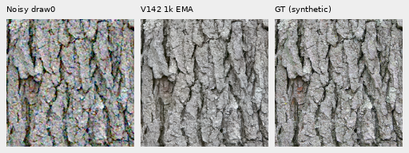
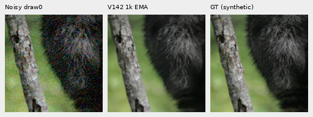
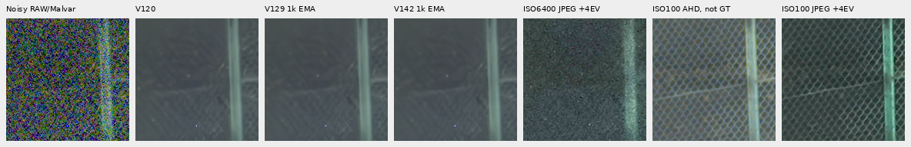
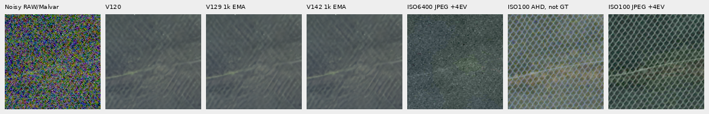

# demosaic

Joint Bayer demosaicing and denoising in linear camera RGB, with physical noise
conditioning, frozen DINOv3 features and tiled16-bit output on NVIDIA GB10.
**V120 Small is the current general recommendation**, using V84's pretrained
DRUNet RGB trunk and official DINOv3 ConvNeXt-Small pyramid. It reaches
**37.04008dB** on the full427-photo panel, with known/unseen measured-CFA means
**54.31272/54.00872dB** and tested ADC maximum55.52DN16. It recovers V119's
camera/color regression while keeping its photo score. Fine detail remains weak.
[Results, native comparisons and explicit GFX profile limits](docs/v120-v121-primary.md).

**V114 Tiny** offers lower tested ADC maximum51.73DN16. **V117 Tiny** has a
slightly higher single-view photo mean37.04408dB, with lower camera means and
higher ADC bias than the current general choice. V120's numerical/native review
and complete102MP RGB16 checks are done. Foliage, neon, fine mesh and dark-field
mottling still need work. [Current choices](docs/current-model.md) ·
[GFX gallery](docs/gfx-qualitative.md) · [Camera comparisons](docs/native-camera-development.md).

Training uses geometry before final downsampling and zero optical blur. The
[current source review](docs/current-source-loss-review.md) covers 2,083 inspected
IDs; the prepared bank has 90,773 photos/37 regions. The latest inspection
withholds one grainy coastal source and adds a mixed-contrast leaf region.
V134/V135 keep their 33-region data; existing jobs retain declared inputs.
[Data pipeline](docs/training-pipeline.md).
An optional [photographic epoch order](docs/photographic-epoch-order.md) covers
all prepared photos within 20k steps; its trained quality remains unmeasured.

The [completed V142 data-only review](docs/v142-crossed-line-pilot.md) recovers
.05212dB faint ADC PSNR and lowers noisy-flat spatial RMS4.55% versus V129.
The new [crossed-line/empty targets](docs/crossed-line-training-data.md) are
useful for further training. Fine mesh still lacks clear recovery, coarse
noisy-flat error remains5.08% above V120 and selected ADC-only color bias worsens.
V125/V131 stopped at the memory reserve; their dependent October queues exited.
Original evidence remains preserved.

| Current quality work | Evidence and next comparison |
| --- | --- |
| [V122/V123 frequency features](docs/v122-v123-quality.md) | Both20k reviews complete: joint training gains0.05493dB photo PSNR over adapter-only, with lower unseen-camera PSNR, a worse ADC tail and little weak-detail recovery |
| [V124/V125 conditional-mean loss](docs/conditional-mean-training.md) | [V12420k native check](docs/v124-final20000-native.md): ordinary+.0095dB/faint−.0856dB versus V120, with late faint recovery and no clear new mesh detail. V125 stopped at the memory reserve; [6k review](docs/v125-progress6000-quality.md) remains weaker on faint detail. Stopped at the memory reserve; full matched review pending |
| [V131/V132 spatial attention](docs/raw-spatial-training.md) | [V1311k progress review](docs/v131-progress1000-quality.md) complete: ordinary+.0016dB, deepest shadows−.0237–.0342dB and faint ADC−.2734dB versus V120; no clear new mesh recovery. V131 stopped at the memory reserve; V132 production remains unstarted |
| [V133 photographic quota](docs/reviewed-quota-training.md) | CPU/CUDA checks pass; 5% versus V131's 50% retains its20k plan. The original dependency queue exited; quality remains unmeasured |
| [V134/V135 cleaned data and photo epochs](docs/photo-epoch-training.md) | All four real 16+2 checks pass on 90,778/33. Matched20k replacement/epoch recipes remain prepared; their original dependency queues exited, and quality is unmeasured |
| [V136 global RAW attention](docs/v136-global-attention-quality.md) | Matched1k review complete: +.0003dB ordinary, +.0007–.0026dB shadow and +.0131dB faint ADC over V129; mixed local detail and no clear new fine-mesh recovery. Native crops and independent audits published |
| [V137 conditioned global attention](docs/v137-global-conditioned-quality.md) | Matched1k review complete: faint ADC+.0334dB versus V136, tiny ordinary/shadow regressions and no clear new mesh recovery. A [trained-memory check](docs/global-memory-contribution.md) finds the local feature path still dominates on six contexts |
| [V138 frozen-parent global branch](docs/raw-global-only-training.md) | Genuine CPU/CUDA16+2 checks pass with91 parent model/EMA tensors exact. Larger branch LR1e−3/1k recipe remains unstarted after the V125 dependency failure; quality is unmeasured |
| [V139 memory-only branch](docs/raw-global-memory-only.md) | Removes the direct local/MLP shortcut. Genuine CPU/CUDA16+2 checks pass; original1k training remains unstarted after dependency failure. Image quality is unmeasured |
| [V140 neighboring-gradient memory](docs/raw-patch-memory.md) | Adds2,048 descriptor parameters before memory matching. [Complete1k/native/flat review](docs/v140-standalone-pilot.md): ordinary+.00003dB/faint−.00015dB versus V120, no clear mesh gain. Exact-flat/sky variation remains near parent; all1,000 training batches match V137 |
| [V141 small-gradient loss](docs/v141-gradient-epsilon-pilot.md) | Complete1k/native/GFX/48-flat review: faint ADC+.01528dB over V129, mixed local detail, no new mesh recovery. Noisy-flat coarse error near V129 and5.75% above V120; defaults unchanged |
| [V142 crossed-line/empty data](docs/v142-crossed-line-pilot.md) | Complete1k/native/GFX/48-flat review: faint ADC+.05212dB and noisy-flat spatial RMS−4.55% versus V129. Coarse error remains5.08% above V120; ADC-only DC bias worsens. Selected weak grass/wood gains, no clear new mesh recovery |
| [V143 combined data/gradient5k](docs/v143-crossed-gradient5000.md) | Fresh5k from V120 with V142 data and gradient epsilon3e−5; CPU/CUDA16+2 inputs and initial outputs match V142. Production running; fixed1k/2.5k/5k native/GFX/flat reviews queued. Quality unmeasured |

Shadow, feature-loss and curated-data pilots show no useful large recovery.
The [FP32 pilot](docs/training-precision-pilot.md) slightly improves selected
weak fur/grass/wood [faint-ADC bands](docs/faint-adc-precision.md), with a0.01720dB
lower panel mean and no clear large real-mesh gain. Measured strengths and
weaknesses guide the baseline. [Research and complete studies](docs/research.md) ·
[Historical diary](diary/index.md).

Optional [V114 eight-view inference](docs/v114-eight-view.md) improves the selected
material/camera support with a color-bias tradeoff; full panels/frame remain
unmeasured. [ADC sample fidelity](docs/adc-consistency.md) improves its ADC-only
photo panel by0.236dB with higher spatial variation; positive-noise inputs bypass it.


[PSNR history and full values](docs/performance-history.md). Versions have unequal
training budgets and data; this describes available models rather than an
isolated architecture ablation.

## Current 100% crops

Photo cells are unchanged160×160 crops at the8×-binned evaluation resolution,
with shared coordinates/transforms. ISO12800-prior noisy observation →
**V142 Small data pilot, single view** → exact synthetic GT. Bark remains
coherent; fine fur remains soft. Its modest faint/flat spatial gains and
selected color-bias cost leave V120 as the general recommendation.
[Audited V142 results and limits](docs/v142-crossed-line-pilot.md) ·
[Source/ROI/checkpoint/noise/display metadata](docs/images/v142-crossed-line-v1/manifest.json).





Sources: [Derek Ramsey](https://commons.wikimedia.org/wiki/File:Kentucky_Coffee-tree_Gymnocladus_dioicus_3264px.jpg),
[CC BY-SA2.5](https://creativecommons.org/licenses/by-sa/2.5/), and
[Korall](https://commons.wikimedia.org/wiki/File:Racoon_clinging_to_a_tree.JPG),
[CC BY3.0](https://creativecommons.org/licenses/by/3.0/), modified by binning,
cropping, simulated noise and restoration.

Real GFX100S: DSCF3879 ISO6400 → **V120 Small, fixed historical Haar profile** → DSCF3880 ISO100 f/5.6.
Native160×160 sensor-pixel crops from complete102MP outputs share +2EV display.
The independent ISO100 exposure is an approximate qualitative reference,
**not GT**. Fine foliage remains painterly; fence geometry is coherent.
[All six regions and other useful models](docs/gfx-qualitative.md) ·
[Metadata](docs/images/v120-v121-fixed-Haar-GFX-v1/manifest.json).


The additional **fine green mesh beside the red train's cab** remains difficult:
the nominal ISO6400 prior largely erases its lattice. The fixed nearby3879
profile retains weak diagonals, without clear new lattice recovery in V142.
Below: noisy Malvar → V120 → V129 → V142 → DSCF3842 camera JPEG → independent
DSCF3835 ISO100 AHD → ISO100 camera JPEG, at the same nearby profile. Native160px
cells share+4EV. Both ISO100 comparators are **not GT**; processing and capture
aperture/exposure differ. [Both priors and source metadata](docs/gfx-green-mesh.md).
The [fixed green-phase peak extension](docs/v142-crossed-line-pilot.md#both-heldout-gfx-scenes)
finds mixed frequency-power changes; these are descriptive ratios, not quality scores.





The [stronger RawNIND full-frame reference](docs/rawnind-fullframe.md) and
[current Tiny/Small Q2/Sony/GFX50R comparisons](docs/cross-camera-qualitative.md)
show additional real-camera limitations. Broad real-photo superiority remains a goal.

## Setup and inference

Linux, Python 3.12+, `uv` and a CUDA 13-compatible NVIDIA driver are required for
the lockfile. DINOv3 requires approved Hugging Face access through `HF_TOKEN`.

```bash
source scripts/env.sh
uv sync --extra dev
uv run demosaic infer /mnt/external/demosaic/models/v120-final20000.pt photo.raf \
  /mnt/external/demosaic/output/photo-linear.tiff \
  --preview /mnt/external/demosaic/output/photo-srgb.tiff \
  --shot 0.001 --read 0.000001 \
  --tile 512 --overlap 64 --batch-size 4 --precision float32 --cudnn-benchmark
PYTHONPATH=.:src:scripts uv run pytest -q
```

Noise values are examples; use suitable camera/input priors.
[Linear DNG + full-resolution JPEG batch export](docs/dng-export.md) preserves
camera RGB and adapts existing darktable XMP edits. Add `--hot-pixels` to repair
isolated Bayer defects before restoration.
`--hot-pixel-clusters` also handles paired same-color defects; see the
[native crop investigation](docs/hot-pixel-clusters.md).
[Usage](docs/usage.md) · [current training](docs/quality-first-training.md) ·
[data pipeline](docs/training-pipeline.md) · [experiments](docs/experiments.md) ·
[documentation guide](docs/index.md). Quality takes priority. State-of-the-art
quality and 100MP within 10s remain project goals; full-frame timing is
checkpoint-specific.
