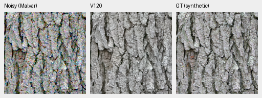
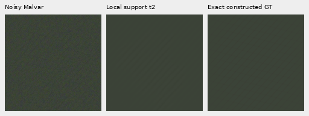
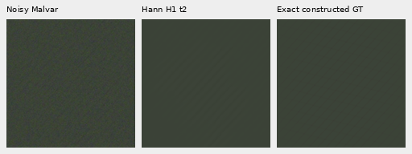
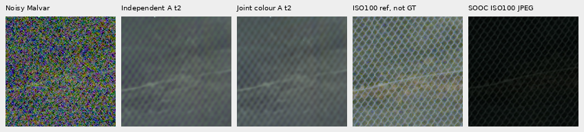
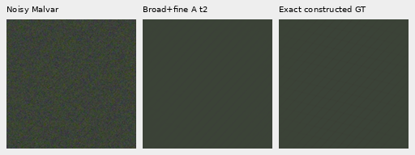

# demosaic

Joint Bayer demosaicing and denoising in linear camera RGB, with physical noise
conditioning, frozen DINOv3 context and tiled 16-bit output on NVIDIA GB10.

**V120 Small remains the general recommendation:** 37.04008 dB on 427 photos,
known/unseen-CFA means 54.31272/54.00872 dB and verified 102MP RGB16 exports.
It uses a pretrained DRUNet trunk and the official DINOv3 ConvNeXt-Small pyramid.
Fine foliage, mesh, neon and dark-field mottle remain weaknesses.
[Results](docs/v120-v121-primary.md) · [Current choices](docs/current-model.md).

The latest detail experiments retain useful tradeoffs: **V198 EMA reaches
11.158% of constructed-GT mesh amplitude**, with stronger real cab modulation,
but introduces green/magenta building fringes and false texture. V200 slightly
improves quiet/flat error while reducing mesh response to 11.102% of GT.
The [shared-edge training comparison](docs/shared-edge-comparison.md) adds small
quiet/flat gains but lowers EMA mesh response to 10.874%; the same fringes and
incomplete crossings persist.
V187 is quieter and V195 avoids those new building color failures in the
reviewed views. [Complete comparison](docs/scale-supported-cfa-wave-comparison.md) ·
[Seven-state native viewer](docs/images/v200-scale-supported-cfa-wave-v1/native-viewer.html).
Broad state-of-the-art quality and 100MP within 10 seconds remain goals.

[Weak-detail literature review and proposed experiments](docs/weak-detail-literature-2026-11.md)
examines the fence/flat-region tradeoff and recent methods. The first proposed
shared-edge trial and its [full quality review are complete](docs/shared-edge-comparison.md).
The [first withheld-CFA diagnostic](docs/withheld-cfa-evidence.md) shows why
independent sample agreement still needs an adequate edge/background model.
Its [geometry refinement](docs/withheld-cfa-edge-refinement.md) improves the
measured synthetic weak-direction/false-detail tradeoff.
The [completed three-noise wire panel](docs/edge-snr-ladder.md) still finds
strong direction imbalance: V200 EMA recovers 86.7% of the strong increment but
8.1% of the weaker increment far from the edge at the clearest tested prior.
A [competing-orientation selector](docs/competing-orientation-comparison.md)
improves one fixed mesh's weaker orientation sector from 28.41% to 33.55% at EMA,
but another weak sector worsens and overall mesh response falls to 10.607%.
The [completed fresh-noise review](docs/competing-edge-response.md) raises far-edge
weak response 3.13%→5.06% at the 1600 prior with slightly lower quiet error;
strong response falls. Both endpoints/all native boards are reviewed, with
persistent building/flat artifacts.
The [complementary stage](docs/complementary-comparison.md) retains frozen V200
EMA and adds proposals: full review finds almost unchanged weaker directions,
11.121% aggregate mesh amplitude and slightly higher quiet/flat error. Both
real-photo families retain their detail/color failures. The [three-noise review](docs/complementary-edge-response.md)
finds a small conditional gain at the clearest prior: far-edge weak response
8.14%→9.43%, with strong response retained and slightly lower quiet error.
A [coverage/response diagnostic](docs/complementary-coverage-quality.md) finds
low weak response even when a nearby carrier is present.
A [fixed-wave GT oracle](docs/measured-wave-oracle.md) raises response to 19.39%,
but quiet error worsens on 56/64 views and weak-increment error on 46/64;
target access does not supply a deployable detail improvement.
The [input-only local-support prototype](docs/local-validated-waves.md) improves
a two-geometry pilot's far response from 0.96% to 2.80% above V143, with quiet
RMS +0.43%; it reduces global-support cab ripples but still misses fine crossings.
The [complete three-prior panel](docs/local-wave-full-panel.md) finds far-edge
weak response 1.826%→2.690% at400, with quiet/increment RMS +0.405%/+0.289%.
Local support lowers global-support error in all six cells; gains remain
source-dependent and higher-noise weak detail stays missing.
A [three-harmonic follow-up](docs/local-wave-shapes.md) reaches 5.46% far weak
response but raises quiet/increment error and adds building color bands;
one harmonic remains the default. The independent fold-assignment fix is retained.
[Individual harmonic validation](docs/individual-wave-validation.md) lowers
far error versus H3 group support, with response 4.07%; building bands persist.
The [phase-aligned measurement average](docs/phase-measurement-aggregation.md)
raises the fixed pilot's400/far weak response2.80%→12.68% versus matched H1,
with quiet/increment error+5.44%/+1.94% and severe building bands. Both projection
arms are fully reviewed. An [A-only neural background diagnostic](docs/withheld-neural-background.md)
predicts withheld building/cab RAW better than the analytic fit, supporting a
richer nuisance test. Its [completed matched correction pilot](docs/neural-nuisance-reconstruction.md)
reduces added building/quiet error but loses400/far weak recovery3.69%→0.90%;
both cab profiles still miss fine crossings. Native comparisons and all controls
are retained. [Holding its analytic proposals fixed](docs/neural-nuisance-fixed-proposals.md)
recovers2.69% weak response, with quiet/increment RMS−0.57%/−0.13% versus
conditional analytic H1, which retains3.69% response. Building banding is much
smaller; missing crossings remain unresolved.
The [native512 context/edge-search ablations](docs/neural-nuisance-context512.md)
fit far-edge backgrounds better but return near-parent0.96% weak response;
native256 remains the preferred nuisance variant. Its
[completed full source/CFA/noise panel](docs/neural-nuisance-full-panel.md)
retains lower added errors than analytic H1, with400/far weak response2.299%
versus parent's1.826%; quiet/increment errors remain slightly above parent.
A [tapered physical-discovery follow-up](docs/neural-nuisance-hann512.md)
adds an analytic option:400/far weak response2.702%, with weak-increment
error−0.093% and quiet error+0.0037% versus parent. Against256 neural it has
lower weak-increment error, weaker strong response and higher total RGB error.
The matched Hann neural arm has smaller added building correction; fine cab
crossings remain absent. Both are audited and actually viewed.
The [local-amplitude follow-up](docs/spatial-carrier-amplitudes.md) reaches6.24%
pilot weak response with lower increment error, but restores severe building
color bands. Global-amplitude alternatives remain available.
Keeping the [background global while fitting carriers locally](docs/global-background-local-carriers.md)
reduces the neural building correction41.87→15.55 DN16, with weak response4.695%
and explicit noise/error costs. Fine crossings remain missing. Its
[completed full source/CFA/noise comparison](docs/global-background-full-panel.md)
raises weak2.299%→2.778% and strong37.032%→48.055% versus256 neural, with
higher quiet/increment error. Added cab ripples are smaller; fine crossings
remain missing. All68 native figures and saved-baseline panels are reviewed.
The [phase measurement follow-up](docs/global-background-phase-reconstruction.md)
raises two-source400/far neural weak response4.70%→27.39%, with quiet/increment
errors+2.35%/+0.43% versus parent and larger building artifacts. Its analytic
arm reaches28.56% with lower increment error but severe real bands. Both are
implemented experimental choices; fine cab crossings remain missing.
Its [neural-guided pooling follow-up](docs/neural-guided-phase-pooling.md)
improves the analytic-nuisance option:28.70% weak response, increment error
−0.946% versus parent with both sources improving, quiet+0.541%, and much
smaller building bands. The neural-nuisance arm worsens increment error;
higher-noise detail and fine real crossings remain unresolved.
Its [full guided source/CFA/noise review](docs/neural-guided-phase-full-panel.md)
has completed all1164 corrections/audits;70 native figures await actual review.
The [additional fine-band pilot](docs/fine-frequency-proposals.md) makes both
cab mesh directions more visible, with a purple/green grid. Analytic1600/far
weak response0.989%→2.037% has unchanged quiet error and slightly lower
increment error, driven by one source;400/far is unchanged. Building artifacts
and neural1600 errors increase. This is an available experimental option;
faithful fine-mesh colour and high-noise recovery remain unresolved.
The [sinusoidal fine-carrier control](docs/fine-sinusoidal-carriers.md) lowers
NN1600/far increment error3.017% versus fine phase, with less weak response.
The cab colour grid persists and building bands increase; both options and
their measured costs remain available.
The [joint-colour fine support](docs/joint-fine-colour-support.md) keeps separate
RGB amplitudes and visibly reduces cab purple/green tint while retaining the
lattice. Extra1600/far synthetic weak response is lost; building bands remain.
Its [fresh coloured-wire comparison](docs/coloured-fine-wire-benchmark.md) has
closed all192 corrections across four CFAs with genuine A-only fields;40 native
figures await actual review.
The [full-model RAW-attention comparison](docs/raw-spatial-continuation.md) has
completed **both20k arms**: [V131 targeted native review](docs/v131-endpoint-quality.md)
finds faint-ADC +0.146 dB across four sources, with fur/grass/wood gains and a
bark regression. Ordinary/shadow gains are about 0.02 dB; fine cab crossings and
soft foliage remain unresolved. The experimental `v131` preset is available.
V132's [completed20k/native review](docs/v132-endpoint-quality.md) loses0.410 dB
faint ADC versus V131, with ordinary detail essentially tied and no new fine
cab crossings. All20,000 training input hashes match across arms; the earlier
1k advantage did not persist. The experimental `v132` preset preserves this
reproducible ablation; it is not a quality upgrade.
V131's [completed broad review](docs/v131-broad-primary.md) improves427-photo
PSNR by0.04000 dB (400/427 source gains), with unseen-camera −0.04381 dB and
worst ADC mean-color error1,816 DN16 versus V120's55.5. Its small high-noise
weak-amplitude gain also raises weak-band error. The opt-in
[`v131-adc-malvar` variant](docs/v131-adc-projection.md) reduces the ADC color
maximum to20.0 DN16 and adds0.151 dB ADC-photo PSNR over V131, with weakest-band
error+1.43%. Positive-noise output is unchanged; fine real mesh remains unresolved.

## Setup and inference

Linux, Python 3.12+, `uv` and a CUDA 13-compatible NVIDIA driver are required for
the lockfile. DINOv3 requires approved Hugging Face access through `HF_TOKEN`.

```bash
source scripts/env.sh
uv sync --extra dev
uv run demosaic infer /mnt/external/demosaic/models/v120-final20000.pt photo.raf \
  /mnt/external/demosaic/output/photo-linear.tiff \
  --preview /mnt/external/demosaic/output/photo-srgb.tiff \
  --shot 0.001 --read 0.000001 \
  --tile 512 --overlap 64 --batch-size 4 --precision float32 --cudnn-benchmark
```

Noise coefficients above are examples; use suitable camera/input priors.
The optional `--phase-harmonic` stage defaults to supported-amplitude detail;
`--phase-harmonic-envelope cross` has lower tested blank RMS.
[Tradeoffs](docs/supported-wave-amplitude.md) · [Usage](docs/usage.md) ·
[DNG/JPEG export](docs/dng-export.md) · [Hot-pixel repair](docs/hot-pixel-clusters.md).

## Development

Reusable data, losses, runtime, checkpoints and evaluation live in
`demosaic.experiments`; named model choices and composed wave stages live in
`demosaic.models`. New cached-head trials use explicit recipes and one runner.
Historical script entry points and frozen experiment evidence remain available.
[Architecture and workflow](docs/architecture.md) · [Current experiments](docs/experiments.md).

```bash
uv sync --extra dev --extra nonlocal
uv run demosaic-experiment models
uv run demosaic-experiment prepare configs/experiments/orientation-balanced.json \
  .cache/experiments/competing-new
uv run demosaic-experiment inspect .cache/experiments/competing-new
PYTHONPATH=.:src:scripts uv run pytest -q
```

The shared-edge cache, matched training and raw/EMA quality review are complete.
The same-data competing-orientation trial has also completed all 900 updates.
Preparation does not launch training. Training data comes from freely licensed
photos and procedural targets, with geometry before downsampling and zero
optical blur in the current recipes. [Data pipeline](docs/training-pipeline.md).

## Representative 100% crops

Noisy Malvar → **V120** → exact synthetic GT. Each cell is 160×160 unchanged
pixels; native256 RGGB context, ROI `[48,48,160,160]`, shot 0.00256/read
2.62144e−5, shared WB/matrix, exposure 1 and clipped sRGB display.
V120 checkpoint SHA256 `a9d9b6b4f974e24a6b11e5e740aab32314233a7f53c056cf37c7d2aac1c589fb`.
[Source/ROI/display metadata](docs/images/v120-v121-primary-v1/manifest.json) ·
[Source credits and licenses](docs/v120-v121-primary.md#native-exact-gt-triplets).




The competing selector's [directional gain](docs/images/competing-orientation-v1/comparison-02.png)
and [counterexample](docs/images/competing-orientation-v1/comparison-06.png) are
noisy → competing EMA → exact constructed GT (native160, exposure 8/contrast 1;
[full provenance](docs/competing-orientation-comparison.md#the-directional-improvement-and-its-counterexample)).
The complementary lower-noise gain has [source0](docs/images/complementary-edge-response-v1/iso400-source0-far-triplet.png)
and [source1](docs/images/complementary-edge-response-v1/iso400-source1-far-triplet.png)
triplets with [full provenance](docs/complementary-edge-response.md#native-pixels-still-show-substantial-attenuation).

V131's completed continuation has native [bark](docs/images/v131-endpoint-v1/bark-small-triplet.png)
and [fur](docs/images/v131-endpoint-v1/raccoon-fur-small-triplet.png) noisy → V131 →
exact constructed-GT triplets at the same ordinary conditions above. Its faint
[fur gain](docs/images/v131-endpoint-v1/raccoon-fur-contrast0p025-adc-contrast20-comparison.png)
and [bark regression](docs/images/v131-endpoint-v1/bark-contrast0p025-adc-contrast20-comparison.png)
use common contrast20, ADC-only noise and unchanged native pixels.
[Checkpoint, source and display provenance](docs/v131-endpoint-quality.md).
V132's completed20k [faint bark](docs/images/v132-endpoint-v1/bark-contrast0p025-adc-triplet.png)
and [faint fur](docs/images/v132-endpoint-v1/raccoon-fur-contrast0p025-adc-triplet.png)
retain the matched native160 noisy → restored → exact synthetic GT comparison,
ROI`[48,48,160,160]`, exposure1/contrast20, shot/read0/0, ADC16/black`.03`.
[Completed attention-ablation result and checkpoint](docs/v132-endpoint-quality.md).

The input-only local stage retains [source 0 without a weak gain](docs/images/local-validated-wave-pilot-v1/source0-far-role2-triplet.png)
and [source 1 with a gain](docs/images/local-validated-wave-pilot-v1/source1-far-role2-triplet.png):
noisy → local support above V143 → exact constructed GT, native160 cells,
exposure2/contrast1. [Complete parent/configuration/noise/source metadata](docs/local-validated-waves.md#native-triplets-retain-a-gain-and-a-counterexample).
The [completed full-panel gallery](docs/images/local-wave-full-panel-v1/native-viewer.html)
adds all eight sources and three priors, including a
[source1 gain](docs/images/local-wave-full-panel-v1/iso400-source1-far-triplet.png)
and [remaining source7 limitation](docs/images/local-wave-full-panel-v1/iso400-source7-far-triplet.png)
under the same native crop/display conditions.
The individual-harmonic trial retains native noisy → restored → exact-GT triplets for
[source0](docs/images/individual-wave-pilot-v1/individual/source0-far-role2-triplet.png)
and [source1](docs/images/individual-wave-pilot-v1/individual/source1-far-role2-triplet.png),
under those same conditions, alongside its
[persistent building-band failure](docs/images/individual-wave-pilot-v1/stress/building-prior-failure-ROI.png).
[Measured tradeoffs and configuration provenance](docs/individual-wave-validation.md).

The fixed-proposal neural-nuisance trial retains native noisy → restored →
exact-GT triplets for [source0](docs/images/neural-nuisance-fixed-v1/triplets/iso400-index0008-role2-triplet.png)
and source1 below, at ROI`[176,176,160,160]`, exposure2/contrast1 and
shot/read`8e-5/2.56e-8`. Fine crossings remain weak.
[Checkpoint/source metadata and measured costs](docs/neural-nuisance-fixed-proposals.md).



The Hann analytic option retains matched [source0](docs/images/neural-nuisance-hann512-v1/triplets/iso400-index0008-role2-analytic-triplet.png)
and source1 noisy → restored → exact-GT triplets with the same native160 ROI,
noise and display conditions above. [Configuration, checkpoint and tradeoffs](docs/neural-nuisance-hann512.md).



The phase option retains native noisy/restored/exact-GT triplets for
[source0](docs/images/neural-nuisance-phase129-v1/triplets/iso400-index0008-role2-triplet.png)
and [source1](docs/images/neural-nuisance-phase129-v1/triplets/iso400-index0024-role2-triplet.png).
These400/far crops use the same native160 ROI`[176,176,160,160]`, exposure2,
shot/read`8e-5/2.56e-8` and unchanged source calibration; pixels are unresized.
[Checkpoint/configuration, errors and real-scene failures](docs/global-background-phase-reconstruction.md).

The guided analytic-nuisance option retains matching native triplets for
[source0](docs/images/neural-nuisance-guided-phase129-v1/triplets/iso400-index0008-role2-analytic-triplet.png)
and [source1](docs/images/neural-nuisance-guided-phase129-v1/triplets/iso400-index0024-role2-analytic-triplet.png)
under those same noise/display conditions. [Gains, errors and checkpoint bindings](docs/neural-guided-phase-pooling.md).
The [prior sinusoidal/phase comparison](docs/images/neural-nuisance-phase129-v1/paired/iso400-index0024-role2-paired.png)
remains available.


The added fine-band option retains native1600/far noisy → restored → exact-GT
triplets for [source0](docs/images/neural-nuisance-fine-phase129-v1/triplets/iso1600-index0008-role2-analytic-triplet.png)
and source1 below: same native160 ROI/exposure2/contrast1, shot/read
`0.00032/4.096e-7`. [Checkpoint/configuration and measured costs](docs/fine-frequency-proposals.md).
The [cab before/after](docs/images/neural-nuisance-fine-phase129-v1/cab-before-after/mesh-nominal-right-before-after.png)
shows increased lattice visibility and false colour against an independent
ISO100 reference and JPEG, neither exact GT.
The sinusoidal NN-nuisance alternative retains native1600/far triplets for
[source0](docs/images/neural-nuisance-fine-sinusoidal129-v1/triplets/iso1600-index0008-role2-triplet.png)
and [source1](docs/images/neural-nuisance-fine-sinusoidal129-v1/triplets/iso1600-index0024-role2-triplet.png)
under those identical ROI/noise/display conditions. [Lower error, response loss and real-scene costs](docs/fine-sinusoidal-carriers.md).

Joint colour support retains matched exact-GT triplets for
[source0](docs/images/neural-nuisance-joint-fine129-v1/triplets/iso1600-index0008-role2-analytic-triplet.png)
and [source1](docs/images/neural-nuisance-joint-fine129-v1/triplets/iso1600-index0024-role2-analytic-triplet.png)
under those same conditions. The following DSCF3842/3835 right cab comparison
uses native160 pixels at`[426,189,160,160]`, exposure16/contrast1, nominal
shot/read`0.00128/6.5536e-6`; the ISO100/AHD/JPEG views are independent
qualitative references, not GT. [Checkpoint/configuration and costs](docs/joint-fine-colour-support.md).





The full neural panel retains [source1](docs/images/neural-nuisance-full-panel-v1/triplets/iso400-index0024-role2-triplet.png)
and [source7](docs/images/neural-nuisance-full-panel-v1/triplets/iso400-index0120-role2-triplet.png)
triplets under those same settings. Local amplitudes retain
[source0](docs/images/neural-nuisance-spatial129-v1/triplets/iso400-index0008-role2-analytic-triplet.png)
and [source1](docs/images/neural-nuisance-spatial129-v1/triplets/iso400-index0024-role2-analytic-triplet.png),
alongside the [building failure](docs/images/neural-nuisance-spatial129-v1/stress/main-building-analytic-max.png).

The competing selector's [cab detail](docs/images/competing-orientation-v1/readme-cab.png)
and [building color failure](docs/images/competing-orientation-v1/readme-building.png)
are noisy → competing EMA → independent ISO100/AHD reference. They remain native160
pixels with matched coordinates/transforms; the separate real captures differ
in aperture, exposure and motion and are **not exact GT**.
[Complete source, checkpoint and display provenance](docs/results/competing-orientation-v1/representative-real.json).

[Documentation](docs/index.md) · [Experiment history](docs/history/experiments-through-v200.md) ·
[Diary](diary/index.md) · [Storage](docs/storage.md).
