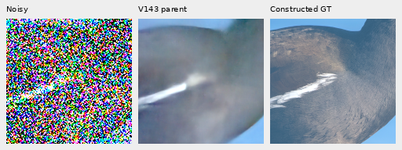
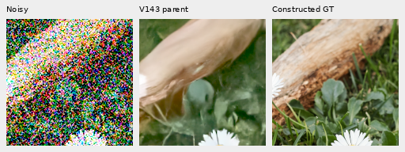

# demosaic

Joint Bayer demosaicing and denoising in linear camera RGB, with physical noise
conditioning, frozen DINOv3 features and tiled 16-bit output on NVIDIA GB10.
**V120 Small is the general recommendation**: full 427-photo mean 37.04008 dB,
measured known/unseen-CFA means 54.31272/54.00872 dB, tested ADC maximum 55.52 DN16.
It uses a pretrained DRUNet trunk and the official DINOv3 ConvNeXt-Small pyramid.
[Primary results](docs/v120-v121-primary.md) · [Current choices](docs/current-model.md).

| Useful choice | Measured strength | Remaining limits |
| --- | --- | --- |
| V120 Small | Broad photo/camera results and complete 102MP RGB16 checks | Fine foliage, mesh, neon and dark-field mottling |
| V114 Tiny | Lower tested ADC maximum, 51.73 DN16 | Camera/photo tradeoffs; [comparison](docs/current-model.md) |
| V1435k + optional `detail` | Stronger measured periodic detail under both GFX mesh priors | Partial orientations, support seams, boundary spill and slow correction; broad superiority unproven |

The [supported-amplitude option](docs/supported-wave-amplitude.md) raises fresh
mesh response **26.4%** and lowers image RMS **1.0%** versus `cross`. All 256 absent
neural cases retain their parents. Added blank-region RMS rises from .000447 to
.000636 DN16 on average, with worst .10535→.13526 DN16. Compared with `wide`,
response is 15.3% higher and mean/worst added blank RMS is 94.5%/84.7% lower.
It is now the default inside optional `--phase-harmonic`; ordinary inference
keeps the stage off. The same-data comparison to the earlier `edge` default gives
53% higher mesh response and 93% lower mean added blank RMS; `edge` stays explicit.
Average response remains only **7.1% of exact procedural GT**. All 64 new natural
photo controls remain unchanged, so nonperiodic detail is still weak.
Recent [local attention](docs/v144-v145-quality.md) and
[frozen global-branch training](docs/v138-quality.md) leave mesh recovery weak.
The [V146 frequency and mesh pilot](docs/v146-coherent-frequency.md) completes
500 updates and both raw/EMA reviews: mesh response rises less than .7% relative while
mesh/photo error grows, with no useful new native detail. The
[matched window-transfer review](docs/v146-window-transfer.md) also finds no
useful gain from 512-pixel Fourier support, including 72 fresh512 flat controls. The
[patch-filter comparison](docs/collaborative-detail.md) records a separate failure:
uniform flats stay unchanged but building color blocks appear.

The [late spectral pilot](docs/late-spectral-detail.md) is training a direct
RAW-innovation correction after V143, with noise-scaled gradient supervision
and explicit quiet-region controls. CUDA/resume checks pass; quality review is pending.

Training uses freely licensed images, geometry before downsampling and zero
optical blur. The prepared bank has 90,773 photos and 37 reviewed regions.
[Source review](docs/current-source-loss-review.md) · [Data pipeline](docs/training-pipeline.md) ·
[V143 training results](docs/v143-final5000-quality.md) · [Research and prior experiments](docs/research.md) ·
[PSNR history](docs/performance-history.md) · [Historical diary](diary/index.md).

## Current 100% crops

Noisy → V1435k with `detail` → exact procedural GT. This native 160×160 crop
uses the first active source and largest added RMS on a fixed 160 grid,
chosen after evaluation. All columns share 8× camera-linear contrast about the
exact empty field, then WB/matrix/+3EV. Pixels are not resized.
[Central diagnostics, failure views and complete metadata](docs/images/supported-wave-amplitude-v1/manifest.json).


Fine organic texture remains a separate weakness. Noisy → V143 → **constructed
GT** from native bin8 Commons photos,160×160 pixels. The faint feather example
uses common exposure14.38835× and8× display contrast; dark grass uses64.04909×
and contrast1. These are exact synthetic targets, not physical-scene GT.
[All24 native views, licensing and metadata](docs/spatial-photo-supplement.md).





Standing real GFX100S scene: DSCF3879 ISO6400 → **V120 Small, historical Haar
prior** → DSCF3880 ISO100 f/5.6. Complete 102MP outputs, native 160px cells, common
+2EV. The independent ISO100 exposure is a qualitative reference, **not exact GT**;
aperture, exposure and motion differ. Foliage remains painterly.
[GFX gallery](docs/gfx-qualitative.md) · [Camera comparisons](docs/native-camera-development.md).


Fine green mesh beside the red train's cab: noisy → V143 → sparse → wide → cross →
**detail** → ISO6400 JPEG → independent ISO100 AHD → ISO100 JPEG. Complete 102MP
outputs, nearby fixed prior, native 160px cells, common +4EV. Both ISO100 views
are **not GT**; aperture, exposure time and processing differ. Stronger crossing
contrast remains soft and uneven. The tested 2.88MP sky keeps every parent value.
[Both priors, standing scene and failure controls](docs/supported-wave-amplitude.md).


The [stronger RawNIND full-frame reference](docs/rawnind-fullframe.md) and
[Q2/Sony/GFX50R comparisons](docs/cross-camera-qualitative.md) show other limits.
Broad state-of-the-art quality and 100MP within 10 seconds remain project goals.

## Setup and inference

Linux, Python 3.12+, `uv` and a CUDA 13-compatible NVIDIA driver are required for
the lockfile. DINOv3 requires approved Hugging Face access through `HF_TOKEN`.

```bash
source scripts/env.sh
uv sync --extra dev
uv run demosaic infer /mnt/external/demosaic/models/v120-final20000.pt photo.raf \
  /mnt/external/demosaic/output/photo-linear.tiff \
  --preview /mnt/external/demosaic/output/photo-srgb.tiff \
  --shot 0.001 --read 0.000001 \
  --tile 512 --overlap 64 --batch-size 4 --precision float32 --cudnn-benchmark
PYTHONPATH=.:src:scripts uv run pytest -q
```

`--phase-harmonic --phase-harmonic-envelope detail` restores contrast inside
reciprocal support. Use `cross` for lower tested blank RMS. The stage remains
opt-in, with `detail` its default; [tradeoffs and complete native comparisons](docs/supported-wave-amplitude.md).

Noise values are examples; use suitable camera/input priors.
Use `--phase-harmonic` to enable Detail, or
`--phase-harmonic --phase-harmonic-envelope edge` for the earlier stage.
[Usage and all explicit modes](docs/usage.md) retain the earlier comparisons.
[Linear DNG + full-resolution JPEG batch export](docs/dng-export.md) preserves
camera RGB and adapts existing darktable XMP edits. Add `--hot-pixels` to repair
isolated Bayer defects before restoration.
`--hot-pixel-clusters` also handles paired same-color defects; see the
[native crop investigation](docs/hot-pixel-clusters.md).
[Usage](docs/usage.md) · [current training](docs/quality-first-training.md) ·
[data pipeline](docs/training-pipeline.md) · [experiments](docs/experiments.md) ·
[documentation guide](docs/index.md). Quality takes priority. State-of-the-art
quality and 100MP within 10s remain project goals; full-frame timing is
checkpoint-specific.
