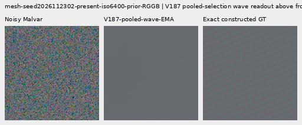
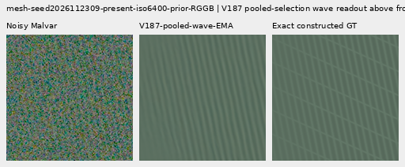
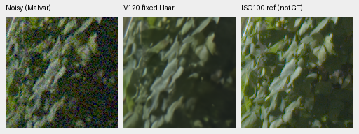
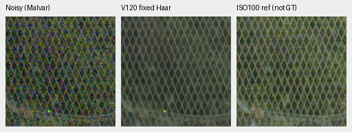

# demosaic

Joint Bayer demosaicing and denoising in linear camera RGB, with physical noise
conditioning, frozen DINOv3 features and tiled 16-bit output on NVIDIA GB10.
**V120 Small is the general recommendation**: 427-photo mean 37.04008 dB,
known/unseen-CFA means 54.31272/54.00872 dB, tested ADC maximum 55.52 DN16.
It uses a pretrained DRUNet trunk and the official DINOv3 ConvNeXt-Small pyramid.
[Primary results](docs/v120-v121-primary.md) · [Current choices](docs/current-model.md).

**V187 is the preferred experimental wave model.** Pooling green-phase and
neighboring-frequency measurements improves mesh response over matched V185 by
5.23% raw / 3.64% EMA, reaching 5.227% / 5.359% of exact constructed GT amplitude.
EMA quiet spatial RMS falls 0.48–0.52%; absent and standalone-flat errors rise
slightly. False waves, broad mottle and missing real crossings remain.
[Full comparison](docs/pooled-phase-wave-comparison.md).

The completed [V193 larger dense-window trial](docs/large-dense-spectrum-comparison.md)
raises mesh response **1.72% raw / 1.50% EMA** over V191 to **4.556% / 4.540% of GT**,
with quiet spatial RMS **0.285–0.707% higher**. Response remains **12.84% / 15.29%
below V187**, and real cab crossings remain incomplete. The measured dense-response
gain and quiet cost are retained; V187 stays preferred. Both endpoints, audits,
60 viewed native figures / 12 triplets and two exports are complete.
[Implementation](docs/large-dense-spectrum-readout.md) · [Exact evidence](docs/results/v193-large-dense-final-v1.json).

Useful strengths remain split across implementations:

| Implementation | Measured strength | Remaining limits |
| --- | --- | --- |
| V120 Small | Broad photo/camera results and complete 102MP RGB16 checks | Fine foliage, mesh, neon and dark-field mottle |
| V114 Tiny | Lower tested ADC maximum, 51.73 DN16 | Camera/photo tradeoffs; [comparison](docs/current-model.md) |
| [V1435k + optional detail](docs/supported-wave-amplitude.md) | Stronger mesh response, reaching 7.1% of GT; all 256 absent neural cases retain parent | Partial orientations, support seams, boundary spill, added blank error and slow correction |
| [V171 matching](docs/learned-matching-residual.md) | Full-flat RMS −1.21–1.52% and coarse RMS −1.73% versus V169 on all 48 inputs | Quiet RMS +26–31%, stronger casts and missing crossings |
| [V172 local noise](docs/local-noise-matching.md) | Balanced matching: quiet RMS −0.31–0.77% and mesh response +1.06% versus V169 | Only 3.877% GT response; broad mottle and crossings unresolved |
| [V181 spatial loss](docs/flat-spatial-evidence-comparison.md) | EMA quiet spatial RMS −0.47–1.15% versus V180 on all 32 inputs | Mesh response falls 8.75% to 4.150% of GT; natural response falls |
| [V183 coherent pairs](docs/coherent-pair-evidence-comparison.md) | Intermediate recipe: mesh response 4.439% of GT, quieter than V180 | Higher quiet error than V181; real crossings remain weak |
| [V185 smaller support](docs/spatial-context-wave-comparison.md) | Better mesh/quiet means than V184; slightly better flat/absent controls than V187 | Only 4.968–5.171% GT response; false waves and mottle |
| [V187 pooled selection](docs/pooled-phase-wave-comparison.md) | Preferred wave option: stronger response and lower EMA quiet spatial means than V185 | Small absent/flat regressions; incomplete real crossings |
| [V191 dense local spectrum](docs/dense-local-spectrum-comparison.md) | Small EMA quiet/fresh-flat improvements over V187 | Large mesh-response loss, lower natural response; no clear new cab crossings |

The [V189 wider-suppression test](docs/spaced-pooled-wave-comparison.md) also
regressed. [Native alias geometry](docs/native-wave-alias-geometry.md) gives little
support to an alias-only fix at the existing centers; geometric proximity is not
a recovery bound or a quality proxy. Earlier gradients, quiet-color and frequency
options remain in [current choices](docs/current-model.md), the
[experiment index](docs/experiments.md) and [timestamped diary](diary/index.md).
Training uses freely licensed photos, geometry before downsampling and zero
optical blur. [Pipeline](docs/training-pipeline.md) · [Source review](docs/current-source-loss-review.md).

The [V192 measurement-support calculation](docs/dense-measurement-support.md) separates taper support from carrier-grid error. In its fixed analytic cases, Hann65 retains 23–48% of rectangular65 SNR power with nearest carriers; Hann129 retains 112–176%. This motivates a larger-window test, not a learned quality or flat-safety claim. No image/model inference or neural source changes occur.


The [directional check](docs/mesh-directional-response.md) shows how whole-pattern
response can hide missing crossings. A [balanced-response loss](docs/directional-pair-response.md)
now passes CPU math and native-derivative checks; matched training and real/flat
quality validation remain pending.

## Current 100% crops

The [twenty-two-state native viewer](docs/images/v193-large-dense-v1/native-viewer.html)
opens V191 EMA versus V193 EMA; V187 remains selectable. Select matching raw states to compare raw/raw;
click the flip tile or press **F**. All 160×160 browser crops retain source PNG
pixels exactly, with separate checkpoint metadata. Both standing GFX scenes and
all older useful states remain available.

Noisy → **V187 EMA** → exact constructed GT, mesh2302/mesh2309. Native
ROI `[176,176,160,160]` in 512px RGGB contexts, shot .00128 / read variance
6.5536e-6, common exposure8 / contrast1. Crop pixels are never resized.
EMA export SHA256 `4965a9baa17dc36e6f64115644d6ea62af1a48416f253b45c8a73c028f4306f8`;
training checkpoint `40b7c7c295ba82cc6b4a4646245483a3234de2759e2ae4d5a8e4e63a16a5e05a`.
[Both endpoints and full display/source metadata](docs/pooled-phase-wave-comparison.md).





Standing real GFX100S scene: DSCF3879 ISO6400 → **V120 Small with historical
Haar prior** → DSCF3880 ISO100 f/5.6. Complete 102MP outputs, native 160px cells,
common +2EV. The independent ISO100 exposure is a qualitative reference,
**not exact GT**; aperture, exposure and motion differ. Foliage remains painterly.
[GFX gallery and bindings](docs/gfx-qualitative.md) · [Camera comparisons](docs/native-camera-development.md).





The difficult fine green cab mesh uses held-out DSCF3842 ISO6400 and DSCF3835
ISO100 plus both SOOC JPEGs. The [latest comparisons](docs/large-dense-spectrum-comparison.md)
include both cab ROIs/profiles alongside main-scene sky, building, foliage and
coarse fence. ISO100/AHD/JPEG views are qualitative, **not exact GT**.
[Complete-frame optional detail comparisons](docs/supported-wave-amplitude.md) ·
[Stronger RawNIND reference](docs/rawnind-fullframe.md) · [Other cameras](docs/cross-camera-qualitative.md).
Broad state-of-the-art quality and 100MP within 10 seconds remain project goals.

## Setup and inference

Linux, Python 3.12+, `uv` and a CUDA 13-compatible NVIDIA driver are required for
the lockfile. DINOv3 requires approved Hugging Face access through `HF_TOKEN`.

```bash
source scripts/env.sh
uv sync --extra dev
uv run demosaic infer /mnt/external/demosaic/models/v120-final20000.pt photo.raf \
  /mnt/external/demosaic/output/photo-linear.tiff \
  --preview /mnt/external/demosaic/output/photo-srgb.tiff \
  --shot 0.001 --read 0.000001 \
  --tile 512 --overlap 64 --batch-size 4 --precision float32 --cudnn-benchmark
PYTHONPATH=.:src:scripts uv run pytest -q
```

`--phase-harmonic --phase-harmonic-envelope detail` restores contrast inside
reciprocal support. Use `cross` for lower tested blank RMS. The stage remains
opt-in, with `detail` its default; [tradeoffs and complete native comparisons](docs/supported-wave-amplitude.md).

Noise values are examples; use suitable camera/input priors.
Use `--phase-harmonic` to enable Detail, or
`--phase-harmonic --phase-harmonic-envelope edge` for the earlier stage.
[Usage and all explicit modes](docs/usage.md) retain the earlier comparisons.
[Linear DNG + full-resolution JPEG batch export](docs/dng-export.md) preserves
camera RGB and adapts existing darktable XMP edits. Add `--hot-pixels` to repair
isolated Bayer defects before restoration.
`--hot-pixel-clusters` also handles paired same-color defects; see the
[native crop investigation](docs/hot-pixel-clusters.md).
[Usage](docs/usage.md) · [current training](docs/quality-first-training.md) ·
[data pipeline](docs/training-pipeline.md) · [experiments](docs/experiments.md) ·
[documentation guide](docs/index.md). Quality takes priority. State-of-the-art
quality and 100MP within 10s remain project goals; full-frame timing is
checkpoint-specific.
