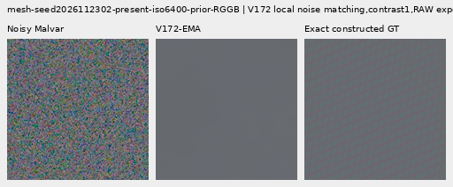
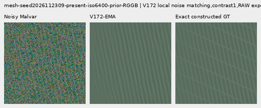

# demosaic

Joint Bayer demosaicing and denoising in linear camera RGB, with physical noise
conditioning, frozen DINOv3 features and tiled 16-bit output on NVIDIA GB10.
**V120 Small is the general recommendation**: full 427-photo mean 37.04008 dB,
measured known/unseen-CFA means 54.31272/54.00872 dB, tested ADC maximum 55.52 DN16.
It uses a pretrained DRUNet trunk and the official DINOv3 ConvNeXt-Small pyramid.
[Primary results](docs/v120-v121-primary.md) · [Current choices](docs/current-model.md).

[Completed V173 gradient training](docs/weak-gradient-matching.md) lowers EMA
quiet spatial RMS **0.32–0.68% versus V172**, improving all 32 inputs, and total-flat
means **0.25–0.30%**. Mesh response falls **3.95% to 3.724% of GT**; natural fine-band
response falls **2.63–2.88%**. The visual change is subtle, with broad mottle and
fine crossings unresolved. Keep V173 as a quieter variant and V172 as the
balanced matching baseline for further detail work. Both endpoints, 822 cases,
60 native figures and independent scoped audits are complete.

[Completed V172 local noise matching](docs/local-noise-matching.md) reduces EMA
quiet RMS **0.31–0.77% versus V169** and **21–24% versus V171**, visibly removing
much of V171's added purple/blue cast. Mesh response rises **1.06% versus V169**
to **3.877% of GT**. Standalone-flat gains shrink to **0.059–0.085%**; absent-mesh
error rises0.060%, broad mottle and real fine crossings remain unresolved.
Keep this local-unit/quiet-color variant beside V171's stronger flat option.
Both endpoints,822 cases,60 native figures and scoped audits are complete.

[Completed V171 learned matching residual](docs/learned-matching-residual.md)
lowers EMA native noisy-flat full RMS **1.21–1.52%** and coarse RMS **1.73% versus
V169**, improving all 48 inputs in both measures. Mesh response rises **1.26%**
to **3.885% of GT**. Quiet RMS rises **26–31%**, with stronger purple/blue casts,
and real fine crossings remain missing. Retain this flat-field option beside
the earlier detail and quiet-color strengths. Both endpoints, 822 cases and
60 actually viewed native figures are complete; ADC-only outputs retain V169.

[Completed V170 released RAW matching comparison](docs/nonlocal-raw-comparison.md)
tests the April 2026 NLFeMF checkpoint. Native noisy-flat coarse error falls
**15.79–19.38% versus V169 EMA**, but mesh response falls to **2.406–2.533% of GT**,
quiet color bias rises, and low-noise controls acquire periodic colored texture.
The cab's fine crossings remain missing. The external checkpoint is retained
as a comparison; V120 and the useful learned prototypes below remain the choices.
All 822 cases, 60 native figures and the scoped array audit are complete.

[Completed V169 spatial balance](docs/balanced-spatial-correction.md) lowers quiet
RMS **3.74–10.69%** and color bias **11.45–31.59% versus V168**, retaining its
**3.806–3.837% of GT mesh response**. It filters broad direct RGB corrections at
fixed weights. All48 coarse-flat errors worsen, total-flat means rise0.39–0.71%,
and local blotches/fine crossings remain unresolved. Both endpoints,822 cases
and72 actually viewed native figures are complete, with explicit audit scope.

[Completed V168 fine-mesh training](docs/fine-mesh-training.md) raises mesh response
**17.48–18.09% over V167**, reaching **3.805–3.836% of constructed GT amplitude**.
The finest crossed-wire group improves about59%, but still recovers only1.8% of
GT. Coarse-flat error improves on all48 inputs; quiet RMS rises1.49–5.44% and
total-flat means rise0.136–0.228%. Real fine cab crossings remain incomplete.
All four endpoints,822 cases,72 native figures and independent audits are complete.

The completed [V166 common-support routing trial](docs/common-support-routing.md) reduces quiet RMS **6.10–15.27%** and DC color bias **17.52–31.30% versus V165**, visibly reducing the representative magenta casts. Mesh response stays near the parent and real fine crossings remain incomplete; all256 present-mesh mean supports remain below1e-4. Full-flat means worsen0.199–0.312%,coarse means0.216–0.376%,with all48 coarse inputs worse versus V165. Quiet means remain2.40–6.34% above V143. Retain this quiet-color gain beside V165 flat/grain,V161/V164 detail,V157 coarse and V158 quiet strengths. Both1k heads/four endpoints/822cases/72actual native figures are complete;238 CPU checks,94 final Adam states,exact V165 controls and independent audits pass. Original smoke failure and three discarded calls are preserved;no full-training restart.

| Useful choice | Measured strength | Remaining limits |
| --- | --- | --- |
| V120 Small | Broad photo/camera results and complete 102MP RGB16 checks | Fine foliage, mesh, neon and dark-field mottling |
| V114 Tiny | Lower tested ADC maximum, 51.73 DN16 | Camera/photo tradeoffs; [comparison](docs/current-model.md) |
| V1435k + optional `detail` | Stronger measured periodic detail under both GFX mesh priors | Partial orientations, support seams, boundary spill and slow correction; broad superiority unproven |

The [supported-amplitude option](docs/supported-wave-amplitude.md) raises fresh
mesh response **26.4%** and lowers image RMS **1.0%** versus `cross`. All256 absent
neural cases and64 new natural photo controls retain their parents. Mean/worst
added blank RMS rises42.1/28.4%; response reaches only **7.1% of exact procedural
GT**. The `detail` mode is the default inside explicitly enabled `--phase-harmonic`;
ordinary inference keeps the stage off. Partial orientations, support seams,
boundary spill, nonperiodic texture and slow correction remain unresolved.

The completed [V161 frequency-context trial](docs/harmonic-frequency-context.md)
raises learned mesh response **21–22% over V160 paired response**, reaching
**4.83–5.24% of exact GT amplitude**. Coarse flat error improves on all 48 inputs,
but quiet RMS worsens another **5–7%** and total flat error increases. Native cab
strands gain slight contrast; crossings remain soft and false colored grain rises.
Both 1k heads, four endpoints, 822 cases, 72 actual native views and independent
audits are complete. This is the stronger learned-detail prototype; its quiet
cost remains unresolved.

| Research implementation | Measured strength | Remaining cost |
| --- | --- | --- |
| [V173 amplitude-balanced gradients](docs/weak-gradient-matching.md) | EMA quiet spatial RMS −0.32–0.68% on all 32 inputs, quiet total −0.27–0.52%, full-flat means −0.25–0.30% versus V172 | Mesh response −3.95% to 3.724% of GT; natural band response −2.63–2.88%, broad mottle and crossings unresolved. Quiet variant; retain V172 for detail work |
| [V172 local noise units](docs/local-noise-matching.md) | EMA quiet RMS −0.31–0.77%, DC −1.33–2.55%, mesh response +1.06% to3.877% of GT versus V169; much less added cast than V171 | Flat gain only0.059–0.085%, absent RMS +0.060%; broad mottle and real fine crossings persist. Same2.09M network/data/loss; local feature/output units |
| [V171 learned matching residual](docs/learned-matching-residual.md) | EMA full-flat RMS −1.21–1.52%, coarse RMS −1.73% versus V169; all 48 inputs improve. Mesh response +1.26% to 3.885% of GT | Quiet RMS +26–31%, DC bias +91–93%; real crossings missing. Fresh 2.09M correction above frozen DINO/V169; exact ADC bypass |
| [V170 released RAW matching](docs/nonlocal-raw-comparison.md) | Native512 coarse error −15.79–19.38%, quiet spatial RMS −6.26–32.71% versus V169 EMA | Mesh response only2.406–2.533% of GT; quiet total/DC error rises, ISO6400 full-flat RMS +17.67–19.03%; periodic low-noise artifacts. External training data |
| [V169 spatial balance](docs/balanced-spatial-correction.md) | Quiet RMS −3.74–10.69% and color bias −11.45–31.59% versus V168; mesh response stays3.806–3.837% of GT | All48 coarse-flat errors worse; total-flat means +0.39–0.71%,quiet spatial +0.17–0.27%; residual blotches/crossings |
| [V168 finer training wires](docs/fine-mesh-training.md) | Mesh response +17.48–18.09% versus V167, reaching3.805–3.836% of GT; all48 coarse-flat errors improve | Quiet RMS +1.49–5.44%,all32 spatial errors worse; full-flat means +0.136–0.228%,real crossings incomplete |
| [V167 bounded support](docs/bounded-spectral-support.md) | Mesh response +47.33–47.55% versus V166, reaching3.24–3.25% of GT; present RMS −1.09–1.15% | Quiet RMS +2.84–3.74%,all32 spatial errors worse; full-flat means +0.189–0.382%,real crossings incomplete |
| [V166 common-support routing](docs/common-support-routing.md) | Quiet RMS −6.10–15.27% and color bias −17.52–31.30% versus V165 | Gate still nearly closes; mesh near parent; full-flat/coarse means +0.20–0.38% |
| [V165 pair-common targets](docs/pair-common-error.md) | Full-flat RMS −1.35–1.91% and quiet spatial RMS −6.22–8.69% versus V164 | Mesh response halves to parent level; quiet color bias +7.67–28.07%, persistent casts |
| [V164 smaller pair units](docs/pair-unit-floor.md) | Mesh response +8.35–12.32% versus V163; all48 coarse flat errors improve, means −0.28–0.52% | Total-flat RMS +0.27–0.39%; quiet means +0.20–9.85%; incomplete real crossings |
| [V163 phase inputs](docs/harmonic-phase-inputs.md) | Quiet DC bias falls 2.60–3.96%; total quiet RMS falls 0.62–1.19% versus V162 | Spatial error rises slightly; mesh response falls 0.52–0.59%; all 48 coarse-flat errors worsen |
| [V162 target anchor](docs/flat-target-anchor.md) | Quiet spatial RMS falls 4.73–7.73% on all 32 inputs versus V161; native512 flat RMS falls 1.28–2.55% | Mesh response falls 20–22%; quiet bias and broad mottle persist |
| [V161 frequency context](docs/harmonic-frequency-context.md) | Learned mesh response 4.83–5.24% of exact GT; coarse flat RMS 0.48–0.58% below V143 | Quiet RMS 14.14–18.38% above V143; extra grain/bias, soft real crossings |
| [V160 paired response](docs/paired-response.md) | Stronger learned mesh response: 4.00–4.31% of exact GT | Blank/quiet errors and fine colored grain rise; real crossings remain soft |
| [V160 ordinary data](docs/paired-response.md) | Native512 full flat RMS falls 0.42–0.53%; all 48 full/coarse inputs improve versus V143 | Quiet RMS rises 0.76–1.58%; new data also changes versus older studies |
| [V159 smoother DC](docs/regional-dc-transition.md) | All 48 native512 coarse errors improve versus V143/V158/V156; much less quiet damage than V157 | Quiet RMS remains above V143/V158; mesh weaker than V156 |
| [V158 regional DC](docs/regional-dc-regret.md) | EMA quiet RMS improves on all 32 inputs versus V143; V157's extra casts recede | Near-parent correction; coarse gains shrink and mesh remains weaker than V156 |
| [V156 local regret](docs/local-excess-risk.md) | Quiet RMS 0.30–0.63% below matched MSE; all 32 inputs improve at both endpoints | Small regressions versus V143 remain; real crossings missing |
| [V157 spatial RGB](docs/spatial-rgb-residual.md) | All 48 native512 noisy-flat inputs improve in full and coarse error versus V143/V156 | Quiet color bias rises; response falls below V143 |
| [V153 delivered loss](docs/delivered-spectral-objective.md) | Mesh response reaches 2.45–2.59% of exact GT | Worse blank/natural/ADC behavior; fine crossings missing |
| [V150 objective floor](docs/objective-floor-training.md) | ADC-photo RMS about 3.06% lower on two held-out sources/four CFAs | Noisy fine-detail and quiet/coarse tradeoffs |

[V154 robust supervision](docs/robust-spectral-objective.md) retains a smaller
0.45–0.50% standalone-flat gain with less mixed-quiet damage than V157.
The [matched V155 parent comparison](docs/matched-parent-comparison.md) retains
V120's lower coarse noisy-flat error but higher total error and worse ADC slopes.
[Complete architecture/loss strengths and failures](docs/current-model.md#quality-and-remaining-work).

Keep V173's quiet/spatial-error option, V172's local-unit/quiet-color option, V171's standalone-flat option,
V169's response/quiet-color option, V168's data/coarse gain, V167's bounded-path response gain, V166's quiet-color gain, V165's grain/total-flat gain, V164's response/coarse gain, V161's stronger
learned response, V163's small bias gain, V158 quiet accuracy and V157's coarse
capacity visible; no model combines their strengths.

V160 passes 123 CPU checks, 450 exact frozen-base gradient comparisons and final
Adam/EMA validation. Its cache accounting failure, explicit 23-batch adoption
and all original evidence are preserved in the report.

V161 passes 139 CPU checks, CUDA parity, restored smoke and final 91-state
validation. Its control exactly reproduces all V160 trace/model/Adam states
and 1,644 actual predictions. The fixed context-removal diagnostic is complete.

[Completed V162](docs/flat-target-anchor.md) reduces quiet RMS 1.68–5.29% versus
V161, but weakens mesh response 20–22%. Native crops confirm less fine colored
grain with persistent casts and soft crossings. Both heads/four endpoints,
822 cases and 72 actual native views are audited. All 156 CPU checks, 92 final
Adam states, exact V161 controls and 1,000 independent training-mask checks pass.

The completed [V163 phase-input trial](docs/harmonic-phase-inputs.md) lowers mean quiet RMS **0.62–1.19% versus V162** through 2.60–3.96% lower color bias. Spatial error rises slightly, mesh response falls another 0.52–0.59%, and all 48 coarse-flat errors worsen versus V162. Native fence crossings remain soft. All four endpoints, 822 cases, 72 actual native views and independent audits are complete; 180 CPU checks, 93 final Adam states and exact controls pass. The disk-guard failure and verified 268-call adoption are preserved.

The completed [V164 weak-pair floor trial](docs/pair-unit-floor.md) gives **8.35–12.32% more mesh response and 0.28–0.52% lower coarse flat error versus V163**, changing only the pair-loss unit floor from16 to2 DN16. All48 native512 coarse inputs improve at both endpoints. Total-flat RMS rises0.27–0.39%, quiet means rise0.20–9.85%, and all32 quiet spatial errors worsen; real fine cab crossings remain incomplete. Both1k heads/four endpoints/822 cases/72 actual native figures and independent audits are complete. All199 CPU checks,94 final Adam states, exact V163 controls and all1,000 actual unit records pass. Retain the response/coarse gain beside earlier quiet/grain/total-flat strengths.

The completed [V165 pair-common trial](docs/pair-common-error.md) lowers native512 full-flat RMS **1.35–1.91%** and quiet spatial RMS **6.22–8.69% versus V164**. Mesh response falls 49–50% to parent level, and quiet color bias rises 7.67–28.07%; real crossings remain weak. Retain the grain/total-flat option beside stronger V161/V164 detail and V158 quiet accuracy. Both 1k heads, four endpoints, 822 cases, 72 actual native figures and independent audits are complete; 221 CPU checks, 94 final Adam states, exact controls and all 2,000 recorded weighted loss totals pass.

Training uses freely licensed images, geometry before downsampling and zero
optical blur. V160 uses the 90,782-photo training cache and reviewed regions.
[Source review](docs/current-source-loss-review.md) · [Data pipeline](docs/training-pipeline.md) ·
[V143 training results](docs/v143-final5000-quality.md) · [Research and prior experiments](docs/research.md) ·
[PSNR history](docs/performance-history.md) · [Historical diary](diary/index.md).

## Current 100% crops

Open the local [V173 native-pixel viewer](docs/images/v173-weak-gradient-matching-v1/native-viewer.html)
or [V172 viewer](docs/images/v172-local-noise-matching-v1/native-viewer.html) to
flip between methods with **F**. All 160×160 browser crops retain the PNG pixels
exactly. The native triplets below remain available.

[Optional periodic-detail native comparisons and failure views](docs/supported-wave-amplitude.md)
remain available alongside the learned heads below.

Noisy → V143 + **V161 harmonic-context EMA** → exact constructed GT, two fixed
mesh crops. Mean response rises 21.57% over matched V160 paired response,
reaching 5.24% of GT. Blank RMS rises 5.31% versus V143, quiet errors rise,
and weak crossings remain difficult. Native 160×160 cells, ROI
`[176,176,160,160]` in 512px RGGB contexts, shot .00128/read variance 6.5536e-6,
common exposure 8 and contrast 1; crop pixels are never resized.
[All endpoints, checkpoint/source hashes and display metadata](docs/harmonic-frequency-context.md).


Noisy → **V172 local-noise EMA** → exact constructed GT, the same two mesh
sources/ROIs above. Response reaches 3.877% of GT, **1.06% above V169**; mean quiet
RMS falls 0.31–0.77%. Fine crossing strands remain weak. Native 160×160 cells,
ROI `[176,176,160,160]`, shot .00128/read variance 6.5536e-6, common exposure 8
and contrast 1; pixels are never resized.
EMA checkpoint SHA256 `0103e5dc59102c849b5ce456f1de24ae3e3e30ec4019f16dc102a26dca0867c1`.
[Both endpoints and complete metadata](docs/local-noise-matching.md).
[Earlier V169 mesh comparisons](docs/balanced-spatial-correction.md) remain available.





Noisy → **V173 gradient EMA** → exact constructed GT, ISO6400 and ISO12800
quiet fields. Mean spatial RMS falls **0.32–0.68% on all 32 inputs versus V172**;
total quiet RMS falls 0.27–0.52%. The change is subtle and broad mottle remains.
Mesh response falls 3.95%, and natural fine-band response falls 2.63–2.88%.
Native 160×160 cells in 512px RGGB contexts, quiet ROI `[80,176,160,160]`, exposure 8,
40× camera-linear contrast about `[.001500000013,.006000000052,.002666666871]`.
Shot/read variance is .00128/6.5536e-6 or .00256/2.62144e-5; pixels are never resized.
EMA checkpoint SHA256 `4fe62a4aea66a7a61ba2f9039c62c7519e5714d0ff766f9254b39946b7a6a5a0`.
[Both endpoints, V172 comparisons and display metadata](docs/weak-gradient-matching.md).
[Earlier V172 quiet triplets](docs/local-noise-matching.md) and
[V166 quiet-color option](docs/common-support-routing.md) remain available.


Noisy → **V171 matching EMA** → exact constructed GT, native 512 ISO6400/12800
flat crops. Full RMS falls **1.21–1.52%** and coarse RMS **1.73% versus V169 EMA**;
all 48 inputs improve in both measures. Mesh response changes modestly, while
quiet fields beside detail acquire stronger color casts. Native 160×160 cells,
ROI `[176,176,160,160]`, exposure4, contrast40 about
`[.010000000708,.020000001416,.013333332725]`; shot/read variance
.00128/6.5536e-6 or .00256/2.62144e-5. Pixels are never resized.
[Exact checkpoints, sources, both endpoints and display metadata](docs/learned-matching-residual.md).
EMA checkpoint SHA256 `5ca2d80b2fc9a8e0a3b45bbb77b20ce83cdc57fe89a01320cf54d70c75a1722f`.


The V165 grain/flat option retains its native
[ISO6400](docs/images/v165-pair-common-v1/comparison-19-pair-common-EMA-step1000-triplet.png)
and [ISO12800](docs/images/v165-pair-common-v1/comparison-20-pair-common-EMA-step1000-triplet.png)
triplets and [complete comparison](docs/pair-common-error.md).

The external V170 comparison retains native noisy → NLRaw Malvar → exact GT
triplets at [ISO6400](docs/images/v170-nonlocal-raw-v1/comparison-24.png) and
[ISO12800](docs/images/v170-nonlocal-raw-v1/comparison-27.png).
The latter improves total-flat RMS; the former worsens it. Both retain fine
periodic artifacts. [Fixed coordinates, checkpoint, noise and display metadata](docs/nonlocal-raw-comparison.md).

V164's stronger coarse result retains its native flat triplets at
[ISO6400](docs/images/v164-pair-unit-floor-v1/comparison-19-fine-pair-raw-step1000-triplet.png)
and [ISO12800](docs/images/v164-pair-unit-floor-v1/comparison-20-fine-pair-raw-step1000-triplet.png).

V162's measured grain-reduction triplets remain at
[ISO6400](docs/images/v162-flat-target-anchor-v1/comparison-26-flat-anchor-EMA-step1000-triplet.png)
and [ISO12800](docs/images/v162-flat-target-anchor-v1/comparison-28-flat-anchor-EMA-step1000-triplet.png).
V163's slightly weaker mesh remains visible at
[seed2302](docs/images/v163-harmonic-phase-v1/comparison-00-harmonic-phase-EMA-step1000-triplet.png)
and [seed2309](docs/images/v163-harmonic-phase-v1/comparison-02-harmonic-phase-EMA-step1000-triplet.png).

V162's weaker mesh response remains visible in
[seed2302](docs/images/v162-flat-target-anchor-v1/comparison-00-flat-anchor-EMA-step1000-triplet.png)
and [seed2309](docs/images/v162-flat-target-anchor-v1/comparison-02-flat-anchor-EMA-step1000-triplet.png).
Its standalone-flat cleanup is shown at
[ISO6400](docs/images/v162-flat-target-anchor-v1/comparison-19-flat-anchor-EMA-step1000-triplet.png)
and [ISO12800](docs/images/v162-flat-target-anchor-v1/comparison-20-flat-anchor-EMA-step1000-triplet.png).
The stronger-grain V161 quiet views remain at
[ISO6400](docs/images/v161-harmonic-context-v1/comparison-26-harmonic-context-EMA-step1000-triplet.png)
and [ISO12800](docs/images/v161-harmonic-context-v1/comparison-28-harmonic-context-EMA-step1000-triplet.png).

The prior V160 paired-response [mesh2302](docs/images/v160-paired-response-v1/comparison-00-paired-response-EMA-step1000-triplet.png),
[mesh2309](docs/images/v160-paired-response-v1/comparison-02-paired-response-EMA-step1000-triplet.png)
and [quiet-field costs](docs/paired-response.md) remain available.

The ordinary control's flat-field gain remains visible at
[ISO6400](docs/images/v160-paired-response-v1/comparison-19-ordinary-EMA-step1000-triplet.png)
and [ISO12800](docs/images/v160-paired-response-v1/comparison-20-ordinary-EMA-step1000-triplet.png).
V159's smaller quiet cost and coarse-flat gain retain their
[ISO6400](docs/images/v159-regional-dc-transition-v1/comparison-19-smooth-dc-EMA-step1000-triplet.png)
and [ISO12800](docs/images/v159-regional-dc-transition-v1/comparison-20-smooth-dc-EMA-step1000-triplet.png)
views and [report](docs/regional-dc-transition.md).

V158's stronger quiet result remains visible:
[ISO6400](docs/images/v158-regional-dc-v1/comparison-26-dc-regret-EMA-step1000-triplet.png)
and [ISO12800](docs/images/v158-regional-dc-v1/comparison-28-dc-regret-EMA-step1000-triplet.png),
with [full conditioning/display details](docs/regional-dc-regret.md).

V157's stronger standalone-flat result remains visible:
[ISO6400](docs/images/v157-spatial-rgb-v1/comparison-19-spatial-rgb-EMA-step1000-triplet.png)
and [ISO12800](docs/images/v157-spatial-rgb-v1/comparison-20-spatial-rgb-EMA-step1000-triplet.png),
with [full conditioning/display details](docs/spatial-rgb-residual.md).

The V157 quiet-region failures are explicit:
[ISO6400](docs/images/v157-spatial-rgb-v1/comparison-26-spatial-rgb-EMA-step1000-triplet.png)
and [ISO12800](docs/images/v157-spatial-rgb-v1/comparison-28-spatial-rgb-EMA-step1000-triplet.png).
The quieter V156 [ISO6400](docs/images/v156-local-risk-v1/comparison-26-local-risk-EMA-step1000-triplet.png)
and [ISO12800](docs/images/v156-local-risk-v1/comparison-28-local-risk-EMA-step1000-triplet.png)
triplets remain available with [full conditioning/display details](docs/local-excess-risk.md).
Earlier V154 [ISO6400](docs/images/v154-robust-spectral-v1/flat-iso6400-charb-0p01-EMA-step1000-triplet.png)
and [ISO12800](docs/images/v154-robust-spectral-v1/flat-iso12800-charb-0p01-EMA-step1000-triplet.png)
flat triplets retain their [complete report](docs/robust-spectral-objective.md).

V150's stronger ADC-only result remains useful: mean photo RMS falls 3.06% on
two held-out sources/four CFAs. Native
[bark](docs/images/v150-objective-floor-v1/comparison-42-floor16-matrix-EMA-step1000-triplet.png) and
[fur](docs/images/v150-objective-floor-v1/comparison-43-floor16-matrix-EMA-step1000-triplet.png)
triplets retain exact constructed GT; [noise, licensing and display details](docs/objective-floor-training.md).

Noisy organic texture remains weak: [current feather/grass/bark views](docs/delivered-spectral-objective.md)
and the [earlier native photo gallery](docs/spatial-photo-supplement.md).

Standing real GFX100S scene: DSCF3879 ISO6400 → **V120 Small, historical Haar
prior** → DSCF3880 ISO100 f/5.6. Complete 102MP outputs, native 160px cells, common
+2EV. The independent ISO100 exposure is a qualitative reference, **not exact GT**;
aperture, exposure and motion differ. Foliage remains painterly.
[GFX gallery](docs/gfx-qualitative.md) · [Camera comparisons](docs/native-camera-development.md).


Fine green mesh beside the red train's cab: noisy → V143 → sparse → wide → cross →
**detail** → ISO6400 JPEG → independent ISO100 AHD → ISO100 JPEG. Complete 102MP
outputs, nearby fixed prior, native 160px cells, common +4EV. Both ISO100 views
are **not GT**; aperture, exposure time and processing differ. Stronger crossing
contrast remains soft and uneven. The tested 2.88MP sky keeps every parent value.
[Both priors, standing scene and failure controls](docs/supported-wave-amplitude.md).


The [stronger RawNIND full-frame reference](docs/rawnind-fullframe.md) and
[Q2/Sony/GFX50R comparisons](docs/cross-camera-qualitative.md) show other limits.
Broad state-of-the-art quality and 100MP within 10 seconds remain project goals.

## Setup and inference

Linux, Python 3.12+, `uv` and a CUDA 13-compatible NVIDIA driver are required for
the lockfile. DINOv3 requires approved Hugging Face access through `HF_TOKEN`.

```bash
source scripts/env.sh
uv sync --extra dev
uv run demosaic infer /mnt/external/demosaic/models/v120-final20000.pt photo.raf \
  /mnt/external/demosaic/output/photo-linear.tiff \
  --preview /mnt/external/demosaic/output/photo-srgb.tiff \
  --shot 0.001 --read 0.000001 \
  --tile 512 --overlap 64 --batch-size 4 --precision float32 --cudnn-benchmark
PYTHONPATH=.:src:scripts uv run pytest -q
```

`--phase-harmonic --phase-harmonic-envelope detail` restores contrast inside
reciprocal support. Use `cross` for lower tested blank RMS. The stage remains
opt-in, with `detail` its default; [tradeoffs and complete native comparisons](docs/supported-wave-amplitude.md).

Noise values are examples; use suitable camera/input priors.
Use `--phase-harmonic` to enable Detail, or
`--phase-harmonic --phase-harmonic-envelope edge` for the earlier stage.
[Usage and all explicit modes](docs/usage.md) retain the earlier comparisons.
[Linear DNG + full-resolution JPEG batch export](docs/dng-export.md) preserves
camera RGB and adapts existing darktable XMP edits. Add `--hot-pixels` to repair
isolated Bayer defects before restoration.
`--hot-pixel-clusters` also handles paired same-color defects; see the
[native crop investigation](docs/hot-pixel-clusters.md).
[Usage](docs/usage.md) · [current training](docs/quality-first-training.md) ·
[data pipeline](docs/training-pipeline.md) · [experiments](docs/experiments.md) ·
[documentation guide](docs/index.md). Quality takes priority. State-of-the-art
quality and 100MP within 10s remain project goals; full-frame timing is
checkpoint-specific.
