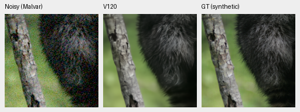

# demosaic

Joint Bayer demosaicing and denoising in linear camera RGB, with physical noise
conditioning, frozen DINOv3 context and tiled 16-bit output on NVIDIA GB10.

**V120 Small remains the general recommendation:** 37.04008 dB on 427 photos,
known/unseen-CFA means 54.31272/54.00872 dB and verified 102MP RGB16 exports.
It uses a pretrained DRUNet trunk and the official DINOv3 ConvNeXt-Small pyramid.
Fine foliage, mesh, neon and dark-field mottle remain weaknesses.
[Results](docs/v120-v121-primary.md) · [Current choices](docs/current-model.md).

The latest detail experiments retain useful tradeoffs: **V198 EMA reaches
11.158% of constructed-GT mesh amplitude**, with stronger real cab modulation,
but introduces green/magenta building fringes and false texture. V200 slightly
improves quiet/flat error while reducing mesh response to 11.102% of GT.
The [shared-edge training comparison](docs/shared-edge-comparison.md) adds small
quiet/flat gains but lowers EMA mesh response to 10.874%; the same fringes and
incomplete crossings persist.
V187 is quieter and V195 avoids those new building color failures in the
reviewed views. [Complete comparison](docs/scale-supported-cfa-wave-comparison.md) ·
[Seven-state native viewer](docs/images/v200-scale-supported-cfa-wave-v1/native-viewer.html).
Broad state-of-the-art quality and 100MP within 10 seconds remain goals.

[Weak-detail literature review and proposed experiments](docs/weak-detail-literature-2026-11.md)
examines the fence/flat-region tradeoff and recent methods. The first proposed
shared-edge trial and its [full quality review are complete](docs/shared-edge-comparison.md).
The [first withheld-CFA diagnostic](docs/withheld-cfa-evidence.md) shows why
independent sample agreement still needs an adequate edge/background model.
Its [geometry refinement](docs/withheld-cfa-edge-refinement.md) improves the
measured synthetic weak-direction/false-detail tradeoff.
The [completed three-noise wire panel](docs/edge-snr-ladder.md) still finds
strong direction imbalance: V200 EMA recovers 86.7% of the strong increment but
8.1% of the weaker increment far from the edge at the clearest tested prior.
A [competing-orientation selector](docs/competing-orientation-comparison.md)
improves one fixed mesh's weaker orientation sector from 28.41% to 33.55% at EMA,
but another weak sector worsens and overall mesh response falls to 10.607%.
The [completed fresh-noise review](docs/competing-edge-response.md) raises far-edge
weak response 3.13%→5.06% at the 1600 prior with slightly lower quiet error;
strong response falls. Both endpoints/all native boards are reviewed, with
persistent building/flat artifacts.
The [next complementary stage](docs/complementary-cfa-branch.md) has completed
training above frozen V200 EMA, adding proposals while retaining its carrier
path. Raw/EMA quality review is running; its gains remain unmeasured.

## Setup and inference

Linux, Python 3.12+, `uv` and a CUDA 13-compatible NVIDIA driver are required for
the lockfile. DINOv3 requires approved Hugging Face access through `HF_TOKEN`.

```bash
source scripts/env.sh
uv sync --extra dev
uv run demosaic infer /mnt/external/demosaic/models/v120-final20000.pt photo.raf \
  /mnt/external/demosaic/output/photo-linear.tiff \
  --preview /mnt/external/demosaic/output/photo-srgb.tiff \
  --shot 0.001 --read 0.000001 \
  --tile 512 --overlap 64 --batch-size 4 --precision float32 --cudnn-benchmark
```

Noise coefficients above are examples; use suitable camera/input priors.
The optional `--phase-harmonic` stage defaults to supported-amplitude detail;
`--phase-harmonic-envelope cross` has lower tested blank RMS.
[Tradeoffs](docs/supported-wave-amplitude.md) · [Usage](docs/usage.md) ·
[DNG/JPEG export](docs/dng-export.md) · [Hot-pixel repair](docs/hot-pixel-clusters.md).

## Development

Reusable data, losses, runtime, checkpoints and evaluation live in
`demosaic.experiments`; named model choices and composed wave stages live in
`demosaic.models`. New cached-head trials use explicit recipes and one runner.
Historical script entry points and frozen experiment evidence remain available.
[Architecture and workflow](docs/architecture.md) · [Current experiments](docs/experiments.md).

```bash
uv sync --extra dev --extra nonlocal
uv run demosaic-experiment models
uv run demosaic-experiment prepare configs/experiments/orientation-balanced.json \
  .cache/experiments/competing-new
uv run demosaic-experiment inspect .cache/experiments/competing-new
PYTHONPATH=.:src:scripts uv run pytest -q
```

The shared-edge cache, matched training and raw/EMA quality review are complete.
The same-data competing-orientation trial has also completed all 900 updates.
Preparation does not launch training. Training data comes from freely licensed
photos and procedural targets, with geometry before downsampling and zero
optical blur in the current recipes. [Data pipeline](docs/training-pipeline.md).

## Representative 100% crops

Noisy Malvar → **V120** → exact synthetic GT. Each cell is 160×160 unchanged
pixels; native256 RGGB context, ROI `[48,48,160,160]`, shot 0.00256/read
2.62144e−5, shared WB/matrix, exposure 1 and clipped sRGB display.
V120 checkpoint SHA256 `a9d9b6b4f974e24a6b11e5e740aab32314233a7f53c056cf37c7d2aac1c589fb`.
[Source/ROI/display metadata](docs/images/v120-v121-primary-v1/manifest.json) ·
[Source credits and licenses](docs/v120-v121-primary.md#native-exact-gt-triplets).




The latest experiment's [directional gain](docs/images/competing-orientation-v1/comparison-02.png)
and [counterexample](docs/images/competing-orientation-v1/comparison-06.png) are
noisy → competing EMA → exact constructed GT (native160, exposure 8/contrast 1;
[full provenance](docs/competing-orientation-comparison.md#the-directional-improvement-and-its-counterexample)).
Its [cab detail](docs/images/competing-orientation-v1/readme-cab.png)
and [building color failure](docs/images/competing-orientation-v1/readme-building.png)
are noisy → competing EMA → independent ISO100/AHD reference. They remain native160
pixels with matched coordinates/transforms; the separate real captures differ
in aperture, exposure and motion and are **not exact GT**.
[Complete source, checkpoint and display provenance](docs/results/competing-orientation-v1/representative-real.json).

[Documentation](docs/index.md) · [Experiment history](docs/history/experiments-through-v200.md) ·
[Diary](diary/index.md) · [Storage](docs/storage.md).
