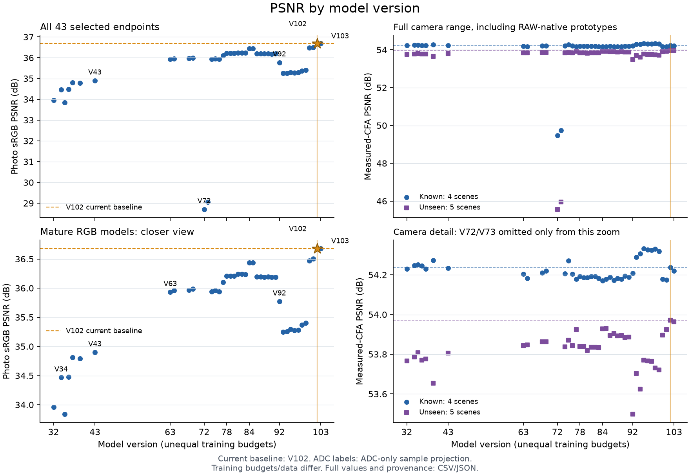
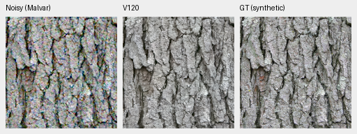
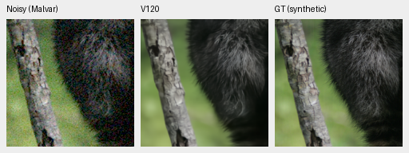
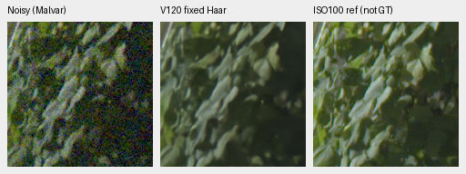
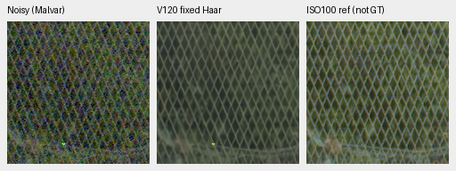
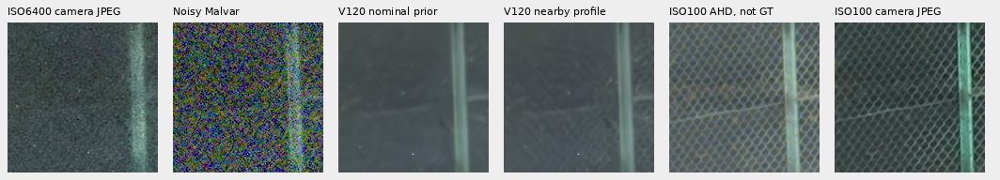
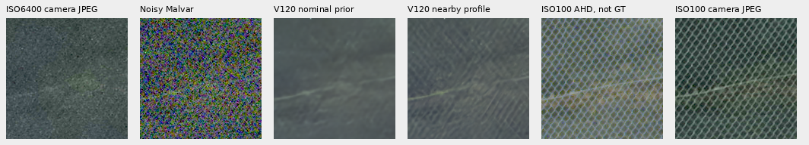

# demosaic

Joint Bayer demosaicing and denoising in linear camera RGB, with physical noise
conditioning, frozen DINOv3 features and tiled16-bit output on NVIDIA GB10.
**V120 Small is the current general recommendation**, using V84's pretrained
DRUNet RGB trunk and official DINOv3 ConvNeXt-Small pyramid. It reaches
**37.04008dB** on the full427-photo panel, with known/unseen measured-CFA means
**54.31272/54.00872dB** and tested ADC maximum55.52DN16. It recovers V119's
camera/color regression while keeping its photo score. Fine detail remains weak.
[Results, native comparisons and explicit GFX profile limits](docs/v120-v121-primary.md).

**V114 Tiny remains a useful alternative**, with lower tested ADC maximum51.73DN16.
V115 Small has a slightly higher known-camera mean54.324dB; V117 has a slightly
higher photo score. These choices retain soft fine foliage/neon detail and
dark-camera mottling. V120's numerical/local panels, selected native review and
complete102MP RGB16 checks are done. The
[matched-profile GFX comparison](docs/v120-v121-primary.md#matched-profile-full-frame-gfx)
against V115/V119 shows subtle changes with continued fine-detail loss.
[Current choices](docs/current-model.md) · [GFX gallery](docs/gfx-qualitative.md).

The [V121 data arm](docs/v120-v121-primary.md) has a small photo change and a
large remaining ADC outlier. Current selection advances to the useful measured
balance without imposing a study-specific promotion gate.

[V119's complete review](docs/v119-quality.md) finds a +.06131dB photo gain over
V115 after cleaned-data training, but a −.22342dB known-camera regression and
a large ADC color outlier. Its real fine-detail softness remains. The completed
[11-capture native-camera comparison](docs/native-camera-development.md) now includes
V120/V121: V120 retains substantially finer detail than RawNIND and gains3.699dB
in high-noise camera-RGB PSNR on binned references with added noise. V117 retains
higher condition means; changes among the newer joint models are small.
Our current training uses zero optical blur and
geometry before final downsampling. [Data review](docs/incoming-commons-quality.md) ·
[Training pipeline](docs/training-pipeline.md) · [Historical diary](diary/index.md).

[V120/V121 Small data trials](docs/paired32-weak-detail-training.md) completed
their original20k updates and independent numerical audit. Saved-output
comparisons and selected native review are complete; the
[early V120 mesh comparison](docs/gfx-green-mesh.md#v120-after-correcting-the-paired-data-mix)
shows no clear lattice-recovery gain over V115/V119.
The new [fixed-Haar main-GFX comparison](docs/v120-v121-primary.md#matched-profile-full-frame-gfx)
matches older inputs exactly; original nominal-profile outputs are also preserved.
The [V122/V123 frequency-feature trial](docs/learned-raw-frequency-training.md)
now compares training the new input adapter alone with adapting the full
restoration path on the same cleaned corpus. A
[V1239k midpoint review](docs/v123-midpoint-quality.md) shows no clear fine-detail
gain on retained materials and both GFX scenes; full endpoint results remain pending.
V123's memory guard saved all12,249 completed updates; its
[bounded continuation is running](docs/v123-memory-guard-recovery.md) within the original
budget and deadline. Dependent reviews reuse completed checks and saved controls.
[V124/V125 mean-loss training](docs/conditional-mean-training.md) is queued on
the cleaned90,784-source/twenty-region corpus after that review chain.
The [completed V126/V127 shadow-data pilot](docs/reviewed-shadow-pilot-quality.md)
uses90,783 sources/23 regions and shows no useful quality gain; native material
and both train-scene comparisons are published. The shadow policy stays off by default.
The [completed V128 feature-loss pilot](docs/v128-feature-pilot-quality.md) also
shows no useful gain. [V129 now tests the curated27-region data](docs/reviewed-detail-training-pilot.md)
with the feature/shadow terms off, reusing V126's completed control.

**V117 is a useful single-view photo-score option:**37.04408dB, +.06435 over
V114 with421/427 source means rising. Its camera means are slightly lower and
ADC color bias higher. The matched V118 band-loss arm lowers weak natural-detail
response and has a large ADC color-tail regression; the term stays off for
further quality work. [Complete results and native comparisons](docs/v117-v118-quality.md).

The optional [V114 eight-view comparison](docs/v114-eight-view.md) improves all
twelve fixed material cases and both selected adverse camera crops. Mean gains
are+.558/.264/.079dB at ADC/ISO100/ISO12800, with slightly higher selected color
bias and lower spatial variation. Full V114 eight-view panels/frame remain
unmeasured. Earlier [V104 eight-view full panels](docs/dihedral-quality.md) reach
37.044dB with a worse ADC color tail. The current [V114 ADC sites option](docs/adc-consistency.md)
improves its full ADC photo panel by +.236 dB, with lower color bias and higher
flat-field spatial variation. It activates only at explicit zero shot/read.
[Camera-outlier diagnostics](docs/camera-outliers.md).



[PSNR history and full values](docs/performance-history.md). Versions have unequal
training budgets and data; this describes available models rather than an
isolated architecture ablation.

## Current 100% crops

Photo cells are unchanged160×160 crops at the8×-binned evaluation resolution,
with shared coordinates/transforms. ISO12800-prior noisy observation →
**V120 Small, single view** → exact synthetic GT. Bark remains coherent;
fine raccoon fur remains softer than GT.
[Audited results and current review limits](docs/v120-v121-primary.md) ·
[Source/ROI/checkpoint/noise/display metadata](docs/images/v120-v121-primary-v1/manifest.json).





Sources: [Derek Ramsey](https://commons.wikimedia.org/wiki/File:Kentucky_Coffee-tree_Gymnocladus_dioicus_3264px.jpg),
[CC BY-SA2.5](https://creativecommons.org/licenses/by-sa/2.5/), and
[Korall](https://commons.wikimedia.org/wiki/File:Racoon_clinging_to_a_tree.JPG),
[CC BY3.0](https://creativecommons.org/licenses/by/3.0/), modified by binning,
cropping, simulated noise and restoration.

Real GFX100S: DSCF3879 ISO6400 → **V120 Small, fixed historical Haar profile** → DSCF3880 ISO100 f/5.6.
Native160×160 sensor-pixel crops from complete102MP outputs share +2EV display.
The independent ISO100 exposure is an approximate qualitative reference,
**not GT**. Fine foliage remains painterly; fence geometry is coherent.
[All six regions and other useful models](docs/gfx-qualitative.md) ·
[Metadata](docs/images/v120-v121-fixed-Haar-GFX-v1/manifest.json).





The additional **fine green mesh beside the red train's cab** remains difficult:
the nominal ISO6400 prior largely erases its lattice. A fixed nearby-capture
profile makes more diagonal texture visible, with substantial fine detail still
missing in V120. Below: DSCF3842 camera JPEG → noisy Malvar → V120 nominal
→ V120 nearby profile → DSCF3835 ISO100 AHD → ISO100 camera JPEG. Both ISO100
references are **not GT**. Native160px cells share +4EV display; camera
processing/aperture differ. [Matched comparison and limits](docs/gfx-green-mesh.md).
The [matched V115/V119/V120 mesh check](docs/gfx-green-mesh.md#v120-after-correcting-the-paired-data-mix)
shows no clear V120 lattice-recovery gain at the same conditioning. The
[V119 report](docs/v119-quality.md) adds native material triplets and matched
foliage/fence comparisons alongside its measured gains and regressions.
The [RAW green-phase diagnostic](docs/green-phase-spectrum.md) finds matching
diagonal frequency peaks that remain strongly attenuated in the saved outputs.





The [stronger RawNIND full-frame reference](docs/rawnind-fullframe.md) and
[current Tiny/Small Q2/Sony/GFX50R comparisons](docs/cross-camera-qualitative.md)
show additional real-camera limitations. Broad real-photo superiority remains a goal.

## Setup and inference

Linux, Python 3.12+, `uv` and a CUDA 13-compatible NVIDIA driver are required for
the lockfile. DINOv3 requires approved Hugging Face access through `HF_TOKEN`.

```bash
source scripts/env.sh
uv sync --extra dev
uv run demosaic infer /mnt/external/demosaic/models/v120-final20000.pt photo.raf \
  /mnt/external/demosaic/output/photo-linear.tiff \
  --preview /mnt/external/demosaic/output/photo-srgb.tiff \
  --shot 0.001 --read 0.000001 \
  --tile 512 --overlap 64 --batch-size 4 --precision float32 --cudnn-benchmark
PYTHONPATH=.:src:scripts uv run pytest -q
```

Noise values are examples; use suitable camera/input priors.
[Linear DNG + full-resolution JPEG batch export](docs/dng-export.md) preserves
camera RGB and adapts existing darktable XMP edits. Add `--hot-pixels` to repair
isolated Bayer defects before restoration.
`--hot-pixel-clusters` also handles paired same-color defects; see the
[native crop investigation](docs/hot-pixel-clusters.md).
[Usage](docs/usage.md) · [current training](docs/quality-first-training.md) ·
[data pipeline](docs/training-pipeline.md) · [experiments](docs/experiments.md) ·
[documentation guide](docs/index.md). Quality takes priority. State-of-the-art
quality and 100MP within 10s remain project goals; full-frame timing is
checkpoint-specific.
