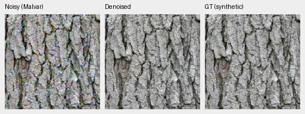

# demosaic

Joint Bayer demosaicing and denoising in linear camera RGB, with physical noise
conditioning, frozen DINOv3 features and tiled 16-bit TIFF output on NVIDIA GB10.
**V112 final20k is the working quality baseline**, using V84's pretrained
DRUNet RGB trunk and frozen DINOv3 ConvNeXt-Tiny pyramid. It reaches
**36.902 dB** on the full 427-photo panel: +0.102 dB over V104 and about +2.00 dB
over V43, with 425/427 source means improving. Known/unseen camera means reach
54.269/53.954 dB. Worst ADC flat-color bias falls from V104's 1,218 to **50.9 DN16**.
[Completed panels, native comparisons and remaining weaknesses](docs/v112-quality.md).

V111 has near-equal photo PSNR; V112 improves camera and color results. Fine
high-noise texture and real foliage still need work. All seven matched panels
and complete 102MP exports are verified. FP32 inference/blending takes 167.51s.
[Primary comparison](docs/v111-v112-primary-quality.md).
The [larger-encoder transfer](docs/small-feature-transfer.md) now starts from
V112. Both continuations passed actual CPU/CUDA updates, and
[V114 training is running](docs/small-aligned-training.md), with
[automatic evaluation and independent saved-prediction review](docs/quality-prediction-archive.md).
[Current models](docs/current-model.md) · [Source-quality review](docs/incoming-commons-quality.md) ·
[Historical diary](diary/index.md).
For explicit zero-shot/read inputs, the [optional V104 sites export](docs/adc-consistency.md)
adds **.2885dB ADC-only PSNR** across all 427 photos/four CFAs with unchanged learned
weights. All 1,708 cases improve; positive-noise inputs bypass it. Native crops,
flat-color limitations and adverse cases accompany the result.

The optional [eight-view V104 mode](docs/dihedral-quality.md),
`--self-ensemble dihedral8`, reaches **37.044dB** on the 427-photo panel (+.243dB over V104,
427/427 source means up) and 54.333/53.994dB known/unseen CFA. Its worse ADC color
tail (421 versus V112's 50.9 DN16) and weak fine detail remain visible. All panels
are independently checked; the [complete 102MP export](docs/dihedral-fullframe.md)
takes 885.93s. V112 remains the default learned baseline.


[PSNR history and full values](docs/performance-history.md). Versions have unequal
training budgets and data; this describes available models rather than an
isolated architecture ablation.

## Current 100% crops

Noisy observation → **V112 final20k** → exact synthetic GT, ISO100 prior.
These are unchanged 160×160 crops at the 8×-binned evaluation resolution, with
shared coordinates and display transforms. [Compare useful versions](docs/v112-quality.md) ·
[source/ROI/checkpoint/noise/display metadata](docs/images/v111-v112-material/iso100-prior/crop-647b560234a48ad7.json).




[Higher-noise crops versus the stronger released RawNIND reference](docs/heldout-detail.md).

Sources: [Derek Ramsey](https://commons.wikimedia.org/wiki/File:Kentucky_Coffee-tree_Gymnocladus_dioicus_3264px.jpg),
[CC BY-SA 2.5](https://creativecommons.org/licenses/by-sa/2.5/), and
[Grendelkhan](https://commons.wikimedia.org/wiki/File:Forest_covered_hills_on_Yakushima.jpg),
[CC BY-SA 4.0](https://creativecommons.org/licenses/by-sa/4.0/), modified by binning,
cropping, simulated noise and restoration.

Real GFX100S: DSCF3879 ISO6400 → **V112** → DSCF3880 ISO100 f/5.6.
Native 160×160 sensor-pixel crops from complete 102MP outputs use shared +2EV display;
the independent ISO100 exposure is a qualitative reference, **not GT**.
Fine foliage and saturated-light detail remain soft. [All six regions and
complete frame comparisons](docs/gfx-qualitative.md) · [Metadata](docs/images/v112-fullframe/manifest.json).
The [stronger RawNIND full-frame reference](docs/rawnind-fullframe.md) and
[earlier Q2/Sony/GFX50R comparisons](docs/cross-camera-qualitative.md) retain
additional real-camera limitations.


## Setup and inference

Linux, Python 3.12+, `uv` and a CUDA 13-compatible NVIDIA driver are required for
the lockfile. DINOv3 requires approved Hugging Face access through `HF_TOKEN`.

```bash
source scripts/env.sh
uv sync --extra dev
uv run demosaic infer /mnt/external/demosaic/models/v112-final20000.pt photo.raf \
  /mnt/external/demosaic/output/photo-linear.tiff \
  --preview /mnt/external/demosaic/output/photo-srgb.tiff \
  --shot 0.001 --read 0.000001 \
  --tile 512 --overlap 64 --batch-size 4 --precision float32 --cudnn-benchmark
PYTHONPATH=.:src:scripts uv run pytest -q
```

Noise values are examples; use suitable camera/input priors.
[Linear DNG + full-resolution JPEG batch export](docs/dng-export.md) preserves
camera RGB and adapts existing darktable XMP edits. Add `--hot-pixels` to repair
isolated Bayer defects before restoration.
`--hot-pixel-clusters` also handles paired same-color defects; see the
[native crop investigation](docs/hot-pixel-clusters.md).
[Usage](docs/usage.md) · [current training](docs/quality-first-training.md) ·
[data pipeline](docs/training-pipeline.md) · [experiments](docs/experiments.md) ·
[documentation guide](docs/index.md). Quality takes priority. State-of-the-art
quality and 100MP within 10s remain project goals; full-frame timing is
checkpoint-specific.
