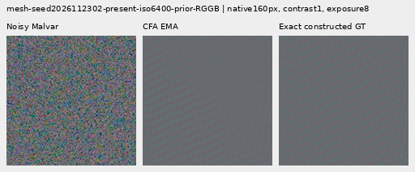
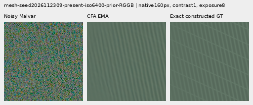
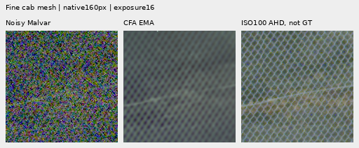
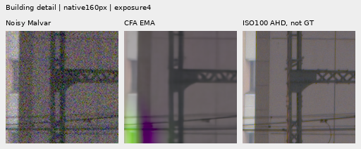

# demosaic

Joint Bayer demosaicing and denoising in linear camera RGB, with physical noise
conditioning, frozen DINOv3 features and tiled 16-bit output on NVIDIA GB10.
**V120 Small is the general recommendation**: 427-photo mean 37.04008 dB,
known/unseen-CFA means 54.31272/54.00872 dB, tested ADC maximum 55.52 DN16.
It uses a pretrained DRUNet trunk and the official DINOv3 ConvNeXt-Small pyramid.
[Primary results](docs/v120-v121-primary.md) · [Current choices](docs/current-model.md).

**V198 CFA EMA is a stronger periodic-response experiment:** it reaches
**11.158% of exact GT mesh amplitude**, +22.72% over V197 innovation EMA, with
more target-like constructed-mesh color and stronger real cab modulation.
It also creates pronounced **green/magenta building fringes** and raises quiet
spatial RMS **1.151–1.648% versus V195** on all 32 inputs. V197 has lower
flat/quiet costs, V195 avoids these new building color failures, and V187 is
quieter. The fine-detail/clean-flat goal remains unresolved.
[Complete comparison](docs/cfa-innovation-wave-comparison.md) ·
[Six-state native viewer](docs/images/v198-cfa-innovation-wave-v1/native-viewer.html).

The [V199 gate diagnostic](docs/cfa-wave-gate-diagnostic.md) finds that sharing
RGB gates or clipping negative gates does not remove these failures. Constant
gates look cleaner while shrinking correction strength; matching that strength
brings artifacts back. The native comparison motivates better local support
measurements; it is not a newly trained model.

Earlier [dense-window](docs/large-dense-spectrum-comparison.md) and
[pooled-selection](docs/pooled-phase-wave-comparison.md) results remain available.

Useful strengths remain split across implementations:

| Implementation | Measured strength | Remaining limits |
| --- | --- | --- |
| V120 Small | Broad photo/camera results and complete 102MP RGB16 checks | Fine foliage, mesh, neon and dark-field mottle |
| V114 Tiny | Lower tested ADC maximum, 51.73 DN16 | Camera/photo tradeoffs; [comparison](docs/current-model.md) |
| [V1435k + optional detail](docs/supported-wave-amplitude.md) | Stronger mesh response, reaching 7.1% of GT; all 256 absent neural cases retain parent | Partial orientations, support seams, boundary spill, added blank error and slow correction |
| [V171 matching](docs/learned-matching-residual.md) | Full-flat RMS −1.21–1.52% and coarse RMS −1.73% versus V169 on all 48 inputs | Quiet RMS +26–31%, stronger casts and missing crossings |
| [V172 local noise](docs/local-noise-matching.md) | Balanced matching: quiet RMS −0.31–0.77% and mesh response +1.06% versus V169 | Only 3.877% GT response; broad mottle and crossings unresolved |
| [V181 spatial loss](docs/flat-spatial-evidence-comparison.md) | EMA quiet spatial RMS −0.47–1.15% versus V180 on all 32 inputs | Mesh response falls 8.75% to 4.150% of GT; natural response falls |
| [V183 coherent pairs](docs/coherent-pair-evidence-comparison.md) | Intermediate recipe: mesh response 4.439% of GT, quieter than V180 | Higher quiet error than V181; real crossings remain weak |
| [V185 smaller support](docs/spatial-context-wave-comparison.md) | Better mesh/quiet means than V184; slightly better flat/absent controls than V187 | Only 4.968–5.171% GT response; false waves and mottle |
| [V187 pooled selection](docs/pooled-phase-wave-comparison.md) | Quieter immediate alternative to V195 Whole EMA; good response/quiet balance over V185 | Small absent/flat regressions; incomplete real crossings |
| [V195 response pressure](docs/directional-response-comparison.md) | Whole EMA: 5.575% GT mesh response, +4.02% over V187 EMA; four natural-response means rise | Quiet RMS +0.334–0.376%; small blank/flat costs; real fine crossings unresolved |
| [V198 own-color innovation waves](docs/cfa-innovation-wave-comparison.md) | EMA: 11.158% GT mesh response, +22.72% over V197; stronger colored mesh modulation | New green/magenta building fringes; quiet RMS +1.151–1.648%, fresh-flat RMS +0.631–0.792% versus V195; crossings incomplete |
| [V197 innovation measurements](docs/innovation-wave-comparison.md) | EMA: 9.092% GT mesh response, +63.09% over frozen V195; stronger synthetic lattice and real cab modulation | New red/cyan building artifact, false periodic texture; quiet RMS +0.176–0.326%, fresh-flat RMS +0.194–0.272% |
| [V191 dense local spectrum](docs/dense-local-spectrum-comparison.md) | Small EMA quiet/fresh-flat improvements over V187 | Large mesh-response loss, lower natural response; no clear new cab crossings |

The [V189 wider-suppression test](docs/spaced-pooled-wave-comparison.md) also
regressed. [Native alias geometry](docs/native-wave-alias-geometry.md) gives little
support to an alias-only fix at the existing centers; geometric proximity is not
a recovery bound or a quality proxy. Earlier gradients, quiet-color and frequency
options remain in [current choices](docs/current-model.md), the
[experiment index](docs/experiments.md) and [timestamped diary](diary/index.md).
Training uses freely licensed photos, geometry before downsampling and zero
optical blur. [Pipeline](docs/training-pipeline.md) · [Source review](docs/current-source-loss-review.md).

The [V192 measurement-support calculation](docs/dense-measurement-support.md) separates taper support from carrier-grid error. In its fixed analytic cases, Hann65 retains 23–48% of rectangular65 SNR power with nearest carriers; Hann129 retains 112–176%. This motivates a larger-window test, not a learned quality or flat-safety claim. No image/model inference or neural source changes occur.


The [directional check](docs/mesh-directional-response.md) shows how whole-pattern
response can hide missing crossings. A [balanced-response loss](docs/directional-pair-response.md)
completed all four trained endpoints and native comparisons. More whole-pattern
pressure gives the stronger response; angular balancing has not fixed missing crossings.

## Current 100% crops

The [six-state native viewer](docs/images/v198-cfa-innovation-wave-v1/native-viewer.html)
opens V197 innovation EMA versus V198 CFA EMA; V187/V195 and V197 RAW EMA are
also selectable. Flip A/B or press **F**. All crop cells are native 160px, with
identical coordinates and transforms. [Earlier V197 comparisons](docs/innovation-wave-comparison.md)
retain that model's lower-error strengths and red/cyan failure.

Mesh2302 and Mesh2309 below: noisy → **V198 CFA EMA** → exact constructed GT;
512px RGGB source, ROI `[176,176,160,160]`, shot 0.00128/read 6.5536e−6,
exposure 8 (+3 EV), contrast 1. [Checkpoint hashes and complete metadata](docs/images/v198-cfa-innovation-wave-v1/manifest-v1.json).





Real examples: noisy → **V198 CFA EMA** → independent ISO100 AHD. The cab uses
DSCF3842 ISO6400 / DSCF3835 ISO100 f/5.6; right ROI `[426,189,160,160]` in the
cached 768px context, exposure 16. Main building uses DSCF3879 ISO6400 /
DSCF3880 ISO100 f/5.6; central ROI `[176,176,160,160]`, exposure 4. Nominal
shot 0.00128/read 6.5536e−6 is a disclosed prior, not measured calibration.
The cab gains modulation; the building shows a strong green/magenta failure.
Independent references differ in aperture, exposure and motion and are **not
exact GT**. [Native-panel provenance](docs/results/v198-cfa-innovation-wave-v1/representative-figures-v1.json).





The [full comparison](docs/cfa-innovation-wave-comparison.md) retains both cab
ROIs/noise profiles/JPEGs and main-scene sky, foliage and coarse fence, with
flat and natural-photo counterexamples beside the measured detail gains.
[V120 full-frame GFX examples](docs/gfx-qualitative.md) and
[camera comparisons](docs/native-camera-development.md) remain available.
[Complete-frame optional detail comparisons](docs/supported-wave-amplitude.md) ·
[Stronger RawNIND reference](docs/rawnind-fullframe.md) · [Other cameras](docs/cross-camera-qualitative.md).
Broad state-of-the-art quality and 100MP within 10 seconds remain project goals.

## Setup and inference

Linux, Python 3.12+, `uv` and a CUDA 13-compatible NVIDIA driver are required for
the lockfile. DINOv3 requires approved Hugging Face access through `HF_TOKEN`.

```bash
source scripts/env.sh
uv sync --extra dev
uv run demosaic infer /mnt/external/demosaic/models/v120-final20000.pt photo.raf \
  /mnt/external/demosaic/output/photo-linear.tiff \
  --preview /mnt/external/demosaic/output/photo-srgb.tiff \
  --shot 0.001 --read 0.000001 \
  --tile 512 --overlap 64 --batch-size 4 --precision float32 --cudnn-benchmark
PYTHONPATH=.:src:scripts uv run pytest -q
```

`--phase-harmonic --phase-harmonic-envelope detail` restores contrast inside
reciprocal support. Use `cross` for lower tested blank RMS. The stage remains
opt-in, with `detail` its default; [tradeoffs and complete native comparisons](docs/supported-wave-amplitude.md).

Noise values are examples; use suitable camera/input priors.
Use `--phase-harmonic` to enable Detail, or
`--phase-harmonic --phase-harmonic-envelope edge` for the earlier stage.
[Usage and all explicit modes](docs/usage.md) retain the earlier comparisons.
[Linear DNG + full-resolution JPEG batch export](docs/dng-export.md) preserves
camera RGB and adapts existing darktable XMP edits. Add `--hot-pixels` to repair
isolated Bayer defects before restoration.
`--hot-pixel-clusters` also handles paired same-color defects; see the
[native crop investigation](docs/hot-pixel-clusters.md).
[Usage](docs/usage.md) · [current training](docs/quality-first-training.md) ·
[data pipeline](docs/training-pipeline.md) · [experiments](docs/experiments.md) ·
[storage maintenance](docs/storage.md) · [documentation guide](docs/index.md). Quality takes priority. State-of-the-art
quality and 100MP within 10s remain project goals; full-frame timing is
checkpoint-specific.
