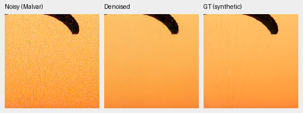
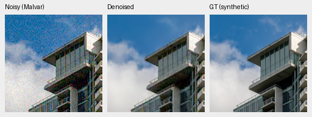

# demosaic

Joint Bayer demosaicing and denoising in linear camera RGB, with 16-bit TIFF
output, physical noise conditioning, tiled inference, and an optional DINOv3
feature branch. Experimental: training and quality validation are in progress.
Reviewed V16 still trails RawNIND on paired real RAW development. An experimental
[stabilized RGB prior](docs/stabilized-gaussian-review.md) improves unseen-camera
PSNR, with remaining known-camera and SSIM deficits. Quality work continues;
state-of-the-art performance is not established.
The [pretrained RGB/DINO first review](docs/pretrained-rgb-v28-review.md) records
an experimental single-pass model; it remains below the overall quality target.

Native 160×160 validation crops: noisy → denoised → GT, using V16 step5000
(FP16, ISO12800 synthetic noise prior). These are 100% crops at the 8×8-binned
evaluation resolution, with identical display transforms; open the PNG at 100%.
They illustrate current behavior, including lost fine detail.





Sources: [Roy Egloff](https://commons.wikimedia.org/wiki/File:CH.VD.Villeneuve_2007-08-25_Vertigo-Swiss-Riviera_2392_3x2-R_4K.jpg)
and [Dietmar Rabich](https://commons.wikimedia.org/wiki/File:Vancouver_(BC,_Canada),_Coal_Harbour_Seaside_Park,_Blick_in_den_Himmel_--_2022_--_2158.jpg),
[CC BY-SA 4.0](https://creativecommons.org/licenses/by-sa/4.0/); modified by binning,
cropping, simulated noise and restoration. See [the performance review and crop receipts](docs/wide-refinement-review.md)
and [real GFX100S crops](docs/gfx-qualitative.md).

Real GFX100S foliage and chain-link-fence crops at native 160×160 sensor resolution:
DSCF3879 noisy ISO6400 → V16 → DSCF3880 ISO100 f/5.6, with shared +2 EV display.
This closer pair is now the standing test. Framing is nearly identical, 3m38s
apart; aperture and moving subjects differ, so the last panel is a qualitative
reference, **not GT**. [All four regions and matched RawNIND comparisons](docs/gfx-qualitative.md).


```bash
source scripts/env.sh
uv sync --extra dev
uv run demosaic prepare --output /mnt/external/demosaic/commons-v1 --limit 1024
uv run demosaic train configs/base.yaml
uv run demosaic evaluate /mnt/external/demosaic/runs/base-v3/best.pt \
  --manifest /mnt/external/demosaic/commons-v1/manifest.jsonl \
  --output /mnt/external/demosaic/evaluation/base-v3.json
uv run demosaic infer /mnt/external/demosaic/runs/base-v3/best.pt photo.raf \
  /mnt/external/demosaic/output/photo-linear.tiff \
  --preview /mnt/external/demosaic/output/photo-srgb.tiff --shot 0.001 --read 0.000001
uv run pytest -q
```

Noise values above are examples, not measured camera profiles. Setup requires
Linux, Python 3.12+, uv, and a CUDA 13-compatible NVIDIA driver for this lockfile.
DINOv3 additionally requires approved Hugging Face access via `HF_TOKEN`.
See [experiment results](docs/experiments.md), [quality and noise diagnostics](docs/evaluation.md),
[usage and data conventions](docs/usage.md), [research](docs/research.md),
and the [completion evidence checklist](docs/requirements.md).
