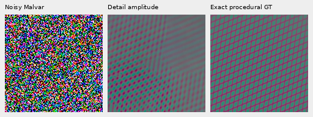
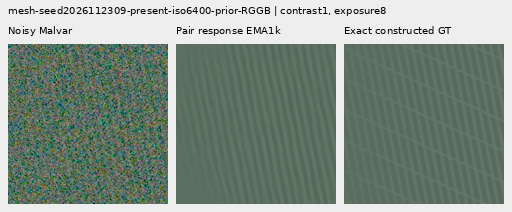
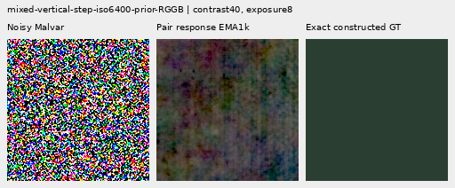
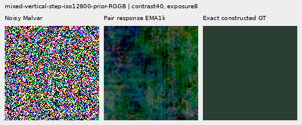
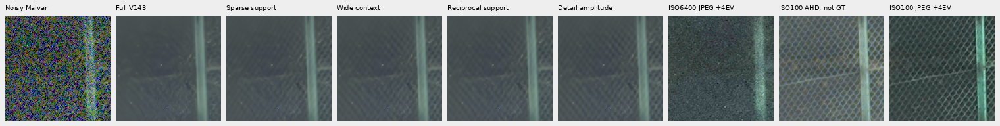
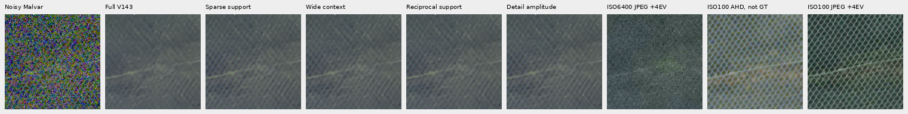

# demosaic

Joint Bayer demosaicing and denoising in linear camera RGB, with physical noise
conditioning, frozen DINOv3 features and tiled 16-bit output on NVIDIA GB10.
**V120 Small is the general recommendation**: full 427-photo mean 37.04008 dB,
measured known/unseen-CFA means 54.31272/54.00872 dB, tested ADC maximum 55.52 DN16.
It uses a pretrained DRUNet trunk and the official DINOv3 ConvNeXt-Small pyramid.
[Primary results](docs/v120-v121-primary.md) · [Current choices](docs/current-model.md).

| Useful choice | Measured strength | Remaining limits |
| --- | --- | --- |
| V120 Small | Broad photo/camera results and complete 102MP RGB16 checks | Fine foliage, mesh, neon and dark-field mottling |
| V114 Tiny | Lower tested ADC maximum, 51.73 DN16 | Camera/photo tradeoffs; [comparison](docs/current-model.md) |
| V1435k + optional `detail` | Stronger measured periodic detail under both GFX mesh priors | Partial orientations, support seams, boundary spill and slow correction; broad superiority unproven |

The [supported-amplitude option](docs/supported-wave-amplitude.md) raises fresh
mesh response **26.4%** and lowers image RMS **1.0%** versus `cross`. All256 absent
neural cases and64 new natural photo controls retain their parents. Mean/worst
added blank RMS rises42.1/28.4%; response reaches only **7.1% of exact procedural
GT**. The `detail` mode is the default inside explicitly enabled `--phase-harmonic`;
ordinary inference keeps the stage off. Partial orientations, support seams,
boundary spill, nonperiodic texture and slow correction remain unresolved.

The completed [V160 paired-response trial](docs/paired-response.md) raises learned
mesh response **82–96%** over V143, reaching **4.00–4.31% of exact GT amplitude**.
Blank RMS rises **3.25–4.69%** and quiet RMS **8.46–11.36%**. Native cab views show
slightly stronger existing strands, with soft crossings and added grain.
Its ordinary new-data control lowers native512 flat RMS **0.42–0.53%** on all
48 inputs, with a smaller quiet regression. Both 1k heads, four endpoints,
822 cases, 72 actual native views and independent audits are complete.

| Research implementation | Measured strength | Remaining cost |
| --- | --- | --- |
| [V160 paired response](docs/paired-response.md) | Stronger learned mesh response: 4.00–4.31% of exact GT | Blank/quiet errors and fine colored grain rise; real crossings remain soft |
| [V160 ordinary data](docs/paired-response.md) | Native512 full flat RMS falls 0.42–0.53%; all 48 full/coarse inputs improve versus V143 | Quiet RMS rises 0.76–1.58%; new data also changes versus older studies |
| [V159 smoother DC](docs/regional-dc-transition.md) | All 48 native512 coarse errors improve versus V143/V158/V156; much less quiet damage than V157 | Quiet RMS remains above V143/V158; mesh weaker than V156 |
| [V158 regional DC](docs/regional-dc-regret.md) | EMA quiet RMS improves on all 32 inputs versus V143; V157's extra casts recede | Near-parent correction; coarse gains shrink and mesh remains weaker than V156 |
| [V156 local regret](docs/local-excess-risk.md) | Quiet RMS 0.30–0.63% below matched MSE; all 32 inputs improve at both endpoints | Small regressions versus V143 remain; real crossings missing |
| [V157 spatial RGB](docs/spatial-rgb-residual.md) | All 48 native512 noisy-flat inputs improve in full and coarse error versus V143/V156 | Quiet color bias rises; response falls below V143 |
| [V153 delivered loss](docs/delivered-spectral-objective.md) | Mesh response reaches 2.45–2.59% of exact GT | Worse blank/natural/ADC behavior; fine crossings missing |
| [V150 objective floor](docs/objective-floor-training.md) | ADC-photo RMS about 3.06% lower on two held-out sources/four CFAs | Noisy fine-detail and quiet/coarse tradeoffs |

[V154 robust supervision](docs/robust-spectral-objective.md) retains a smaller
0.45–0.50% standalone-flat gain with less mixed-quiet damage than V157.
The [matched V155 parent comparison](docs/matched-parent-comparison.md) retains
V120's lower coarse noisy-flat error but higher total error and worse ADC slopes.
[Complete architecture/loss strengths and failures](docs/current-model.md#quality-and-remaining-work).

Keep V160's learned response, V158 quiet accuracy, V159's coarse/quiet compromise
and V157 direct spatial/coarse capacity visible; no model combines their strengths.

V160 passes 123 CPU checks, 450 exact frozen-base gradient comparisons and final
Adam/EMA validation. Its cache accounting failure, explicit 23-batch adoption
and all original evidence are preserved in the report.

[V161](docs/harmonic-frequency-context.md) is testing wider frequency context
on the same paired-response data and loss. Its 139 CPU checks, CUDA parity and
save/restore smoke pass; trained quality is pending.

Training uses freely licensed images, geometry before downsampling and zero
optical blur. V160 uses the 90,782-photo training cache and reviewed regions.
[Source review](docs/current-source-loss-review.md) · [Data pipeline](docs/training-pipeline.md) ·
[V143 training results](docs/v143-final5000-quality.md) · [Research and prior experiments](docs/research.md) ·
[PSNR history](docs/performance-history.md) · [Historical diary](diary/index.md).

## Current 100% crops

Noisy → V1435k with `detail` → exact procedural GT. This native 160×160 crop
uses the first active source and largest added RMS on a fixed 160 grid,
chosen after evaluation. All columns share 8× camera-linear contrast about the
exact empty field, then WB/matrix/+3EV. Pixels are not resized.
[Central diagnostics, failure views and complete metadata](docs/images/supported-wave-amplitude-v1/manifest.json).



Noisy → V143 + **V160 paired-response EMA** → exact constructed GT, two fixed
mesh crops. Mean response rises 95.73% over V143 and 94.77% over its matched
ordinary control, reaching 4.31% of GT. Blank RMS rises 4.69%, quiet errors rise,
and weak crossings remain difficult. Native 160×160 cells, ROI
`[176,176,160,160]` in 512px RGGB contexts, shot .00128/read variance 6.5536e-6,
common exposure 8 and contrast 1; crop pixels are never resized.
[All endpoints, checkpoint/source hashes and display metadata](docs/paired-response.md).




The paired model's quiet-field cost: noisy → **V160 paired-response EMA** →
exact constructed GT, ISO6400 and ISO12800 priors. Fine colored grain increases
beside the edge. Native 160×160 cells in 512px RGGB contexts, quiet ROI
`[80,176,160,160]`, common exposure 8 and 40× camera-linear contrast about
`[.001500000013,.006000000052,.002666666871]`. Shot/read variance is
.00128/6.5536e-6 or .00256/2.62144e-5; crop pixels are never resized.
[All methods and complete metadata](docs/paired-response.md).





The ordinary control's flat-field gain remains visible at
[ISO6400](docs/images/v160-paired-response-v1/comparison-19-ordinary-EMA-step1000-triplet.png)
and [ISO12800](docs/images/v160-paired-response-v1/comparison-20-ordinary-EMA-step1000-triplet.png).
V159's smaller quiet cost and coarse-flat gain retain their
[ISO6400](docs/images/v159-regional-dc-transition-v1/comparison-19-smooth-dc-EMA-step1000-triplet.png)
and [ISO12800](docs/images/v159-regional-dc-transition-v1/comparison-20-smooth-dc-EMA-step1000-triplet.png)
views and [report](docs/regional-dc-transition.md).

V158's stronger quiet result remains visible:
[ISO6400](docs/images/v158-regional-dc-v1/comparison-26-dc-regret-EMA-step1000-triplet.png)
and [ISO12800](docs/images/v158-regional-dc-v1/comparison-28-dc-regret-EMA-step1000-triplet.png),
with [full conditioning/display details](docs/regional-dc-regret.md).

V157's stronger standalone-flat result remains visible:
[ISO6400](docs/images/v157-spatial-rgb-v1/comparison-19-spatial-rgb-EMA-step1000-triplet.png)
and [ISO12800](docs/images/v157-spatial-rgb-v1/comparison-20-spatial-rgb-EMA-step1000-triplet.png),
with [full conditioning/display details](docs/spatial-rgb-residual.md).

The V157 quiet-region failures are explicit:
[ISO6400](docs/images/v157-spatial-rgb-v1/comparison-26-spatial-rgb-EMA-step1000-triplet.png)
and [ISO12800](docs/images/v157-spatial-rgb-v1/comparison-28-spatial-rgb-EMA-step1000-triplet.png).
The quieter V156 [ISO6400](docs/images/v156-local-risk-v1/comparison-26-local-risk-EMA-step1000-triplet.png)
and [ISO12800](docs/images/v156-local-risk-v1/comparison-28-local-risk-EMA-step1000-triplet.png)
triplets remain available with [full conditioning/display details](docs/local-excess-risk.md).
Earlier V154 [ISO6400](docs/images/v154-robust-spectral-v1/flat-iso6400-charb-0p01-EMA-step1000-triplet.png)
and [ISO12800](docs/images/v154-robust-spectral-v1/flat-iso12800-charb-0p01-EMA-step1000-triplet.png)
flat triplets retain their [complete report](docs/robust-spectral-objective.md).

V150's stronger ADC-only result remains useful: mean photo RMS falls 3.06% on
two held-out sources/four CFAs. Native
[bark](docs/images/v150-objective-floor-v1/comparison-42-floor16-matrix-EMA-step1000-triplet.png) and
[fur](docs/images/v150-objective-floor-v1/comparison-43-floor16-matrix-EMA-step1000-triplet.png)
triplets retain exact constructed GT; [noise, licensing and display details](docs/objective-floor-training.md).

Noisy organic texture remains weak: [current feather/grass/bark views](docs/delivered-spectral-objective.md)
and the [earlier native photo gallery](docs/spatial-photo-supplement.md).

Standing real GFX100S scene: DSCF3879 ISO6400 → **V120 Small, historical Haar
prior** → DSCF3880 ISO100 f/5.6. Complete 102MP outputs, native 160px cells, common
+2EV. The independent ISO100 exposure is a qualitative reference, **not exact GT**;
aperture, exposure and motion differ. Foliage remains painterly.
[GFX gallery](docs/gfx-qualitative.md) · [Camera comparisons](docs/native-camera-development.md).


Fine green mesh beside the red train's cab: noisy → V143 → sparse → wide → cross →
**detail** → ISO6400 JPEG → independent ISO100 AHD → ISO100 JPEG. Complete 102MP
outputs, nearby fixed prior, native 160px cells, common +4EV. Both ISO100 views
are **not GT**; aperture, exposure time and processing differ. Stronger crossing
contrast remains soft and uneven. The tested 2.88MP sky keeps every parent value.
[Both priors, standing scene and failure controls](docs/supported-wave-amplitude.md).





The [stronger RawNIND full-frame reference](docs/rawnind-fullframe.md) and
[Q2/Sony/GFX50R comparisons](docs/cross-camera-qualitative.md) show other limits.
Broad state-of-the-art quality and 100MP within 10 seconds remain project goals.

## Setup and inference

Linux, Python 3.12+, `uv` and a CUDA 13-compatible NVIDIA driver are required for
the lockfile. DINOv3 requires approved Hugging Face access through `HF_TOKEN`.

```bash
source scripts/env.sh
uv sync --extra dev
uv run demosaic infer /mnt/external/demosaic/models/v120-final20000.pt photo.raf \
  /mnt/external/demosaic/output/photo-linear.tiff \
  --preview /mnt/external/demosaic/output/photo-srgb.tiff \
  --shot 0.001 --read 0.000001 \
  --tile 512 --overlap 64 --batch-size 4 --precision float32 --cudnn-benchmark
PYTHONPATH=.:src:scripts uv run pytest -q
```

`--phase-harmonic --phase-harmonic-envelope detail` restores contrast inside
reciprocal support. Use `cross` for lower tested blank RMS. The stage remains
opt-in, with `detail` its default; [tradeoffs and complete native comparisons](docs/supported-wave-amplitude.md).

Noise values are examples; use suitable camera/input priors.
Use `--phase-harmonic` to enable Detail, or
`--phase-harmonic --phase-harmonic-envelope edge` for the earlier stage.
[Usage and all explicit modes](docs/usage.md) retain the earlier comparisons.
[Linear DNG + full-resolution JPEG batch export](docs/dng-export.md) preserves
camera RGB and adapts existing darktable XMP edits. Add `--hot-pixels` to repair
isolated Bayer defects before restoration.
`--hot-pixel-clusters` also handles paired same-color defects; see the
[native crop investigation](docs/hot-pixel-clusters.md).
[Usage](docs/usage.md) · [current training](docs/quality-first-training.md) ·
[data pipeline](docs/training-pipeline.md) · [experiments](docs/experiments.md) ·
[documentation guide](docs/index.md). Quality takes priority. State-of-the-art
quality and 100MP within 10s remain project goals; full-frame timing is
checkpoint-specific.
