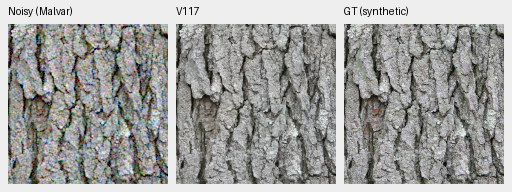
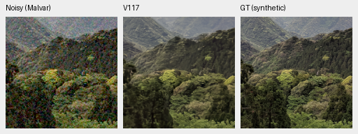
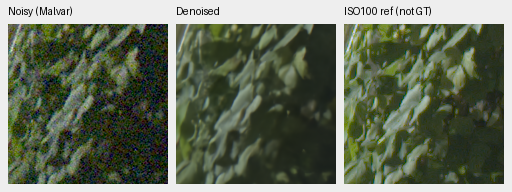
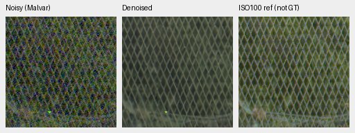

# demosaic

Joint Bayer demosaicing and denoising in linear camera RGB, with physical noise
conditioning, frozen DINOv3 features and tiled16-bit output on NVIDIA GB10.
**V114 Tiny is the current general quality baseline**, using V84's pretrained
DRUNet RGB trunk and official DINOv3 ConvNeXt-Tiny pyramid. It reaches
**36.980dB** on the full427-photo panel, +.077dB over V112, with422/427 source
means improving. Known/unseen measured-CFA means are54.286/54.003dB.
[Complete results, native comparisons and remaining weaknesses](docs/v114-v115-quality.md).

**V115 Small is a useful alternative:** its known-camera mean is higher at
54.324dB and its tested eight-pixel weak-carrier response improves. Tiny has
slightly higher photo PSNR and lower tested color bias. Both retain soft fine
foliage/neon detail and dark-camera mottling. All numerical panels, independent
saved-prediction checks, native review and complete102MP RGB16 exports are done.
[Current choices](docs/current-model.md) · [GFX gallery](docs/gfx-qualitative.md).

[V116's complete review](docs/v116-quality.md) finds higher tested eight-pixel
carrier gain, similar weak natural detail and a worse ADC color tail; V114
retains the better overall balance. These models use90,864 sources, zero optical blur and geometry
before final downsampling. [V119 is training](docs/cleaned-diverse-small-training.md)
from V115 Small with90,791 cleaned sources and the expanded paired set; quality
results are pending. [Data review](docs/incoming-commons-quality.md) ·
[Training pipeline](docs/training-pipeline.md) · [Historical diary](diary/index.md).

**V117 is a useful single-view photo-score option:**37.04408dB, +.06435 over
V114 with421/427 source means rising. Its camera means are slightly lower and
ADC color bias higher. The matched V118 band-loss arm lowers weak natural-detail
response and has a large ADC color-tail regression; the term stays off for
further quality work. [Complete results and native comparisons](docs/v117-v118-quality.md).

The optional [V114 eight-view comparison](docs/v114-eight-view.md) improves all
twelve fixed material cases and both selected adverse camera crops. Mean gains
are+.558/.264/.079dB at ADC/ISO100/ISO12800, with slightly higher selected color
bias and lower spatial variation. Full V114 eight-view panels/frame remain
unmeasured. Earlier [V104 eight-view full panels](docs/dihedral-quality.md) reach
37.044dB with a worse ADC color tail. The current [V114 ADC sites option](docs/adc-consistency.md)
improves its full ADC photo panel by +.236 dB, with lower color bias and higher
flat-field spatial variation. It activates only at explicit zero shot/read.
[Camera-outlier diagnostics](docs/camera-outliers.md).


[PSNR history and full values](docs/performance-history.md). Versions have unequal
training budgets and data; this describes available models rather than an
isolated architecture ablation.

## Current 100% crops

Photo cells are unchanged160×160 crops at the8×-binned evaluation resolution,
with shared coordinates/transforms. ISO12800-prior noisy observation →
**V117 Tiny, single view** → exact synthetic GT. Fine texture remains softer
than GT. V117 is the photo-score option; V114 retains the camera/color balance.
[Results and parent comparison](docs/v117-v118-quality.md) ·
[Source/ROI/checkpoint/noise/display metadata](docs/images/v117-v118-quality/manifest.json).





Sources: [Derek Ramsey](https://commons.wikimedia.org/wiki/File:Kentucky_Coffee-tree_Gymnocladus_dioicus_3264px.jpg),
[CC BY-SA2.5](https://creativecommons.org/licenses/by-sa/2.5/), and
[Grendelkhan](https://commons.wikimedia.org/wiki/File:Forest_covered_hills_on_Yakushima.jpg),
[CC BY-SA4.0](https://creativecommons.org/licenses/by-sa/4.0/), modified by binning,
cropping, simulated noise and restoration.

Real GFX100S: DSCF3879 ISO6400 → **V117 Tiny** → DSCF3880 ISO100 f/5.6.
Native160×160 sensor-pixel crops from complete102MP outputs share +2EV display.
The independent ISO100 exposure is an approximate qualitative reference,
**not GT**. Fine foliage remains painterly; fence geometry is coherent.
[All six regions and other useful models](docs/gfx-qualitative.md) ·
[Metadata](docs/images/v117-v118-quality/manifest.json).





The [stronger RawNIND full-frame reference](docs/rawnind-fullframe.md) and
[current Tiny/Small Q2/Sony/GFX50R comparisons](docs/cross-camera-qualitative.md)
show additional real-camera limitations. Broad real-photo superiority remains a goal.

## Setup and inference

Linux, Python 3.12+, `uv` and a CUDA 13-compatible NVIDIA driver are required for
the lockfile. DINOv3 requires approved Hugging Face access through `HF_TOKEN`.

```bash
source scripts/env.sh
uv sync --extra dev
uv run demosaic infer /mnt/external/demosaic/models/v114-final20000.pt photo.raf \
  /mnt/external/demosaic/output/photo-linear.tiff \
  --preview /mnt/external/demosaic/output/photo-srgb.tiff \
  --shot 0.001 --read 0.000001 \
  --tile 512 --overlap 64 --batch-size 4 --precision float32 --cudnn-benchmark
PYTHONPATH=.:src:scripts uv run pytest -q
```

Noise values are examples; use suitable camera/input priors.
[Linear DNG + full-resolution JPEG batch export](docs/dng-export.md) preserves
camera RGB and adapts existing darktable XMP edits. Add `--hot-pixels` to repair
isolated Bayer defects before restoration.
`--hot-pixel-clusters` also handles paired same-color defects; see the
[native crop investigation](docs/hot-pixel-clusters.md).
[Usage](docs/usage.md) · [current training](docs/quality-first-training.md) ·
[data pipeline](docs/training-pipeline.md) · [experiments](docs/experiments.md) ·
[documentation guide](docs/index.md). Quality takes priority. State-of-the-art
quality and 100MP within 10s remain project goals; full-frame timing is
checkpoint-specific.
