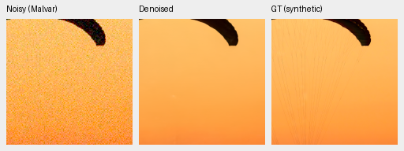
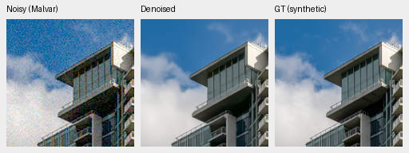
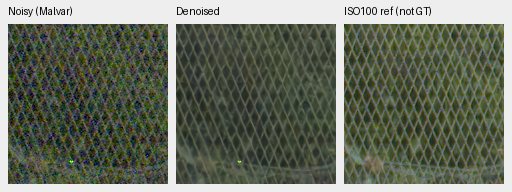

# demosaic

Joint Bayer demosaicing and denoising in linear camera RGB, with 16-bit TIFF
output, physical noise conditioning, tiled inference, and an optional DINOv3
feature branch. Experimental: training and quality validation are in progress.
V43 step2000 remains the working experimental reference below. The
[completed 160k-example review](docs/packed-isotropic-mixed16-quarter-review.md)
finds progress over the new models' own parents, but both trail older controls
and retain grain and detail/color limitations. State-of-the-art quality, decisive
real-photo superiority and 100MP within 10 seconds remain unmet/unproven.
Detailed comparisons and earlier trials are in [experiment results](docs/experiments.md).

Native 160×160 validation crops: noisy → denoised → GT, using V43 step 2000
(autotuned FP32, fixed CPU-generated ISO12800 noise). These are 100% crops at the 8×8-binned
evaluation resolution, with identical display transforms; open the PNG at 100%.
They illustrate current behavior, including lost fine detail.





Sources: [Roy Egloff](https://commons.wikimedia.org/wiki/File:CH.VD.Villeneuve_2007-08-25_Vertigo-Swiss-Riviera_2392_3x2-R_4K.jpg)
and [Dietmar Rabich](https://commons.wikimedia.org/wiki/File:Vancouver_(BC,_Canada),_Coal_Harbour_Seaside_Park,_Blick_in_den_Himmel_--_2022_--_2158.jpg),
[CC BY-SA 4.0](https://creativecommons.org/licenses/by-sa/4.0/); modified by binning,
cropping, simulated noise and restoration. See [the FP32 report and crop receipts](docs/mature-cudnn-fullframe.md)
and [real GFX100S crops](docs/gfx-qualitative.md).

Real GFX100S foliage and chain-link-fence crops at native 160×160 sensor resolution:
DSCF3879 noisy ISO6400 → experimental V43 step 2000 FP32 → DSCF3880 ISO100 f/5.6,
with shared +2 EV display, cropped from the full 102 MP output.
This closer pair is now the standing test. Framing is nearly identical, 3m38s
apart; aperture and moving subjects differ, so the last panel is a qualitative
reference, **not GT**. [All four regions and matched comparisons](docs/mature-cudnn-fullframe.md).
Additional [Q2, a7R II and GFX50R native comparisons](docs/cross-camera-qualitative.md)
use locally cached captures and explicitly labeled RawNIND comparators.
Supplementary [neon-sign and platform crops](docs/gfx-highlight-qualitative.md)
cover colored lighting and bright boundaries from the same cached GFX pair.




```bash
source scripts/env.sh
uv sync --extra dev
uv run demosaic prepare --output /mnt/external/demosaic/commons-v1 --limit 1024
uv run demosaic train configs/base.yaml
uv run demosaic evaluate /mnt/external/demosaic/runs/base-v3/best.pt \
  --manifest /mnt/external/demosaic/commons-v1/manifest.jsonl \
  --output /mnt/external/demosaic/evaluation/base-v3.json
uv run demosaic infer /mnt/external/demosaic/models/v43-step2000.pt photo.raf \
  /mnt/external/demosaic/output/photo-linear.tiff \
  --preview /mnt/external/demosaic/output/photo-srgb.tiff --shot 0.001 --read 0.000001 \
  --tile 512 --overlap 64 --batch-size 4 --precision float32 --cudnn-benchmark
uv run pytest -q
```

Noise values above are examples, not measured camera profiles. Setup requires
Linux, Python 3.12+, uv, and a CUDA 13-compatible NVIDIA driver for this lockfile.
The optional FP32 autotuning flag adds startup search; [timings and full-output validation](docs/mature-cudnn-fullframe.md)
distinguish the fresh CLI's 166.7s restore from the warmed 118.2s benchmark.
DINOv3 additionally requires approved Hugging Face access via `HF_TOKEN`.
See [experiment results](docs/experiments.md), [quality and noise diagnostics](docs/evaluation.md),
[usage and data conventions](docs/usage.md), [research](docs/research.md),
and the [completion evidence checklist](docs/requirements.md).
The [Commons archive download](docs/commons-download.md) stopped cleanly at its
512GiB free-space reserve after adding95,347 files; active experiments retain
frozen manifests. The [completed matched V72/V73 review](docs/packed-isotropic-mixed16-quarter-review.md)
finds gains over their own parents but losses against older equal-example models;
neither replaces V43.
The [completed content audit](docs/commons-content-overlap.md) supplies
84,867-file training manifests with identified capture series quarantined.
The [completed objective comparison](docs/reconstruction-objective-first1k-review.md)
misses its continuation gate. The [completed camera-supervision review](docs/camera-supervision-first1k-review.md)
finds photo/color gains with mixed camera results; its continuation gate also fails.
The [directional RAW residual and interval-loss study](docs/directional-interval-v78-v79.md)
has passed execution/restart checks and is training; image quality is pending.
See [training pipeline work](docs/training-pipeline.md) for augmentation before
the last reduction, selected-domain loading and the batch-size sweep.
The [packed detail review](docs/packed-detail-v40-v41-review.md) retains the
full-resolution model after testing two native-detail variants.
See the [V37 inference precision and timing review](docs/hidden-autocast-v42-review.md)
for an opt-in export with unchanged learned weights.
The [strip export check](docs/rgb16-strip-export.md) reduces full-photo TIFF
export memory while preserving the decoded 16-bit pixels.
