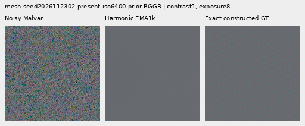
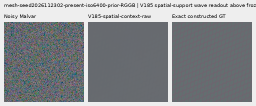
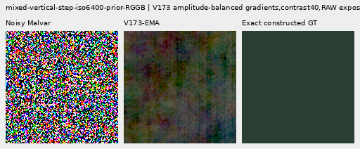
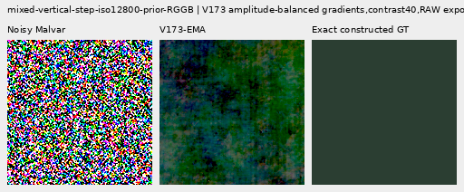
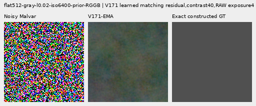
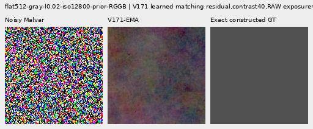
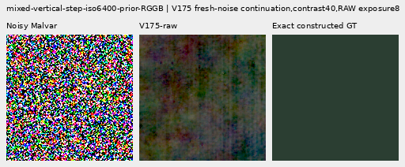

# demosaic

Joint Bayer demosaicing and denoising in linear camera RGB, with physical noise
conditioning, frozen DINOv3 features and tiled 16-bit output on NVIDIA GB10.
**V120 Small is the general recommendation**: full 427-photo mean 37.04008 dB,
measured known/unseen-CFA means 54.31272/54.00872 dB, tested ADC maximum 55.52 DN16.
It uses a pretrained DRUNet trunk and the official DINOv3 ConvNeXt-Small pyramid.
[Primary results](docs/v120-v121-primary.md) · [Current choices](docs/current-model.md).

The [V174 spread-sampling experiment](docs/spread-sample-matching.md)
keeps wide matching positions but does not recover more fine fence crossings.
EMA quiet total RMS falls **0.12–0.17% versus V172**, with DC color error down
0.36–0.43%; mesh response slips **0.25% to 3.868% of exact constructed GT amplitude**.
Flat results are mixed and broad mottle persists. Both endpoints, all 822 cases,
60 actually viewed native figures and 133 CPU tests are complete. Keep V172 as
the balanced matching baseline for detail work. The separate six-input
[V175 path-removal probe](docs/results/v175-local-shortcut-diagnostic-v1.json)
finds a nonzero matching contribution; it does not establish why detail is lost.

The completed [V175 fresh-noise continuation](docs/fresh-noise-matching.md)
reaches 9,000 total updates but barely changes mesh response: **+0.03–0.05%
versus V172**, reaching 3.878–3.879% of exact constructed GT amplitude. Raw
quiet RMS falls **0.14–0.27%**, while EMA ISO12800 quiet RMS rises 0.21%.
Flat results remain mixed, broad mottle persists and real fine crossings stay
weak. Both endpoints, 822 cases and 60 actually viewed native figures are complete.

An [exact-template training diagnostic](docs/mesh-template-evidence.md) finds
much more conditional mesh evidence across larger areas. It supplies hidden GT
and makes no new model-quality or flat-safety claim.
A [CFA phase-split follow-up](docs/phase-frequency-evidence.md) tests whether
input-only frequency selections repeat in separately measured green samples.
The completed [V178 phase-evidence trial](docs/phase-evidence-comparison.md)
exposes those measurements to matching. Mesh response rises **0.92% over its
matched control**, reaching **3.924% of exact GT amplitude**. Quiet spatial
error rises slightly; broad mottle and real fine cab crossings remain unresolved.
All four endpoints, 72 actually viewed native figures and independent audits
are complete. Retain this small mesh-response option alongside the earlier strengths.
The completed [V180 local-window variant](docs/local-phase-evidence-comparison.md)
raises mesh response **15.2–15.9% over global V178**, reaching **4.52–4.55% of GT**
at the same parameter budget. Quiet spatial RMS rises **0.76–1.05%**, and actual
fine cab crossings remain incomplete. Both endpoints, independent audits and
60 actually viewed figures are complete. Retain this stronger detail architecture
alongside the earlier quiet and flat strengths.

The completed [V181 spatial-loss variant](docs/flat-spatial-evidence-comparison.md)
recovers quiet-field performance on the local architecture: EMA quiet spatial
RMS falls **0.47–1.15% versus V180 on all 32 inputs**. Mesh response falls
**8.75% to 4.150% of GT**, still 5.78% above global V178. Natural fine-band
response also falls; real cab crossings and broad mottle remain unresolved.
Retain this quieter option beside V180's stronger response and V172's balanced
comparison. Both endpoints, independent audits and 60 actually viewed figures
are complete.

A [training-gradient diagnostic](docs/flat-spatial-gradient-conflict.md) finds
that flat and paired-detail supervision can conflict through shared parameters,
despite positive output-gradient alignment. It changes no model or quality result.

The completed [V183 coherent-response loss](docs/coherent-pair-evidence-comparison.md)
recovers detail response: EMA mesh response rises **6.95% over V181 to 4.439%
of GT**, with quiet spatial RMS **0.39–0.67% higher**. Against V180 it retains
2.41% less mesh response and 0.09–0.49% lower quiet spatial error. Natural
fine-band response improves slightly versus V181, while real fence crossings
and broad mottle remain unresolved. Both endpoints, independent audits and
60 actually viewed native figures are complete. Retain this intermediate recipe
beside V180's stronger response and V181's quieter output.

The completed [V185 smaller-support readout](docs/spatial-context-wave-comparison.md)
improves the wave readout at matched training: mesh response rises **2.11% raw /
0.45% EMA versus V184**, reaching **4.968% / 5.171% of GT**. Quiet spatial RMS
falls **0.42–0.55% raw / 0.83–1.38% EMA**, with all 32 EMA inputs improving.
This is the current experimental wave option. Standalone flats and absent-mesh
controls regress slightly; false striping, broad mottle and real missing crossings
remain. Both endpoints, audits and all 60 viewed native figures are complete.

The read-only [V186 selection diagnostic](docs/frequency-selection-coverage.md)
finds most clean mesh power already inside the current frequency band, while
selected bins lie near little of it in typical weak cases. Broadening the band
alone helps little; no new denoising gain is claimed.

The [V187 pooled-selection trial](docs/pooled-phase-wave-readout.md) is running at V185’s parameter and training budget, following the completed frequency diagnostic. Native CPU/GPU parity and optimizer restoration pass; trained quality is pending.

The completed [V184 phase-aware readout](docs/phase-wave-readout-comparison.md)
adds a stronger response option above frozen V183 EMA: mesh response rises
**9.60% raw / 15.96% EMA**, reaching **4.865% / 5.148% of GT amplitude**.
Quiet spatial RMS rises **0.76–0.94% raw / 1.81–2.35% EMA**. Constructed mesh
views show stronger periodic modulation, while real cab crossings stay incomplete
and quiet regions gain false striping. Retain this direct readout for further
detail work, with raw's lower quiet cost, beside the earlier quieter strengths.
Both endpoints, independent audits and all 60 native figures are complete.
This adds training and capacity; both primary baselines are V183 EMA.

| Useful implementation | Measured strength | Remaining limits |
| --- | --- | --- |
| V120 Small | Broad photo/camera results and complete 102MP RGB16 checks | Fine foliage, mesh, neon and dark-field mottling |
| V114 Tiny | Lower tested ADC maximum, 51.73 DN16 | Camera/photo tradeoffs; [comparison](docs/current-model.md) |
| [V1435k + optional `detail`](docs/supported-wave-amplitude.md) | Mesh response +26.4% versus `cross`, reaching 7.1% of GT; all 256 absent neural cases retain parent | Partial orientations, support seams, boundary spill and slow correction; added blank error rises |
| [V161 frequency context](docs/harmonic-frequency-context.md) | Stronger learned mesh response, 4.83–5.24% of GT; slight contrast gain on real strands | Quiet RMS 14–18% above V143, extra grain/bias and soft crossings |
| [V171 matching residual](docs/learned-matching-residual.md) | Full-flat RMS −1.21–1.52%, coarse RMS −1.73% versus V169; all 48 inputs improve | Quiet RMS +26–31%, stronger casts and missing real crossings |
| [V172 local noise units](docs/local-noise-matching.md) | Quiet RMS −0.31–0.77% and mesh response +1.06% to 3.877% of GT versus V169; much less cast than V171 | Flat gain only 0.059–0.085%; broad mottle and fine crossings unresolved |
| [V173 gradient supervision](docs/weak-gradient-matching.md) | Quiet spatial RMS −0.32–0.68% on all 32 inputs, full-flat means −0.25–0.30% versus V172 | Mesh response −3.95% to 3.724% of GT, natural band response −2.63–2.88% |
| [V174 spread initialization](docs/spread-sample-matching.md) | Small quiet-color gain: total −0.12–0.17%, DC −0.36–0.43% versus V172 | Mesh response −0.25%; both coarse-flat means worsen, no visible crossing recovery |
| [V175 fresh-noise raw](docs/fresh-noise-matching.md) | Quiet RMS −0.14–0.27% versus V172, with nearly unchanged mesh response | 11/32 quiet inputs worsen; ISO6400 flat RMS +0.09%, natural band response slips and fine crossings remain weak |
| [V178 measured phase evidence](docs/phase-evidence-comparison.md) | Mesh response +0.92% versus matched control, reaching 3.924% of GT; EMA quiet total −0.05–0.09% versus V172 | Slightly higher quiet spatial error versus control; EMA ISO6400 flat RMS +0.12% versus V172, no clear real crossing recovery |
| [V180 local phase evidence](docs/local-phase-evidence-comparison.md) | Mesh response +15.2–15.9% versus global V178, reaching 4.52–4.55% of GT; same parameter budget | Quiet spatial RMS +0.76–1.05%; broad/fine mottle and missing real cab crossings remain |
| [V181 clean-flat spatial loss](docs/flat-spatial-evidence-comparison.md) | EMA quiet spatial RMS −0.47–1.15% on all 32 inputs versus V180; mesh response still 5.78% above global V178 | Mesh response −8.75% versus V180 to 4.150% of GT; fine-band response falls and real crossings/broad mottle remain |
| [V183 coherent pair response](docs/coherent-pair-evidence-comparison.md) | EMA mesh response +6.95% versus V181 to 4.439% of GT; quiet spatial RMS 0.09–0.49% below V180 | Quiet spatial RMS +0.39–0.67% versus V181 on all 32 inputs; real crossings and broad mottle remain |
| [V184 phase-aware readout](docs/phase-wave-readout-comparison.md) | Mesh response +9.60% raw / +15.96% EMA versus frozen V183 EMA, reaching 4.865–5.148% of GT | Quiet spatial RMS +0.76–2.35%, extra false striping, worse natural band-error means and incomplete real crossings; extra training/capacity |
| [V185 smaller RAW support](docs/spatial-context-wave-comparison.md) | Mesh response +2.11% raw / +0.45% EMA and quiet spatial RMS −0.42–1.38% versus matched V184; all 32 EMA quiet cases improve | Still only 4.968–5.171% of GT response; tiny flat/absent regressions, false striping, mottle and incomplete real crossings |
| [V158 regional DC](docs/regional-dc-regret.md) | Quiet RMS −1.93–2.63% versus matched MSE; all 32 inputs improve | Small regressions versus V143, persistent real detail loss |

No model combines these strengths. The [released V170 RAW matching comparison](docs/nonlocal-raw-comparison.md)
has stronger coarse-flat reduction but periodic low-noise artifacts and weaker
mesh response. [Fine-mesh training](docs/fine-mesh-training.md) documents useful
finer-wire data gains and their quiet-field costs. Complete earlier strengths,
failures and evidence remain in [current choices](docs/current-model.md), the
[experiment index](docs/experiments.md) and [timestamped diary](diary/index.md).
Training uses freely licensed photos, geometry before downsampling and zero
optical blur. [Data pipeline](docs/training-pipeline.md) · [Source review](docs/current-source-loss-review.md).

## Current 100% crops

Open the local [V185 native-pixel viewer](docs/images/v185-spatial-context-v1/native-viewer.html),
[V184 viewer](docs/images/v184-wave-readout-v1/native-viewer.html),
[V183 viewer](docs/images/v183-coherent-pair-evidence-v1/native-viewer.html),
[V181 viewer](docs/images/v181-flat-spatial-evidence-v1/native-viewer.html),
[V180 viewer](docs/images/v180-local-phase-evidence-v1/native-viewer.html),
[V178 viewer](docs/images/v178-phase-evidence-v1/native-viewer.html),
[V175 viewer](docs/images/v175-fresh-noise-matching-v1/native-viewer.html),
[V174 viewer](docs/images/v174-spread-matching-v1/native-viewer.html),
[V173 viewer](docs/images/v173-weak-gradient-matching-v1/native-viewer.html) or
[V172 viewer](docs/images/v172-local-noise-matching-v1/native-viewer.html). Click
the flip tile or press **F**. All 160×160 browser crops retain the PNG pixels
exactly. V185 opens with V184 EMA versus V185 EMA; select both raw states for
the matched raw comparison. All fourteen V178/V180/V181/V183/V184/V185 states
retain separate checkpoint metadata. V175 retains its modest raw quiet gain.

[Optional periodic-detail native comparisons and failure views](docs/supported-wave-amplitude.md)
remain available alongside the learned heads below.

Noisy → V143 + **V161 harmonic-context EMA** → exact constructed GT, two fixed
mesh crops. Mean response rises 21.57% over matched V160 paired response,
reaching 5.24% of GT. Blank RMS rises 5.31% versus V143, quiet errors rise,
and weak crossings remain difficult. Native 160×160 cells, ROI
`[176,176,160,160]` in 512px RGGB contexts, shot .00128/read variance 6.5536e-6,
common exposure 8 and contrast 1; crop pixels are never resized.
[All endpoints, checkpoint/source hashes and display metadata](docs/harmonic-frequency-context.md).




Noisy → **V172 local-noise EMA** → exact constructed GT, the same two mesh
sources/ROIs above. Response reaches 3.877% of GT, **1.06% above V169**; mean quiet
RMS falls 0.31–0.77%. Fine crossing strands remain weak. Native 160×160 cells,
ROI `[176,176,160,160]`, shot .00128/read variance 6.5536e-6, common exposure 8
and contrast 1; pixels are never resized.
EMA checkpoint SHA256 `0103e5dc59102c849b5ce456f1de24ae3e3e30ec4019f16dc102a26dca0867c1`.
[Both endpoints and complete metadata](docs/local-noise-matching.md).
[Earlier V169 mesh comparisons](docs/balanced-spatial-correction.md) remain available.

[V172 mesh2302 triplet](docs/images/v172-local-noise-matching-v1/comparison-02.png) ·
[V172 mesh2309 triplet](docs/images/v172-local-noise-matching-v1/comparison-06.png).

Noisy → **V178 evidence EMA** → exact constructed GT, the same mesh sources,
ROI, physical noise and display transform above. Response reaches **3.9235%
of GT**, +0.915% over matched control EMA and +1.196% over V172 EMA. Quiet
spatial error rises 0.0165–0.0525% versus control; weak crossings still disappear.
Native 160×160 pixels are never resized. EMA export SHA256
`8e9896a22ca2b6885a5e838188d909a4dd4c0c173632437e656667e70a49c268`.
[Four endpoints, source checkpoints and all display metadata](docs/phase-evidence-comparison.md).

[V178 mesh2302 triplet](docs/images/v178-phase-evidence-v1/comparison-04.png) ·
[V178 mesh2309 triplet](docs/images/v178-phase-evidence-v1/comparison-10.png).

Noisy → **V180 local evidence EMA** → exact constructed GT, the same sources,
ROI, noise and display transform above. Response reaches **4.5484% of GT**,
+15.93% over global V178 EMA and +17.31% over V172 EMA. Quiet spatial RMS rises
0.79–1.05% versus global V178; fine crossings remain incomplete. Native pixels
are never resized. EMA export SHA256
`a04d1db000d168c23ada05eb6b5a73015be8fbb4cc6f5ca1581f61d08ca9592d`.
[Both endpoints, all prior strengths and complete metadata](docs/local-phase-evidence-comparison.md).

[V180 mesh2302 triplet](docs/images/v180-local-phase-evidence-v1/comparison-02.png) ·
[V180 mesh2309 triplet](docs/images/v180-local-phase-evidence-v1/comparison-06.png).

Noisy → **V181 flat-spatial EMA** → exact constructed GT, ISO6400/12800 quiet
fields. Spatial RMS falls **1.15% / 0.47% on all 32 inputs versus V180**;
total quiet RMS falls 0.96% / 0.35%. Mesh response falls 8.75%, and broad mottle
persists. Native 160×160 cells, ROI `[80,176,160,160]` in the same 512px RGGB
contexts, exposure8/contrast40 about camera RGB
`[.001500000013,.006000000052,.002666666871]`. Shot/read variance is
.00128/6.5536e-6 or .00256/2.62144e-5; pixels are never resized.
EMA export SHA256 `62a293c27b9f0443904ac76428578df0033b0c64336927e6188e62763ec51486`.
[Both endpoints, mesh triplets and complete metadata](docs/flat-spatial-evidence-comparison.md).

[V181 ISO6400 quiet triplet](docs/images/v181-flat-spatial-evidence-v1/comparison-36.png) ·
[V181 ISO12800 quiet triplet](docs/images/v181-flat-spatial-evidence-v1/comparison-40.png).

Noisy → **V183 coherent-pair EMA** → exact constructed GT, mesh2302/mesh2309.
Response reaches **4.4390% of GT**, +6.95% over V181; quiet spatial RMS rises
0.39–0.67% on all 32 inputs. Both crops use the same 512px RGGB sources,
ROI `[176,176,160,160]`, shot .00128/read variance 6.5536e-6 and exposure8/
contrast1 as the mesh comparisons above. Native 160×160 cells are never resized.
EMA export SHA256 `b713608498158b24b09da72c8079d6eae58bc2458f7d4ac63d493b7b679f63b3`;
training checkpoint `4d6d47cc14ef3effb9569d867c5aed59a1e09b315de6bbb82e61281e928b3962`.
[Both endpoints, quiet/flat triplets and complete metadata](docs/coherent-pair-evidence-comparison.md).
Fine crossed strands remain incomplete; amplified views retain broad colored mottle.

[V183 mesh2302 triplet](docs/images/v183-coherent-pair-evidence-v1/comparison-02.png) ·
[V183 mesh2309 triplet](docs/images/v183-coherent-pair-evidence-v1/comparison-06.png).

[V184 mesh2302 triplet](docs/images/v184-wave-readout-v1/comparison-01.png) ·
[V184 mesh2309 triplet](docs/images/v184-wave-readout-v1/comparison-05.png).

Noisy → **V185 spatial-support raw** → exact constructed GT, mesh2302/mesh2309.
Mean response reaches **4.968% of GT**, +2.11% over V184 raw, while quiet
spatial RMS falls 0.42–0.55%. Both fixed 512px RGGB contexts use native
ROI `[176,176,160,160]`, shot .00128/read variance 6.5536e-6, exposure8/contrast1.
The 160×160 crop pixels are never resized. Raw export SHA256
`054f31a5734ed944163f51b73f5efb2c814f863c54948167d573e9e90b9ca1b8`;
training checkpoint `4bce120381d4c5208e17f10e43a450b0e00884dcbb8f6a7b632312a714787d9f`.
[Both endpoints, quiet/flat triplets and complete metadata](docs/spatial-context-wave-comparison.md).
False striping, broad mottle and incomplete real crossings remain.




Noisy → **V173 gradient EMA** → exact constructed GT, ISO6400 and ISO12800
quiet fields. Mean spatial RMS falls **0.32–0.68% on all 32 inputs versus V172**;
total quiet RMS falls 0.27–0.52%. The change is subtle and broad mottle remains.
Mesh response falls 3.95%, and natural fine-band response falls 2.63–2.88%.
Native 160×160 cells in 512px RGGB contexts, quiet ROI `[80,176,160,160]`, exposure 8,
40× camera-linear contrast about `[.001500000013,.006000000052,.002666666871]`.
Shot/read variance is .00128/6.5536e-6 or .00256/2.62144e-5; pixels are never resized.
EMA checkpoint SHA256 `4fe62a4aea66a7a61ba2f9039c62c7519e5714d0ff766f9254b39946b7a6a5a0`.
[Both endpoints, V172 comparisons and display metadata](docs/weak-gradient-matching.md).
[Earlier V172 quiet triplets](docs/local-noise-matching.md) and
[V166 quiet-color option](docs/common-support-routing.md) remain available.





Noisy → **V171 matching EMA** → exact constructed GT, native 512 ISO6400/12800
flat crops. Full RMS falls **1.21–1.52%** and coarse RMS **1.73% versus V169 EMA**;
all 48 inputs improve in both measures. Mesh response changes modestly, while
quiet fields beside detail acquire stronger color casts. Native 160×160 cells,
ROI `[176,176,160,160]`, exposure4, contrast40 about
`[.010000000708,.020000001416,.013333332725]`; shot/read variance
.00128/6.5536e-6 or .00256/2.62144e-5. Pixels are never resized.
[Exact checkpoints, sources, both endpoints and display metadata](docs/learned-matching-residual.md).
EMA checkpoint SHA256 `5ca2d80b2fc9a8e0a3b45bbb77b20ce83cdc57fe89a01320cf54d70c75a1722f`.





V174 retains two native noisy → EMA → exact constructed GT quiet triplets at
[ISO6400](docs/images/v174-spread-matching-v1/comparison-36.png) and
[ISO12800](docs/images/v174-spread-matching-v1/comparison-40.png), using the same
quiet source/ROI, noise and display transform as V173 above. Its smaller quiet
RMS gain leaves more mesh response than V173, but slightly less than V172.
EMA checkpoint SHA256 `3f604e7ef028e2ed6e1f475e347fed6db7da96f672c0ee6eeafcd2af3c8c817b`.
[Both endpoints, 12 triplets and complete metadata](docs/spread-sample-matching.md).
Earlier native comparisons remain in their [experiment reports](docs/experiments.md).

Noisy → **V175 fresh-noise raw** → exact constructed GT, ISO6400 and ISO12800
quiet fields. Mean quiet RMS falls **0.14–0.27% versus V172**, with 21/32 inputs
improving; broad mottle remains and fine cab crossings do not visibly recover.
Native 160×160 cells use the same quiet source, ROI `[80,176,160,160]`, exposure8,
contrast40 anchor and shot/read variance as the V173 quiet crops above; no resizing.
Raw export SHA256 `75e3a404345ba79a9dfbb9e4e579182d0972b3e81824dd9f9e980cf38b48436f`.
[Both endpoints, all comparisons and complete metadata](docs/fresh-noise-matching.md).




Standing real GFX100S scene: DSCF3879 ISO6400 → **V120 Small, historical Haar
prior** → DSCF3880 ISO100 f/5.6. Complete 102MP outputs, native 160px cells, common
+2EV. The independent ISO100 exposure is a qualitative reference, **not exact GT**;
aperture, exposure and motion differ. Foliage remains painterly.
[GFX gallery](docs/gfx-qualitative.md) · [Camera comparisons](docs/native-camera-development.md).


Fine green mesh beside the red train's cab: noisy → V143 → sparse → wide → cross →
**detail** → ISO6400 JPEG → independent ISO100 AHD → ISO100 JPEG. Complete 102MP
outputs, nearby fixed prior, native 160px cells, common +4EV. Both ISO100 views
are **not GT**; aperture, exposure time and processing differ. Stronger crossing
contrast remains soft and uneven. The tested 2.88MP sky keeps every parent value.
[Both priors, standing scene and failure controls](docs/supported-wave-amplitude.md).


The [stronger RawNIND full-frame reference](docs/rawnind-fullframe.md) and
[Q2/Sony/GFX50R comparisons](docs/cross-camera-qualitative.md) show other limits.
Broad state-of-the-art quality and 100MP within 10 seconds remain project goals.

## Setup and inference

Linux, Python 3.12+, `uv` and a CUDA 13-compatible NVIDIA driver are required for
the lockfile. DINOv3 requires approved Hugging Face access through `HF_TOKEN`.

```bash
source scripts/env.sh
uv sync --extra dev
uv run demosaic infer /mnt/external/demosaic/models/v120-final20000.pt photo.raf \
  /mnt/external/demosaic/output/photo-linear.tiff \
  --preview /mnt/external/demosaic/output/photo-srgb.tiff \
  --shot 0.001 --read 0.000001 \
  --tile 512 --overlap 64 --batch-size 4 --precision float32 --cudnn-benchmark
PYTHONPATH=.:src:scripts uv run pytest -q
```

`--phase-harmonic --phase-harmonic-envelope detail` restores contrast inside
reciprocal support. Use `cross` for lower tested blank RMS. The stage remains
opt-in, with `detail` its default; [tradeoffs and complete native comparisons](docs/supported-wave-amplitude.md).

Noise values are examples; use suitable camera/input priors.
Use `--phase-harmonic` to enable Detail, or
`--phase-harmonic --phase-harmonic-envelope edge` for the earlier stage.
[Usage and all explicit modes](docs/usage.md) retain the earlier comparisons.
[Linear DNG + full-resolution JPEG batch export](docs/dng-export.md) preserves
camera RGB and adapts existing darktable XMP edits. Add `--hot-pixels` to repair
isolated Bayer defects before restoration.
`--hot-pixel-clusters` also handles paired same-color defects; see the
[native crop investigation](docs/hot-pixel-clusters.md).
[Usage](docs/usage.md) · [current training](docs/quality-first-training.md) ·
[data pipeline](docs/training-pipeline.md) · [experiments](docs/experiments.md) ·
[documentation guide](docs/index.md). Quality takes priority. State-of-the-art
quality and 100MP within 10s remain project goals; full-frame timing is
checkpoint-specific.
