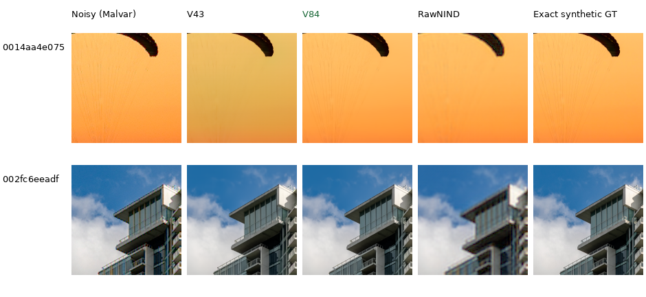
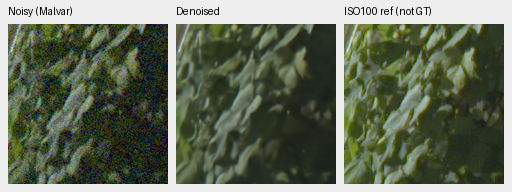

# demosaic

Joint Bayer demosaicing and denoising in linear camera RGB, with physical noise
conditioning, frozen DINOv3 features and tiled 16-bit TIFF output on NVIDIA GB10.
**V84 is the current quality and training baseline**, using a pretrained DRUNet
RGB trunk and DINOv3 ConvNeXt-Tiny feature pyramid. Its full-photo PSNR is
36.44 dB, about **1.54 dB above V43**. V85 offers similar quality; V95 is a useful
weak-detail comparison. [Current models, strengths and tradeoffs](docs/current-model.md).

Current work applies the cleaned 88,484-source Commons cohort, less optical blur
and reviewed fine-detail examples to this stronger architecture. Useful new
versions and image comparisons belong here as they become available. The
[diary](diary/index.md) retains historical decisions.
V101's completed fine-detail continuation improves all12 selected natural-detail
cases against V84/V100, with the largest gains at low noise.
[Current native comparisons](docs/heldout-detail.md) show its progress and remaining
smoothing. The full matched evaluation is running; V100's
[completed camera comparison](docs/real-camera-quality.md) has mixed results.
For explicit zero-shot/read inputs, [optional site consistency](docs/adc-consistency.md)
adds **.40dB ADC-only PSNR** with unchanged V84 weights across all427 photos/four
CFAs; positive-noise inputs bypass it. The report includes native crops and color tradeoffs.


[PSNR history and full values](docs/performance-history.md). Versions have unequal
training budgets and data; this describes available models rather than an
isolated architecture ablation.

## Current 100% crops

Same noisy observation → V43 / **V84** / RawNIND → exact synthetic GT. Every cell
is an unchanged 160×160-pixel crop at the 8×-binned evaluation resolution, with
ISO 100 conditioning and shared display transforms. V84 preserves the fabric's
orange color and fine suspension lines that V43 loses.
[Source, ROI, checkpoint, noise and display metadata](docs/images/current-quality/iso100-prior/manifest.json).
The [model guide](docs/current-model.md) also shows ADC-only and high-noise
comparisons, where fine-detail loss remains a development target.



Sources: [Roy Egloff](https://commons.wikimedia.org/wiki/File:CH.VD.Villeneuve_2007-08-25_Vertigo-Swiss-Riviera_2392_3x2-R_4K.jpg)
and [Dietmar Rabich](https://commons.wikimedia.org/wiki/File:Vancouver_(BC,_Canada),_Coal_Harbour_Seaside_Park,_Blick_in_den_Himmel_--_2022_--_2158.jpg),
[CC BY-SA 4.0](https://creativecommons.org/licenses/by-sa/4.0/), modified by binning,
crop, simulated noise and restoration.

Real GFX100S: DSCF3879 ISO 6400 → **V101** → DSCF3880 ISO 100 f/5.6. Native160
sensor-pixel crops, 512px inference contexts and shared +2 EV display. The last
panel is a separately captured qualitative reference, **not GT**.
[Compare V84, V100, V101 and RawNIND on six regions](docs/gfx-qualitative.md).
V101 and V84 look close here; fine foliage and saturated-light detail remain targets.
The [Q2, Sony a7R II and GFX50R gallery](docs/cross-camera-qualitative.md)
also includes V84/V100 on six fixed native regions.




## Setup and inference

Linux, Python 3.12+, `uv` and a CUDA 13-compatible NVIDIA driver are required for
the lockfile. DINOv3 requires approved Hugging Face access through `HF_TOKEN`.

```bash
source scripts/env.sh
uv sync --extra dev
uv run demosaic infer /mnt/external/demosaic/models/v84-original20000.pt photo.raf \
  /mnt/external/demosaic/output/photo-linear.tiff \
  --preview /mnt/external/demosaic/output/photo-srgb.tiff \
  --shot 0.001 --read 0.000001 \
  --tile 512 --overlap 64 --batch-size 4 --precision float32 --cudnn-benchmark
PYTHONPATH=.:src:scripts uv run pytest -q
```

Noise values are examples; use suitable camera/input priors.
[Usage](docs/usage.md) · [current training](docs/quality-first-training.md) ·
[data pipeline](docs/training-pipeline.md) · [experiments](docs/experiments.md) ·
[documentation guide](docs/index.md). Quality takes priority. State-of-the-art
quality and 100MP within 10s remain project goals; full-frame timing is
checkpoint-specific.
