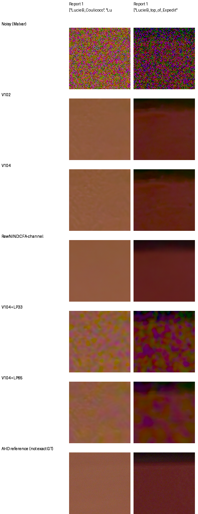
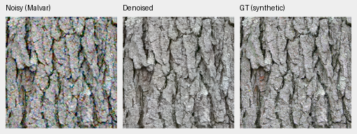
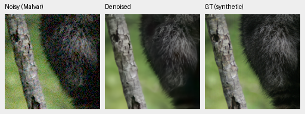

# Reject fixed low-frequency CFA correction on noisy V104 outputs

Recorded: 2026-10-23T18:28:58-07:00 (America/Los_Angeles).

Tested whether the broad spatial errors in the two recently reviewed adverse
Canon EOS M100/ISO12800 fields could be reduced by a fixed, target-free output
correction. Reused all saved predictions/observations: four exact-target
material sources at three noise conditions and the two camera crops with
their original batch partners. There are zero new learned forwards, optimizer
updates, RAW decodes or source-HDD reads. Existing training and evaluation jobs
remain live with unchanged plans and original V104 initialization.

The correction is P + G(M*(y−P))/G(M), where M is the Bayer RGB sampling mask
and G is a separable Gaussian. Fixed sigma 4/support 33 and sigma 8/support 65
before outcomes, with full strength and no fitted gain, target, blend or noise
override. Negative black-subtracted observations remain included. This simple
rule also includes clipped samples, a known limitation; these dark camera
contexts do not approach saturation. All methods use the original photo240
and camera448 interiors and native display ROIs.

Four-source rendered PSNR means:

| Condition | Original V104 | Sigma 4 | Sigma 8 |
| --- | ---: | ---: | ---: |
| ADC-only | 39.49290 | 39.50298 | 39.49334 |
| ISO100 prior | 40.80494 | 40.75134 | 40.76153 |
| ISO12800 prior | 33.49300 | 33.07280 | 33.38089 |

Each policy improves only one of the four ADC cases and regresses on all eight
positive-noise cases. The high-noise means fall .42020/.11211 dB. These are
four selected material sources, not a new full427 result.

On the selected Coulicoco camera crop, measured-CFA PSNR falls
56.98928→51.36972/55.07517 dB. On top_of_Expedit it falls
60.67192→53.63947/57.47208. Channel-mean bias decreases, but total MSE increases.
Native viewing shows strong broad colored blotches under the shared +2EV
display, with the wider correction milder but still poor. Exact-target
bark/fur changes are subtle and do not recover the absent fine structure.

Two unchanged 160×160 high-noise triplets for the broader sigma 8 correction,
noisy → corrected V104 → exact synthetic GT, shared exposure ×1:

These remain original V104 learned weights, SHA256
`8a3a7d94f2b1465cbdddbeec201fb37a2f69b12c74f9298527a94e3a7bbf6300`,
with an explicitly labeled experimental output operator, not a new checkpoint.
Source, ROI, physical noise, WB/matrix, exposure and source licenses are in the
[photo manifest](../docs/images/v104-low-frequency-consistency/photo/manifest.json).
Bark derives from Derek Ramsey (CC BY-SA 2.5); fur from Korall (CC BY 3.0).
Camera AHD is an independently demosaiced auxiliary reference, not exact RGB GT.

Independent NumPy64 Bayer unpack/masks and Gaussian normalized convolution
reproduce all 32 corrected source cases, maximum full-image difference
3.233e-8. All 56 primary score rows are independently rebuilt; the original
12 photo metric dictionaries reproduce exactly. All 48 panels across 16
triplets re-render exactly from retained floats, and all 24 board cells were
actually viewed at native resolution. Constant-color offset controls pass
both policies on all four CFAs. No model/selector/production inference changes.
[Full evidence and published galleries](../docs/results/v104-low-frequency-consistency-rejected-v1.json).
[Initial pre-execution plan and unchanged operator lineage](../docs/results/v104-low-frequency-consistency-plan-lineage-v1.json).

The first wrapper stopped while treating camera metadata like photographic
metadata. Corrected that wrapper in a separate root, retaining the first
source/partial files. Its complete numeric outputs then reached an invalid
photo-board kind. Preserved that source and every output, and used a separate
review assembly to adopt the bound floats and normalize method metadata.
Independent operator/score/pixel audits validate the adopted outputs; the
recovery did not rerun restoration or the source-image corrections. No widths,
strengths, source choices or ROIs changed after outcomes.

Reject both fixed corrections for noisy captures. Reduced color means alone
do not establish a better restoration; noise remains in spatial averages.
This does not reject learned/noise-aware consistency. Continue the fixed
V111/V112 loss-scale trial instead of tuning this pilot on its selected cases.
