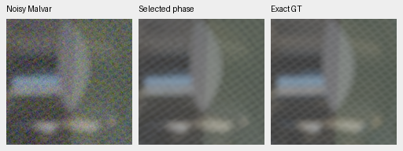
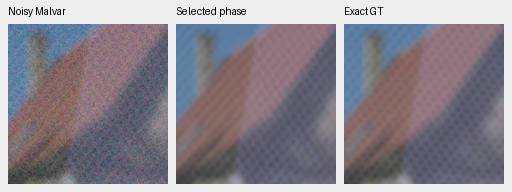

# Selecting the phase of weak fence crossings from Bayer samples

An independent Bayer fold chooses between affine and curved crossing
phase. On 24 new variable-phase photo fixtures, the selected fit
recovers **0.335 percentage points** of interaction contrast and lowers
junction increment error **0.203 DN16** over the regional RAW refit.
The earlier fixed curve recovers **0.371 points**. Selection reduces
mean added gap luma from **0.014 to 0.010 DN16** and peak gap luma from
**0.328 to 0.145 DN16**. The response advantage at equal mean gap luma
has an interval spanning zero. Both variants remain experimental.

On the real right cab, a slight preference for the affine fit gives
small local contrast changes. Fine crossings remain incomplete.

## Phase selection and local support

The [spatial junction phase test](spatial-junction-phase.md) fits separate
complex fields for the two fundamental wire directions. Each affine
field has a spatial plane. The curved field adds a quadratic term
along the wire. A candidate difference waveform follows the phase
difference between the fitted wires. The stationary difference and
competing fundamentals and harmonics are controls in the fit.

Four complete-cell strata divide the green Bayer samples.

1. Q0 fits both phase fields and fixes the signed amplitude of each
   candidate after projecting out the stationary difference and its
   other nuisance terms.
2. Q1 measures how much each fixed candidate lowers weighted
   prediction error after projecting out a shared nuisance span,
   including the moving fundamentals and rival harmonics from both
   shapes. The curve can replace the affine candidate when it lowers
   prediction error and its advantage exceeds the specified margin.
   The tested margins are 0, 0.5 and 1 predictive noise SD. The Q1
   standardization includes the covariance of the two candidate scores.
3. Q2 and Q3 check both wire directions and the nominated difference
   waveform. They use the earlier cutoffs, including a pooled
   difference score of 3.25 and a minimum of 0.90 per held fold.
   Rejection returns the regional refit directly.

The local-amplitude variant fits 16 windows and uses the existing
16-pixel station gate for the two wire directions. The pooled
variant fits one amplitude across the 192-pixel interior. A second
local gate asks whether Q2 and Q3 support that specific difference
band around each station using a 40×40 weighted neighborhood. The
station's own support caps the interpolated gate. The last three
folds contribute to amplitude estimation after nomination. Only
the component outside the stationary carrier is delivered, in a
neutral RGB direction.

Replacing Q1 through Q3 leaves both candidate shapes and their Q0
amplitudes bit-identical at an odd crop origin on all four Bayer
layouts. Replacing Q2 and Q3 also leaves the Q1 nomination and
scores bit-identical. Forced rejection confirms the nominated fit
cannot fall through to the other family after validation.

## Source-disjoint exact targets

The earlier 24-source warped calibration set locks the zero-margin
selector and full local amplitude. Calibration also selects the
full station-gated pooled variants and a 60% dose for the
whole-region pool. It applies the earlier limits of 0.150 DN16
mean added gap luma, 0.075 mean additive luma, 0.50 peak quiet
luma and 0.10 mean stationary junction error increase.

The new panel uses 32 different Commons backgrounds, verified by
source ID and cached pixel hash. There are 12 affine difference
phases, 12 curved difference phases and eight stationary
differences with moving fundamental wires. Half of each class has
a known gap. Each source has two matched draws with σ 0.85 optical
blur, ISO6400 shot/read `0.00128/6.5536e-6`, sensor exposure ×0.33,
ADC16 and black 0.03. The matched present/absent pair shares Poisson
counts at the lower site rate and shares read noise.

| Method | Contrast response, 24 variable-phase photos | Junction increment RMS, DN16 | Mean gap luma added, 16 gapped photos | Peak gap luma added, DN16 |
| --- | ---: | ---: | ---: | ---: |
| Regional RAW refit | 14.502% | 44.481 | 0.000 | 0.000 |
| Fixed affine, local amplitude | 14.816% | 44.287 | 0.009 | 0.145 |
| Fixed curve, local amplitude | 14.873% | 44.254 | 0.014 | 0.328 |
| Selected phase, local amplitude | 14.837% | 44.278 | 0.010 | 0.145 |
| Fixed curve, station-gated pool | 14.833% | 44.285 | 0.067 | 0.404 |
| Selected phase, station-gated pool | 14.846% | 44.281 | 0.083 | 0.441 |
| Fixed curve, whole-region pool at locked dose | 15.781% | 43.747 | 0.232 | 1.185 |

Selection gives **+0.335 points** `[+0.070,+0.645]` and
**−0.203 DN16** `[−0.404,−0.038]` against the regional refit.
Against the fixed curve at full dose the response difference is
**−0.036 points** `[−0.145,+0.065]`. Reducing the fixed curve
retrospectively to the selector's observed mean gap cost gives a
selected-phase advantage of **+0.066 points** `[−0.012,+0.157]`.
Intervals resample whole photos within fixture geometry. The
locked selector nominates curve on six of 24 draws with true
affine drift and 10 of 24 with true curvature. Seventeen of 48
variable draws support both candidates in Q2 and Q3. The selector
chooses a rejected shape when another would pass on one draw.

Pooling over the whole region gives the largest gain at its
calibration dose and exceeds the gap limit on transfer. Against
the whole-region curve retrospectively scaled to the same mean
gap luma, station-gated pools recover **0.040 fewer points** for
the fixed curve and **0.116 fewer** with adaptive selection. The local difference-band gate passes less usable
interaction at the same mean gap cost. Every compared variant
returns the regional refit exactly on the eight stationary
fixtures and on matched additive, continuous additive, strong-only,
flat-core, edge-only and uniform controls. All 48 ordinary photos
also return the refit with both authentic and incompatible
exterior guidance.

## Native exact comparisons

Each triplet shows noisy Malvar, selected phase above
`weak-junction-refit` and optical GT. Tiles are native 160×160
pixels with `[48,48,160,160]` inside the 256×256 recipient at
`[128,128]` and the same ×2 display exposure and sRGB transform.
The underlying Local 50k EMA SHA256 is
`62f4e9ce84075c8df1a254a1889033b5787133e8c98c63e0ec3d174a94734959`.
The two views show the largest junction-error reduction in each
variable phase class. Both sources were binned, overlaid with
simulated carriers and rendered as captured RAW.

Eric Magnan, *CubeVacuum*, bin-four crop `[272,18,512,512]`, GRBG,
draw one. The fit restores some modulation through the bright
boundary. The exact gap and faint crossing pattern are still
easier to see in the target.
[All methods](assets/adaptive-junction-phase-v1/adaptive-30-comparison.png) ·
[Source photo](https://commons.wikimedia.org/wiki/File:CubeVacuum.jpg) ·
[CC BY-SA 4.0](https://creativecommons.org/licenses/by-sa/4.0/).

Harke, *Hemmingen ehemaliger Gasthaus Zum Ochsen*, bin-four crop
`[0,36,512,512]`, GRBG, draw zero. The stronger crossing
modulation is clearest on the pink face. The fitted center
remains smoother and less distinct than the target.
[All methods](assets/adaptive-junction-phase-v1/adaptive-26-comparison.png) ·
[Source photo](https://commons.wikimedia.org/wiki/File:Hemmingen_ehemaliger_Gasthaus_Zum_Ochsen.jpg) ·
[CC BY-SA 3.0](https://creativecommons.org/licenses/by-sa/3.0/).

## Standing GFX100S comparisons

The selected phase returns the regional RAW refit in the overcast
sky, building and foliage. The coarse fence chooses affine and
changes by **0.775 DN16 RGB RMS**, with connected intersections.
Adding the station gate to pooled amplitude changes it by **1.158
DN16 RGB RMS**. The two reconstructions look close at native scale.

The default selector nominates the curve on the right cab with
Q1 advantages of **0.023** and **0.086** predictive SD in the
nominal and transferred profiles. Q2/Q3 then reject it. The
predeclared 0.5-SD margin nominates affine in both and changes
the crop by **0.134 and 0.172 DN16 RGB RMS**. With the
station-gated pool the changes rise to **0.274 and 0.321 DN16**.
At ×16 the differences are limited to subtle local modulation.
Crossings remain uneven, existing mottling is visible and there
is no obvious new color ripple. Both left crops reproduce the
regional RAW refit.

Native origins for sky, building, foliage and coarse fence are
`[5800,1400]`, `[5790,2690]`, `[8890,5570]` and `[2240,6000]`.
Cab origins are `[806,6489]` and `[1026,6449]`. Nominal
shot/read is `0.00128/6.5536e-6` and transferred is
`0.0014635775921166604/1.0715704128646712e-6`. Boards include
V120 Small EMA SHA256
`a9d9b6b4f974e24a6b11e5e740aab32314233a7f53c056cf37c7d2aac1c589fb`.
Both cab profiles show the same independently demosaiced ISO100
and in-camera JPEG references at each exposure. Aperture,
exposure time and motion differ between the RAW captures.

| RAW and conditioning | Native comparisons |
| --- | --- |
| DSCF3879 nominal ×4 | [Sky](assets/adaptive-junction-phase-v1/main-overcast-sky-main-overcast-sky-x4.png) · [Building](assets/adaptive-junction-phase-v1/main-building-detail-main-building-detail-x4.png) · [Foliage](assets/adaptive-junction-phase-v1/main-foliage-main-foliage-x4.png) · [Coarse fence](assets/adaptive-junction-phase-v1/main-chain-link-fence-main-chain-link-fence-x4.png) |
| DSCF3842 nominal | [Left ×4](assets/adaptive-junction-phase-v1/mesh-nominal-fine-green-mesh-left-x4.png) · [Right ×4](assets/adaptive-junction-phase-v1/mesh-nominal-fine-green-mesh-right-x4.png) · [Left ×16](assets/adaptive-junction-phase-v1/mesh-nominal-fine-green-mesh-left-x16.png) · [Right ×16](assets/adaptive-junction-phase-v1/mesh-nominal-fine-green-mesh-right-x16.png) |
| DSCF3842 transferred | [Left ×4](assets/adaptive-junction-phase-v1/mesh-profile3879-fine-green-mesh-left-x4.png) · [Right ×4](assets/adaptive-junction-phase-v1/mesh-profile3879-fine-green-mesh-right-x4.png) · [Left ×16](assets/adaptive-junction-phase-v1/mesh-profile3879-fine-green-mesh-left-x16.png) · [Right ×16](assets/adaptive-junction-phase-v1/mesh-profile3879-fine-green-mesh-right-x16.png) |

The numeric review and native viewing are complete for this
frozen-model crop study. The fixed 427-photo and measured-camera
panels measure the underlying full models.
[Summary](results/adaptive-junction-phase-v1/summary.json) ·
[Native provenance](assets/adaptive-junction-phase-v1/manifest.json) ·
[Publication hashes](results/adaptive-junction-phase-v1/publication.json) ·
[Sources and receipts](results/adaptive-junction-phase-v1/evidence.tar.xz).
