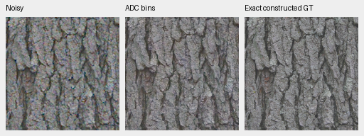
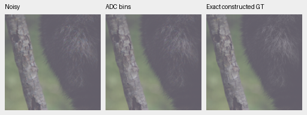

# Experimental consistency with calibrated ADC bins

**Respecting quantization intervals gives a small useful zero-noise tradeoff
on retained outputs. Broader validation is still running.** The opt-in
[helper](../src/demosaic/adc_bins.py) changes no checkpoint, model configuration
or default inference path. It cannot recover the noisy green fence: positive
shot/read inputs return the original prediction object, including12 actual
retained GFX/model checks across both protected families.

The [completed corpus20k review](full-corpus-control20k-review.md) prompted this
exploratory diagnostic after existing exact-sample Malvar correction worsened
its faint mean. This was not a prospectively declared part of that training
study. Targets are decoded only after the input-only operator, for scoring and
checking the known simulator contract. No learned/gain fitting is performed.

[All policies/scores](results/full-corpus-control20k-review-v1/adc-bin-scores.json) ·
[Independent NumPy codec/FFT/pixel audit](results/full-corpus-control20k-review-v1/adc-bin-independent-audit.json) ·
[Actual12-board viewing](results/full-corpus-control20k-review-v1/adc-bin-native-viewing.json) ·
[CPU/CUDA qualification](results/full-corpus-control20k-review-v1/adc-bin-GPU-qualification.json) ·
[Sources/failures/receipts](results/full-corpus-control20k-review-v1/publication.json).

## What the operator constrains

A zero-noise ADC code describes an interval, rather than an exact analog value.
Construct the exact representable float32 preimage of each code under the
declared **CPU** quantizer/decoder, preserving round-to-even ties and one-sided
clipped endpoint bins. Keep predictions already inside the interval; clamp
incompatible measured CFA predictions to its nearest value. Interpolate that
minimal residual with the existing WB-aware Malvar and restore measured values.

Bit depth, black level and simulator precision are required calibration data.
Historical faint inputs use CPU FP64 arithmetic; palette inputs use CPU FP32.
Packed values must exactly match that decoder. Arbitrary real RAW or a
different simulator is not silently assumed calibrated. Source tables are built
on CPU and copied to the processing device: an initial device-built version
failed GPU decoder equality because rounding differed. That failure/source and
the earlier analytic-bin prototype are preserved; reported numbers use corrected
exact CPU-code tables, including source-specific FP32 palette boundaries.

If the true measured value lies in the declared bin, its camera-space squared
error cannot increase under nearest-bin clamping. There is **no corresponding
guarantee for missing colors, rendered RGB or spatial detail**. Malvar can spread
error, and noise, calibration errors or mismatched arithmetic invalidate that
conditional argument. This helper is an experimental inference utility.

## All selected controls, gains and regressions

Same V120 EMA `a9d9b6b4f974e24a6b11e5e740aab32314233a7f53c056cf37c7d2aac1c589fb`
and corpus20k EMA `633053370bdfb455d738ce0e3af686cb61e8dcac7c501954eb3b2293738a3795`.
Four faint materials/all CFAs (16 inputs), two preselected flat colors/all CFAs
(8 inputs). Saved CPU FP32 outputs; no new neural/RAW/noise/training calls.

| Policy | Faint mean sRGB dB | Worst flat mean bias DN16 | Worst flat centered RMS DN16 |
| --- | ---: | ---: | ---: |
| V120 | 67.480669 | 15.0789 | 4.6402 |
| V120 +existing exact Malvar | 67.518889 | 4.1723 | 4.1643 |
| V120 +existing exact sites | 67.746379 | 9.1931 | 6.8461 |
| V120 +ADC bins/Malvar | 67.613831 | 3.8236 | 4.1495 |
| Corpus20k | 67.460059 | 13.6928 | 7.1299 |
| Corpus20k +existing exact Malvar | 67.424072 | 7.1397 | 6.5917 |
| Corpus20k +existing exact sites | 67.703020 | 10.2297 | 6.4967 |
| Corpus20k +ADC bins/Malvar | 67.517201 | 6.9350 | 6.5767 |

Exact-sites fitting gives a higher faint mean with higher selected flat spatial
error. Bins/Malvar improves selected V120 flat bias/RMS slightly over exact Malvar;
it does not dominate every policy/metric.

Against raw V120, bins/Malvar gains0.12711 dB bark/0.93694 fur but loses0.25698
wood/0.27443 grass. Its faint-target lowest-contrast fine-band RMS decreases for
all four: bark10.9719→10.1103, fur5.0662→3.6746, wood3.2179→2.7284 and
grass6.7759→6.7132 DN16. Existing exact Malvar also helps all four bands, with
slightly better fur/wood and slightly worse bark/grass than bins. A four-source
band improvement does not establish general weak-detail recovery or absence of
false detail.

## Actual native comparisons

All12 boards were viewed: four faint materials/two flat colors, both models,
raw/exact Malvar/exact sites/bin policies. Bark gains modest fine contrast; fur
remains soft. Wood grain is a little clearer, with residual chroma differences;
grass remains incomplete. Flats look uniform at8-bit display. Numeric color
claims rely on original unquantized tensors, rather than visible improvement.

Noisy Malvar → V120 plus ADC bins → exact constructed GT. Native160px cells,
ROI[48,48,160,160], shot/read0/0, ADC16/black0.03, CPU FP64 source codec,
exposure1. All methods use the same contrast20 display around linear0.18,
anchored to target-ROI channel means **for display only**; clipping is recorded.
No crop pixels are resized. Bark: Derek Ramsey, CC BY-SA2.5; fur: Korall, CC BY3.0.

PIXLS grass/wood comparisons use binned low-ISO references, not exact scene GT.
Both protected GFX outputs bypass identically; their actual noisy native reviews
remain in the [20k report](full-corpus-control20k-review.md).

## Verification and next coverage

Seventeen tests pass: exhaustive8/16-bit code boundaries and adjacent floats,
black0/0.03, both source precisions, all Bayer phases, censored endpoints,
rounding ties, measured-error nonincrease, idempotence and identity bypass.
Independent NumPy re-encoding verifies all48 actual corrected predictions and
target inclusion,128 metric/64 flat rows,12 native boards and four triplet subsets.
Every65,536-code CPU/CUDA table matches under both codecs; four actual output
comparisons are bit-exact, with zero module forwards and a2GiB process cap.
That is physical qualification under concurrent training, not a speed benchmark.

The [complete588-case color review](full-corpus-control20k-color-review.md)
now passes independent audit/native viewing:147 colors/all four CFAs,all eight
policies and4,704 metric rows. V120 bins improves worst bias13.554→13.039 DN16,
worst centered RMS15.150→15.137 and mean MSE2.15% versus exact Malvar. On20k,
mean MSE improves1.76% but worst bias/RMS worsen slightly versus exact Malvar.
The full grid also exposes raw20k bias765.656 DN16 versus V12055.525, missed by
the earlier two-color spot check; Malvar/bins repair most of it. These are
complete color results,not a general photo/detail score.

The [427-photo faint study](full427-faint-adc.md) is complete. It pools four
CFA observations per source and weights each source equally. Local band masks
come from the original images, and errors use the contrast-reduced exact targets.
Corpus20k's weakest-band RMS falls from 2.594 to 1.901 DN16 with ADC-bin
projection, effectively matching projected V120. All validation IDs are disjoint
from the current training set. The helper returns both standing positive-noise
GFX families unchanged. [Analysis implementation](../scripts/report_full_faint_photo_panel.py).
