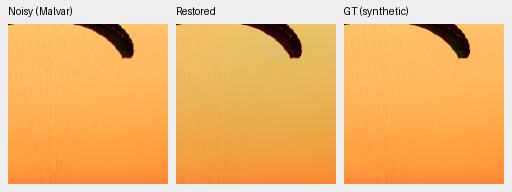
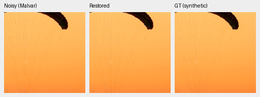
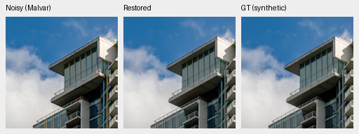
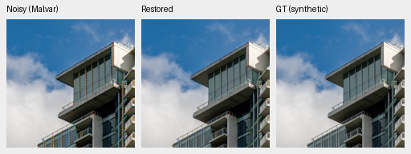
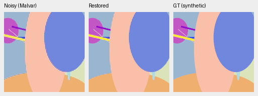

# ADC-only CFA consistency: full427 development check

The fixed correction improves ADC-only photo PSNR by **0.52882dB**
[0.45370,0.61337] and SSIM by0.003923 [0.003287,0.004589] across all427
photographs. It improves355 source means and worsens72; median+0.45716dB,
range−1.03402 to+10.99619. The full-sample gain is smaller than the initial
eight-photo mean. Procedural SSIM still decreases. **No promotion or real-noise
gain is established.** [Complete scores, source hashes and12 native triplets](results/adc-cfa-projection-full427.json).

| Method | Photo PSNR | Photo SSIM | Procedural PSNR | Procedural SSIM |
| --- | ---: | ---: | ---: | ---: |
| V43 step2000 parent | 34.35249 | .961586 | 31.01158 | .954794 |
| Parent + ADC-only correction | 34.88131 | .965510 | 32.43896 | .949675 |
| WB-aware Malvar | 29.92250 | .929354 | 27.88644 | .886672 |

Correction−parent procedural PSNR+1.42739dB [.01487,3.43409], SSIM−.005119
[−.013636,.001175]. Correction−Malvar photo+4.95880dB [4.83129,5.07863],
procedural+4.55252dB [3.92158,5.14377]. Intervals bootstrap evaluation sources;
they do not measure training-seed uncertainty. Photo chroma MAE slightly
worsens (.008812→.008884) even though photo PSNR/SSIM improve. Procedural
gradient MAE also worsens (.014116→.016200), consistent with an edge tradeoff.

For prediction P and fixed WB-aware Malvar operator K, apply
`P + K((y − mosaic(P))*valid)`. Only raw values strictly between1/65535 and
1−1/65535 contribute. Their measured RGB channels reproduce ADC observations
within1.49e−8; clipped/near-black measured channels retain P. Neighboring
unmeasured colors may change. This keeps the parent's component in the
nullspace of CFA sampling, uses no target or fitted parameters and does not
clamp HDR output. Colored interpolation artifacts remain possible.

This follow-up used the predeclared policy from the
[small CPU probe](adc-cfa-projection-probe.md), with no threshold/kernel sweep.
It ran only after the fresh-DINO GPU workflow exited successfully. Parent and
correction share each actual prediction and observation. Genuine V43 step2000
EMA `0d74cf31fb1c7e3f97fc692c855a2ca0ee3ebf562b454e4f8b135c28fc0aa5c5`,
CUDA FP16 CNN/IEEE FP32 physical operations, original8× validation, native256
patches, original batch companions, four CFAs,8px scoring border and all16
procedural sources give5316 cases (three methods). All are **ADC-only**, with
shot=read=0. ISO100 still has shot noise and is outside this claim. Seven-noise
condition, real paired and GFX checks are required for the optional integrated
inference export; existing checkpoint/README aliases stay unchanged.

Native160×160 pixels per panel, no resize: noisy Malvar → restored → exact
synthetic GT. Shared ROI[48,48,160,160], RGGB/ADC16/black.03, WB[2,1,1.5],
fixed camera matrix and display×1. Each PNG's noisy/reference bytes, source/ROI,
checkpoint/noise/display metadata and hash verify. PNGs are8-bit previews;
metrics use unquantized predictions. All12 triplets are recorded in the receipt.

The fabric correction reduces the selected yellow bias and retains strands.
On the building, interpolation colors remain around fine railing/window edges;
neither measured-site consistency nor a PSNR gain removes aliasing. The selected
procedural color field is repaired substantially, but boundary quality and
aggregate procedural SSIM still require attention.

Photo sources: [Roy Egloff](https://commons.wikimedia.org/wiki/File:CH.VD.Villeneuve_2007-08-25_Vertigo-Swiss-Riviera_2392_3x2-R_4K.jpg)
and [Dietmar Rabich](https://commons.wikimedia.org/wiki/File:Vancouver_(BC,_Canada),_Coal_Harbour_Seaside_Park,_Blick_in_den_Himmel_--_2022_--_2158.jpg),
[CC BY-SA4.0](https://creativecommons.org/licenses/by-sa/4.0/). Modified by binning,
crop, ADC quantization, reconstruction and rendering; previews retain that license.

The opt-in `model.adc_cfa_projection` flag defaults false and requires the
stabilized pretrained RGB backbone with explicit shot/read conditioning. It
selects each zero-noise image independently; positive shot or read bypasses the
correction regardless of variance-map values. The standalone probe and model
share the same physical operator. No new learned tensors or buffers are added.

[The V52 inference-only export](results/adc-projection-v52-export.json) copies
V43 step2000 EMA exactly, changes only this flag and performs zero training
updates. Sixteen targeted tests pass; the CPU suite passes387 with eight CUDA
checks skipped. Five additional export tests pass for exact EMA selection,
parent/hash/config preservation, no overwrite and unsupported-parent rejection.
These are separate invocations, not a claim that the enlarged full suite ran.

[Actual-weight CPU preflight](results/adc-projection-v52-cpu.json) checks all
four CFAs at two native shapes in FP32/BF16, scalar/mixed priors, exact noisy
prediction parity, exact agreement with the standalone correction, clipped-site
preservation, identical parent/export tensors and genuine pinned DINO weights.
Max nonclipped CFA error is5.96e−8; tiled native16-bit ramp error4.47e−8, with
more than256 sampled codes. CUDA was not initialized. GPU preflight, the full
suite and seven-condition/paired/full-GFX evaluation wait for the live matched
capacity continuation to finish and exit; no promotion follows before review.
