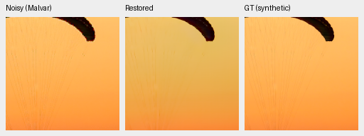
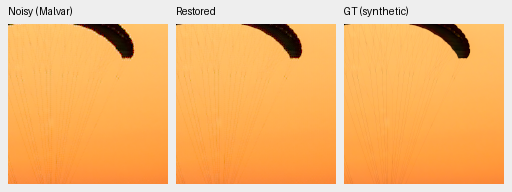
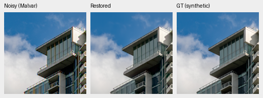
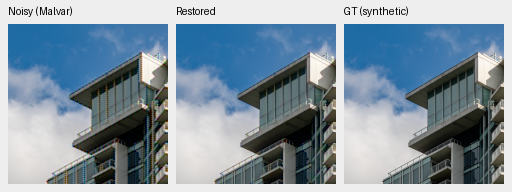
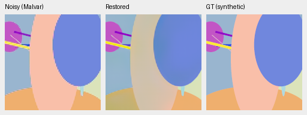
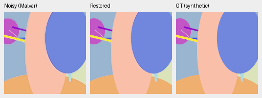

# ADC-only consistency: positive small probe, full check pending

An input-only correction improves the fixed eight-photo ADC-only development
sample by **1.74463dB**[.29822,4.42683] and SSIM by.004012. Across all16 procedural
sources, sRGB PSNR improves1.42705dB[.01476,3.43347], but SSIM falls.005121 with an
interval including zero. These are evaluation-source bootstrap intervals.
**This is not a promoted model, full427 result or real-noise improvement.**
[Measurements, source identities and eight native triplets](results/adc-cfa-projection-probe-v1.json).

For a prediction P, original CFA samples y, sampling operator A and fixed
WB-aware Malvar interpolation K, compute `P + K((y-A(P))*valid)`. Valid excludes
clipped/near-black samples. This restores measured nonclipped CFA values to
floating-point accuracy while retaining a learned correction at other RGB
positions. No target, fit, learned weight, window-size sweep or output clamp is
used. Clipped measured-channel predictions stay unchanged; neighboring RGB
interpolation can change. MHC interpolation can introduce colored edges/aliasing,
so consistency alone is insufficient evidence of better reconstruction.

The [standalone probe](../scripts/probe_adc_cfa_projection.py) accepts only the
protocol's ADC-only condition, shot=read=0. It is separate from production
inference and the live fresh-DINO training. No claim applies to ISO100 shot noise
or the real GFX scene. Real Poisson/read-noise inputs need denoising; enforcing
their samples exactly would inject noise. The earlier broad
[local-mean correction](cfa-mean-consistency-probe.md) remains rejected.

V1 runs the original V43 step2000 EMA on CPUFP32: first8 frozen protocol photos,
all16 procedural sources, four CFAs and192 cases across parent/correction.
Both methods reuse the same parent prediction and observations. It retains
original batch companions/generation seeds and8px scoring border. Maximum
valid-CFA error after correction is1.49e-8. This is not a bitwise replay of
GPUFP16 canonical scores. Malvar's aggregate scores were not included in V1;
the full follow-up adds that direct comparator before any selection.

Six targeted CPU tests pass for all four CFAs, data fidelity, clipped/near-black
measured sites, exact zero-residual identity without HDR clamping, native16-bit
code variation under autocast, and invalid shapes. They validate the operator,
not its full-image reconstruction quality.

Native160×160 triplets, noisy Malvar → restored → exact synthetic GT, without
resizing. Shared ROI[48,48,160,160], RGGB/ADC16/black.03, display×1, WB[2,1,1.5]
and fixed protocol camera matrix. Noisy/reference panel bytes, source/ROI/noise/
display metadata and PNG hashes verify equal between policies. PNGs are8-bit
previews; metrics use unquantized predictions. Both policies use checkpoint
`0d74cf31fb1c7e3f97fc692c855a2ca0ee3ebf562b454e4f8b135c28fc0aa5c5`.

Inspection finds more visible fabric strands and a large repair of the selected
pattern's color bias. Fine colored edges/aliasing remain, especially around the
building and procedural boundaries. The aggregate procedural SSIM tradeoff
requires attention; these examples are not a broad quality claim.

Photo sources: [Roy Egloff](https://commons.wikimedia.org/wiki/File:CH.VD.Villeneuve_2007-08-25_Vertigo-Swiss-Riviera_2392_3x2-R_4K.jpg)
and [Dietmar Rabich](https://commons.wikimedia.org/wiki/File:Vancouver_(BC,_Canada),_Coal_Harbour_Seaside_Park,_Blick_in_den_Himmel_--_2022_--_2158.jpg),
[CC BY-SA4.0](https://creativecommons.org/licenses/by-sa/4.0/). Modified by binning,
crop, ADC quantization, reconstruction and rendering; previews retain that license.

The next check covers all427 photographs and16 procedural sources, four CFAs,
GPUFP16 and5,316 cases across parent/projection/Malvar. It must wait for the
actual live fresh-DINO controller to finish and exit before using the GPU.
Neither the checkpoint/README aliases nor any training recipe change.
