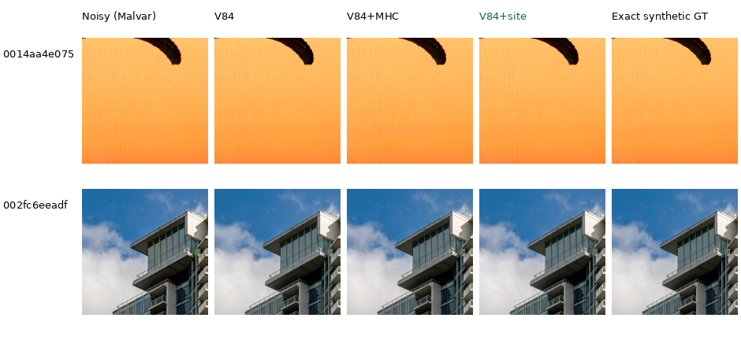
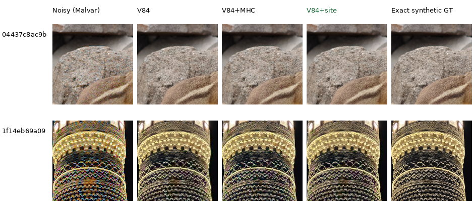
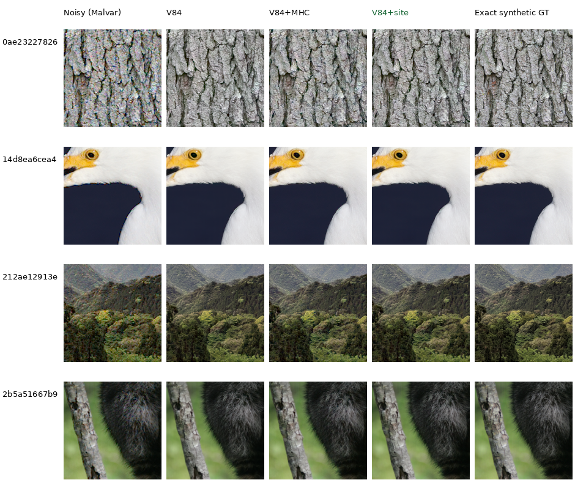

# ADC-only consistency on the current V84 model

**Use the optional observed-site correction for explicitly ADC-only inputs.**
With unchanged V84 weights it gains **.400 dB sRGB PSNR** on all427 validation
photos and all four CFAs. Every source average and all1,708 source/CFA cases
improve. Positive shot/read priors bypass it, so this is separate from real-RAW
denoising and the ongoing V100/V101 training work.

[Complete numerical audit, hashes and viewed native crops](results/v84-adc-sites-full427-v1.json).
The [earlier four-photo pilot and implementation receipt](results/v84-adc-sites-pilot-and-implementation-v1.json)
remains preserved.

## Complete ADC-only comparison

| Method, same V84 final20k weights | sRGB PSNR | Camera-linear PSNR | sRGB SSIM | Chroma MAE ↓ | Gradient MAE ↓ |
| --- | ---: | ---: | ---: | ---: | ---: |
| Original V84 | 36.65032 | 42.71406 | .975111 | .006912 | .010454 |
| V84 + Malvar correction | 36.85936 | **43.10438** | .975683 | .007114 | .010325 |
| **V84 + observed sites** | **37.05077** | 42.99844 | **.977432** | .006917 | **.010241** |

The site-only PSNR gain is+.40045dB, with a paired source-bootstrap95% interval
of[+.38733,+.41382]dB. Its source changes range from+.13238 to+1.06633dB.
Camera-linear PSNR also improves in all427 sources/all1,708 cases. SSIM improves
in424 sources and declines in3; gradient error improves in374 and worsens in53.
Chroma error improves in215 sources and worsens in212. Its small mean change,
+5.77e−6, has an interval spanning zero; localized color aliasing remains.
Highlight-boundary RGB error improves for all295 applicable sources/all1,180
cases, while highlight chroma still has mixed individual changes.

Malvar has the highest camera-linear PSNR, but lower rendered PSNR/SSIM than
sites, a larger chroma increase, and94 sources with rendered-PSNR regressions.
The site mode preserves every unmeasured channel, which avoids those interpolated
residual changes. These measured tradeoffs support the ADC-only recommendation;
they do not establish a noisy real-camera improvement.

This complete CPUF32 run uses native256 contexts from the existing8×-binned
linear-sRGB caches, the240×240 interior,
427 sources, four CFAs and three methods:5,124 score rows. It uses one original
neural prediction per observation and two fixed operators, with no target
fitting or training. All means/counts independently reproduce within1e−10;
intervals use10,000 source resamples, seed42. Source intervals do not measure
training-seed uncertainty. **This is not the original seven-condition CUDA
photographic mean** in the current model table.
All methods share WB=[2,1,1.5], the camera-to-sRGB matrix in the bound
[evaluation protocol](../configs/evaluation.yaml), and display exposure ×1.

## Native comparisons

The first two validation sources were fixed before this comparison. These show
subtle gains in fine fabric cords, with close building outputs:



[Six native triplets and common settings](images/adc-consistency/full427/manifest.json).

The next examples were selected **after scoring**: the smallest source-mean
PSNR gain, and a separate source with the largest chroma-error increase. Their
selected CFA cases still gain+.122dB and+.646dB respectively. The minaret's
repeating bands retain some color aliasing, stronger with Malvar than sites;
GT is more neutral. Rock/fur texture remains close and softer than GT.



[Six native triplets, selection and ROI metadata](images/adc-consistency/adverse/manifest.json).
The CFA is chosen by the corresponding case change; the native160 ROI maximizes
the signed error increase inside the scored240 interior. Coordinates are
[8,8,160,160] for the squirrel and[50,88,160,160] for the minaret. Every method
uses the exact same ROI, observation and display. These are targeted tradeoff
views, not additional randomly selected benchmark examples. Original partner
batches were rerun; all six sets of metrics reproduce exactly.

## Natural-detail examples



Every cell is an unchanged **160×160 native-pixel crop**. Open the PNG at 100%;
a browser may fit the whole board to its window. The
[12 source triplets and metadata](images/adc-consistency/manifest.json) record
source attribution, full checkpoint hash, common coordinates, noise and display.
All methods share identical noisy and exact synthetic GT pixels.

| Detail | V84 sRGB PSNR | V84 + Malvar | V84 + sites | Sites change, dB |
| --- | ---: | ---: | ---: | ---: |
| Pale bark | 34.603 | 34.223 | 35.007 | +.405 |
| White feathers | 41.826 | 42.232 | 42.302 | +.476 |
| Forest canopy | 36.436 | 36.289 | 36.728 | +.293 |
| Gray fur | 42.055 | 42.110 | 42.320 | +.265 |

In this earlier four-source subset, site-only SSIM and gradient error improve
in all four; chroma error worsens in three. Malvar's subset mean PSNR change
is−.016dB, whereas its complete427-source change is+.209dB. The native outputs look close, and
bark/canopy remain softer than GT. This is a useful numerical gain with a color
tradeoff, not a demonstrated large visual improvement or a real-camera gain.

The four contexts were selected by viewing clean inputs before these outputs;
this correction was investigated afterward. They are the same sources and
observations as the [natural-detail gallery](heldout-detail.md), with RGGB,
shot=read=0, WB=[2,1,1.5], the shared camera matrix and display exposure ×1.
Context size is256; numerical ROI is[8,8,240,240], display ROI[48,48,160,160].
Scores use unquantized FP32 camera RGB rendered to sRGB. This condition includes
ADC quantization and demosaicing, with no simulated shot/read noise.

Four constant gray/magenta counterchecks show small spatial-uniformity tradeoffs.
The maximum channel's centered192×192 RMS, in normalized16-bit camera-RGB codes:

| Flat target | V84 | Malvar | Sites |
| --- | ---: | ---: | ---: |
| Gray .02 | .139 | .121 | .177 |
| Magenta .02 | .714 | .400 | 2.063 |
| Gray .18 | 1.520 | .866 | 1.324 |
| Magenta .18 | 3.403 | 2.888 | 3.199 |

These are normalized16-bit units, not the camera's14-bit ADC units. Ordinary
RGB8 previews look flat. Centered RMS measures spatial variation; it does not
establish a periodic CFA-grid artifact. Flat previews use ×4 at level.02 and ×1
at level.18, identically across methods.

## Implementation and use

`model.adc_cfa_projection` remains false by default. When enabled,
`model.adc_cfa_projection_mode` selects `malvar` (the backward-compatible
default) or `sites`. The site mode directly writes measured RGB values for
packed observations strictly between1/65535 and1−1/65535. Every other FP32
channel, including censored near-black/clipped sites, remains bit-identical.
It uses no target, fitted gain or output clamp and changes no learned tensors.

The model activates either operator **only for explicitly supplied shot=read=0**.
Any positive shot or read prior bypasses it, including mixed-profile batches.
It therefore does not improve the noisy ISO6400 GFX test or substitute for the
current reduced-blur/fine-detail training work. Real captures retain their
measured/estimated positive-noise conditioning.

Export a separate optional checkpoint from V84's final EMA:

```bash
source scripts/env.sh
uv run --no-sync python scripts/export_adc_cfa_projection.py \
  /mnt/external/demosaic/models/v84-original20000.pt \
  --expected-sha256 134887e12357aabf420cceee3ee53fc8832cf02a8f81ff883b829a9e51e16f10 \
  --mode sites --output /mnt/external/demosaic/V84-ADC-sites-new-export
```

The exporter refuses an existing output directory. The current generated
checkpoint is `/mnt/external/demosaic/V84-ADC-sites-export-20261022-v1/model.pt`,
SHA256 `c129262a40faf76c1acc236697eaf1dd7d12a0ee62603c2c47cccbe99cdd9da9`.
Its91 learned tensors independently match the original V84 EMA bit for bit;
only the serialized inference policy changes. The gallery above uses the
original checkpoint plus postprocessing. Actual exported-model inference
reproduces all four site scores and native PNGs exactly. All12 original V84
scores/PNGs also reproduce, and eight positive-noise outputs bypass bit-exactly.

Focused projection/export tests:31 passed. Related RGB, stabilization,
packing, inference and checkpoint tests:66 passed. Tests cover all four CFAs,
shared/per-image CFA indices, censored endpoints, exact channel values and
gradients, FP32 under CPU BF16 autocast, mixed noise profiles, older checkpoints
and mode round trips. Ruff passed for the six changed code/test files.
Active training/evaluation copies remain unchanged.

## Scope and credits

The completed full427 plan is
`.cache/current-quality-20261022-v1/V84-ADC-full427-CPU-v1/plan.json`.
The [current model table](current-model.md) retains its original seven-condition
values. The original V84 checkpoint remains the training initializer; the
optional export changes only inference policy. Full-frame speed and real-RAW
quality remain checkpoint/protocol-specific.

The two preselected sources are by Roy Egloff and Dietmar Rabich, both
[CC BY-SA4.0](https://creativecommons.org/licenses/by-sa/4.0). The squirrel is by
[Dllu](https://commons.wikimedia.org/wiki/File:Golden-Mantled_Ground_Squirrel,_Mount_Rainier,_June_2015.jpg),
CC BY-SA4.0; the minaret is by
[Bgag](https://commons.wikimedia.org/wiki/File:Kalan_Minaret_04.jpg),
[CC0](https://creativecommons.org/publicdomain/zero/1.0/). Their triplet sidecars
link each original source and license.

Sources and licenses are the same as the [natural-detail credits](heldout-detail.md#image-credits):
bark ©2007 Derek Ramsey (Ram-Man), CC BY-SA2.5; snowy egret by Serebit,
CC BY-SA4.0; Yakushima forest by Grendelkhan, CC BY-SA4.0; raccoon by Korall,
CC BY3.0. Triplet sidecars preserve full source URLs and license URLs. Modifications
include binning, cropping, simulated observation and restoration.
