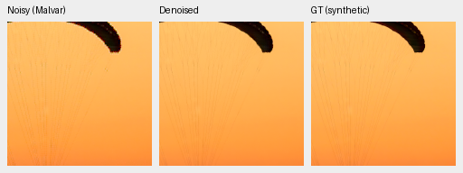
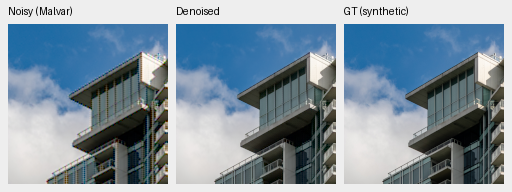
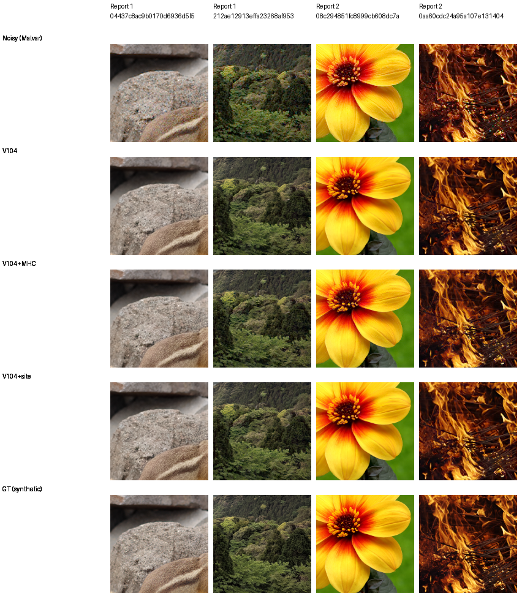

# ADC-only sample consistency

**The optional V104 observed-site export improves ADC-only photographic
restoration with unchanged learned weights.** On all 427 validation photos and
four CFAs, sRGB PSNR rises **37.39257→37.68106dB**, a **+.28850dB** gain.
All 427 source means and all 1,708 source/CFA cases improve. The source-bootstrap
95% interval is [+.27658,+.30072]dB. The ordinary V104 checkpoint remains the
positive-noise/training baseline; this is an inference-only output policy.

[Complete scores, actual native review and serialized-export evidence](results/v104-adc-sites-full427-v1.json).
The [color/texture diagnostics](v104-adc-color-projection.md) retain meaningful
tradeoffs: sites leaves a larger flat-color tail than Malvar or unprojected
V102, and local photographic chroma/SSIM changes remain mixed.

## Complete photographic comparison

| Same V104 final20k weights | sRGB PSNR | Camera-linear PSNR | sRGB SSIM | Chroma MAE ↓ | Gradient MAE ↓ |
| --- | ---: | ---: | ---: | ---: | ---: |
| Original V104 | 37.39257 | 43.43382 | 0.978483 | 0.006478 | 0.009611 |
| V104 + Malvar residual | 37.62565 | 43.72550 | 0.978711 | 0.006507 | 0.009551 |
| V104 + observed sites | 37.68106 | 43.62004 | 0.979906 | 0.006449 | 0.009490 |

Sites gains camera-linear PSNR in every source/CFA case. SSIM improves in 424
sources and declines in 3; chroma MAE improves in 255 and worsens in 172; gradient
MAE improves in 367 and worsens in 60. Mean chroma and gradient changes favor
sites, with source intervals below zero. Highlight-boundary RGB error improves
in all 295 applicable sources/all 1,180 cases; highlight chroma remains mixed.

Malvar has higher camera-linear PSNR and repairs the flat-color tail more
strongly. Its mean rendered gain is +.23308 dB, [+.20784,+.25824], with 379 improved
and 48 worsened photographic sources. Its worst source change is −.79778dB,
and mean chroma error increases. These measured tradeoffs favor sites as the
optional photographic policy, while retaining Malvar as a useful comparator.

The comparison uses native 256 contexts, scored 240 interiors, ADC quantization
without simulated shot/read noise, one fixed V104 prediction per observation
shared by all three policies, CPU IEEE FP32 and batch 2. It contains 5,124 score
rows and 856 batched neural forwards. All means/counts were independently
rebuilt; intervals use 10,000 source resamples, seed 42. They describe source
variation rather than training-seed uncertainty. This is **one noise condition**,
not a newly measured seven-condition mean, real-camera result or speed claim.

All 1,708 original V104 ADC keys agree numerically with the earlier CUDA study.
Maximum rendered-PSNR difference is .0001984dB, with mean −1.743e-6dB; each policy
contrast uses the new matched CPU output. Original full-panel scores remain
unchanged.

## Two native export triplets

Noisy Malvar → **actual serialized V104 sites export** → exact synthetic GT.
The first two validation sources were fixed before the complete comparison.
Every panel is an unchanged 160×160 crop at[48,48,160,160] inside the original 256
context. Shared WB=[2,1,1.5], the bound evaluation camera matrix and display
exposure ×1 apply to all methods. No resizing, sharpening or target fitting.





The actual export replays the original first batch's two sites-policy float
predictions and PNG bytes exactly. These are verified deployment examples,
separate from the manually postprocessed predictions used for the full study.
[Export checkpoint/source/ROI/noise/display metadata](images/v104-adc-consistency/export/manifest.json) ·
[Original/Malvar/sites fixed-source board](images/v104-adc-consistency/first-two-sources.png).

Sites preserves useful fine cords and architectural edges, with small native
visual changes. The original outputs already retain most of this structure;
the numerical gain is not a demonstrated large real-camera improvement.
Source attribution and licensing are retained in each source record.
The two examples derive from Roy Egloff's
[Villeneuve photograph](https://commons.wikimedia.org/wiki/File:CH.VD.Villeneuve_2007-08-25_Vertigo-Swiss-Riviera_2392_3x2-R_4K.jpg)
and Dietmar Rabich's
[Vancouver photograph](https://commons.wikimedia.org/wiki/File:Vancouver_%28BC%2C_Canada%29%2C_Coal_Harbour_Seaside_Park%2C_Blick_in_den_Himmel_--_2022_--_2158.jpg),
both [CC BY-SA 4.0](https://creativecommons.org/licenses/by-sa/4.0).
The displayed derivatives are binned, simulated, restored and cropped.

## Adverse examples

The first two columns below are sites' smallest source-mean PSNR gain and a
separate source with its largest chroma increase. The next two are Malvar's
worst source-mean PSNR change and a separate largest-chroma-increase case.
Sources, CFAs and display ROIs are selected **post hoc**, with the native 160
window maximizing the corresponding signed error increase inside the scored
interior. Every method uses the identical observation, window and transform.



[Sites adverse selection and six triplets](images/v104-adc-consistency/adverse-sites/manifest.json) ·
[Malvar adverse selection and six triplets](images/v104-adc-consistency/adverse-Malvar/manifest.json).

The sites cases still gain PSNR, but fine rock/forest structures stay soft and
local color differences remain. Malvar changes flower/fine-fiber contrast and
color more strongly; the selected flower's score regresses. All 30 distinct
benchmark cells were viewed natively. Exact original partner-batch reruns
reproduce all selected case scores, including both operators on every case.

## Use the optional export

Checkpoint: `/mnt/external/demosaic/models/v104-final20000-adc-sites.pt`.
SHA256: `1d9c02be5876515811fb4067ba84fc666538dbe9024c85ff0cffc478310fc85a`.
Its 91 restoration tensors exactly equal the original V104 final EMA; the
encoder remains the official frozen pinned DINOv3 ConvNeXt-Tiny. There are
zero additional training updates and no optimizer state in this inference
export. The original V104 checkpoint and active training recipes retain their
bytes.

```bash
source scripts/env.sh
uv run demosaic infer \
  /mnt/external/demosaic/models/v104-final20000-adc-sites.pt input.raf \
  /mnt/external/demosaic/output/adc-linear.tiff \
  --shot 0 --read 0 --precision float32
```

Projection activates **only for explicit shot=read=0 profiles**. Positive shot
or read values bypass it, so ordinary noisy RAWs should retain suitable physical
priors. The operator writes valid measured CFA values into their observed RGB
channels and retains every other predicted channel exactly, including censored
near-black/clipped measured sites. Valid samples lie strictly between 1/65535
and 1−1/65535. It uses no target, fitted gain or output clamp.

The actual serialized export passes eight CPU FP32 profile/shape checks across
all four CFAs, including mixed ADC/positive-noise batches and censored samples.
Valid ADC-site error is exactly zero; a blended native 16-bit ramp, including
an incomplete final tile batch, has maximum error 4.47e-8 and retains more than
256 code values. Twelve actual native 256 DINO forwards also match four external
ADC-sites predictions and eight original positive-noise predictions byte-for-byte.

The preflight helper now validates the selected mode rather than assuming
Malvar, and labels CPU precision as the FP32 actually exercised. Both policy
exports pass the integration/regression tests. [Preserved validation sources](results/v104-adc-validation-sources-v1.json).

## Remaining tradeoffs

On the separate 588-case analytic ADC color grid, sites reduces V104's worst
channel-mean bias 1,218.06→610.67 DN16. Malvar reaches 31.91 DN16; unprojected V102
has 59.23 DN16. Thus sites is not the lowest-bias choice for uniform saturated
fields. On 48 tested ADC carrier/CFA cases, sites improves RGB RMSE in all 48;
Malvar improves 39 and regresses 9. These are complementary diagnostics rather
than independent photographs. [Color/texture results and native counterexample](v104-adc-color-projection.md).

Keep the original V104 for current positive-noise restoration/training, and
consider V102 when lower unprojected flat-color bias or its higher unseen-camera
mean matters. The current model selector does not switch checkpoints by noise.
[Current choices](current-model.md) · [Earlier completed V84 study](v84-adc-consistency-study.md).
