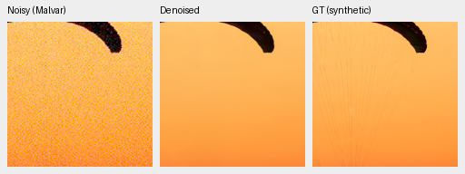
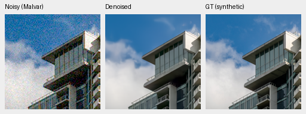
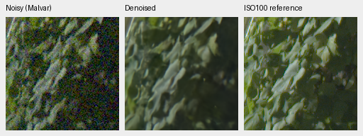
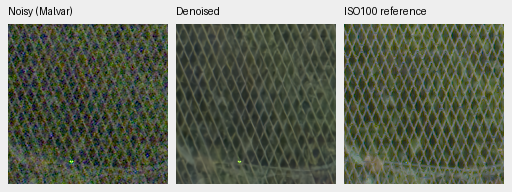

# Opt-in ADC-only export: complete seven-condition and real-photo review

The unchanged-weight V52 export gains **.075545dB photo PSNR** across the full
seven-condition protocol, entirely from the declared ADC-only condition.
**Positive-noise outputs remain exact**, including real paired metrics and all
full GFX RGB16 pixels. Procedural SSIM decreases slightly. Keep the policy
opt-in; the default flag and retained real-photo checkpoint stay unchanged.
[Complete results, source hashes and40 verified native triplets](results/adc-projection-v52-review.json).

| Model | 427-photo PSNR | SSIM | 16-procedural PSNR | SSIM |
| --- | ---: | ---: | ---: | ---: |
| V43 step2000 | 34.899343 | 0.957126 | 33.285375 | 0.966604 |
| V52 ADC-only export | 34.974889 | 0.957687 | 33.489297 | 0.965873 |

Export−parent photo PSNR +0.075545 [+0.064814, +0.087623]dB,
SSIM +0.000560 [+0.000470, +0.000655]; procedural PSNR
+0.203922 [+0.002131, +0.490592]dB, SSIM
-0.000731 [-0.001948, +0.000168]. Intervals bootstrap evaluation sources,
not training seeds. The standalone [ADC-only full427 check](adc-cfa-projection-full427.md)
records the predeclared operator and native examples: photo+.52882dB/
SSIM+.003923, procedural+1.42739dB/SSIM−.005119 at that condition alone.
Those examples use the same parent weights and explicit post-operation; the
canonical export crops below come directly from this all-condition evaluation.

The original V43 step2000 EMA is copied byte-exact at the tensor level;
no training updates, adapters or new learned parameters. Only
`model.adc_cfa_projection=true` changes. Export SHA256
`e1e0cb4c324c8814475d980cc670fa57f9ddec611a4ce7a4d6d523eac7285120`; parent
`0d74cf31fb1c7e3f97fc692c855a2ca0ee3ebf562b454e4f8b135c28fc0aa5c5`.
It applies `P+MHC((y-mosaic(P))*valid)` only to images explicitly conditioned on
shot=read=0. Nonclipped samples are anchored; clipped/near-black measured
channels retain the prediction, with neighboring interpolated RGB free to
change. There is no target fitting or HDR clamp. Ordinary ISO100/6400 captures
have positive noise and must retain their actual supplied priors.

The noisy-condition crops retain the current fine-detail limits: fabric strands
and leaf texture remain soft. This conditional policy supplies no improvement
to those positive-noise examples.

The frozenbf665d4 GPU workflow ran400 tests (46.18s), then genuine-weight
all-CFA/precision/mixed-profile/tiled preflight. All10,632 positive-noise synthetic
model-case metrics match exactly; all162 real paired crop metrics match.
Known/unseen measured-CFA means stay54.233322/53.806059dB.
All parent/export noisy-condition native prediction panels match byte-for-byte.
Eight complete8746×11662×3 RGB16 TIFFs verify SHA/size/dtype/tags and>256 sampled
codes; sRGB files carry ICC. Both parent/export linear16 and sRGB16 GFX arrays
match at every pixel. Protected-final scoring remains closed.

## Native crops

Native160×160 per panel, no resizing. Noisy Malvar → restored → exact synthetic
GT for two frozen photographs. Shared ROI[48,48,160,160], RGGB/ISO12800 prior
shot=.00256/read=.0000262144, WB[2,1,1.5], fixed matrix, display×1. The export
bypasses at this positive prior, so the restored panels are identical. PNGs are
8-bit previews; scores use unquantized predictions.

Full102MP GFX DSCF3879 ISO6400 → restored → separate DSCF3880 ISO100 f/5.6.
Shared+2EV/input-only shot=.0014635775921166604/read=.0000010715704128646712;
foliage[8890,5570,160,160], fence[2240,6000,160,160] (reference x2241).
Time, optics and subjects differ; the right panel is a qualitative reference,
**not GT**. No reference gain fitting or pixelwise GFX reference score.

### Exact synthetic GT: 0014aa4e

### Exact synthetic GT: 002fc6ee

### Separate ISO100 qualitative reference: foliage

### Separate ISO100 qualitative reference: chain-link-fence

Sources: Roy Egloff and Dietmar Rabich, [photographic source links and
CC BY-SA4 attribution](adc-cfa-projection-full427.md); modified by binning,
crop, noise simulation, reconstruction and rendering. Paired sources:
Benoit Brummer/Christophe De Vleeschouwer, [RawNIND](https://doi.org/10.14428/DVN/DEQCIM)
and individual grants in receipts. GFX by the project owner. No broad real-noise
improvement, SOTA or10-second throughput follows from this conditional policy.
