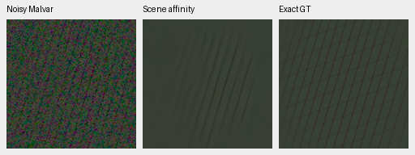
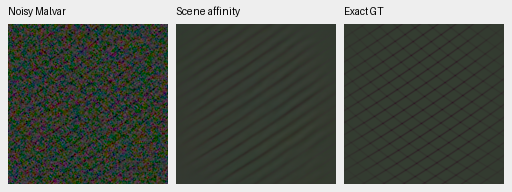
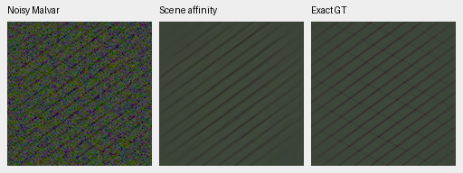
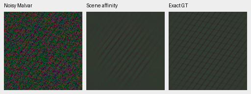
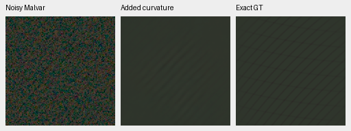
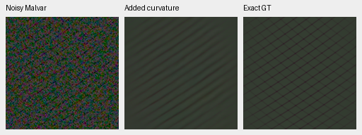

# Choosing RAW donors by appearance before fitting detail

Selecting by appearance raises the intended-pair count from 9 to 75
of 96 on the original synthetic composite panel. At the same fixed
delivery scale, ISO400 far weak-wire response rises from **4.91% to
6.43%** over context-weighted spectral ranking. At the common quiet
limit the improvement is from **1.48% to 1.57%**. On camera, one
left-cab pair fails donor validation and the saved fallback brings
back visible diagonal modulation. Fine crossings remain unresolved.

The [localized donor follow-up](localized-donor-validation.md) tests
smaller windows and a two-boundary check. Returning to V120 when
validation fails removes the diagonal banding.

## Selection and validation

Candidates use the same RAW spectra, bracketing constraints, spatial
affinities and query measurements as the
[whole-frame ranking comparison](screened-scene-donors.md). The two
appearance-first arms rank spectrally compatible pairs by the weaker
of the two donor affinities. The top pair is fixed before confirming
its proposed frequencies on reserved donor RAW. No alternative pair
is tried after looking at confirmation samples. The query's two
reserved RAW folds determine local phase, amplitude, color and
support with the same phase-fit and refit policy as the weighted arm.
Final coefficient refitting follows the evidence checks.

The matched replay uses V143 EMA for the exact-target synthetics
and V120 EMA for both GFX families. Scene affinities come from the
saved A-only whole-frame run and DINOv3 ConvNeXt-Small revision
`421020015aa4266363db803b6049a529999afb1e`. Near affinities use
that run's corresponding preview with distant pixels replaced.
No new neural forwards were needed in the retained replay. Fits
with exactly matching guide geometry reused the corresponding
saved linear prediction at the same setting.

## Retained composite comparison

The 32 retained query fields supply 96 role-specific observations.
This panel motivated the rank change. Both appearance-first arms
choose the same pair for each observation and produce identical
synthetic arrays. The underlying references have distinct colors
on the two bracket types with strong rotated distractor wires.

| Ranking rule | Intended pair, all roles | Intended pair, two wire families |
| --- | ---: | ---: |
| Spectral | 0/96 | 0/32 |
| Full-frame weighted spectral | 9/96 | 3/32 |
| Near or full-frame appearance first | 75/96 | 25/32 |

Each cell gives weak-response percentage and weak-increment RMS
in linear DN16 at the common observed quiet limit. The scale is
capped at the tighter frozen setting for each noise and placement.

| Setting | Guarded guide | Spectral | Weighted context | Appearance first | Quiet limit, DN16 |
| --- | ---: | ---: | ---: | ---: | ---: |
| ISO400 far | 1.69% / 11.2318 | 1.15% / 11.2363 | 1.48% / 11.2325 | 1.57% / 11.2323 | 2.33655 |
| ISO400 near | 2.69% / 14.1247 | 2.17% / 14.1276 | 2.88% / 14.1231 | 3.21% / 14.1228 | 6.31621 |
| ISO6400 far | 1.31% / 22.9391 | 1.31% / 22.9392 | 1.35% / 22.9389 | 1.31% / 22.9391 | 6.40634 |
| ISO6400 near | 2.97% / 30.2402 | 2.89% / 30.2378 | 2.89% / 30.2378 | 2.90% / 30.2397 | 14.96980 |

At the fixed ISO400 far scale of 0.82212, the appearance-first
arm gives weak-increment RMS 11.20229 DN16 and quiet RMS 2.34016.
Weighted context gives 11.20586 and 2.33840 respectively.
The guarded guide reaches 8.81% weak response and 2.34372 quiet RMS
at this scale. At ISO6400 far, the gain in fixed-scale response comes
with higher quiet and increment error than weighted context.

Pair correctness and carrier correctness differ. In the 25 two-family
queries where the intended pair is chosen, 17 deliver a guide within
one native frequency bin of the weak family and 12 reach both families.
All eight selected straight cases reach both. In all eight selected
curved cases the weak family remains more than 21 bins away even with
the existing held-out curvature refit. That refit can improve the
strong family and cannot introduce a missing screened orientation.
[Geometry audit](results/affinity-first-donors-v1/geometry-audit.json) ·
[Curvature diagnostic](results/affinity-first-donors-v1/curvature-diagnostic.json).

### Native synthetic crops

Sources 81 and 85 use BGGR, native ROI `[176,176,160,160]`,
shot/read `8e-5 / 2.56e-8`, exposure ×2 and contrast ×5 around
the target mean. The middle cells use threshold 2 and fixed scale
0.82212 above V143 EMA
`96d146d017c54196288c585f8b7eddcf030e8a235061049c31e985b9380b7ce4`.
The dominant family remains visible and the weakest crossings still drop out.

[Source 81 comparison](images/affinity-first-donors-v1/iso400-source81-far-BGGR-comparison.png) ·
[Source 85 comparison](images/affinity-first-donors-v1/iso400-source85-far-BGGR-comparison.png).

## Fresh fields with a same-paint control

Eight source recipes 88–95, disjoint from the retained selection panel,
supply 16 far-edge fields at ISO400 and ISO6400. The correct bracket
covers both horizontal and vertical placement. Four recipes give the
distractors the same base color and luminance as the intended donors.
Four give them distinct color. The distractor wires are rotated and
stronger in both groups.
All arms use the same new RAW draws, and unsupported queries return
V143 EMA. The V143 parent runs in CUDA IEEE FP32. Scene features and
analytic validation run on CPU. Collection takes 276.04 seconds,
including 24.20 seconds for parent forwards and transfers.

With both wire families in the query, spectral and weighted ranking
choose the distractor in all 16 fields. Near affinity chooses the
intended pair in five of eight ISO400 cases and three of eight
ISO6400 cases. Full-frame affinity reaches six of eight and two of
eight respectively. At ISO400, the full-frame rank gets three of
four right in both paint groups.

| ISO400 far subset | V143 weak response | Near affinity | Full-frame affinity | Full-frame weak-increment RMS |
| --- | ---: | ---: | ---: | ---: |
| All, common quiet limit | 0.89% | 1.35% | 0.91% | 11.2018 DN16 |
| Distinct paint, common quiet limit | 1.60% | 5.07% | 5.07% | 10.8054 DN16 |
| Same paint, common quiet limit | 0.18% | 0.18% | 0.18% | 11.5592 DN16 |

At the fixed scale, full-frame affinity raises all-source ISO400
response from 0.89% to 7.82%, with higher quiet and increment error
than V143. Near affinity reaches 5.15% with lower increment RMS and
less added quiet error. On the distinct-paint subset at the common
quiet limit, both context arms lower weak-increment RMS from
10.8331 to 10.8054 DN16. The same-paint cases give essentially no
gain at that limit despite three correct full-frame brackets.
ISO6400 responses stay below 0.71% across the full panel at matched
quiet error. These eight synthetic recipes test a specific ambiguity
with two coherent pairs and one weak query.

The fresh native crops use the same 160×160 coordinates, exposure,
contrast, V143 checkpoint and ISO400 noise settings as the retained
triplets. Source 88 uses RGGB and source 89 uses BGGR. The weak
families remain soft in both boards.

[Fresh measurements](results/affinity-first-fresh-v3/summary.json) ·
[Fresh input and execution evidence](results/affinity-first-fresh-v3/publication.json).

## Native camera comparison

All evaluated ranks leave the overcast sky bit for bit identical to V120.
Whole-frame appearance-first retains the coarse lattice and the
coarse-fence crop matches V120 exactly in linear RGB. Foliage and
building hardware remain soft. Under the transferred profile in the
left cab crop, the most compatible bracket includes visible mesh on
both sides. The earlier weighted bracket included a train-body
patch. The new pair fails donor verification at the frequencies
selected from its mixed mesh, foliage and rail patches.
The cross-checked fallback returns the previously visible diagonal
banding, a 7.21 DN16 RMS correction from V120. The nominal left
correction is 0.71 DN16 from V120 and leaves the fine mesh largely
absent. Both right crops retain their weak or partly erased diagonals,
with incomplete crossings and no clear new colored grid.

Camera replays compose with V120 EMA checkpoint
`a9d9b6b4f974e24a6b11e5e740aab32314233a7f53c056cf37c7d2aac1c589fb`.
The main display uses exposure ×4 and the cab uses ×16.
Main and nominal noise are shot/read `0.00128 / 6.5536e-6`.
The profile transferred from DSCF3879 uses
`0.0014635775921166604 / 1.0715704128646712e-6`.
Each cell retains the original 160×160 pixels. The separate ISO100
AHD references and two cab JPEGs are used qualitatively. The
reference exposures include different apertures and moving subjects.
[Native coordinates and full provenance](images/affinity-first-donors-v1/manifest.json).

[Sky](images/affinity-first-donors-v1/main-overcast-sky.png) ·
[Building](images/affinity-first-donors-v1/main-building-detail.png) ·
[Foliage](images/affinity-first-donors-v1/main-foliage.png) ·
[Coarse fence](images/affinity-first-donors-v1/main-chain-link-fence.png) ·
[Cab left](images/affinity-first-donors-v1/mesh-nominal-left.png) ·
[Cab right](images/affinity-first-donors-v1/mesh-nominal-right.png) ·
[Transferred left](images/affinity-first-donors-v1/mesh-profile3879-left.png) ·
[Transferred right](images/affinity-first-donors-v1/mesh-profile3879-right.png) ·
[Selected donor neighborhoods](images/affinity-first-donors-v1/selected-neighborhoods.png).

The retained comparison took 144.40 seconds on CPU. The numerical
audit independently reduces 1,920 scores and verifies 120 exact
control arrays. Full427 and known/unseen PSNR panels are outside
this component study.
[Retained evidence](results/affinity-first-donors-v1/publication.json).

## Confirming a second direction with a changing angle

In the four source/noise combinations with the correct curved pair,
both complete A-only donor spectra contain peaks within 0.0013
cycles/pixel of the true weak-family gradient at their centers.
The same family changes angle by 31–37 degrees between the donors,
outside the original 25-degree matching limit. Two cases also exceed
the original frequency difference limit of 0.045 cycles/pixel.
[Screening diagnostic](results/affinity-first-donors-v1/segment-diagnostic.json).

The follow-up keeps the chosen pair and its verified first direction.
It allows a second candidate to differ by up to 45 degrees and
0.06 cycles/pixel across donors. The two reserved folds must agree on
shared curvature and beat separate donor planes before the query
receives that direction. It then goes through the same query-local
phase and support tests. These wider screening limits were chosen
after inspecting the retained cases.

The second direction passes donor confirmation on four of the eight
retained two-family curved queries with the intended bracket. At
matched quiet error the ISO6400 far curved subset moves from
**1.49% to 1.69%** weak response and **21.9555 to 21.9544 DN16**
increment RMS. The full ISO6400 far panel stays at 1.31% response.
Five retained prediction arrays differ, and the fresh comparison
changes only one one-family role by 0.020 DN16 over the 256-pixel
query. All eight camera outputs are byte-identical to the
appearance-first comparison above. Donor evidence can restore a
missing proposal, with query evidence still limiting delivery.
[Direct measurements and exact camera identity](results/curved-donor-rescue-v1/independent-audit.json).

Sources 83 and 85 use GBRG and BGGR respectively at ISO400. The
triplets retain native ROI `[176,176,160,160]`, shot/read
`8e-5 / 2.56e-8`, display exposure ×2, and contrast ×5.
The middle cells use threshold 2 and scale 0.82212 above the same V143
EMA. Source 83 has a confirmed second direction with little visible
delivery. Source 85 at ISO400 keeps the unexpanded result.

[Curvature replay evidence and native provenance](results/curved-donor-rescue-v1/publication.json).
