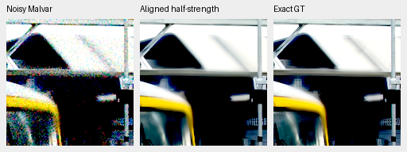
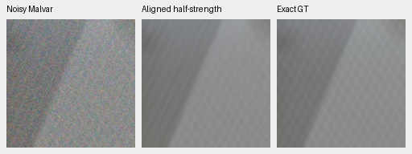

# Isolating the correction from aligned distant context

The [64-photo control](scene-50000-controlled.md#the-faintest-cases)
finds more fine response with aligned context than with a wrong view
in the faintest photos. This pilot adds only the resulting contextual
difference above Local 50k. The strict flat-region budgets select
zero correction. A relaxed fit transfers to 24 separate natural
photos with **+0.013 response points** and **−0.006 DN16**
fine-increment error. On 24 wire backgrounds, weak response falls
**0.131 points** and exact-flat RMS increases **0.045 DN16**. The
standing GFX cab crossings remain incomplete.

[Machine results](results/aligned-context-delta-v1/publication.json) ·
[Frozen evidence](results/aligned-context-delta-v1/evidence.tar.xz) ·
[Native provenance](images/aligned-context-delta-v1/manifest.json).

## Composition and calibration

The pilot uses the matched Local 50k and Spatial 50k EMAs in CUDA
IEEE FP32. For the same local RAW query, subtract the spatial
prediction made with the wrong distant view from the prediction
made with the correct view. Extract linear luminance, filter it
with a fixed radial passband, subtract the native mean and add it to
the local parent in the camera's neutral direction. The smooth
transitions run from 1/64 to 1/32 cycles/pixel at the low end and
from 0.30 to 3/8 at the high end. This keeps the weak fundamental
near the period observed in the fine green fence.
[Checkpoints and training](scene-50000-native.md#training-and-review-coverage) ·
[Fine frequency observation](innovation-frequency-selection.md).

The fit maximizes true fine response in the faintest 22 of the 64
previously reviewed ISO6400 independent-noise photos. It constrains
mean exact-flat RMS in all three bands and limits increases of
mean lower- and fine-band absolute and increment RMS to 0.05 DN16.
The contrast sign and the full spatial-minus-local difference are
controls. Every direction selects zero with the original local
flat budget. With up to 0.10 DN16 of exact-flat RMS increase
allowed, the aligned difference selects ×0.5 and raises faint
response by 0.186 points in calibration. The other directions still
select zero.

## Transfer to separate source photos

The 24 natural and 24 planted-wire sources are disjoint from the
64 calibration photos. The input-side alternative reverses the
original packed exterior while retaining the exact query samples.
It differs from the swapped photograph used in calibration. The
fixed gain applies to every source without consulting its target.

Against the Local 50k parent, the transfer changes natural
fine-increment RMS by −0.006 DN16 [−0.041, +0.031], exact-flat
fine RMS by −0.012 DN16 [−0.059, +0.017], and response by
+0.013 points [−0.032, +0.059]. Wire weak response falls 0.131
points [−0.220, −0.055], and exact-flat RMS increases 0.045 DN16
[0.012, 0.081]. Absolute error inside the twelve true gaps changes
−0.004 DN16, with an interval spanning zero. The half-strength
correction gives little measurable gain on the natural transfer
and makes the weak wires less distinct.

## Native exact-target triplets

Each crop is 160 × 160 at `[48,48,160,160]) inside its 256-pixel
query, using ISO6400 shot/read `0.00128/6.5536e-6`, capture exposure
×0.33, 16-bit ADC and black 0.03. The scene's faint detail stays
soft. The triplets show noisy Malvar, the half-strength composition
and exact GT.

**Reading railway station**, mattbuck, CC BY-SA 4.0. GRBG query
`[678,86,256,256]`, display ×3.03 and contrast ×2.
[Source](https://commons.wikimedia.org/wiki/File:Reading_railway_station_MMB_87_221137_165124.jpg).

**Hirvijoki wire fixture**, Makele-90, CC BY-SA 3.0. The GBRG query
`[128,128,256,256]` is inside the constructed scene from source
box `[188,162,512,512]`. Display ×2 and contrast ×1.
[Source](https://commons.wikimedia.org/wiki/File:Hirvijoki,_Lemu,_Myn%C3%A4m%C3%A4ki,_10.4.2010_(2).JPG).

## Standing GFX100S comparisons

At display ×4, the DSCF3879 sky stays smooth and the coarse chain
link stays coherent. The main-region output changes by 0.30–5.81
DN16 RGB RMS versus Local 50k, with soft building wires and foliage.
On the DSCF3842 cab at display ×16, the four crops change by
0.60–1.61 DN16 RGB RMS, with no visible recovery of the fine
intersections. Both noise profiles use the fixed camera settings
and both camera JPEGs alongside the independent ISO100 AHD reference.
The ISO100 and JPEG images are qualitative references.

[Sky](images/aligned-context-delta-v1/standing/main-overcast-sky-main-overcast-sky.png) ·
[Building](images/aligned-context-delta-v1/standing/main-building-detail-main-building-detail.png) ·
[Foliage](images/aligned-context-delta-v1/standing/main-foliage-main-foliage.png) ·
[Coarse fence](images/aligned-context-delta-v1/standing/main-chain-link-fence-main-chain-link-fence.png).

| Cab profile | Left native crop | Right native crop |
| --- | --- | --- |
| Nominal `0.00128/6.5536e-6` | [Left](images/aligned-context-delta-v1/standing/mesh-nominal-fine-green-mesh-left.png) | [Right](images/aligned-context-delta-v1/standing/mesh-nominal-fine-green-mesh-right.png) |
| Transferred `0.0014635775921166604/1.0715704128646712e-6` | [Left](images/aligned-context-delta-v1/standing/mesh-profile3879-fine-green-mesh-left.png) | [Right](images/aligned-context-delta-v1/standing/mesh-profile3879-fine-green-mesh-right.png) |

The composition runs the local model and two spatial forwards per query.
Its scope is exact faint-detail and qualitative GFX evidence. The fixed
photo and measured-camera scores in the history refer to the individual
trained models. [Performance history](performance-history.md).
