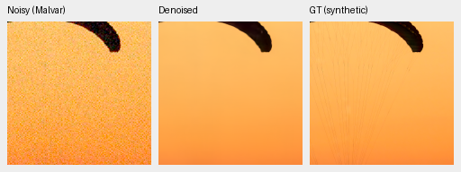
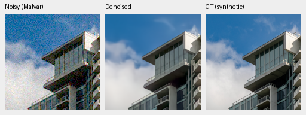
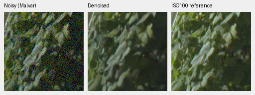
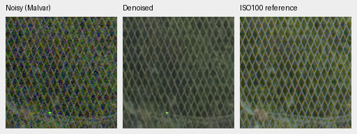

# V31: faster batches, mixed quality after continuation

V31 improves the 16-photo synthetic screen by **.26572 dB** over V30, but
measured-CFA PSNR falls by **.12152/.20939 dB** on known/unseen real development.
It stops at step2000 and does not replace V30 as the quality reference.
[Complete numerical/native-crop receipt](results/anchored-rgb-b16-v31-2k-review.json).

The model, AdamW state, EMA and RNG resume from V30 step1000, changing batch4
to batch16 while retaining LR/schedule, frozen8× data, model and proportions.
The additional1,000 updates process16,000 examples; global sample indices change
to batch16. This is not an equal-image or batch-only quality ablation. The
new pre-downsample pipeline was not used in this experiment.
Checkpoint SHA256:
`dc9c4b021cd2c81532c05a4b43eacef44ed7107fb1eaf565dc6d67718d079dbd`.

| Panel | Method | Measured-CFA PSNR | AHD RGB PSNR | AHD SSIM |
| --- | --- | ---: | ---: | ---: |
| Known4 | V30 step1000 | 54.25796 | 39.87232 | .929979 |
| Known4 | V31 step2000 | 54.13644 | 39.75234 | .929168 |
| Unseen5 | V30 step1000 | 53.75824 | 38.07829 | .915793 |
| Unseen5 | V31 step2000 | 53.54885 | 38.02844 | .914914 |

Known:8 pairs/72 crops; unseen:10 pairs/90 crops. Primary reference is registered
low-noise measured CFA. Auxiliary AHD is independently demosaiced RGB, **not exact
RGB GT**. Shared input-only noise estimates, source/coordinates and display.
V31−V30 primary scene-bootstrap95% intervals are [−.15678,−.08626] known and
[−.33510,−.07963] unseen. All real means in the table decline.

Photo PSNR/SSIM rises from34.81952/.957844 to**35.08524/.958737** on the same
16-photo screen; gain95% source-bootstrap interval[+.17773,+.35645]. Procedural
PSNR/SSIM rises32.57810/.968435→**33.00140/.971409**. Mean photo highlight-boundary
chroma error improves .0195073→.0179899. These are synthetic-noise results,
and they do not offset the real-camera regression. V31 has no full427 review.

Native160px noisy Malvar → V31 → exact synthetic GT, RGGB/ISO12800 nominal
prior (`shot=.00256`,`read=.0000262144`), ×1 display, WB[2,1,1.5] and the fixed
protocol matrix. ROI[48,48,160,160] within each binned evaluation tile. No pixels
were resized; PNG previews are8-bit sRGB, scores use unquantized output.

Thin canopy lines remain lost and cloud edges soft. Sources:
[Roy Egloff](https://commons.wikimedia.org/wiki/File:CH.VD.Villeneuve_2007-08-25_Vertigo-Swiss-Riviera_2392_3x2-R_4K.jpg)
and [Dietmar Rabich](https://commons.wikimedia.org/wiki/File:Vancouver_(BC,_Canada),_Coal_Harbour_Seaside_Park,_Blick_in_den_Himmel_--_2022_--_2158.jpg),
[CC BY-SA4.0](https://creativecommons.org/licenses/by-sa/4.0/); modified by
linear binning, crop, simulated Bayer/noise, restoration and rendering. Derivative
previews retain that license; full source/cache/checkpoint hashes and display
metadata are in the receipt.

Standing GFX DSCF3879 ISO6400 → V31 → separate DSCF3880 ISO100 f/5.6 reference:
same native160px foliage/fence ROIs, shared +2EV/WB/matrix and input-only priors.
These use512px context. The different aperture/time/motion makes the ISO100
capture a qualitative reference, **not GT**.

Mesh remains visible but irregular and foliage remains soft; no decisive visual
improvement over V30. All four regions and matched methods are retained in the
receipt. Matching metadata and exact noisy/reference panel bytes were checked.

The next matched pair starts from the same V30 EMA with fresh optimizers,
batch16, seed46 and LR3e-5 in both arms. V32 retains25% paired/25% native/50%
Commons; V33 uses50% paired/25% native/25% Commons. Both stop after1,000 updates
and compare their shared logged observations before matched development/GFX
evaluation. This tests data balance at the lower LR; neither a quality gain
nor the explanation for V31's regression is presumed. Protected-final and GFX
sources remain outside training and transform fitting.
