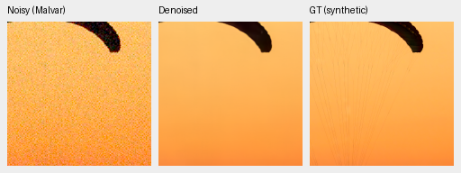
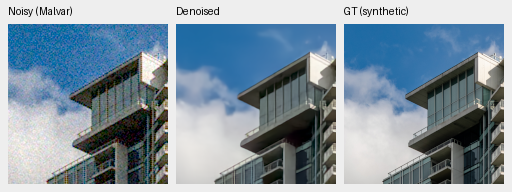
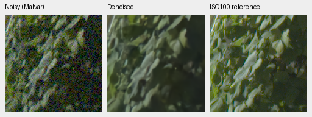
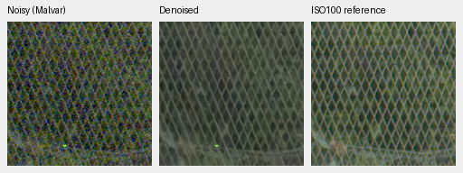

# V30: calibrated stabilized RGB, first 1,000 steps

Physical black/white conditioning improves the matched V29 development means:
known and unseen measured-CFA PSNR rise by .11420/.16202 dB, and the 16-photo
synthetic screen gains .05860 dB. The gains are small, and unseen rendered
PSNR/SSIM still trail RawNIND. This remains below the requested final quality.

[Full numerical/crop receipt](results/anchored-stabilized-rgb-v30-1k-review.json),
[V29 architecture and clipping probe](stabilized-rgb-v29-review.md),
[recipe](../configs/dino-anchored-stabilized-rgb-v30.yaml).
Checkpoint SHA256:
`3a529117f127b2b48c203d6d23d154aeea0924f1aeb7ca649b1778ac8c0686c6`.

V30 retains V29's exact step-zero neural tensors, frozen DINO, source manifests,
seed45, per-step sample/noise schedule, batch4, LR1e-4 and planned 5k schedule.
All 41 logged observations through step1000 match. Three constant stabilized
variance channels become physical black/white measurement coordinates plus a
noise-family/read-ratio tag; parameter counts are unchanged. These anchors
retain ISO/clipping calibration lost by the unanchored normalization. They do
not use reference data or fit the GFX scene. FP16 deep evaluation features use
IEEE FP32 neural boundaries and float64 transform/inverse intermediates.

| Panel | Method | Measured-CFA PSNR | AHD RGB PSNR | AHD SSIM |
| --- | --- | ---: | ---: | ---: |
| Known4 | V29 step1000 | 54.14376 | 39.73981 | .929373 |
| Known4 | **V30 step1000** | **54.25796** | **39.87232** | **.929979** |
| Known4 | RawNIND | 54.06860 | 39.67805 | .928811 |
| Unseen5 | V29 step1000 | 53.59622 | 37.91679 | .913810 |
| Unseen5 | **V30 step1000** | **53.75824** | **38.07829** | **.915793** |
| Unseen5 | RawNIND | 53.56220 | 38.14484 | .918380 |

Known4 comprises eight pairs/72 crops; unseen5 ten pairs/90 crops. Primary scores
use registered low-noise measured CFA. AHD is an independently demosaiced RGB
reference, **not exact RGB GT**. Shared input-only conditioning and coordinates;
no target-derived model gain. V30 minus V29 primary source-bootstrap 95%
intervals are [+.02050,+.20790] known and [+.07483,+.27197] unseen. Against
RawNIND: known +.18937 dB [−.21416,+.58845], unseen +.19604 dB
[+.02198,+.36043]. Small panels, related source provenance and the remaining
rendered-quality deficit limit the generalization claim.

On the same 16-photo/four-procedural screen, V30 scores **34.81952/.957844**
photo PSNR/SSIM and **32.57810/.968435** procedural. V29 photo scores were
34.76093/.957497. Photo PSNR gain +.05860 dB has 95% source-bootstrap interval
[+.00654,+.10753]. Mean highlight-boundary chroma error is slightly worse
(.0195073 versus .0192615); this does not establish solved highlight recovery.
Full 427-photo and untouched final evaluations are still pending for V30.

Two native **160×160** noisy → V30 → exact synthetic GT triplets: RGGB,
ISO12800 nominal prior (`shot=.00256`, `read=.0000262144`), ×1 display exposure,
WB[2,1,1.5] and the protocol matrix. ROI[48,48,160,160] within each evaluation
tile; native binned evaluation pixels, with **no resizing**. PNGs are 8-bit sRGB
previews; scores use unquantized predictions.

Thin canopy/fabric lines are still lost and cloud edges are soft. Sources:
[Roy Egloff](https://commons.wikimedia.org/wiki/File:CH.VD.Villeneuve_2007-08-25_Vertigo-Swiss-Riviera_2392_3x2-R_4K.jpg)
and [Dietmar Rabich](https://commons.wikimedia.org/wiki/File:Vancouver_(BC,_Canada),_Coal_Harbour_Seaside_Park,_Blick_in_den_Himmel_--_2022_--_2158.jpg),
[CC BY-SA 4.0](https://creativecommons.org/licenses/by-sa/4.0/); modified by
linear-light binning, cropping, simulated Bayer/noise, restoration and rendering.
Derivative previews retain that license. Full source/ROI/cache/checkpoint hashes,
noise and display metadata are in the receipt.

Standing GFX100S DSCF3879 ISO6400 → V30 → independent DSCF3880 ISO100 f/5.6
reference. Native sensor160px foliage/fence crops, fixed coordinates, shared
+2 EV/WB/matrix and input-only shot/read. These are 512px-context results.
The low-ISO exposure differs in aperture/time/motion and is **not GT**.

Mesh structure is visible with reduced colored texture, but fine wires and
foliage remain soft and wires are irregular. This is not a large qualitative
lead over the fixed eight-step prior. All four regions and matched V29/prior
images are retained. Matching noisy/reference panel bytes, crop coordinates,
conditioning and display metadata were checked across methods.

The experiment stopped at step1000. Full 102 MP RGB16 output is queued after
the separate [training throughput sweep](training-pipeline.md); no new timing
or final-quality claim is made here. The completed V30 quality evaluation used
the original input pipeline; the new augmentation and loading changes were
implemented separately afterward.
