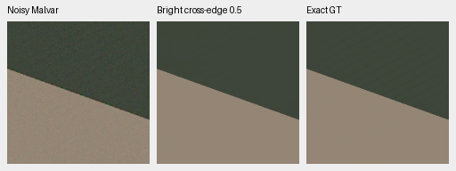
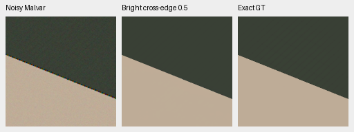
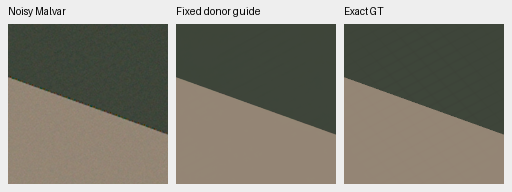
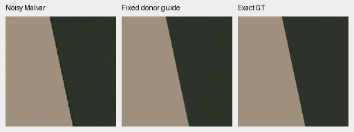

# Let bright-side validation borrow evidence across a strong edge

The [same-side comparison](phase-edge-side.md) retained more ISO400
dark-side detail at matched quiet error, with lower bright-side recovery.
Here the dark side retains the same restriction. The bright side can
use dark-side held-out CFA measurements at half or full weight.
All four arms fit the same original eight-knot waveforms.
[Implementation](../src/demosaic/local_validated_waves.py) ·
[Frozen runner](../scripts/probe_asymmetric_phase_evidence.py).

The two cross-edge weights recover less ISO400 near-edge signal than
same-side validation at matched quiet error. The new geometries also
expose frequency drift from already accurate donor guides. A separate
fixed-guide replay recovers more signal at the same quiet error.

## Frozen comparison

For a bright query pixel, half-weight validation multiplies the
dark-side held-out squared-error improvement by 0.5 and its
contribution to the score variance by 0.25. Full weight gives the
original score on that side before the weighted delivery refit.
The dark-side score remains same-side only for both weights. A fold
with no strong step or inadequate CFA samples on either side uses the
earlier fallback. Settings do not depend on the reference or held-out
score outcome.

The new panel uses eight edge and wire geometries, sources 60–67,
with fresh query noise at repeat 7521 and disjoint noisy donor
regions at repeat 7522. All eight are evaluated at both ISO400
and ISO6400 near the edge. Sources 60 and 61 also test far placement
under both noise levels. The four Bayer orders are balanced in the
near groups. The sensor noise is independent between the paired
background-only, one-wire and two-wire roles. The parent V143
runs on every new observation. Weighted-refit thresholds and scales
carry over from the earlier development study. No geometry or
result is discarded by donor accuracy.

Both standing GFX families retain the cached V120 parent, the two
original baselines and threshold 2. Camera controls are qualitative.

## Matched quiet error on the new ISO400 near scenes

All four rows have mean quiet RMS of 7.39038 DN16. The matching
uses one common correction multiplier per arm and the known targets.
It describes attained error on these scenes.

| Validation | Overall weak response | Dark-side response | Bright-side response | Weak increment RMS (DN16) |
| --- | ---: | ---: | ---: | ---: |
| Original | 3.46% | 2.95% | 1.70% | 15.15740 |
| Same-side | 3.94% | 2.97% | 2.62% | 15.15961 |
| Bright cross-edge 0.5 | 3.56% | 2.84% | 2.01% | 15.15857 |
| Bright cross-edge 1.0 | 3.36% | 2.74% | 1.69% | 15.15780 |

Here the same-side gain comes predominantly from the bright side.
Adding cross-edge evidence gives back that response. The absolute
differences in increment error are small, with the original fit
lowest in this comparison.

At the original tighter scale, same-side ISO400 response is 3.94%
versus 3.65% for the original fit. At the looser scale it recovers
5.14% versus 4.50%, with quiet delta 0.01283 versus 0.03219 DN16.
The half-weight arm recovers 4.57% at a quiet delta of 0.02475 DN16.
At equal quiet RMS in ISO6400 near scenes, all four overall responses
lie within 0.03 percentage point, around 1.4%. Both far controls
under each noise level reproduce the original fits bit for bit.
[Paired metrics, attained quiet error, and activation counts](results/asymmetric-phase-evidence-v1/summary.json).

## Retaining accurate donor frequencies

In the new ISO400 near two-wire scenes, the weak frequency has mean
donor error 0.047 native Fourier bins. Guarded local recentering raises
mean error across folds to 0.464 bin, with higher mean error on six
of eight queries. Every main comparison arm uses those same decisions.

A follow-up replay covers all eight ISO400 near scenes with the same
same-side validation, thresholds and scales, holding the measured
donor frequencies fixed. At the original scale, recovery rises from
3.94% to 6.80%. Increment RMS falls from 15.15961 to 15.14461 DN16
and quiet delta increases from 0.00242 to 0.00359 DN16. Six sources
gain response and seven reduce increment error. At equal measured quiet
RMS, the fixed guides retain 6.12% weak response and 15.14448 DN16
increment RMS. This adaptive replay tests the effect of recentering
on the observed ISO400 near scenes. The real-camera results below
cover the frozen comparison.
[Fixed-guide metrics](results/asymmetric-phase-evidence-v1/fixed-guide-metrics.json) ·
[Independent reductions and quiet match](results/asymmetric-phase-evidence-v1/fixed-guide-audit.json).

## Native crop provenance

The synthetic triplets use noisy Malvar, the half-weight bright-side
refit and exact constructed GT at the frozen 0.02 DN16 development
setting. They show sources 60 RGGB and 61 BGGR, near placement,
two-wire role and repeat 7521. Each native 160×160 cell uses parent
ROI `[176,176,160,160]`. ADC16 black fraction is 0.03 and shot/read
are `8e-5/2.56e-8` at ISO400 and `0.00128/6.5536e-6` at ISO6400.
The display uses exposure 2 with matched white balance, color matrix
and clipped sRGB. The synthetic parent is V143 EMA SHA256
`96d146d017c54196288c585f8b7eddcf030e8a235061049c31e985b9380b7ce4`.

[ISO400 RGGB](images/asymmetric-phase-evidence-v1/iso400-source60-near-RGGB-comparison.png) ·
[ISO400 BGGR](images/asymmetric-phase-evidence-v1/iso400-source61-near-BGGR-comparison.png) ·
[ISO6400 RGGB](images/asymmetric-phase-evidence-v1/iso6400-source60-near-RGGB-comparison.png) ·
[ISO6400 BGGR](images/asymmetric-phase-evidence-v1/iso6400-source61-near-BGGR-comparison.png).

The fixed-guide diagnostic shows sources 60 RGGB and 62 GRBG at the
same ISO400 conditioning, coordinates and exposure. These sources
showed near-edge frequency drift. Source 62 retains faint modulation
on the dark side, with substantially clearer wires in the exact target.

[Source 60 with recentered comparison](images/asymmetric-phase-evidence-v1/iso400-source60-near-RGGB-fixed-guide-comparison.png) ·
[Source 62 with recentered comparison](images/asymmetric-phase-evidence-v1/iso400-source62-near-GRBG-fixed-guide-comparison.png).

The camera parent is V120 EMA SHA256
`a9d9b6b4f974e24a6b11e5e740aab32314233a7f53c056cf37c7d2aac1c589fb`.
DSCF3879/3880 uses exposure 4 and shot/read `0.00128/6.5536e-6`.
DSCF3842/3835 uses exposure 16 with that nominal profile and the
transferred DSCF3879 shot/read `0.0014635776/1.0715704e-6`. The boards
include both sides and camera JPEGs. The ISO100 AHD and low-ISO JPEG
are independent qualitative references with different aperture,
exposure and subject motion.
[Native coordinates and method settings](images/asymmetric-phase-evidence-v1/manifest.json).

The two cross-edge arms reproduce V120 exactly in the sky, in both
linear camera RGB and displayed pixels. Only the building activates
the edge test. Both arms there equal V120, with a 0.035 DN16 RMS
change from same-side validation. Foliage and both fences match the
earlier side-validation controls. Fine cab crossings remain incomplete.
[Sky](images/asymmetric-phase-evidence-v1/main-overcast-sky.png) ·
[Building](images/asymmetric-phase-evidence-v1/main-building-detail.png) ·
[Foliage](images/asymmetric-phase-evidence-v1/main-foliage.png) ·
[Coarse fence](images/asymmetric-phase-evidence-v1/main-chain-link-fence.png) ·
[Cab left](images/asymmetric-phase-evidence-v1/mesh-nominal-left.png) ·
[Cab right](images/asymmetric-phase-evidence-v1/mesh-nominal-right.png) ·
[Transferred profile left](images/asymmetric-phase-evidence-v1/mesh-profile3879-left.png) ·
[Transferred profile right](images/asymmetric-phase-evidence-v1/mesh-profile3879-right.png).

The frozen collection takes 1106.71 seconds on two CPU cores, including
887.01 seconds of V143 forward time. The primary audit verifies 2,144
metrics, 1,568 fold fields, 100 sensor hashes and 136 retained camera
cells. All twelve main boards and two fixed-guide boards were viewed.
The first summary attempt stopped on a missing frozen import. The
successful replay supplies that dependency and reads the same saved
results. Both attempts are archived.
[Independent audit](results/asymmetric-phase-evidence-v1/independent-audit.json) ·
[Native viewing receipt](results/asymmetric-phase-evidence-v1/actual-native-viewing.json) ·
[Executed evidence](results/asymmetric-phase-evidence-v1/publication.json).
