# V169 balanced spatial correction: fixed V168 weights

V169 removes broad displacement from V168's learned direct RGB correction while keeping its trained weights and spectral path. Mean quiet RMS falls **3.74–10.69%** and quiet DC color bias falls **11.45–31.59% versus V168**. Mesh response is essentially unchanged at **3.806–3.837% of constructed GT amplitude**. This retains V168's fine-wire response gain with less added quiet color bias, without retraining.

The tradeoff is measurable: **all 48 native512 coarse-flat errors worsen** at both endpoints, with means **0.529–0.770% higher**. Total-flat means rise **0.389–0.705%**. Quiet spatial error rises **0.167–0.267%**, with all32 raw and31/32 EMA cases worse. Native crops retain colored blotches and incomplete fine cab crossings. V169 is a useful quiet-color option with V168-level response; it is not a general flat-safety solution. V168 remains useful for coarse error, V165 for grain/total-flat error, V161/V164 for stronger learned response, V166 for quiet color, V158 for quiet accuracy and V157 for coarse capacity.

## What changed at fixed weights

Only the direct RGB correction is filtered. Its Gaussian lowpass at sigma8/radius24 native pixels is removed, with replicated boundaries; the parent image and spectral path are retained. The default filter preserves the tested 8px carrier to within .5% in the interior, and exactly removes constant corrections in FP32. It adds no learned parameters or persistent state tensors. All90 older neural files are unchanged. The 124,909 weights/47 tensors load strictly from the actual V168 raw/EMA exports.

The full branch ablations support a specific functional explanation at these weights. Spectral-only response is **3.730/3.765% of GT**, compared with **2.277/2.273%** for direct-only and **2.202%** for V143. Direct-only quiet DC bias is **13.05–46.26% above V143**, while its native512 full-flat means improve **0.567–0.979%** and coarse means improve **0.556–0.802%**. Much of its broad correction helps standalone flats and hurts quiet neighbors beside edges. Removing all direct RGB also loses useful fine correction; the balanced path retains more mesh response and lower full/coarse-flat error than spectral-only. This does not identify why training learned these corrections or establish performance outside this adaptive cohort.

## Quiet color improves; spatial mottle remains

Raw quiet RMS is **4.038576/6.336010 DN16** at ISO6400/12800, versus V168's 4.350000/7.094512. EMA is **4.046127/6.344343**, versus4.203388/6.745842. Raw improves26/32 quiet cases and EMA24/32. Quiet DC means become **2.018252/2.853456 raw**, **2.018205/2.853327 EMA**, only **0.106–0.154% above V143**, instead of V168's 13.05–46.41% excess.

Quiet total RMS still exceeds V143 by **2.98–3.78%**. Spatial error is worse than V168 on63/64 endpoint/input comparisons, despite lower color bias. Mean whole mixed-context RMS improves0.09–0.47%, which alone would conceal the residual quiet-region problem. A near-parent mean cast is not evidence that local splotches are absent.

Native512 full-flat means are **18.599781/24.189486 raw**, **18.618871/24.219097 EMA**. They worsen on40/48 raw and45/48 EMA inputs versus V168, and remain0.286–0.612% above V143. Coarse32 means are **13.436235/17.928281 raw**, **13.438463/17.930574 EMA**; their remaining mean gain over V143 is only0.011–0.032%.

Present-mesh full RMS rises0.138–0.248% to **8.953379/8.956287 DN16**, while signed response changes by just+.0240/+.0173% relative to V168. Actual blank RMS rises0.355–0.552%, to **5.601190/5.609300**. Wholly absent RMS rises0.297–0.534%, to **5.299300/5.305929**. Lower blank DC bias coexists with higher blank spatial error; a signed absent response near zero is not a safety guarantee.

All eight natural-photo cohort/endpoint full-RMS means improve versus V168 by only **0.0026–0.0199%**. Retained-source band error improves by less than .0006%; organic-source band error worsens by less than .0005%. These tiny differences do not establish better visible natural detail. All **72 ADC cases per endpoint** retain V168 outputs bit-exactly, including photographic and sloped controls. All48 constant-field outputs per method/endpoint remain exactly the parent; across four methods/two endpoints this is384 constant-field checks.

## Actual native review

All72 figures and24 triplets were inspected at original detail across18 sheets. Synthetic2302 remains almost flat despite the clear crossed GT; contrast40 mostly reveals broad mottle. Synthetic2309 keeps the strong diagonal family, with weak crossings still missing. Balanced and spectral-only look close at ordinary exposure, while the optional periodic correction recovers more lattice with direction/support defects.

The fine cab left crop remains largely erased; right keeps one direction more strongly than the crossing family under both nominal and profile3879 noise priors. No convincing new full crossings are visible. Main-scene coarse fence, building and foliage stay similar; ordinary sky remains smooth at exposure4. ISO100/AHD/JPEG references differ in aperture, shutter, movement and processing and are qualitative, not exact GT.

Quiet and dark-flat contrast40 panels retain strong red/blue/green patches. Overall color balance changes toward the parent, but localized false variation persists. Ordinary step/bar/pattern boundaries stay well defined. Bird, butterfly and plant microdetail remains heavily smoothed; ADC bark/raccoon detail and sloped planes look unchanged. The user goal of reliable fine crossings without false flat detail remains open.

The underlying V168 raw/EMA weight-export SHA256 values are `7e2be7ba5edadc2fbf8d97bf9cb275a7cec1714a5ea6ff61a8c2efcb1c118de2` and `d089b40e5502887510308816c648a9fc91d9cb58c687aa57862ed853e1efbc61`. The final manifest binds the new balanced-operator exports, source hash, fixed kernel, source ROIs, noise conditioning and display transforms. No target/reference enters inference.

The independent posthoc audit covers all replay/input/journal bindings,19,760 scalar comparisons and all saved native arrays; full new-array recomputation is limited to36 selected cases. All822 cases receive streamed metrics/fingerprints and independent in-process filter/norm checks. The two preparation/initialization corrections used no neural forwards; a resource pause resumed the same live worker without repeating inference. A pre-execution bookkeeping correction replaced ambiguous better/worse labels with decreased/increased for signed response fields. [Preserved correction](results/v169-reduction-label-correction-v1.json).

[Final evidence and exact sources](results/v169-balanced-spatial-final-v1.json) · [Native pixel metadata and checkpoints](images/v169-balanced-spatial-v1/manifest-v1.json).

## Mesh response and actual blank error

| Metric | V143 | V168 raw | V168 EMA | Balanced raw | Balanced EMA | Spectral raw | Spectral EMA | Direct raw | Direct EMA |
| --- | ---: | ---: | ---: | ---: | ---: | ---: | ---: | ---: | ---: |
| Present full RMS | 9.111243 | 8.931209 | 8.943902 | 8.953379 | 8.956287 | 8.973376 | 8.973442 | 9.072458 | 9.084715 |
| Present signed template gain | 0.02202090 | 0.03804833 | 0.03835930 | 0.03805746 | 0.03836594 | 0.03730320 | 0.03764991 | 0.02276603 | 0.02273029 |
| Present actual blank RMS | 5.523323 | 5.570457 | 5.589461 | 5.601190 | 5.609300 | 5.620189 | 5.624936 | 5.476437 | 5.490373 |
| Present blank spatial RMS | 5.343113 | 5.391310 | 5.407807 | 5.423568 | 5.431940 | 5.443173 | 5.448070 | 5.294107 | 5.305358 |
| Present blank DC RMS | 1.289621 | 1.300568 | 1.300783 | 1.289564 | 1.289568 | 1.289601 | 1.289614 | 1.300579 | 1.300776 |
| Absent full RMS | 5.237910 | 5.271166 | 5.290214 | 5.299300 | 5.305929 | 5.320546 | 5.323622 | 5.192938 | 5.208513 |
| Absent signed template gain | 0.00003236 | -0.00001904 | -0.00000810 | -0.00001868 | -0.00000719 | -0.00004277 | -0.00003030 | 0.00005609 | 0.00005456 |
| Absent actual blank RMS | 5.237910 | 5.271166 | 5.290214 | 5.299300 | 5.305929 | 5.320546 | 5.323622 | 5.192938 | 5.208513 |
| Absent blank spatial RMS | 5.099652 | 5.132079 | 5.146561 | 5.162743 | 5.169538 | 5.184540 | 5.187690 | 5.051662 | 5.062498 |
| Absent blank DC RMS | 1.098115 | 1.115760 | 1.128089 | 1.098130 | 1.098120 | 1.098134 | 1.098138 | 1.115749 | 1.128078 |

## Quiet fields beside edges

| Metric | V143 | V168 raw | V168 EMA | Balanced raw | Balanced EMA | Spectral raw | Spectral EMA | Direct raw | Direct EMA |
| --- | ---: | ---: | ---: | ---: | ---: | ---: | ---: | ---: | ---: |
| iso6400-prior whole RMS | 27.105631 | 26.892995 | 26.831196 | 26.817444 | 26.806949 | 26.796072 | 26.796717 | 27.200276 | 27.136168 |
| iso6400-prior quiet RMS | 3.898845 | 4.350000 | 4.203388 | 4.038576 | 4.046127 | 4.042142 | 4.048402 | 4.222486 | 4.064210 |
| iso6400-prior quiet spatial RMS | 3.268502 | 3.423454 | 3.433879 | 3.430546 | 3.439626 | 3.434802 | 3.442277 | 3.265387 | 3.266968 |
| iso6400-prior quiet DC RMS | 2.016074 | 2.553053 | 2.279202 | 2.018252 | 2.018205 | 2.018381 | 2.018285 | 2.552310 | 2.279269 |
| iso12800-prior whole RMS | 36.747466 | 35.636443 | 35.550733 | 35.470020 | 35.462223 | 35.487091 | 35.485205 | 36.892388 | 36.807967 |
| iso12800-prior quiet RMS | 6.152652 | 7.094512 | 6.745842 | 6.336010 | 6.344343 | 6.362229 | 6.367000 | 6.914867 | 6.551781 |
| iso12800-prior quiet spatial RMS | 5.341833 | 5.535426 | 5.547922 | 5.550182 | 5.559786 | 5.579434 | 5.584971 | 5.312052 | 5.316762 |
| iso12800-prior quiet DC RMS | 2.849060 | 4.171370 | 3.617679 | 2.853456 | 2.853327 | 2.853786 | 2.853730 | 4.167104 | 3.613403 |

## Standalone native512 flat fields

| Metric | V143 | V168 raw | V168 EMA | Balanced raw | Balanced EMA | Spectral raw | Spectral EMA | Direct raw | Direct EMA |
| --- | ---: | ---: | ---: | ---: | ---: | ---: | ---: | ---: | ---: |
| iso6400-prior full RMS | 18.546808 | 18.506482 | 18.546646 | 18.599781 | 18.618871 | 18.647902 | 18.654711 | 18.407830 | 18.441619 |
| iso6400-prior spatial RMS | 18.235130 | 18.187010 | 18.237235 | 18.289408 | 18.308796 | 18.338499 | 18.345385 | 18.086282 | 18.129910 |
| iso6400-prior coarse32 RMS | 13.440561 | 13.335471 | 13.367796 | 13.436235 | 13.438463 | 13.442055 | 13.442439 | 13.333920 | 13.365882 |
| iso12800-prior full RMS | 24.071890 | 24.020028 | 24.086164 | 24.189486 | 24.219097 | 24.259882 | 24.273651 | 23.836343 | 23.889308 |
| iso12800-prior spatial RMS | 23.596861 | 23.579540 | 23.649192 | 23.716886 | 23.747288 | 23.788959 | 23.803139 | 23.392100 | 23.448174 |
| iso12800-prior coarse32 RMS | 17.932544 | 17.791280 | 17.832479 | 17.928281 | 17.930574 | 17.935027 | 17.935191 | 17.788713 | 17.829784 |

## Natural photographic detail

| Metric | V143 | V168 raw | V168 EMA | Balanced raw | Balanced EMA | Spectral raw | Spectral EMA | Direct raw | Direct EMA |
| --- | ---: | ---: | ---: | ---: | ---: | ---: | ---: | ---: | ---: |
| retained512/photo-faint full RMS | 33.963754 | 33.967361 | 33.968609 | 33.966465 | 33.966492 | 33.971400 | 33.971783 | 33.960443 | 33.961278 |
| retained512/photo-faint band response | 0.298560 | 0.297802 | 0.297996 | 0.297837 | 0.298025 | 0.297859 | 0.298032 | 0.298502 | 0.298523 |
| retained512/photo-faint band error | 0.824639 | 0.824717 | 0.824695 | 0.824713 | 0.824693 | 0.824925 | 0.824879 | 0.824470 | 0.824488 |
| retained512/photo-dark full RMS | 29.097715 | 29.101435 | 29.098256 | 29.095638 | 29.094009 | 29.093816 | 29.094007 | 29.105887 | 29.102464 |
| retained512/photo-dark band response | 0.531446 | 0.530744 | 0.530871 | 0.530774 | 0.530900 | 0.531102 | 0.531237 | 0.531088 | 0.531080 |
| retained512/photo-dark band error | 0.661447 | 0.661270 | 0.661254 | 0.661266 | 0.661251 | 0.661323 | 0.661306 | 0.661407 | 0.661406 |
| organic384/photo-faint full RMS | 37.469061 | 37.487845 | 37.487138 | 37.485177 | 37.483612 | 37.494195 | 37.492394 | 37.463627 | 37.464687 |
| organic384/photo-faint band response | 0.150701 | 0.148982 | 0.149124 | 0.149023 | 0.149160 | 0.148627 | 0.148795 | 0.151055 | 0.151030 |
| organic384/photo-faint band error | 0.924117 | 0.925100 | 0.925055 | 0.925104 | 0.925058 | 0.925549 | 0.925455 | 0.923769 | 0.923802 |
| organic384/photo-dark full RMS | 33.685796 | 33.692924 | 33.690339 | 33.688124 | 33.685928 | 33.687840 | 33.687407 | 33.691430 | 33.689243 |
| organic384/photo-dark band response | 0.398945 | 0.397680 | 0.397768 | 0.397707 | 0.397799 | 0.397649 | 0.397784 | 0.398977 | 0.398929 |
| organic384/photo-dark band error | 0.781612 | 0.781703 | 0.781689 | 0.781705 | 0.781691 | 0.781811 | 0.781800 | 0.781538 | 0.781530 |

## ADC controls

| Metric | V143 | V168 raw | V168 EMA | Balanced raw | Balanced EMA | Spectral raw | Spectral EMA | Direct raw | Direct EMA |
| --- | ---: | ---: | ---: | ---: | ---: | ---: | ---: | ---: | ---: |
| Photo full RMS | 18.149871 | 18.140792 | 18.142182 | 18.140792 | 18.142182 | 18.140792 | 18.142182 | 18.149871 | 18.149871 |
| Photo band error | 0.101855 | 0.101788 | 0.101800 | 0.101788 | 0.101800 | 0.101788 | 0.101800 | 0.101855 | 0.101855 |
| Sloped512 full RMS | 3.771369 | 3.776748 | 3.776943 | 3.776748 | 3.776943 | 3.776748 | 3.776943 | 3.771369 | 3.771369 |
| Sloped512 spatial RMS | 3.397249 | 3.402835 | 3.403006 | 3.402835 | 3.403006 | 3.402835 | 3.403006 | 3.397249 | 3.397249 |
| Sloped512 coarse32 RMS | 0.574652 | 0.573529 | 0.573442 | 0.573529 | 0.573442 | 0.573529 | 0.573442 | 0.574652 | 0.574652 |

All RMS values are camera-RGB DN16. Signed template gain1 means the constructed mesh amplitude; a small signed absent mean is not proof of safety. Coarse32 is spatially centered block-mean error.

## Architecture and evidence scope

The direct RGB correction is replaced by its Gaussian complement at sigma8/radius24 native pixels, with replicated boundaries and numerical centering for exact constant removal. The parent is not filtered; the spectral path is unchanged. All 47 persistent state tensors and 124,909 weights transfer unchanged from V168. The kernel is fixed and nonpersistent. This is an inference intervention on existing weights, not retraining with a constrained path. Spectral-only and direct-only outputs diagnose the split. References and targets never enter inference. The reused adaptive cohort does not prove blind generalization.

All 47 relevant CPU checks pass, including 19 new independent filter/carrier/embedding/gradient tests. Six CPU/CUDA filter value/gradient cases and three FP32 autocast checks pass. Both actual endpoint weights load strictly; all 90 prior neural sources remain unchanged. Original preparation and import failures, sources and receipts are preserved in the [original protocol](results/v169-balanced-spatial-v1/original-protocol-v1.md) and [preparation evidence](results/v169-spatial-balance-preparation-v2.json).

A 56GiB local reserve paused the same live review worker before another forward. Seventy owned derived mesh fixtures moved byte-exact to the fast SSD with unchanged original-path links, freeing .752GiB. The worker resumed without repeating completed inference; 56/116GiB local/external guards remain fixed. No original media moved or dataz reads occurred.

Completed quality work is 1,644 actual neural roots, each with exact original V168 replay. All 6,576 method rows have durable journals and input/output fingerprints. Independent Gaussian checks cover 1,186,725,888 correction channels in process. A separate posthoc audit checks all saved native arrays, 19,760 scalar comparisons and 53,772,288 selected balanced-output channels. The other new full predictions were not retained; no complete new-array posthoc audit is claimed. Independent Decimal means check 1,105 reductions. No source/noise, parent/DINO or training calls are added. Both recorded review owners are terminal; the earlier import failure used zero neural calls.

## Fixed native comparisons

Every panel is native160×160 without resizing. Coordinates, camera transform, exposure, contrast and noise conditioning match V168. Main scene DSCF3879/3880 includes sky, building, foliage and coarse fence; cab mesh DSCF3842/3835 includes both priors and camera JPEGs. Separate ISO100/AHD/JPEG views differ in aperture, shutter, motion and processing and are qualitative references, not exact GT. Real captures are not pixelwise scored. Source/ROI, weights, kernel and display metadata are in the manifest. Photographic source credits and licenses remain in the [V168 source report](fine-mesh-training.md#photographic-credits).

### All native comparison boards

mesh-seed2026112302-present-iso6400-prior-RGGB; ROI `[176, 176, 160, 160]`, exposure8, contrast1.

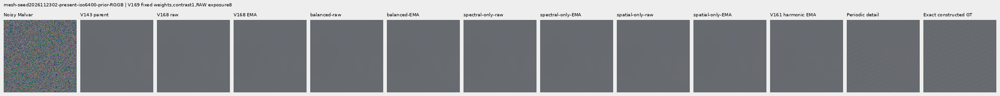

mesh-seed2026112302-present-iso6400-prior-RGGB; ROI `[176, 176, 160, 160]`, exposure8, contrast40.

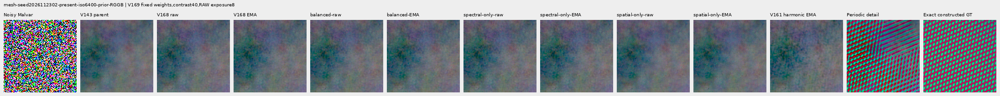

mesh-seed2026112309-present-iso6400-prior-RGGB; ROI `[176, 176, 160, 160]`, exposure8, contrast1.

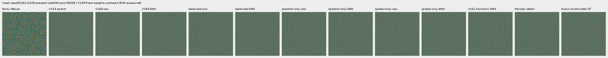

mesh-seed2026112309-present-iso6400-prior-RGGB; ROI `[176, 176, 160, 160]`, exposure8, contrast40.

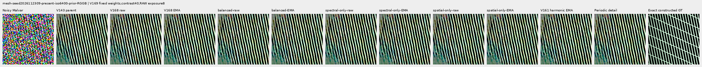

mesh-seed2026112304-absent-iso6400-prior-RGGB; ROI `[165, 0, 160, 160]`, exposure8, contrast40.

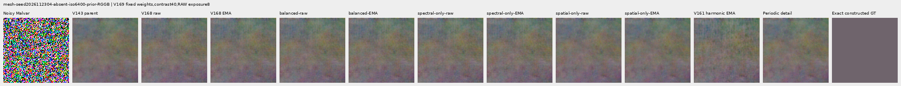

main-overcast-sky; ROI `[176, 176, 160, 160]`, exposure4, contrast1.

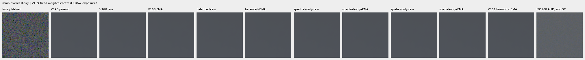

main-building-detail; ROI `[176, 176, 160, 160]`, exposure4, contrast1.

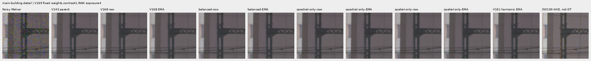

main-foliage; ROI `[176, 176, 160, 160]`, exposure4, contrast1.

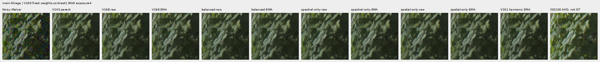

main-chain-link-fence; ROI `[176, 176, 160, 160]`, exposure4, contrast1.

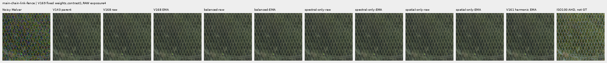

mesh-nominal; ROI `[206, 229, 160, 160]`, exposure16, contrast1.

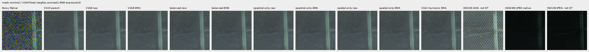

mesh-nominal; ROI `[426, 189, 160, 160]`, exposure16, contrast1.

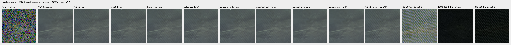

mesh-profile3879; ROI `[206, 229, 160, 160]`, exposure16, contrast1.

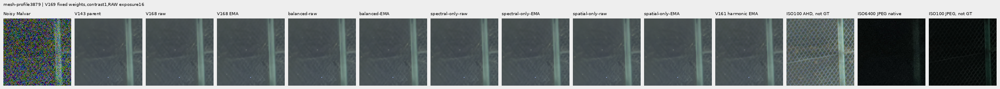

mesh-profile3879; ROI `[426, 189, 160, 160]`, exposure16, contrast1.

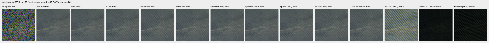

organic-02a76fd33b5e1414a0504f0b3f0aeb03a569b6f4-photo-faint-RGGB; ROI `[112, 112, 160, 160]`, exposure14.3883, contrast8.

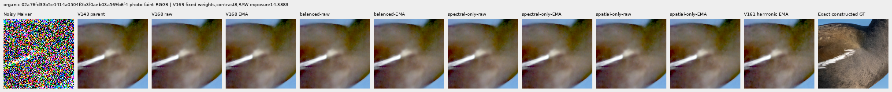

organic-dabacecd4780a1c230f8e9fce6ca1a604bdeab4c-photo-dark-RGGB; ROI `[112, 112, 160, 160]`, exposure102.758, contrast1.

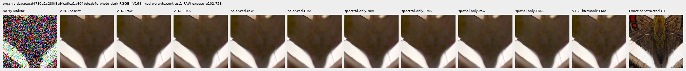

organic-6b3920bceba82d95ecf9351d47f6f94267694bd0-photo-dark-RGGB; ROI `[112, 112, 160, 160]`, exposure64.0491, contrast1.

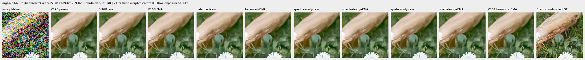

gray-l0.02-adc-only-RGGB; ROI `[48, 48, 160, 160]`, exposure4, contrast40.

gray-l0.02-iso12800-prior-RGGB; ROI `[48, 48, 160, 160]`, exposure4, contrast40.

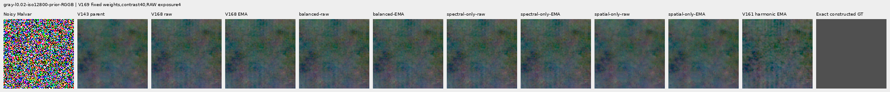

flat512-gray-l0.02-adc-only-RGGB; ROI `[176, 176, 160, 160]`, exposure4, contrast40.

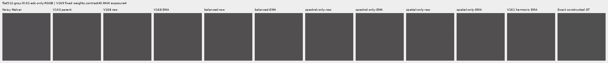

flat512-gray-l0.02-iso6400-prior-RGGB; ROI `[176, 176, 160, 160]`, exposure4, contrast40.

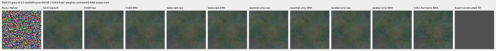

flat512-gray-l0.02-iso12800-prior-RGGB; ROI `[176, 176, 160, 160]`, exposure4, contrast40.

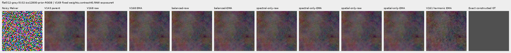

flat512-h210-s0.50-l0.02-iso6400-prior-RGGB; ROI `[176, 176, 160, 160]`, exposure4, contrast40.

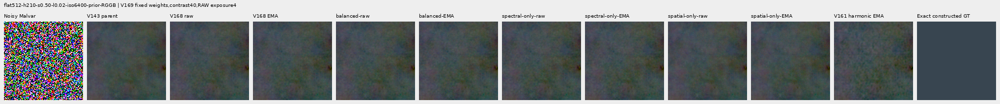

flat512-gray-l0.18-iso12800-prior-RGGB; ROI `[176, 176, 160, 160]`, exposure1, contrast8.

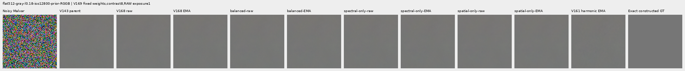

flat512-gray-l0.90-iso12800-prior-RGGB; ROI `[176, 176, 160, 160]`, exposure1, contrast4.

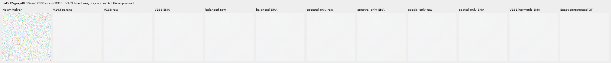

photo-3e638bbb56ed80abc88939468783e3bf9b92ee77-photo-faint-RGGB; ROI `[176, 176, 160, 160]`, exposure12.1494, contrast8.

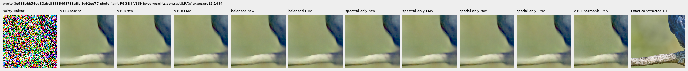

photo-3e638bbb56ed80abc88939468783e3bf9b92ee77-photo-dark-RGGB; ROI `[176, 176, 160, 160]`, exposure80.9959, contrast1.

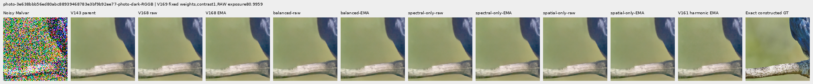

mixed-vertical-step-iso6400-prior-RGGB; ROI `[80, 176, 160, 160]`, exposure8, contrast40.

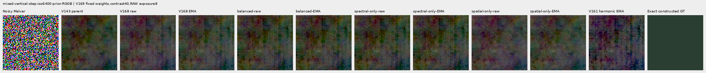

mixed-vertical-step-iso6400-prior-RGGB; ROI `[240, 176, 160, 160]`, exposure8, contrast1.

mixed-vertical-step-iso12800-prior-RGGB; ROI `[80, 176, 160, 160]`, exposure8, contrast40.

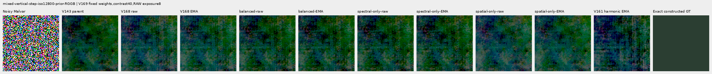

mixed-vertical-step-iso12800-prior-RGGB; ROI `[240, 176, 160, 160]`, exposure8, contrast1.

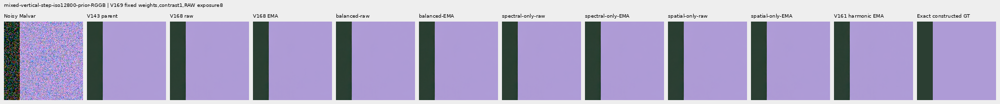

mixed-narrow-bar-iso6400-prior-RGGB; ROI `[80, 176, 160, 160]`, exposure8, contrast40.

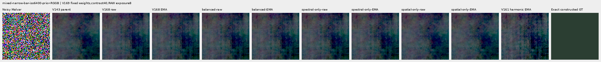

mixed-narrow-bar-iso6400-prior-RGGB; ROI `[240, 176, 160, 160]`, exposure8, contrast1.

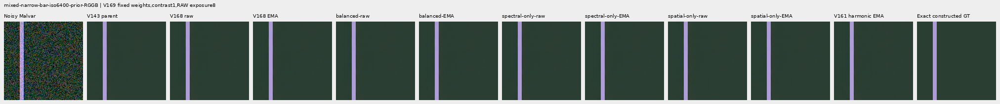

mixed-narrow-bar-iso12800-prior-RGGB; ROI `[80, 176, 160, 160]`, exposure8, contrast40.

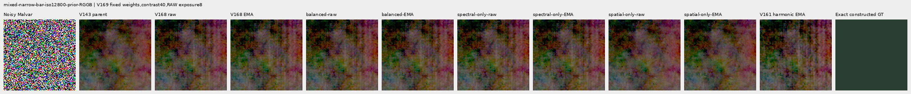

mixed-narrow-bar-iso12800-prior-RGGB; ROI `[240, 176, 160, 160]`, exposure8, contrast1.

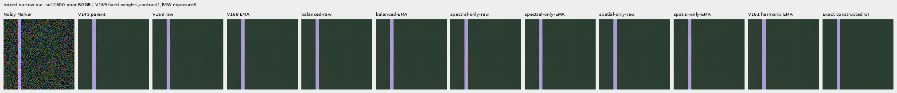

mixed-slanted-step-iso6400-prior-RGGB; ROI `[80, 176, 160, 160]`, exposure8, contrast40.

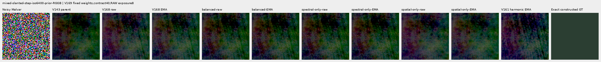

mixed-slanted-step-iso6400-prior-RGGB; ROI `[240, 176, 160, 160]`, exposure8, contrast1.

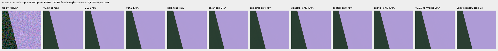

mixed-slanted-step-iso12800-prior-RGGB; ROI `[80, 176, 160, 160]`, exposure8, contrast40.

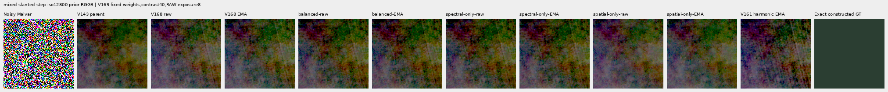

mixed-slanted-step-iso12800-prior-RGGB; ROI `[240, 176, 160, 160]`, exposure8, contrast1.

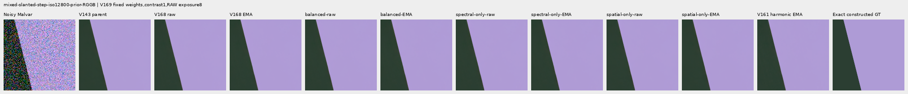

mixed-striped-patch-iso6400-prior-RGGB; ROI `[80, 176, 160, 160]`, exposure8, contrast40.

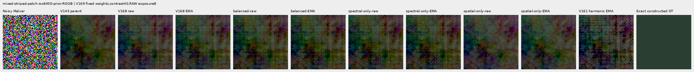

mixed-striped-patch-iso6400-prior-RGGB; ROI `[240, 176, 160, 160]`, exposure8, contrast1.

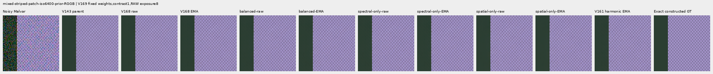

mixed-striped-patch-iso12800-prior-RGGB; ROI `[80, 176, 160, 160]`, exposure8, contrast40.

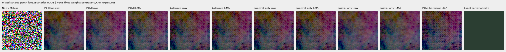

mixed-striped-patch-iso12800-prior-RGGB; ROI `[240, 176, 160, 160]`, exposure8, contrast1.

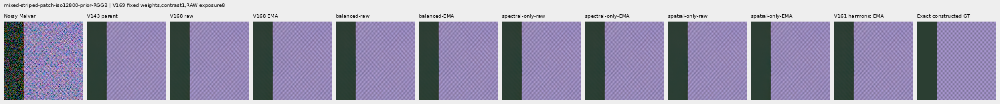

V150-control-bark-contrast0p025-adc-RGGB; ROI `[48, 48, 160, 160]`, exposure1, contrast40.

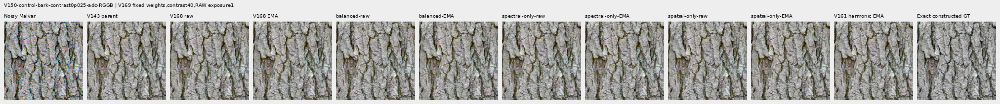

V150-control-raccoon-fur-contrast0p025-adc-RGGB; ROI `[48, 48, 160, 160]`, exposure1, contrast40.

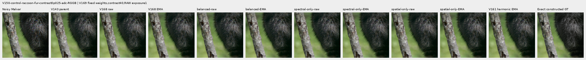

V150-control-ADC-plane0-RGGB; ROI `[176, 176, 160, 160]`, exposure45, contrast8.

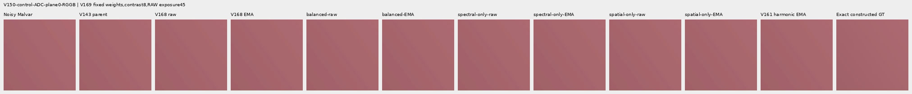

V150-control-ADC-plane1-RGGB; ROI `[176, 176, 160, 160]`, exposure9, contrast8.

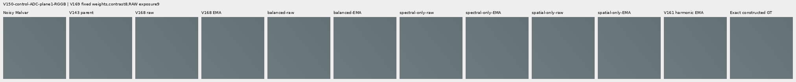

V150-control-ADC-plane2-RGGB; ROI `[176, 176, 160, 160]`, exposure1, contrast8.

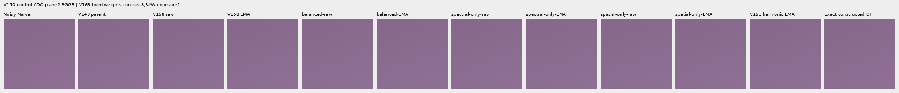

V150-control-ADC-plane3-RGGB; ROI `[176, 176, 160, 160]`, exposure0.24, contrast8.

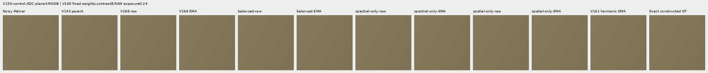

### Noisy, restored, exact constructed GT triplets

mesh-seed2026112302-present-iso6400-prior-RGGB; ROI `[176, 176, 160, 160]`, exposure8, contrast1.

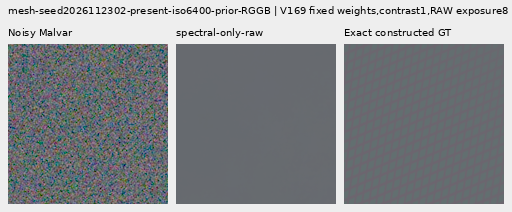

mesh-seed2026112302-present-iso6400-prior-RGGB; ROI `[176, 176, 160, 160]`, exposure8, contrast1.

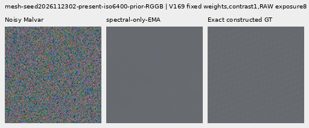

mesh-seed2026112302-present-iso6400-prior-RGGB; ROI `[176, 176, 160, 160]`, exposure8, contrast1.

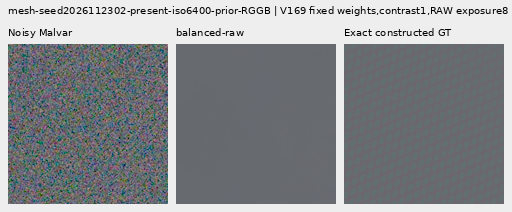

mesh-seed2026112302-present-iso6400-prior-RGGB; ROI `[176, 176, 160, 160]`, exposure8, contrast1.

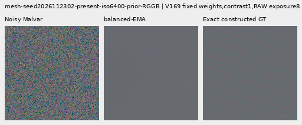

mesh-seed2026112309-present-iso6400-prior-RGGB; ROI `[176, 176, 160, 160]`, exposure8, contrast1.

mesh-seed2026112309-present-iso6400-prior-RGGB; ROI `[176, 176, 160, 160]`, exposure8, contrast1.

mesh-seed2026112309-present-iso6400-prior-RGGB; ROI `[176, 176, 160, 160]`, exposure8, contrast1.

mesh-seed2026112309-present-iso6400-prior-RGGB; ROI `[176, 176, 160, 160]`, exposure8, contrast1.

flat512-gray-l0.02-iso6400-prior-RGGB; ROI `[176, 176, 160, 160]`, exposure4, contrast40.

flat512-gray-l0.02-iso6400-prior-RGGB; ROI `[176, 176, 160, 160]`, exposure4, contrast40.

flat512-gray-l0.02-iso6400-prior-RGGB; ROI `[176, 176, 160, 160]`, exposure4, contrast40.

flat512-gray-l0.02-iso6400-prior-RGGB; ROI `[176, 176, 160, 160]`, exposure4, contrast40.

flat512-gray-l0.02-iso12800-prior-RGGB; ROI `[176, 176, 160, 160]`, exposure4, contrast40.

flat512-gray-l0.02-iso12800-prior-RGGB; ROI `[176, 176, 160, 160]`, exposure4, contrast40.

flat512-gray-l0.02-iso12800-prior-RGGB; ROI `[176, 176, 160, 160]`, exposure4, contrast40.

flat512-gray-l0.02-iso12800-prior-RGGB; ROI `[176, 176, 160, 160]`, exposure4, contrast40.

mixed-vertical-step-iso6400-prior-RGGB; ROI `[80, 176, 160, 160]`, exposure8, contrast40.

mixed-vertical-step-iso6400-prior-RGGB; ROI `[80, 176, 160, 160]`, exposure8, contrast40.

mixed-vertical-step-iso6400-prior-RGGB; ROI `[80, 176, 160, 160]`, exposure8, contrast40.

mixed-vertical-step-iso6400-prior-RGGB; ROI `[80, 176, 160, 160]`, exposure8, contrast40.

mixed-vertical-step-iso12800-prior-RGGB; ROI `[80, 176, 160, 160]`, exposure8, contrast40.

mixed-vertical-step-iso12800-prior-RGGB; ROI `[80, 176, 160, 160]`, exposure8, contrast40.

mixed-vertical-step-iso12800-prior-RGGB; ROI `[80, 176, 160, 160]`, exposure8, contrast40.

mixed-vertical-step-iso12800-prior-RGGB; ROI `[80, 176, 160, 160]`, exposure8, contrast40.

[Independent publication verification](results/v169-balanced-spatial-publication-verification-v1.json).
