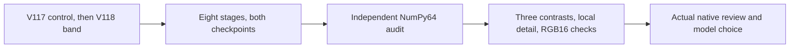

# V114-parent band-loss training

**V117's original 20,000-update control is complete; V118 is running from the
shared V114 parent. Both passed their discarded CPU and native256 CUDA checks.**
This tests whether explicit weak-band supervision improves natural detail after the
[V116 data-only trial](v116-quality.md) left broad weak-material gain unchanged.
V114 remains the current general model; trained quality for this pair is pending.

[Execution/checkpoint/input receipts](results/v114-band-loss-training-started-v1.json) ·
[V117 completion and V118 startup audit](results/v117-training-complete-v1.json) ·
[V117 recipe](../configs/quality-v114-band-control-v117.yaml) ·
[V118 recipe](../configs/quality-v114-band-normalized-v118.yaml).

## One objective change, current architectural baseline

| Setting | V117 control | V118 candidate |
| --- | --- | --- |
| Initial EMA | Exact V114 final20k | Same91 tensors |
| Architecture | V84-family DRUNet RGB + official frozen DINOv3 Tiny | Same |
| Normalized-band weight | 0 | .0003 |
| Reconstruction epsilon | .0003 | .0003 |
| Commons sources | 90,864 reviewed sources | Same |
| Weak source profile | Existing legacy profile, quota.15 | Same |
| Paired references | Reviewed four-crop mask correction | Same |
| Training | Seed64, fresh AdamW/EMA,20k, native256/B16/BF16 | Same |

Both keep the six reviewed ROIs, photographic contrast attenuation, physical
camera/noise conditioning,4×→geometry→area2 and zero optical PSFs. They use
LR1e−5/warmup200. Paired RAW keeps its original objective. The new control is
needed because both arms add20k updates to V114; the completed V114 checkpoint
also remains a separate quality reference. The common reference-mask correction
does not become a loss effect.

The optional [normalized-band term](contrast-normalized-band-supervision.md)
uses the3×3-minus9×9 mean band in native camera RGB. Scale is each training
image's valid target-band RMS, floored at.001, with dimensionless smoothing.1.
The9×9 validity neighborhood and eight-pixel border omit invalid/clipped targets.
Normalization uses clean training supervision; inference has no target-dependent
operation. Full-photo local16px contrast stratification is a separate evaluation.

Earlier output/parameter/first-Adam checks have mixed signs. They establish the
implementation and a possible objective effect, rather than ranking trained
quality. The complete matched run will measure signal recovery, residual/false
texture, color tails and real-photo appearance together.

## Actual readiness and production prefix

Four completed checks make **32 real optimizer updates**: eight CPU64/B1/FP32
and eight CUDA256/B16/BF16 updates per arm. Each starts freshly from V114's91
EMA tensors, keeps the official Tiny encoder frozen and reaches step8 in all89
fresh Adam states with finite model/EMA/optimizer tensors. All eight physical
input records match across arms within each phase, as do initial predictions.

Each prefix contains four paired, one native and three Commons batches. The
control performs zero band evaluations. The candidate performs four, all on
synthetic/native supervision; paired batches skip the term. At the first
unpaired step4, the observed loss exactly equals the FP32 control loss plus
.0003 times the band term. This checks genuine routing and objective addition,
without asserting a restored-quality gain.

Production starts fresh from V114 rather than continuing a discarded check.
V117's first 4,194,304 FP32 prediction/auxiliary values match its own CUDA check
exactly; its first loss matches too. The original startup receipt retains its
775-step observed prefix, with finite loss/gradient-norm/LR.

The [completion audit](results/v117-training-complete-v1.json) now binds V117's
original final checkpoint
`f69452432a852ac4c5ffdcbf7d6fe6837a3ab46adbc8a7fdae073111220b8ab0`.
Its actual worker records **20,000 optimizer updates**, all 89 AdamW states at
step 20,000, finite model/EMA/optimizer tensors and the unchanged frozen encoder.
The separate CPU audit verifies the checkpoint hash, all 72 frozen source files,
801 complete training log rows, 808 observed input records and 20 finite
validation monitors. Full tensor checks are adopted from the bound worker
receipt; validation monitors do not replace the full quality comparison.

V118 starts freshly from the same V114 EMA. Its first 4,194,304 saved FP32 values
and first loss match V117 exactly. The immutable startup audit covers 37 logged
rows through step 900: input hashes, domains, steps and learning rates match the
control; unpaired band terms are finite and paired batches omit them. This
checks the observed prefix, not every unlogged input or a completed V118 run.
The audit uses saved arrays/logs without neural inference or checkpoint loading.

The physical source archive is byte-identical to completed V116:
`707abdcea6f3e14a48a7d6ebc7f1769e3da8e96d8959d856fcfc32961787075b`.
The different parent and loss settings are explicit in the recipes/checkpoints.
The original API/source evidence is reused without replaying completed neural
work. First-eight hook hashes and existing production trace hashes check
matched inputs; the observer avoids hashing every logged batch twice.

V117's actual 20k allocation is 5,013 paired / 4,955 native / 10,032 Commons batches,
with 14,987 synthetic/native loss calls and zero band-loss evaluations. This
matches the frozen seed64 routing. V118 has the same prospective allocation
and plans 14,987 band evaluations; its full-run counts remain pending. Unlogged
production input tensors are not independently checked in full. Failures
preserve evidence and stop without automatic retry or a budget extension.

## Full quality review and resource limits

The exact training owner has a live evaluator waiting downstream for both
checkpoints. It declares **9,172 new model/encoder calls**, **28,380 numerical
observations**, all eight stages and retained FP32 predictions/targets. The
independent CPU audit is queued too, preparing at least two native160px
noisy/restored/exact-GT triplets per model. Six standing GFX regions include
foliage/fence, plus complete102MP outputs. ISO100 remains an approximate
independent reference, not GT; scene/siblings remain outside training.
A separate [matched review is now queued](results/band-loss-matched-review-queued-v1.json)
after the exact original audit owner. It resolves checkpoint hashes from the
successful original20k receipts, then prepares three complete contrasts:

* V118 versus V117 isolates the band-loss coefficient.
* V117 versus retained V114 measures the zero-band continuation with the common
  mask correction and new training seed.
* V118 versus retained V114 shows the resulting quality relative to the parent.

Each pairs all14,190 numerical observations, requiring identical noisy-input,
target/mask/WB/matrix fingerprints and scoring protocols. The V114 reference
uses its independently rebuilt F64 rows; the audit's historical V112 summaries
remain explicitly separate. Matched material boards, two native GT triplets
per candidate and all six full-frame GFX regions accompany each contrast.
No control neural inference is repeated for reporting.

The CPU job also applies the [full-photo local definitions](local-material-detail.md#full-photo-follow-up)
to all427 photos/5124 source-noise-CFA cases per contrast. It reuses the same
96,075 GT blocks; three contrasts do not add independent material coverage.
All contrast strata, phase/carrier response, residuals and flat-color tails
remain available alongside primary PSNR. The four new TIFFs get hash/type/shape
checks, with921,600 linear-RGB16 values in twelve native ROIs checked against
retained FP32 quantization. The already verified V114 exports are reused.

The frozen CPU controller imports with no Torch and rejects unintended changes
to LR, fine data, band weight, budget and parent. It declares8GiB available RAM,
4GiB output headroom, a1200s total analysis bound and600s per local audit.
Actual native viewing/interpretation follows; no model is selected automatically.
Original training/evaluation/audit sources, owners and budgets stay unchanged.

Artifacts stay in the frozen internal workspace, with128GiB free required at
phase starts and96GiB at runtime. Cached external inputs retain208GiB free;
training phase starts need48GiB available RAM, runtime24GiB, and the CUDA model
quota is24GiB. Six storage tests verify internal boundaries and unchanged
legacy external reserves. Parent selection is frozen explicitly, allowing
current documentation/model recommendations to advance during training.

A metadata coverage check explains keeping native256: all90,864 Commons
sources support it at the current4×→2× geometry, while320/384/512px patches fit
55,998/24,753/1,762 sources without upscaling. A global512px change would also
change the corpus substantially. Larger-context training remains a separate
quality question. This trial keeps data geometry and batch size matched.
