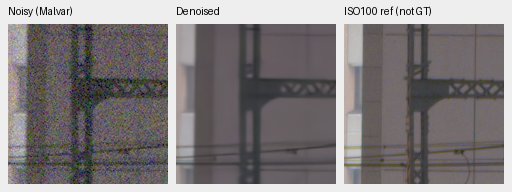
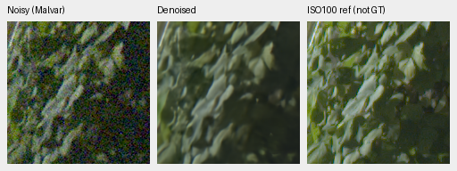
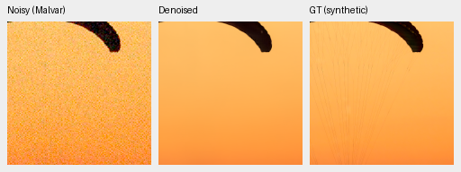
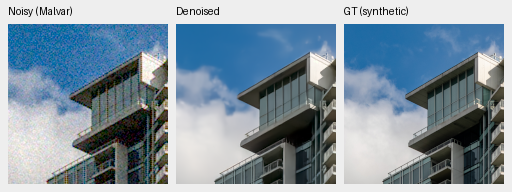
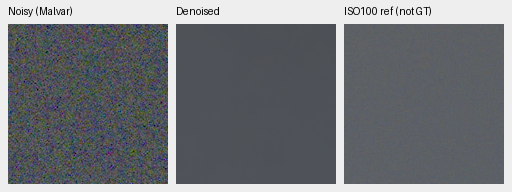
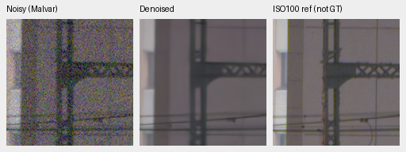
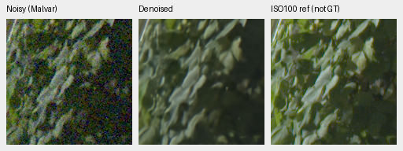
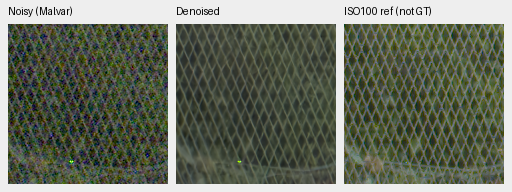

# V82/V83: completed original4k bank-gradient review

Current architecture and recommendations: [current model guide](current-model.md).
The versioned study below retains its measured results and original protocol.

Detaching the bank descriptor input does **not** improve this matched study.
Full427 rendered PSNR changes -0.00351dB
against connected, source-bootstrap 95% interval [-0.00427, -0.00273]. ADC-only weak-detail
gain also falls. **Neither arm is promoted or extended; V43 was the reference for this study.** Both fail the original known/unseen camera requirements.

[Complete results and artifact registry](results/bank-detachment-original4k-complete-v1.json).
[Publication/pixel/source audit](results/bank-detachment-original4k-publication-v1.json).
[Original fixed criteria](directional-bank-detachment-v82-v83.md).

Both bank-enabled arms start from genuine V63 original20k EMA with fresh original
optimizer/EMA/RNG, seed 51, B16/native256/BF16/channels-last, deterministic execution,
LR 1e-5/branch 20x and the original 4,000-step cosine horizon. Data stays at cleaned
Commons84,867/native128/paired32, sensor-valid supervision and 4×→geometry/PSF→area2.
Only the descriptor's input gradient is detached in V83; inference uses the same
architecture and parameter count. The prepared private150 and new Commons stay
inactive. GFX3879/3880 and siblings remain excluded from training.

The [memory-guard recovery](bank-detachment-memory-recovery.md) restores V83's
genuine emergency checkpoint at 2,999 and completes exactly 1,001 remaining updates.
Its CPU emergency/resume fixture matches uninterrupted optimization state and RNG
bitwise. V82 is retained without retraining. Both final states are finite; all 176
sampled full/input/legacy-target observations, 161 domain/LR pairs and final
Python/CPU/CUDA RNG states match between arms. These checks and one training seed
do not establish convergence or training-repeat uncertainty.

All ten review stages and CPU arithmetic/array audits finished. Fresh FP32 panels
contain 432 known, 540 unseen and 74,424 photo/procedural records. All 108 primary
comparisons, 81 sensitivity comparisons, 84 carrier/flat groups and 54 hue groups
are retained. All eight final boards were actually viewed at original resolution:
81 source triplets represented by 125 unchanged 160px cells.

## Photographs and real cameras

Source/scene-balanced means use seven photo conditions and four CFAs. Bootstrap
95% intervals use 1,000 resamples, seed 42; they do not quantify training-seed variance.

| Model | Photo sRGB PSNR | Change from fresh parent [95% source interval], dB | Photo SSIM |
| --- | --- | --- | --- |
| V82-original4000 | 36.24146 | +0.30849 [+0.23013, +0.41422] | 0.964158903 |
| V83-original4000 | 36.23795 | +0.30498 [+0.22682, +0.41088] | 0.964087527 |
| V63-parent | 35.93298 | reference | 0.963289824 |

| Model | Known4 measured-CFA change [95% scene interval], dB | Unseen5 measured-CFA change [95% scene interval], dB |
| --- | --- | --- |
| V82-original4000 | -0.01233 [-0.07152, +0.04687] | -0.00817 [-0.02416, +0.00842] |
| V83-original4000 | -0.02062 [-0.07520, +0.03396] | -0.00902 [-0.02505, +0.00736] |

Each camera panel requires at least +.05dB over fresh V63 and a positive lower
bound. Both arms fail both panels. The matched photo interval is negative;
detachment's known/unseen losses remain within the separate .03dB ceilings.
Its matched photo SSIM change is -0.000071377.
No broad real-camera superiority or matched detachment benefit is established.

| Photo condition | Connected−parent rendered PSNR, dB | Detached−parent rendered PSNR, dB |
| --- | --- | --- |
| adc-only | +0.33287 | +0.31768 |
| iso100-prior | +0.52771 | +0.52203 |
| iso1600-prior | +0.37254 | +0.37021 |
| iso12800-prior | +0.17386 | +0.17363 |
| shadows | +0.02079 | +0.02050 |
| highlights | +0.39312 | +0.39333 |
| legacy-noise | +0.33852 | +0.33746 |

Canonical camera-linear photo changes remain adverse:
-2.03023 / -2.03107dB,
intervals [-2.14539, -1.89913] / [-2.14652, -1.89988]. Highlight-condition changes are
-17.30346 / -17.30119dB.
Evaluation retains reference-white clipping before inverse camera transport;
training uses sensor-valid targets. This convention limits interpretation and
does not justify dropping unfavorable scores. All procedural 16 and condition
means remain in the registry.

| Photo sources | Connected−parent, dB | Detached−parent, dB | Detached−connected [95% source interval], dB |
| --- | --- | --- | --- |
| 427 | +0.30849 | +0.30498 | -0.00351 [-0.00427, -0.00273] |
| 418 | +0.30995 | +0.30643 | -0.00352 [-0.00432, -0.00271] |
| 416 | +0.31019 | +0.30669 | -0.00350 [-0.00427, -0.00275] |

The related-series sensitivity exclusions preserve the negative matched effect.
Unknown aliases/ancestry remain; these subsets do not prove scene independence.
Retained baseline means require unchanged source/protocol/coverage and classical
witnesses:

| Baseline | Photo rendered PSNR | Known4 measured-CFA PSNR | Unseen5 measured-CFA PSNR |
| --- | --- | --- | --- |
| V43-working | 34.89933 | 54.23334 | 53.80629 |
| RawNIND-global | 26.69578 | 54.06860 | 53.56220 |
| RawNIND-channel | 26.68357 | 54.08474 | 53.76822 |

The synthetic RawNIND gap is large, but real scene intervals remain essential.
The [known](images/bank-detachment-known-all-methods-native.png)/[unseen](images/bank-detachment-unseen-all-methods-native.png) boards show
similar new-model/parent/working-reference appearance, softened plate/illustration
detail and an isolated bright chart point. RawNIND has softer/fringed boundaries
in these fixed views. Independent AHD is an auxiliary RGB reference, not exact GT.

## Weak detail, color and real highlights

The high-noise requirements demand at least +.05 detached−connected signed gain
in each case, with corresponding flat spatial-luma RMS at most 1.25× connected.
Each descriptive mean has four CFAs/four draws, without scene confidence claims.

| Level/contrast/period | Connected signed gain | Detached signed gain | Gain change | Flat RMS ratio |
| --- | --- | --- | --- | --- |
| 0.01/0.1/8 | 0.00027910 | 0.00038606 | +0.00010696 | 0.997649 |
| 0.18/0.02/16 | 0.29846159 | 0.31111031 | +0.01264872 | 1.003546 |

Both weak-detail gain gates fail; flat-RMS ceilings pass. The ADC-only
.01/.02/period 4 case worsens from 0.46707529
to 0.42187657 (change
-0.04519872), failing its +.05 requirement.
All 24 carrier/four flat configurations, quadrature, noncarrier error and ranges
are retained. The [analytic board](images/bank-detachment-analytic-all-methods-native.png) shows the nearly
erased dark carrier and weakened brighter modulation.

Mean maximum absolute channel-mean error / centered camera-RGB RMS under the
high-noise condition:

| Saturation/peak | Connected | Detached | V63 parent |
| --- | --- | --- | --- |
| 0/0.18 | 0.00080682 / 0.00044526 | 0.00082178 / 0.00044760 | 0.00073790 / 0.00045348 |
| 0.98/0.02 | 0.00013052 / 0.00015947 | 0.00013099 / 0.00015943 | 0.00011977 / 0.00016074 |
| 0.98/0.18 | 0.00034967 / 0.00047155 | 0.00035099 / 0.00046998 | 0.00039867 / 0.00049250 |
| 0.98/0.9 | 0.00114843 / 0.00158881 | 0.00110727 / 0.00158144 | 0.00573934 / 0.00183866 |

Both new arms reduce selected parent magenta mottling, but color changes are
mixed. The largest detached−connected mean-bias increase is
+0.00005765 at
adc-only, saturation 0.0/peak 0.9.
All 54 groups and descriptive quantiles remain in the registry. The
[hue](images/bank-detachment-hue-all-methods-native.png)/[extra-palette](images/bank-detachment-hue-extra-all-methods-native.png) boards retain
small purple nonuniformity; the finite palette cannot establish general color accuracy.

On [cached GFX](images/bank-detachment-gfx-all-methods-native.png), the learned models strongly reduce sky
grain and retain more continuous fence diamonds than RawNIND's checkered/broken
pattern. V82/V83 remain close to V63/V43; foliage is soft against the independent
ISO100 f/5.6 capture. The [highlight board](images/bank-detachment-highlights-all-methods-native.png) retains
missing/softened cyan neon waves and similar broad platform geometry. No clear
detached advantage or new obvious detached-specific fringe appears in these
selected views. Aperture, exposure and motion differences prevent pixelwise GT
scoring of the ISO100 reference.

## Native report crops

All PNGs below are byte-for-byte source copies, with native 160×160 crop pixels.
Two noisy/restored/exact synthetic-GT triplets are included for each checkpoint;
GT is defined at the original 8×-binned evaluation resolution. The
[all-method photo board](images/bank-detachment-full427-all-methods-native.png) also shows V63/V43. Fine canopy
cords remain absent and cloud wisps are softened across models. This finite view
does not rule out other failures. Scores use FP32 predictions; RGB8 is a preview.

### V82-original4000

Checkpoint SHA256: `00de9839cb41fe50fcbc9dcc518e357a4279f377ee3aac43319ad404eab6c0be`.

Source/ROI: `[237, 51, 160, 160]`; noise/conditioning: `{"exposure": 1.0, "name": "iso12800-prior", "read": 2.62144e-05, "shot": 0.00256}`; display exposure ×1.0.

Source [File:CH.VD.Villeneuve 2007-08-25 Vertigo-Swiss-Riviera 2392 3x2-R 4K.jpg](https://commons.wikimedia.org/wiki/File:CH.VD.Villeneuve_2007-08-25_Vertigo-Swiss-Riviera_2392_3x2-R_4K.jpg), Roy Egloff; [CC BY-SA 4.0](https://creativecommons.org/licenses/by-sa/4.0). Binned, cropped, simulated noise and restoration.

Source/ROI: `[243, 137, 160, 160]`; noise/conditioning: `{"exposure": 1.0, "name": "iso12800-prior", "read": 2.62144e-05, "shot": 0.00256}`; display exposure ×1.0.

Source [File:Vancouver (BC, Canada), Coal Harbour Seaside Park, Blick in den Himmel -- 2022 -- 2158.jpg](https://commons.wikimedia.org/wiki/File:Vancouver_(BC,_Canada),_Coal_Harbour_Seaside_Park,_Blick_in_den_Himmel_--_2022_--_2158.jpg), Dietmar Rabich; [CC BY-SA 4.0](https://creativecommons.org/licenses/by-sa/4.0). Binned, cropped, simulated noise and restoration.

Source/ROI: `{"context_green_correlation": null, "name": "overcast-sky", "noisy_xy": [5800, 1400], "reference_xy": [5800, 1400], "selection_method": "Same sensor coordinates; sky has no fixed registration landmarks", "size": 160}`; noise/conditioning: `{"read": 1.0715704128646712e-06, "shot": 0.0014635775921166604}`; display exposure ×4.

DSCF3879 ISO6400 and independently demosaiced DSCF3880 ISO100 differ in aperture, exposure time and moving subjects. The ISO100 image is a qualitative reference, not a pixelwise scoring target.

Source/ROI: `{"context_green_correlation": 0.6824449896812439, "name": "building-detail", "noisy_xy": [5790, 2690], "reference_xy": [5791, 2690], "selection_method": "Maximum normalized green correlation in input/reference 512px contexts; integer offsets only, no output-dependent selection", "size": 160}`; noise/conditioning: `{"read": 1.0715704128646712e-06, "shot": 0.0014635775921166604}`; display exposure ×4.

DSCF3879 ISO6400 and independently demosaiced DSCF3880 ISO100 differ in aperture, exposure time and moving subjects. The ISO100 image is a qualitative reference, not a pixelwise scoring target.

Source/ROI: `{"context_green_correlation": 0.9597686529159546, "name": "foliage", "noisy_xy": [8890, 5570], "reference_xy": [8890, 5570], "selection_method": "Maximum normalized green correlation in input/reference 512px contexts; integer offsets only, no output-dependent selection", "size": 160}`; noise/conditioning: `{"read": 1.0715704128646712e-06, "shot": 0.0014635775921166604}`; display exposure ×4.

DSCF3879 ISO6400 and independently demosaiced DSCF3880 ISO100 differ in aperture, exposure time and moving subjects. The ISO100 image is a qualitative reference, not a pixelwise scoring target.

Source/ROI: `{"context_green_correlation": 0.9550720453262329, "name": "chain-link-fence", "noisy_xy": [2240, 6000], "reference_xy": [2241, 6000], "selection_method": "Maximum normalized green correlation in input/reference 512px contexts; integer offsets only, no output-dependent selection", "size": 160}`; noise/conditioning: `{"read": 1.0715704128646712e-06, "shot": 0.0014635775921166604}`; display exposure ×4.

DSCF3879 ISO6400 and independently demosaiced DSCF3880 ISO100 differ in aperture, exposure time and moving subjects. The ISO100 image is a qualitative reference, not a pixelwise scoring target.

### V83-original4000

Checkpoint SHA256: `f08de7d978ddfbb1512c7fc9016e9467c47cc6f5a458023d4829b8762544cbca`.

Source/ROI: `[237, 51, 160, 160]`; noise/conditioning: `{"exposure": 1.0, "name": "iso12800-prior", "read": 2.62144e-05, "shot": 0.00256}`; display exposure ×1.0.

Source [File:CH.VD.Villeneuve 2007-08-25 Vertigo-Swiss-Riviera 2392 3x2-R 4K.jpg](https://commons.wikimedia.org/wiki/File:CH.VD.Villeneuve_2007-08-25_Vertigo-Swiss-Riviera_2392_3x2-R_4K.jpg), Roy Egloff; [CC BY-SA 4.0](https://creativecommons.org/licenses/by-sa/4.0). Binned, cropped, simulated noise and restoration.

Source/ROI: `[243, 137, 160, 160]`; noise/conditioning: `{"exposure": 1.0, "name": "iso12800-prior", "read": 2.62144e-05, "shot": 0.00256}`; display exposure ×1.0.

Source [File:Vancouver (BC, Canada), Coal Harbour Seaside Park, Blick in den Himmel -- 2022 -- 2158.jpg](https://commons.wikimedia.org/wiki/File:Vancouver_(BC,_Canada),_Coal_Harbour_Seaside_Park,_Blick_in_den_Himmel_--_2022_--_2158.jpg), Dietmar Rabich; [CC BY-SA 4.0](https://creativecommons.org/licenses/by-sa/4.0). Binned, cropped, simulated noise and restoration.

Source/ROI: `{"context_green_correlation": null, "name": "overcast-sky", "noisy_xy": [5800, 1400], "reference_xy": [5800, 1400], "selection_method": "Same sensor coordinates; sky has no fixed registration landmarks", "size": 160}`; noise/conditioning: `{"read": 1.0715704128646712e-06, "shot": 0.0014635775921166604}`; display exposure ×4.

DSCF3879 ISO6400 and independently demosaiced DSCF3880 ISO100 differ in aperture, exposure time and moving subjects. The ISO100 image is a qualitative reference, not a pixelwise scoring target.

Source/ROI: `{"context_green_correlation": 0.6824449896812439, "name": "building-detail", "noisy_xy": [5790, 2690], "reference_xy": [5791, 2690], "selection_method": "Maximum normalized green correlation in input/reference 512px contexts; integer offsets only, no output-dependent selection", "size": 160}`; noise/conditioning: `{"read": 1.0715704128646712e-06, "shot": 0.0014635775921166604}`; display exposure ×4.

DSCF3879 ISO6400 and independently demosaiced DSCF3880 ISO100 differ in aperture, exposure time and moving subjects. The ISO100 image is a qualitative reference, not a pixelwise scoring target.

Source/ROI: `{"context_green_correlation": 0.9597686529159546, "name": "foliage", "noisy_xy": [8890, 5570], "reference_xy": [8890, 5570], "selection_method": "Maximum normalized green correlation in input/reference 512px contexts; integer offsets only, no output-dependent selection", "size": 160}`; noise/conditioning: `{"read": 1.0715704128646712e-06, "shot": 0.0014635775921166604}`; display exposure ×4.

DSCF3879 ISO6400 and independently demosaiced DSCF3880 ISO100 differ in aperture, exposure time and moving subjects. The ISO100 image is a qualitative reference, not a pixelwise scoring target.

Source/ROI: `{"context_green_correlation": 0.9550720453262329, "name": "chain-link-fence", "noisy_xy": [2240, 6000], "reference_xy": [2241, 6000], "selection_method": "Maximum normalized green correlation in input/reference 512px contexts; integer offsets only, no output-dependent selection", "size": 160}`; noise/conditioning: `{"read": 1.0715704128646712e-06, "shot": 0.0014635775921166604}`; display exposure ×4.

DSCF3879 ISO6400 and independently demosaiced DSCF3880 ISO100 differ in aperture, exposure time and moving subjects. The ISO100 image is a qualitative reference, not a pixelwise scoring target.

## Decision and remaining objective

This study closes at its original4k budgets. The input-gradient hypothesis is
unsupported by the fixed photo/camera/ADC/weak-detail requirements in this seed.
No threshold or training budget changes, no model promotion and no new full
101.996MP run, 16-bit export/timing claim or protected-final evaluation follow.
The representative README pixels stay unchanged. SOTA, broad real superiority
and 100MP within 10s remain unmet/unproven. Future training needs a new controlled
hypothesis and budget; this result does not establish the cause of the older
bank/base detail regression.
