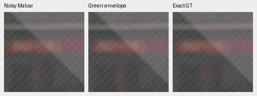
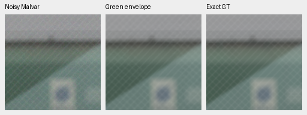

# Local amplitude checks for the 64-pixel Bayer mesh fit

A green-only amplitude envelope lowers ISO400 weak-wire error inside
true gaps from **4.835 to 3.659 DN16** while losing **0.132 percentage
points** of intact response. It changes ISO6400 gap error by about
0.0002 DN16. Red and blue observations add some accepted local fits at
ISO6400, with little effect on error. The established 64-pixel crop fit
is now available as a Python function and reproduces the earlier outputs
bit for bit.
[Results and receipts](results/bayer-amplitude-envelope-v1/publication.json) ·
[Frozen sources](results/bayer-amplitude-envelope-v1/evidence.tar.xz) ·
[Calling the crop function](usage.md#repeating-mesh-crops).

## Local amplitude over a fixed carrier

The [64-pixel Bayer fit](bayer-carrier-scale.md) estimates a constant
complex coefficient per frequency in each overlapping window. This
follow-up keeps the same exterior frequency nomination, phase model,
0.73 correction dose and parent. It tests local attenuation of each
delivered carrier behind its measured phase. Seven low-frequency cosine
terms allow amplitude to vary within the window. Before fitting them,
the procedure projects out the smooth tone and both constant carriers.

In the green-only arm, each green lattice independently fits the
baseline and the amplitude terms. The other lattice scores each
candidate envelope conditional on the competing wave. A bounded
attenuation requires more than three prior-whitened squared-error units
on both lattices. The second arm uses a fixed disjoint partition of
whole Bayer cells. Each color plane fits its own tone, phase and
amplitude. The fractional spatial envelope is shared, with residuals
scaled by shot/read variance. A green-only version of the same cell
split controls for the partition. Evaluated variants also use unchecked,
mean-per-window and spatially reversed envelopes.

Both noise profiles replay the 24 held-out constructed-wire backgrounds
from the 64-pixel study. Twelve backgrounds have a true local gap.
Both directions use the same rules, including on the visually stronger
wire that continues through a true gap. The separate 24 ISO6400
calibration backgrounds set two scalar gains for the uniform comparator.
They match the two families' mean squared corrections on intact pixels.
The natural-photo admission results carry over from the original fit
because the envelope acts only on the existing correction. No weights
are trained.

The frozen parent is local-only scene 20k EMA
`b892a08c8ebbccb05c000e4f42d1f86c3a7d1d5870721ccd6e1c8fe9e82c3889`
with eight-donor EMA
`7b854d681083550de869b06b55d56c2f84224ec4a0545419a2cf34682a38ec68`
and distant gate EMA
`ca2f3567bc65a3e3f2f8dadf81d97f36b13f0b2b5648ee0412f929be66b0e4c5`.
The original carrier calibration and input identities are bound in the
machine receipts. This scoped experiment adds no comparable fixed 427-photo
or known/unseen camera scores.

## What the extra evidence changes

| Change from the 64-pixel fit | Intact response, pp | Intact increment RMS, DN16 | Total gap RMS, DN16 | Weak-band gap RMS, DN16 |
| --- | ---: | ---: | ---: | ---: |
| Green envelope, ISO400 | −0.132 | +0.016 | −0.117 | −1.176 |
| All-color envelope, ISO400 | −0.030 | +0.003 | −0.076 | −0.743 |
| Green envelope, ISO6400 | −0.039 | +0.002 | +0.000 | +0.028 |
| All-color envelope, ISO6400 | −0.026 | +0.003 | +0.001 | +0.023 |
| Unchecked green envelope, ISO6400 | −1.298 | +0.536 | +0.123 | −0.166 |

At ISO400 the green envelope lowers weak-band gap RMS by 1.176 DN16
with a source-bootstrap 95% interval of [0.623, 1.828]. The effect is
0.788 DN16 larger than reversing the attenuation map and 0.456 DN16
larger than applying its per-window mean. The result also survives
matching the two families' scalar correction strengths on calibration.
The strong-family correction inside gaps changes by 0.042 DN16 RMS.
The primary effect is on the faint missing direction.

At ISO6400, including red and blue increases accepted weak-family
window fits from 21 to 31 relative to the green cell-split control.
The effect on weak-band gap RMS is +0.002 DN16 [−0.008, +0.012].
The checked green and all-color outputs preserve most of the base
wire gain. The unchecked green variant suppresses more added weak
texture and raises both intact and total gap RMS. The 64-pixel parent
remains the crop option for both noise profiles.

## Package and native checks

The opt-in crop API delivers the original fixed 64-pixel fit. It
reads only the packed Bayer sites in the crop and four donor patches.
The replay reproduces all 192 exact-target role outputs and eight
standing GFX outputs **bit for bit** with the matched composed
parent above. The synthetic regressions cover odd crop starts, all four
CFAs, a flat enclosed by mesh donors, and missing edge donors.
[Package source](../src/demosaic/mesh_carrier_fit.py) ·
[Replay receipt](results/bayer-amplitude-envelope-v1/package-parity.json).

The exact ISO400 triplets each display 160×160 native pixels at
`[48,48,160,160]` in the query `[128,128,256,256]`.
Shot/read is `8e-5/2.56e-8`, capture exposure 0.33, ADC 16-bit,
black 0.03 and display ×2. Each row shows noisy Malvar, the checked
green envelope and exact GT. The weak contrast inside the two gaps
remains subtle at native scale.
[Crop, noise and checkpoint manifest](images/bayer-amplitude-envelope-v1/manifest.json).

**M62-1719 locomotive**, George Chernilevsky, CC BY-SA 4.0. BGGR,
source crop `[408,318,512,512]`, known strip gap. Strong diagonals
remain visible with a faint weak-family remnant.
[Photo source](https://commons.wikimedia.org/wiki/File:Locomotive_M62-1719_2013_G3.jpg) ·
[Comparison](images/bayer-amplitude-envelope-v1/low-iso/005-iso400-comparison.png).

**St Valentin rail**, GT1976, CC BY-SA 4.0. RGGB, source crop
`[376,16,512,512]`, known ellipse. Faint lines remain near the bright
background step. The small ISO400 numerical change is hard to see.
[Photo source](https://commons.wikimedia.org/wiki/File:2018-05-04_(217)_33_53_9332_586-5_at_Bahnhof_St._Valentin.jpg) ·
[Comparison](images/bayer-amplitude-envelope-v1/low-iso/012-iso400-comparison.png).

## Standing GFX100S comparisons

All eight crops were inspected. DSCF3879 uses nominal shot/read
`0.00128/6.5536e-6` and display ×4. The three sky, building and
foliage crops reproduce the 64-pixel fit at display precision. The
coarse fence keeps both directions. DSCF3842 uses display ×16 under
the same nominal prior and the transferred
`0.0014635775921166604/1.0715704128646712e-6` prior. The checked arms
retain both visible directions. Wire contrast can look too regular
and smaller crossings stay incomplete. The unchecked fit removes
more visible contrast. Both cab JPEGs and the separate ISO100 AHD
captures are qualitative references with aperture and motion differences.

[Sky](images/bayer-amplitude-envelope-v1/standing/main-overcast-sky-main-overcast-sky.png) ·
[Building](images/bayer-amplitude-envelope-v1/standing/main-building-detail-main-building-detail.png) ·
[Foliage](images/bayer-amplitude-envelope-v1/standing/main-foliage-main-foliage.png) ·
[Coarse lattice](images/bayer-amplitude-envelope-v1/standing/main-chain-link-fence-main-chain-link-fence.png).

| Cab prior | Native comparisons |
| --- | --- |
| Nominal | [Left](images/bayer-amplitude-envelope-v1/standing/mesh-nominal-fine-green-mesh-left.png) · [Right](images/bayer-amplitude-envelope-v1/standing/mesh-nominal-fine-green-mesh-right.png) |
| Transferred | [Left](images/bayer-amplitude-envelope-v1/standing/mesh-profile3879-fine-green-mesh-left.png) · [Right](images/bayer-amplitude-envelope-v1/standing/mesh-profile3879-fine-green-mesh-right.png) |
