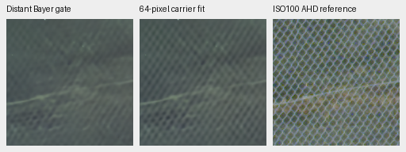
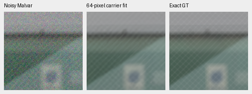
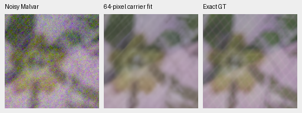

# Pooling Bayer evidence over 64 pixels for fine mesh

A 64×64 native Bayer fit makes both wire directions and some intersections
clearer in the real GFX100S cab mesh. The frozen distant Bayer gate
leaves most of that weave diffuse. On held-out ISO6400 planted wires,
the 64-pixel fit raises recovered response from **42.74% to 55.01%**,
lowers intact increment RMS by **2.56 DN16** and lowers total error in
true gaps by **2.22 DN16**. The lattice can still look too regular, and
the fit adds some weak-family signal in true gaps. The 48 held-out
natural photo backgrounds receive no added correction at either ISO.
[Source-bound results](results/bayer-carrier-scale-v1/publication.json) ·
[Executed code and original receipts](results/bayer-carrier-scale-v1/evidence.tar.xz).

## Finding supported spacing in the high-ISO RAW

The cab post and nearby texture compete with the fine wires in a small
Fourier window. The diagnostic estimates the two oblique spacings from
four separate nearby 128×128 noisy RAW donor patches. Each donor contributes
its phase-aligned green spectrum after normalization by its mean power
in the search band. The same search independently selects spacing in the
registered ISO100 RAW. The candidate coordinates below are cycles per
native pixel, in `(x,y)` order. The reference is an independent exposure
with different aperture and motion. It contributes neither phase nor
amplitude to the fit or to the rendered output.

| Cab ROI | DSCF3842 noisy exterior spacing | DSCF3835 separate ISO100 spacing |
| --- | --- | --- |
| Left | `(0.1152,0.0742)`, `(0.0898,−0.0723)` | `(0.1172,0.0742)`, `(0.0898,−0.0723)` |
| Right | `(0.1172,0.0742)`, `(0.0898,−0.0723)` | `(0.1172,0.0723)`, `(0.0918,−0.0723)` |

For each fixed pair, one green lattice fits a low-frequency cosine
background and both carriers on their native measured sites. The other
green lattice scores the prediction. The roles then reverse. Removing
one carrier and refitting the rest lets each direction earn its own
conditional prediction-error reduction. Its units are squared error
divided by the shot/read variance estimated from the fitting lattice.
The thresholds are empirical and shared sensor noise can affect them.

With noisy-exterior spacing and nominal conditioning, the left cab
passes a six-unit threshold on both folds in **2 of 25** disjoint
32-pixel tiles in its first direction and **0 of 25** in the second.
At 64 pixels it passes in **3 of 4** and **1 of 4**. The right cab goes
from **10 of 25** and **1 of 25** to **4 of 4** and **3 of 4**. These
tiles come from the same two ROIs and describe spatial support within
each region. The 160-pixel fit
from noisy-exterior spacing reaches summed reciprocal gains of 152 and
80 on the left, and 462 and 208 on the right. The sky yields negative
gains for both tested directions at that size. The executable diagnostic
also records 128-pixel fits, an affine-background control and frequency
selection separately within each green lattice.

## Delivering the extra signal

The tested crop fit uses noisy RAW for both nomination and delivery.
A donor bank passes if the two frequencies are in the declared diagonal
native band and at least one independent donor nominates both within 0.009
cycles per pixel of the pooled estimates. These exploratory bounds were
chosen after inspecting the standing RAW scale diagnostic. The wire
calibration and held-out targets are separate from the standing scenes.
An incomplete donor bank at the scene edge skips the fit.

Overlapping 32- or 64-pixel target windows then fit the same fixed
frequencies. Each direction must clear six units of predictive gain on
both green lattices. A bounded weight increases with the smaller gain,
and the two complex coefficients are averaged. The corresponding signal
already in the model's green output is subtracted before each residual is
capped at the measured wave amplitude. The tapered overlap introduces an
achromatic correction with no reference image input. The parent has seen
all query samples, so the predictive test validates only the Bayer fit.
Four-CFA checks cover all crop parities. Replacing held-out green samples
leaves their fitting coefficients identical, and replacing the entire
central ROI leaves exterior nominations identical.

The frozen composition starts from local-only 20k EMA
`b892a08c8ebbccb05c000e4f42d1f86c3a7d1d5870721ccd6e1c8fe9e82c3889`.
It uses ring8 EMA
`7b854d681083550de869b06b55d56c2f84224ec4a0545419a2cf34682a38ec68`
and the distant phase gate EMA
`ca2f3567bc65a3e3f2f8dadf81d97f36b13f0b2b5648ee0412f929be66b0e4c5`.
The original transported phase head is bound in the receipt. The 24
ISO6400 calibration backgrounds pick a dose between zero and one by
minimizing intact increment RMS under caps of +0.05 DN16 gap RMS and
+0.025 DN16 flat RMS. The 32-pixel fit calibrates to zero and the
64-pixel fit to **0.73**. Inference applies the calibrated scalar to
the measured residual over the frozen model.

## Exact-target comparisons

| ISO6400 held-out change versus the distant gate | Intact response, pp | Intact RMS, DN16 | Absolute gap RMS, DN16 | Added gap luma RMS, DN16 |
| --- | ---: | ---: | ---: | ---: |
| 32 pixels, full dose | +4.083 | +1.851 | +0.012 | 16.882 |
| 64 pixels, calibrated 0.73 dose | +12.264 | −2.564 | −2.217 | 17.913 |
| 64 pixels, full dose | +16.800 | −2.609 | −2.368 | 24.538 |

On 24 backgrounds, the 64-pixel dose gains **12.26** response points
[8.73, 15.88] and lowers intact RMS by 2.56 DN16 [0.85, 4.61]. On the
12 true-gap backgrounds it lowers absolute gap RMS by 2.22 DN16
[0.82, 4.01]. The gap-band audit shows the extra correction concentrates
in the continuing strong band at 15.79 DN16, with **1.54 DN16** added
to the missing weak band. Its absolute weak-band gap error changes by
+0.329 DN16 [−0.364, +0.990]. At ISO400 that weak-band error rises
1.553 DN16, even as intact increment RMS falls by 0.845 DN16.

On the separately corrupted **strong-only** roles at ISO6400, the fit
adds just **0.071 DN16** in the absent weak subspace and changes its
absolute error by −0.002 DN16 [−0.016, +0.013]. The exact synthetic flat
cores receive no correction at either ISO. The gap measures matter
because continuation across a local break is harder to reject than a wire
that is missing from the whole query. When the 32-pixel comparison is
scaled to match the 64-pixel calibration gap dose, the 64-pixel fit gains
6.43 more response points. The two delivered gap magnitudes separate on
the held-out backgrounds, so that difference applies to the calibration
match.

Both ISO profiles on the 48 independent natural backgrounds reproduce the
frozen distant path. On each profile 21 queries lack a complete nearby
donor bank and 27 have sufficient coverage but fail the geometry check.
On the ISO6400 panel the composed output thus inherits the distant
gate's 0.677 DN16 lower increment RMS and 0.127 DN16 higher flat RMS
relative to V120. Relative to Corpus 100k these differences are
−0.470 and +0.588 DN16. The fit is useful on admitted repeating structure
and supplies no new general-photo or broad camera score. The evaluation
covers scopes with planted structure plus independent natural and
real-camera crops. V120 remains the general model choice.

### Native crops

Each cell shows 160×160 unchanged pixels at `[48,48,160,160]` of the
native query. Shot/read is `0.00128/6.5536e-6`, capture exposure 0.33,
with 16-bit ADC and black 0.03. Display exposure is ×2 for the wire
comparisons. The triplets show noisy Malvar, the composed 64-pixel
output and the exact simulated target.
[Native source, noise and checkpoint manifest](images/bayer-carrier-scale-v1/manifest.json).

**St Valentin rail**, GT1976, CC BY-SA 4.0, RGGB. Query at
`[128,128,256,256]` inside original photo crop `[376,16,512,512]`.
The faint second family becomes more visible, including on the lower
panel. It stays weaker than the exact weave. Some wire impressions
persist inside the ellipse.
[Photo source](https://commons.wikimedia.org/wiki/File:2018-05-04_(217)_33_53_9332_586-5_at_Bahnhof_St._Valentin.jpg) ·
[All methods](images/bayer-carrier-scale-v1/exact/012-iso6400-comparison.png).

**Dianthus superbus**, Uoaei1, CC BY-SA 4.0, GRBG. The smooth-dip
fixture places the same query coordinates within the source crop
listed in the manifest. Both wire directions register, with
weak contrast in the central region still below the exact target.
[Photo source](https://commons.wikimedia.org/wiki/File:Dianthus_superbus_Auernig_01.jpg) ·
[All methods](images/bayer-carrier-scale-v1/exact/014-iso6400-comparison.png).

The natural cathedral triplet uses BGGR query `[22,250,256,256]`,
display ×3.0303 and contrast ×2. Its small brick and trim details stay
soft, with no fit activation. [Cathedral board](images/bayer-carrier-scale-v1/exact/001-iso6400-independent-comparison.png).

## Standing GFX100S comparisons

All eight cases were viewed at native scale. The main DSCF3879 sky,
building and foliage reproduce the distant gate pixel for pixel at
display ×4. The coarse lattice holds both directions. The nominal
DSCF3842 right cab at display ×16 shows the clearest difference,
with both fine diagonals and more visible crossings. The nominal left
also shows more crossings away from the vertical post. Transferred
conditioning `0.0014635775921166604/1.0715704128646712e-6` retains
both patterns, with weaker additional contrast. Some wires remain
overly regular and broader mottling persists. The independent ISO100
AHDs and both cab JPEGs are qualitative references, with aperture,
exposure time and subject motion differences.

[Sky](images/bayer-carrier-scale-v1/standing/main-overcast-sky-main-overcast-sky.png) ·
[Building](images/bayer-carrier-scale-v1/standing/main-building-detail-main-building-detail.png) ·
[Foliage](images/bayer-carrier-scale-v1/standing/main-foliage-main-foliage.png) ·
[Coarse fence](images/bayer-carrier-scale-v1/standing/main-chain-link-fence-main-chain-link-fence.png).

| Cab profile | Native comparison with both JPEGs and ISO100 AHD |
| --- | --- |
| Nominal `0.00128/6.5536e-6` | [Left](images/bayer-carrier-scale-v1/standing/mesh-nominal-fine-green-mesh-left.png) · [Right](images/bayer-carrier-scale-v1/standing/mesh-nominal-fine-green-mesh-right.png) |
| Transferred | [Left](images/bayer-carrier-scale-v1/standing/mesh-profile3879-fine-green-mesh-left.png) · [Right](images/bayer-carrier-scale-v1/standing/mesh-profile3879-fine-green-mesh-right.png) |
