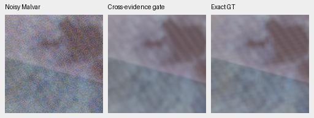
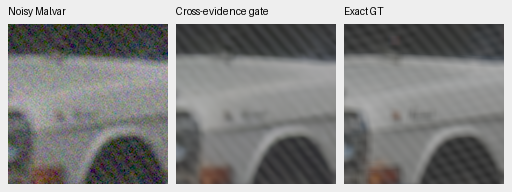

# Cross-checking weak carrier coefficients in the two Bayer greens

A crop gate based on agreement between the two Bayer greens passes
**8 of 8** eligible bent-wire captures on 24 additional held-out photos.
The existing query check passes **5 of 8**. A held-residual check
calibrated to the same development false-activation budget passes **6 of
8**. All three checks reject the 12 eligible absent-detail controls.
Applying just the weaker exterior direction improves mean fine-increment
RMS by **0.55 DN16** over the prior joint fit. Most of the recovery comes
from the exterior proposal itself. The additional gain over the calibrated
residual check is small, and both standing GFX families keep the prior fit.

[Machine results](results/bayer-cross-evidence-v1/publication.json) ·
[Frozen drivers and receipts](results/bayer-cross-evidence-v1/evidence.tar.xz) ·
[Native crop provenance](images/bayer-cross-evidence-v1/manifest.json).

## Crop evidence and delivered corrections

The [warped exterior spectra](bayer-warped-spacing.md) estimate center
frequency and bend from windows outside the native query. This study holds
those proposals fixed and tests cases where the primary joint fit abstains.
Four disjoint 64-pixel query windows fit both proposed directions and a
polynomial nuisance on each green lattice. Each fit returns sine and cosine
coefficients and their estimated covariance for each direction.

For coefficient vectors $a$ and $b$ with covariance estimates $C_a$
and $C_b$, the window contributes $a^\top Wb$ with
$W=(C_a+C_b)^{-1}$. The approximate independent-noise variance is
$\operatorname{tr}(C_a W C_b W)$. The score sums the contributions
across windows and divides by the square root of the summed variance.
The smaller of the two directional scores governs the crop. This cross
product avoids the square-amplitude penalty of predicting one green with a
noisy fitted amplitude from the other. Shared natural structure can still
align both estimates. The thresholds therefore come from empirical controls.

The calibrated held-residual score sums the original held-green residual
improvements within each lattice and direction and uses the smallest total.
Both scores use their maximum among 18 eligible development negatives
as a strict cutoff. The cross and residual thresholds are 4.73453 and
8.25408, respectively, in their own units. The earlier fixed crop check
also requires a minimum count of supporting windows.

The delivered comparisons all use the same local 64-pixel residual fit,
dose 0.73 and Corpus 100k EMA
`87b96f3c487b9edaf1c477742b6c38f2a82cc6b20a94716d51cc8cf46a17a760`.
The weak-only variant keeps the direction with less summed support in the
exterior RAW. The exact target assigns neither the direction nor the lift.
A replay reconstructs the two-direction correction exactly from the local
fit before testing the weaker contribution on its own.

## Development and independent replay

The first 20 backgrounds calibrate the cutoffs. A disjoint 16-photo replay
includes eight bent and eight straight fields. A further prospective
panel uses 24 distinct held-out photo backgrounds with bent carriers.
Source ordering, geometry, thresholds and correction strength were frozen
before the latter run. All cases use two independent noise draws for
each of four roles. The roles are present weak detail with a known local
gap, weak detail only outside the query, strong carrier alone and an
exactly flat central core. Shot/read are `0.00128/6.5536e-6`, with
capture exposure 0.33 and 16-bit ADC at black 0.03.

| Panel and role | Exterior eligible | Fixed crop check | Calibrated held residual | Bayer agreement |
| --- | ---: | ---: | ---: | ---: |
| Development bent present | 5 of 20 | 5 | 5 | 5 |
| Development straight present | 5 of 20 | 4 | 5 | 5 |
| Development absent-detail controls | 18 of 120 | 0 | 0 | 0 |
| Independent bent present | 2 of 16 | 0 | 1 | 2 |
| Independent straight present | 2 of 16 | 1 | 1 | 1 |
| Independent absent-detail controls | 9 of 96 | 0 | 0 | 0 |
| Prospective bent present | 8 of 48 | 5 | 6 | 8 |
| Prospective absent-detail controls | 12 of 144 | 0 | 0 | 0 |

The two first independent bent candidates are redraws of one photo.
Agreement adds 0.600 weak-response points and lowers fine-increment RMS
by 0.066 DN16 versus the calibrated residual gate on that eight-photo
bent subset. The prospective difference occurs on two different
backgrounds. A looser residual cutoff also passes 8 of 8 on the newer
panel after accepting one development negative and one older independent
outside-only negative. With exact geometry supplied, agreement passes
41 of 48 prospective present captures and the calibrated held-residual
gate passes 35. Those diagnostic results indicate how much remains
limited by finding the pair in the first place.

| Prospective bent metric | Prior joint fit | Fixed crop check | Held residual | Agreement | Agreement, weaker only |
| --- | ---: | ---: | ---: | ---: | ---: |
| Weak response | 34.835% | 36.389% | 36.564% | 36.666% | 36.665% |
| Fine-increment RMS, DN16 | 169.931 | 169.530 | 169.477 | 169.557 | 169.384 |
| Absolute gap RMS, DN16 | 137.338 | 136.987 | 136.999 | 136.745 | 137.367 |
| Weak coherent gap projection, DN16 | 4.817 | 5.009 | 5.002 | 4.999 | 5.004 |
| Outside-only added RMS, DN16 | 2.804 | 2.804 | 2.804 | 2.804 | 2.804 |
| Exact-flat added RMS, DN16 | 0.000 | 0.000 | 0.000 | 0.000 | 0.000 |

Both-direction delivery adds **0.102 response points** over the
calibrated residual check and raises fine-increment RMS by **0.080 DN16**.
Weak-only delivery gains **0.101 points** and lowers increment RMS by
**0.094 DN16**, with a paired photo bootstrap interval of
[−0.300, +0.027] DN16 for the error difference. Relative to the fixed
warped crop check, weak-only lowers increment RMS by 0.146 DN16 and adds
0.380 DN16 to absolute gap RMS. The two-direction variant retains the
better absolute gap score. The outside-only residual in the table is
already present in the prior joint fit. Quiet-region RMS stays at
18.397 DN16 throughout. This is a replay of a local inference component.
The fixed 427-photo and measured-camera benchmarks are outside its scope.

## Native exact-target triplets

Each cell uses the original `[48,48,160,160]` ROI within the
`[128,128,256,256]` query, with display ×2. Both triplets show noisy
Malvar, both-direction agreement and exact GT. They are the two
prospective captures admitted by agreement alone at the fixed cutoffs.
Weak crossings remain faint on the fungi background and over the car's
bright flank, especially beside the strong diagonal near the wheel.

**King Alfred's Cakes**, Stu's Images, CC BY-SA 3.0. GBRG, redraw one,
source box `[310,46,512,512]`.
[Source](https://commons.wikimedia.org/wiki/File:Daldinia_concentrica,_King_Alfred's_Cakes,_Enfield_UK.JPG) ·
[All methods](images/bayer-cross-evidence-v1/disagreement/case-003-draw1-comparison.png).

**GAZ 24**, Victor Vizu, CC BY-SA 3.0. BGGR, redraw zero,
source box `[184,46,512,512]`.
[Source](https://commons.wikimedia.org/wiki/File:%D0%93%D0%90%D0%97_24_IMG_8516.JPG) ·
[All methods](images/bayer-cross-evidence-v1/disagreement/case-013-draw0-comparison.png).

[Other independent draw zero](images/bayer-cross-evidence-v1/independent/case-001-draw0-comparison.png) ·
[Same background, draw one](images/bayer-cross-evidence-v1/independent/case-001-draw1-comparison.png).

## Standing GFX100S comparisons

The same exterior candidates are rejected on all eight standing inputs
before either crop gate runs. The source, native crop and profile bindings
reproduce the prior checked panel, which was viewed again. Sky is smooth.
The coarse mesh keeps both directions and the building cables and foliage
stay soft. The fine mesh remains mottled in places, with incomplete
junctions under nominal and transferred conditioning. Both camera JPEGs
and the independently demosaiced ISO100 captures are qualitative references.
The matched standing path combines local 20k EMA, eight-donor EMA and
distant gate EMA using the prior report's bound inputs and checkpoints.
[Standing crops and checkpoint provenance](bayer-warped-spacing.md#standing-gfx100s-comparisons).
