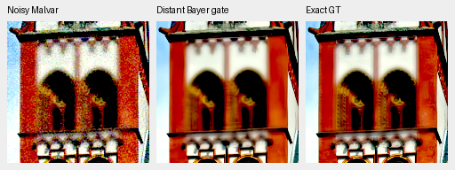
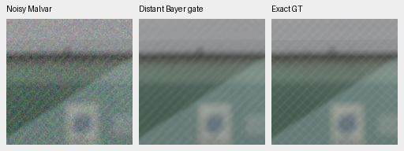

# Gating Bayer phase correction with distant RAW support

The distant Bayer gate retains the planted-wire benefit of the earlier fixed
phase correction and reduces its independent natural-photo flat penalty from
**0.894 to 0.145 DN16** at ISO6400. Against the frozen eight-donor model it
recovers **1.59 percentage points** more planted-wire signal, with **2.64 DN16**
lower intact error and **2.09 DN16** lower absolute gap error. Fine natural
response still falls 0.061 points and the real cab intersections stay incomplete.
[Machine results](results/bayer-distant-phase-gate-v1/publication.json) ·
[Frozen sources, checkpoints and receipts](results/bayer-distant-phase-gate-v1/evidence.tar.xz).

## Measurement and training

The [fixed exterior rule](bayer-phase-quadrature.md) proposes parallel and
perpendicular changes to each Fourier coefficient of the eight-donor
reconstruction. Near cardinal and diagonal supporters nominate a frequency
for one another and supply a transported complex estimate. The two green
planes in the query are measured at their native Bayer offsets. The new
distant gate also receives four 32×32 Bayer donor windows whose centers
are displaced 64 native pixels along the cardinal axes. These windows
share no samples with the target or either near nomination group at
the same station. They score the fixed frequencies with signed and
perpendicular projections, projected along and across the wave direction.
A fixture changes pixels in one distant donor and verifies that the
near measurements and correction proposal stay bit-identical. The frozen
parent and its correction still use the whole crop.

Three arms share the same frozen proposal and can only scale its two components
by factors in [0, 1]. The scalar arm learns two gains. The near gate uses the
local and near Bayer evidence. The distant gate uses the same two-hidden-layer
MLP with the additional measurement inputs. Inference controls rotate the
distant direction weights by 90° or shift only their descriptors by five
and seven stations, keeping the original proposed correction fixed.

All arms see the same 448 previously frozen, distinct training sources
with 224 ordinary photos and 224 planted-wire backgrounds, matched CFA,
conditioning and exposures. Both protected camera families and scored
sources stay outside training. FP32 training uses 672 AdamW updates,
four photos per update, six passes, 2,688 photo visits and 8,064 native
role queries per arm. It takes **23.42 s** after **151.66 s** of feature
preparation. The loss combines the earlier paired response, exact-flat
and direction-separated gap objectives. Evaluation uses EMA 0.99.

| Composed endpoint | SHA256 |
| --- | --- |
| New gate checkpoint with raw and EMA arms | `ca2f3567bc65a3e3f2f8dadf81d97f36b13f0b2b5648ee0412f929be66b0e4c5` |
| Frozen eight-donor checkpoint, EMA ring8 | `7b854d681083550de869b06b55d56c2f84224ec4a0545419a2cf34682a38ec68` |
| Frozen transported phase head | `069de3a3d3f18ab0f32cf9b242daa1fb859d03762086ee27244557aced803e54` |
| Local-only scene 20k parent, EMA | `b892a08c8ebbccb05c000e4f42d1f86c3a7d1d5870721ccd6e1c8fe9e82c3889` |

## Held-out errors and response

| ISO6400 change versus ring8 | Planted response, pp | Planted intact RMS, DN16 | Planted gap RMS, DN16 | Natural fine response, pp | Natural flat RMS, DN16 |
| --- | ---: | ---: | ---: | ---: | ---: |
| Fixed exterior phase | +1.226 | −2.581 | −1.883 | −0.153 | +0.894 |
| Learned scalar gains | +2.420 | −4.381 | −3.273 | −0.214 | +1.085 |
| Near Bayer gate | +1.242 | −2.076 | −1.596 | −0.112 | +0.273 |
| Distant Bayer gate | +1.588 | −2.641 | −2.088 | −0.061 | +0.145 |
| Distant gate, shifted measurements | +1.446 | −2.583 | −1.964 | −0.089 | +0.198 |
| Distant gate, rotated weights | +1.589 | −2.646 | −2.093 | −0.061 | +0.145 |

The natural panel uses independent draws on 48 photo backgrounds at each
ISO. The wire panel uses 24 backgrounds per profile, with 12 true gaps.
At the original settings, adding distant support to the learned scheme
lowers ISO6400 natural flat RMS by **0.128 DN16** [0.090, 0.172] versus
the near gate and recovers **0.051 points** [0.023, 0.075] more response.
The gain over shifting the distant measurements is smaller. Rotating
the weights has negligible effect, so the improvement is consistent
with spatially matched measurements and gives little evidence for the
particular tangent weighting.

At the original deployed doses the distant gate improves natural flat RMS
over fixed phase by 0.749 DN16 [0.527, 0.993] and natural increment RMS by
0.190 DN16 [0.104, 0.284]. Its planted response rises a further 0.36 points.

Dose-matched comparisons use a separate 16-photo ISO6400 calibration
set to match RMS added in natural flats, and 12 separate true-gap
backgrounds to match RMS added in planted gaps. Both measurements are
relative to ring8. The held-out distant model gains 0.705 planted
response points [0.257, 1.221] and lowers gap error 0.664 DN16
[0.282, 1.140] over the matched fixed phase dose. Its natural response
is effectively tied, and flat RMS is 0.037 DN16 lower [0.010, 0.065].
At matched near-gate strength, the interval on the natural flat advantage
crosses zero. At ISO400 the distant gate reduces intact planted RMS
by 1.060 DN16 while losing 1.511 response points relative to ring8.

Within true ISO6400 gaps, error projected onto the missing weak family
changes by +0.088 DN16 [−0.004, +0.201] versus ring8. The gate lowers
error outside the fitted trend and wire bands by 1.493 DN16. It adds
4.144 DN16 of change in the continuing strong family and 0.459 DN16
in the missing weak family. The total gap improvement therefore still
allows some weak-family leakage. At ISO400, weak-family error rises
0.337 DN16 despite the lower total gap RMS.
[Gap subspace audit](results/bayer-distant-phase-gate-v1/gap-bands.json) ·
[Analysis driver and receipt](results/bayer-distant-phase-gate-v1/gap-bands.tar.xz).

On this natural ISO6400 panel the composed path has 0.677 DN16 lower
increment RMS and 0.127 DN16 higher flat RMS than V120. Relative to
Corpus 100k these differences are −0.470 and +0.588 DN16. Versus ring8
it adds 0.031 DN16 natural increment RMS and loses 0.0011 dB on the
present-role sRGB PSNR. One-core warm correction medians on a fixed
256-pixel query are 259 ms for fixed phase and 275 ms for the distant
gate. The 16 interleaved trials per arm each restore one output from
the same cached parent and donor inputs.
[Matched timing](results/bayer-distant-phase-gate-v1/matched-runtime.json) ·
[Timing driver and receipt](results/bayer-distant-phase-gate-v1/matched-runtime.tar.xz).

Training, scoped numerical evaluation and native viewing are complete.
This component has no new fixed-427 or measured-camera scores.

## Native exact-target comparisons

Each 160×160 cell shows original query pixels at `[48,48,160,160]`.
The matched ISO6400 conditioning is `0.00128/6.5536e-6`, with capture
exposure 0.33, 16-bit ADC and black 0.03. The middle panel uses the
distant gate with the EMA composition above.
[Native provenance](images/bayer-distant-phase-gate-v1/manifest.json).

**Limburg Cathedral**, Berthold Werner, public domain. BGGR query
`[22,250,256,256]`, display ×3.0303 and contrast ×2. Fine trim and
brick remain softer than the exact target.
[Source](https://commons.wikimedia.org/wiki/File:Limburger_Dom_BW_1.jpg) ·
[All methods](images/bayer-distant-phase-gate-v1/exact/001-iso6400-independent-comparison.png).

**St Valentin rail**, GT1976, CC BY-SA 4.0. RGGB query
`[128,128,256,256]` within the original `[376,16,512,512]`, display ×2.
Strong diagonals remain visible across the image. The weak family and
many junctions are diffuse. The continuous smooth-dip crop shows a
similar strength imbalance.
[Source](https://commons.wikimedia.org/wiki/File:2018-05-04_(217)_33_53_9332_586-5_at_Bahnhof_St._Valentin.jpg) ·
[All methods](images/bayer-distant-phase-gate-v1/exact/012-iso6400-comparison.png) ·
[Smooth dip](images/bayer-distant-phase-gate-v1/exact/014-iso6400-comparison.png).

## Standing GFX100S comparisons

All eight boards were viewed at native scale with identical coordinates
and transforms. DSCF3879 uses the nominal profile and display ×4.
The sky is smooth, both coarse fence directions are coherent, and
fine building wires and leaf tips stay soft. DSCF3842 uses display ×16
and either nominal or transferred shot/read
`0.0014635775921166604/1.0715704128646712e-6`.
The transferred right diagonals remain visible. The left wire fragments
and right crossings appear similar to ring8, with some background
mottling under both priors. Independent ISO100 AHD and both cab JPEG
views are shown as qualitative references. Aperture, exposure time
and movement differ across captures.

[Sky](images/bayer-distant-phase-gate-v1/standing/main-overcast-sky-main-overcast-sky.png) ·
[Building](images/bayer-distant-phase-gate-v1/standing/main-building-detail-main-building-detail.png) ·
[Foliage](images/bayer-distant-phase-gate-v1/standing/main-foliage-main-foliage.png) ·
[Coarse fence](images/bayer-distant-phase-gate-v1/standing/main-chain-link-fence-main-chain-link-fence.png).

| Cab prior | Native crops with both JPEGs and ISO100 AHD |
| --- | --- |
| Nominal | [Left](images/bayer-distant-phase-gate-v1/standing/mesh-nominal-fine-green-mesh-left.png) · [Right](images/bayer-distant-phase-gate-v1/standing/mesh-nominal-fine-green-mesh-right.png) |
| Transferred | [Left](images/bayer-distant-phase-gate-v1/standing/mesh-profile3879-fine-green-mesh-left.png) · [Right](images/bayer-distant-phase-gate-v1/standing/mesh-profile3879-fine-green-mesh-right.png) |
