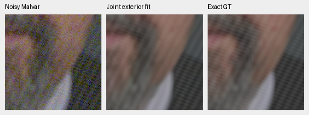
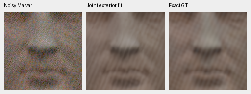

# Estimating weak wire bends from exterior Bayer samples

Nearby RAW windows recover much of a synthetic bend when the center spacing
is known. At ISO6400, the weak direction's phase error falls from 0.031 to
**0.004 cycles** and delivered weak response rises **1.55 percentage
points**. Jointly estimating spacing and bend from noisy RAW improves
response by **0.39 points** over the original noisy spacing fit. That path
gets an eligible spacing pair in just three of twenty bent present draws.
All four fine cab crops reproduce the fixed 64-pixel result at display
precision. The fixed fit remains the crop option for the real photographs.
[Machine results](results/bayer-exterior-bend-v1/publication.json) ·
[Frozen drivers and receipts](results/bayer-exterior-bend-v1/evidence.tar.xz) ·
[Native crop provenance](images/bayer-exterior-bend-v1/manifest.json).

## Estimating geometry outside the crop

The [shared Bayer phase study](bayer-shared-phase.md) estimates curvature
from four central windows. This follow-up uses eight disjoint 64-pixel
windows beyond the entire native 256-pixel query. Four are centered on
the cardinal axes and four near the diagonals. Across donor windows, the
fit shares one shape per direction. Inside each window it independently
fits local tone and a complex amplitude. The amplitude and constant phase
can vary across the scene.

Each green lattice proposes geometry, then the other tests its fixed
prediction. In the control with different donor locations, cardinal and
diagonal groups predict one another's reserved green, with local amplitude
and tone fitted on the other plane in each test tile. The fitted changes
need more than three prior-whitened squared-error units in both directions
and less than 0.18 cycles of estimated phase disagreement in the delivered
windows. Replacing **every sample of the native query** with a constant
leaves the fixed-center exterior estimator bit-identical in all 20 tested
cases. The optional reserved query check can then vet the resulting
geometry inside the crop, before the same 0.73-dose local delivery.

The synthetic replay holds ten bent and ten straight backgrounds fixed,
with two ISO6400 draws of four present and absent roles per source. These
are the same fields as the preceding geometry test. All synthetic
predictions use the frozen Corpus 100k EMA
`87b96f3c487b9edaf1c477742b6c38f2a82cc6b20a94716d51cc8cf46a17a760`.
Standing outputs compose local-only scene 20k EMA, eight-donor EMA and
distant gate EMA with the original eight-view provenance. The final
64-pixel lift still requires local evidence for the carrier itself.
[Checkpoint composition and the original crop fit](bayer-shared-phase.md#fitting-and-checking-the-geometry).

## Conditional test with exact center spacing

| Ten bent photos at ISO6400 | Weak response | Fine-increment RMS, DN16 | Total gap RMS, DN16 | Weak-wave gap projection, DN16 |
| --- | ---: | ---: | ---: | ---: |
| Corpus 100k EMA | 28.268% | 184.931 | 141.645 | 3.747 |
| Fixed exact center | 45.551% | 178.902 | 139.662 | 5.526 |
| Four central windows, tangent fit | 45.341% | 178.869 | 139.617 | 5.362 |
| Exterior fit, linear shift then bend | 44.520% | 179.433 | 139.662 | 5.083 |
| Exterior bend with fixed center | 47.098% | 178.538 | 139.685 | 5.723 |
| Fixed center with separate test locations | 47.032% | 178.564 | 139.678 | 5.703 |
| Fixed center plus central query check | 45.755% | 178.863 | 139.702 | 5.526 |
| Exact center and exact bend | 47.052% | 178.548 | 139.685 | 5.730 |

Holding the supplied center fixed lets the eight exterior windows confirm
weak curvature in 19/20 bent present draws. The version with distinct
test locations confirms it in 16/20. Both accept it once in 20 straight
present draws. The same estimator often confirms a bend in the
outside-only and quiet-query roles, where the wave really does extend
outside the query. Correct exterior geometry by itself provides limited
evidence that the center contains the wave.

The fixed-center gain is **1.547 points** [0.739, 2.440]. The fine-increment
error falls **0.364 DN16** [0.158, 0.602]. Total gap RMS changes by
+0.023 DN16, with the uncertainty spanning zero. Weak-wave projection
within a gap has a +0.196 DN16 point estimate. The additional query
check brings that projection back to the fixed-center baseline level and
reduces the response benefit to 0.204 points [−0.020, +0.572].
Exact-flat error is unchanged for the fixed-center exterior arms. The
sequential shift-and-bend method changes one exact-flat source
and adds 0.084 DN16 of mean correction RMS on the ten
bent backgrounds. Its response also falls by 1.031 points.

[Storefront comparison at exact center](images/bayer-exterior-bend-v1/exact-center/bent-001-comparison.png) ·
[Air show comparison at exact center](images/bayer-exterior-bend-v1/exact-center/bent-003-comparison.png).

## Joint estimation from noisy RAW

The noisy-only test uses the existing four-donor spacing nomination and
eligibility rule. The new joint fit refines two center-frequency coordinates
and one tangential bend per family in one optimization. Each update
accounts for the change in apparent frequency across a bent wire
before settling on a center. On the three
admitted bent captures, the mean within-window RMS of weak phase error
falls from **0.064 to 0.009 cycles**.

| Change from the fixed noisy spacing fit | Bent weak response, pp | Bent fine-increment RMS, DN16 | Bent total gap RMS, DN16 |
| --- | ---: | ---: | ---: |
| Bend around noisy center | +0.070 | −0.053 | −0.008 |
| Joint exterior fit | +0.387 | −0.178 | +0.012 |
| Joint exterior fit plus query check | +0.387 | −0.188 | +0.013 |

The joint response effect has a paired 95% interval of [0.000, 1.160]
points. Two source images account for the three admitted bent draws.
On the straight panel the joint response changes by +0.034 points and
the exact-flat outputs are identical to the baseline. All intervals
bootstrap source photos. The noisy-only comparison reuses the development
panel and says little about weak patterns missed by the original
nomination. Full427 and measured-CFA scores are outside this crop study.

### Native exact targets

The two examples are the first two bent sources in panel order with an
eligible noisy nomination. Each triplet uses [48,48,160,160] in the
native [128,128,256,256] query, redraw zero, BGGR, shot/read
`0.00128/6.5536e-6`, 16-bit ADC, black 0.03, capture exposure 0.33, and
the same ×2 display transform. The weak direction is still patchy
compared with the exact target.

**Andreas Statzkowski portrait**, Sandro Halank, Wikimedia Commons,
CC BY-SA 3.0. Source box `[276,376,512,512]`. The weave on the dark
jacket changes slightly near the edge. [Source](https://commons.wikimedia.org/wiki/File:2017-11-16_Andreas_Statzkowski_by_Sandro_Halank%E2%80%931.jpg) ·
[All methods](images/bayer-exterior-bend-v1/noisy-center/case-005-comparison.png).

**Chénier sculpture**, photograph by Selbymay, CC BY-SA 3.0.
Source box `[50,68,512,512]`. The joint fit keeps the broad sculpture
shading and soft crossings. [Source](https://commons.wikimedia.org/wiki/File:David_d%27Angers_-_Chenier.jpg) ·
[All methods](images/bayer-exterior-bend-v1/noisy-center/case-013-comparison.png).

## Standing GFX100S comparisons

All variants reproduce the native sky, building, foliage and four cab
crops at display precision. In the coarse DSCF3879 fence, both directions
qualify for the joint shift-and-bend test and the local query test keeps
one. Crossing contrast changes slightly, with no clear added fine weave.
Dark sky stays smooth and thin building cables and leaf edges remain soft.
The four DSCF3842 crops retain the faint diagonals, incomplete fine
crossings and some overly regular or mottled patches.

All eight comparisons were viewed at native size. The DSCF3879 crop
display uses ×4. The separate DSCF3842 cab uses ×16 and both established
noise profiles. The ISO100 AHD frames and cab JPEGs are qualitative
references from different aperture, exposure time and motion conditions.

[Sky](images/bayer-exterior-bend-v1/standing/main-overcast-sky-main-overcast-sky.png) ·
[Building](images/bayer-exterior-bend-v1/standing/main-building-detail-main-building-detail.png) ·
[Foliage](images/bayer-exterior-bend-v1/standing/main-foliage-main-foliage.png) ·
[Coarse fence](images/bayer-exterior-bend-v1/standing/main-chain-link-fence-main-chain-link-fence.png).

| Cab profile | Native comparisons |
| --- | --- |
| Nominal `0.00128/6.5536e-6` | [Left](images/bayer-exterior-bend-v1/standing/mesh-nominal-fine-green-mesh-left.png) · [Right](images/bayer-exterior-bend-v1/standing/mesh-nominal-fine-green-mesh-right.png) |
| Transferred `0.0014635775921166604/1.0715704128646712e-6` | [Left](images/bayer-exterior-bend-v1/standing/mesh-profile3879-fine-green-mesh-left.png) · [Right](images/bayer-exterior-bend-v1/standing/mesh-profile3879-fine-green-mesh-right.png) |

## Serial replay of the preceding diagnostic

A synthetic-only helper temporarily overrides which geometry the renderer
receives. Running source cases on parallel threads let one source inherit
another's override. The serial replay changes source 17 in the preceding
20-source diagnostic. The corrected exact-curve gain is **1.502 points**. The earlier estimate was
1.506. The increment error falls by **0.354 DN16**. Both published
exact-bend example displays match byte for byte. The earlier standing
comparisons and planted-wire replay use their own fixed functions, and
their evidence remains valid. This study reuses the serial result for
all numerical comparisons. [Serial replay and original values](results/bayer-exterior-bend-v1/serial-replay.json).
