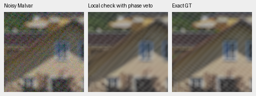
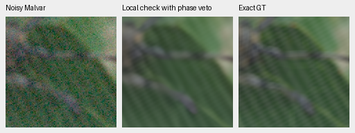

# Local Bayer gap checks that preserve shifted phase

A local attenuation rule reduces weak-wire signal inside known gaps.
On the 24-photo bent-wire panel it lowers coherent gap projection by
**0.195 DN16** relative to the existing near and far donor fit and by
**0.120 DN16** relative to a matched uniform reduction. A check for
continuing signal at a different phase retains most of that benefit.
It also prevents a false cut in all 48 noisy quarter-cycle controls.
The effects at native scale are small. The standing fine fence still
has incomplete intersections.

[Machine results](results/bayer-local-deficit-v1/publication.json) ·
[Frozen drivers and receipts](results/bayer-local-deficit-v1/evidence.tar.xz) ·
[Native crop provenance](images/bayer-local-deficit-v1/manifest.json).

## Local validation of an existing correction

The [near and far donor fit](bayer-near-donors.md) provides a fixed
geometry and 64-pixel carrier coefficients. The new step can only
attenuate its corrections. It tests nine overlapping 32-pixel
subwindows in each 64-pixel delivery tile. Each Bayer green separately
fits a quadratic background and both directions inside the subwindow
and in its disjoint complement. On one green the difference between
the ring and subwindow coefficients is projected onto the direction
estimated by the other green's ring. Variances of the two fits determine
the scale of that difference.

Each green must indicate a coherent deficit. The smaller standardized
score ramps the attenuation between 0.75 and 2.5 units, capped at 75%
of the existing directional addition. The weaker-only variant protects
the direction with higher crop-wide cross-green support. The phase
veto instead checks the component perpendicular to the mean ring
phase. It suspends the cut when this component is coherent in both
inner greens above twice the noise scale and above a quarter of the
ring's coherent power. These are empirical thresholds.

Uniform and reversed spatial controls use the same mean attenuation
weighted by each direction's squared tapered correction within a tile.
The original 64-pixel sums and projection reproduce the earlier baseline
bit for bit before attenuation. The experiments use the frozen Corpus
100k EMA
`87b96f3c487b9edaf1c477742b6c38f2a82cc6b20a94716d51cc8cf46a17a760`
on the same 20 development, 16 independent and 24 later photo backgrounds.
The source masks and targets enter only scoring and rendering.

## Preserving a wire when its phase changes

A separate 64-pixel diagnostic uses one carrier pair, a flat background
and a predeclared 32-pixel center. The weak direction either continues
at constant amplitude, disappears, or rotates by a quarter cycle while
keeping its amplitude. The two methods receive identical samples. The
four Bayer layouts are each tested at an odd native origin. There are
12 independently drawn Gaussian noise realizations per layout and
condition, using variance `0.00128 × RAW + 6.5536e-6`.

| Noisy center condition | Ordinary rule, mean cut | Phase veto, mean cut |
| --- | ---: | ---: |
| Continuous with matching phase | 0.000 | 0.000 |
| Missing weak direction | 0.723 | 0.723 |
| Continuous with quarter-cycle shift | 0.718 | 0.000 |

The ordinary rule cuts every shifted center and the veto preserves all
48. Both retain exactly the same attenuation on every missing center.
The separate noiseless controls give 0.75 cuts for the missing centers
and the same false-cut distinction for the shifted centers. The test
checks the nominated center window on a single frequency pair.

## Held-out photo backgrounds

| Later 24 bent backgrounds | Weak response change, pp | Fine-increment RMS change, DN16 | Absolute gap RMS change, DN16 | Weak coherent gap change, DN16 |
| --- | ---: | ---: | ---: | ---: |
| Local attenuation vs existing fit | −0.073 | +0.021 | −0.007 | −0.195 |
| Weak-only attenuation vs existing fit | −0.072 | +0.027 | −0.026 | −0.196 |
| Phase veto vs existing fit | −0.049 | +0.016 | −0.006 | −0.174 |
| Local attenuation vs matched uniform | +0.028 | +0.005 | +0.003 | −0.120 |
| Weak-only attenuation vs matched uniform | +0.028 | −0.004 | −0.016 | −0.120 |
| Phase veto vs matched uniform | +0.028 | +0.002 | +0.002 | −0.107 |

The phase-veto gap difference versus matched uniform has a paired
photo-bootstrap interval of [−0.211, −0.024] DN16. It retains 0.024 more
response points than the plain local rule and leaves 0.021 DN16 more
coherent gap error. The gap difference versus matched uniform is
−0.057 DN16 on the independent eight bent photos, with an interval
[−0.147, +0.002]. On that subset the veto preserves nearly all of the
3.62 response points provided by the added near fallback. Its change
in total gap RMS is +0.003 DN16. The measured exact-flat core errors
stay the same across all panels. This scoped inference replay does
not contribute scores to the fixed 427-photo or measured-camera panels.

## Native exact-target triplets

Both triplets show the noisy Malvar input, the local check with phase
veto, and exact GT. The cells use 160 × 160 original pixels at
`[48,48,160,160]` inside the `[128,128,256,256]` query. Both use
redraw one with shot/read `0.00128/6.5536e-6`, capture exposure 0.33,
16-bit ADC, black level 0.03 and display ×2. The correction's difference
from the prior fit is subtle. The planted weak crossings stay visibly
softer than GT.

**Villa Elli**, Johann Jaritz, CC BY-SA 4.0. BGGR, source box
`[46,72,512,512]`.
[Source](https://commons.wikimedia.org/wiki/File:P%C3%B6rtschach_Hauptstra%C3%9Fe_119_Villa_Elli_09072011_2857.jpg) ·
[All methods](images/bayer-local-deficit-v1/exact/case-005-draw1-comparison.png).

**Saperda carcharias**, AfroBrazilian, CC BY-SA 3.0. GBRG, source box
`[206,54,512,512]`.
[Source](https://commons.wikimedia.org/wiki/File:Saperda_carcharias_01.JPG) ·
[All methods](images/bayer-local-deficit-v1/exact/case-007-draw1-comparison.png).

## Standing GFX100S comparisons

The prior joint crop path uses local 20k EMA, eight-donor EMA and the
distant gate EMA. Sky, building and foliage reproduce that path exactly.
The phase veto changes the coarse fence by 0.191 DN16 camera-RGB RMS.
It changes the four fine-cab crops by 0.064–0.183 DN16 and softens them
too little to see clearly at the fixed display exposure. The right
diagonals remain visible and fine junctions are incomplete. All eight
native boards were viewed alongside the same references. The main
views use display ×4 and the fine cab uses ×16. The two camera JPEGs
and independent ISO100 AHD are qualitative references, with aperture
and subject-motion differences.
[Standing checkpoint lineage](bayer-shared-phase.md#fitting-and-checking-the-geometry).

[Sky](images/bayer-local-deficit-v1/standing/main-overcast-sky-main-overcast-sky.png) ·
[Building](images/bayer-local-deficit-v1/standing/main-building-detail-main-building-detail.png) ·
[Foliage](images/bayer-local-deficit-v1/standing/main-foliage-main-foliage.png) ·
[Coarse fence](images/bayer-local-deficit-v1/standing/main-chain-link-fence-main-chain-link-fence.png).

| Cab shot/read | Left | Right |
| --- | --- | --- |
| Nominal `0.00128/6.5536e-6` | [Native board](images/bayer-local-deficit-v1/standing/mesh-nominal-fine-green-mesh-left.png) | [Native board](images/bayer-local-deficit-v1/standing/mesh-nominal-fine-green-mesh-right.png) |
| Transferred `0.0014635775921166604/1.0715704128646712e-6` | [Native board](images/bayer-local-deficit-v1/standing/mesh-profile3879-fine-green-mesh-left.png) | [Native board](images/bayer-local-deficit-v1/standing/mesh-profile3879-fine-green-mesh-right.png) |
