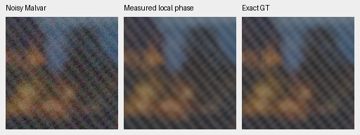
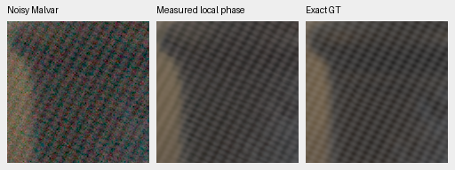

# Applying a locally measured Bayer phase shift

When the carrier pair is supplied, rotating an existing correction
toward the locally measured phase improves weak recovery on 24
held-out photo backgrounds with planted local shifts. At ISO6400
the change is **+2.25 weak-response points** and **−1.67 DN16**
absolute error in the shifted center versus the phase veto alone.
The opposite rotation worsens the fit. With noisy-only donor proposals the gains are
**+0.93 weak-response points** and **−1.29 DN16** in the shifted center. Both standing
GFX scenes were inspected. Fine cab crossings remain incomplete.

[Machine results](results/bayer-local-phase-transfer-v1/publication.json) ·
[Frozen drivers and receipts](results/bayer-local-phase-transfer-v1/evidence.tar.xz) ·
[Native crop provenance](images/bayer-local-phase-transfer-v1/manifest.json).

## Direction as well as presence

The [local phase veto](bayer-local-deficit.md) detects coherent signal in
quadrature with a carrier's surrounding phase. A wire can then continue
through a phase change without triggering a false deficit. This follow-up
uses that same veto to nominate a local rotation of the existing
correction.

In each 32-pixel window of a 64-pixel delivery tile, each green separately
estimates the inner sine and cosine coefficients and the full tile's
coefficients. Each proposal keeps the full-tile amplitude and uses the
inner phase. The other green scores this fixed prediction against the
full-tile phase, using the inner fit's estimated covariance. Both
whitened improvements must exceed three and the two proposed angles
must agree within 30 degrees. The veto still requires coherent
quadrature measurements. The bounded shift, at most 90 degrees,
blends with neighboring windows. The method rotates each existing
directional correction at fixed local amplitude, then applies the
prior attenuation. Both greens also inform the shared selection, so the
replay tests the complete rule empirically. The opposite-phase control uses the same amplitude
and angle magnitude with reversed sign.

The raw test asks which phase predicts measured Bayer green samples.
Rotating the existing correction has a different target, the residual
error of the frozen model. These replay scores measure the delivered
image. They reproduce all existing veto and matched-control metrics
before adding the new arm.

## Planted local shifts with known geometry

Repeat the 24 held-out backgrounds from the
[earlier bent-wire panel](bayer-cross-evidence.md) with fresh Bayer
observations. A 32-pixel center has a fixed positive or negative
45° or 90° phase change with a smooth seven-pixel transition.
The same-phase, absent-weak and flat controls use the same camera
recipe. Both carrier frequencies and bends are supplied for this
delivery diagnostic. It holds the Corpus 100k EMA fixed at
`87b96f3c487b9edaf1c477742b6c38f2a82cc6b20a94716d51cc8cf46a17a760`.

| Shifted center | Corpus 100k | Veto only | Measured local phase | Opposite shift |
| --- | ---: | ---: | ---: | ---: |
| ISO400 absolute error, DN16 | 47.944 | 47.735 | 47.631 | 47.831 |
| ISO6400 weak response | 62.382% | 69.768% | 72.018% | 66.825% |
| ISO6400 fine-increment RMS, DN16 | 164.322 | 160.500 | 159.246 | 162.472 |
| ISO6400 absolute error, DN16 | 141.121 | 135.768 | 134.097 | 137.782 |
| ISO6400 gap core error, DN16 | 106.662 | 108.628 | 108.645 | 108.612 |

At ISO6400 the +2.250-point weak-response change has a paired source
interval of [+0.996, +3.774]. Increment error falls 1.254 DN16
[0.267, 2.822]. The 1.672 DN16 absolute-error reduction has an interval
of [0.496, 3.498]. Outside the shifted region the change is +0.003
DN16, while the true-gap core rises 0.018 DN16. The rotation changes
22 of 24 shifted crops, 13 of 24 same-phase crops and 9 of 24 gap
crops somewhere in the query. The latter cases retain the strong
carrier and a weak surrounding carrier. The exact-flat crops
reproduce the veto output. At ISO400 the absolute-error gain is
0.103 DN16 and paired weak response is already near 100%.

## Recovering the pair from donor RAW

Use the same 24 photos to render fresh 512 × 512 Bayer captures at
ISO6400. All four roles and both geometry routes share the same
mosaics and central 256 × 256 query. The automatic route uses the
existing primary, far and near donor selection. Twelve shifted
examples admit a pair, seven primary, four far and one near. The
rotation changes 10 of the 24 shifted queries. Supplied geometry
allows changes in 21.

| Geometry route | Weak response, veto → rotation | Fine-increment RMS, DN16 | Shifted-center absolute RMS, DN16 |
| --- | ---: | ---: | ---: |
| Supplied | 63.924% → 66.478% | 161.788 → 159.943 | 137.480 → 135.248 |
| Noisy-only | 60.672% → 61.597% | 163.363 → 162.320 | 139.343 → 138.058 |

With noisy-only geometry, the paired source interval for the
+0.926-point response gain is [+0.032, +2.296]. Fine-increment RMS
falls 1.042 DN16 [0.049, 2.619] and shifted-center absolute RMS falls
1.285 DN16 [0.045, 3.283]. The opposite shift delivers 2.202 fewer
response points than the measured direction and 2.938 DN16 more absolute
error. Absolute RMS moves +0.098 DN16 in steady weak centers,
−0.042 DN16 in absent weak centers and +0.004 DN16 outside shifted
centers. No exact-flat crop changes. These are tests of the planted
local phase shifts.

On the 60 previously evaluated photo backgrounds with smoothly varying
carriers, the measured rotation changes mean increment error by
−0.005 DN16 on the independent eight bent photos and +0.009 DN16 on
the later 24 bent photos. It changes mean weak response by less than
0.024 points on every subset. Quiet-core errors equal the veto's
scores. The large local-shift result therefore has a narrower scope.
These crop experiments use the same checkpoint and deliver no new
fixed 427-photo or measured-camera results.

## Native exact-target triplets

Each cell is 160 × 160 native pixels at `[48,48,160,160]` inside the
`[128,128,256,256]` query of the listed source box. Shot/read is
`0.00128/6.5536e-6`, 16-bit ADC, black 0.03, capture exposure 0.33
and display ×2. The first two automatic examples with a delivered phase change use
the far-donor and primary routes. The triplets show noisy Malvar, the
measured rotation and exact GT. Small center changes leave both
planted lattices softer than the reference.

**Wrocław University Library**, Jar.ciurus, CC BY-SA 3.0 PL. RGGB,
source box `[514,118,512,512]`, +45° local shift.
[Source](https://commons.wikimedia.org/wiki/File:Wroclaw_-_Biblioteka_Uniwersytecka_i_Kosciol_NMP_na_Piasku_02.jpg) ·
[All methods](images/bayer-local-phase-transfer-v1/automatic/000-iso6400-automatic-comparison.png).

**Fulda Schloss Ofen**, Reinhold Möller Ermell, CC BY-SA 4.0. RGGB,
source box `[0,246,512,512]`, +90° local shift.
[Source](https://commons.wikimedia.org/wiki/File:Fulda_Schloss_Ofen-20250525-RM-142620.jpg) ·
[All methods](images/bayer-local-phase-transfer-v1/automatic/004-iso6400-automatic-comparison.png).

[Supplied-geometry Wrocław board](images/bayer-local-phase-transfer-v1/exact/000-iso6400-comparison.png) ·
[Supplied-geometry Luxor board](images/bayer-local-phase-transfer-v1/exact/001-iso6400-comparison.png).

## Standing GFX100S comparisons

The previously evaluated local 20k and eight-donor EMAs with the
distant gate and phase veto define the standing baseline. Rotation
changes the coarse fence by 0.209 DN16 RMS and the right transferred
fine cab by 0.075 DN16. The other six crops reproduce the veto's
values. Both coarse directions stay coherent, the sky is smooth
and fine cab junctions remain soft. All eight comparisons were
viewed, using display ×4 for the main scene and ×16 for the cab.
Both cab JPEGs and the independent ISO100 AHD are qualitative
references from different aperture, exposure time and subject motion.
[Standing checkpoint lineage](bayer-shared-phase.md#fitting-and-checking-the-geometry).

[Sky](images/bayer-local-phase-transfer-v1/standing/main-overcast-sky-main-overcast-sky.png) ·
[Building](images/bayer-local-phase-transfer-v1/standing/main-building-detail-main-building-detail.png) ·
[Foliage](images/bayer-local-phase-transfer-v1/standing/main-foliage-main-foliage.png) ·
[Coarse fence](images/bayer-local-phase-transfer-v1/standing/main-chain-link-fence-main-chain-link-fence.png).

| Cab shot/read | Left | Right |
| --- | --- | --- |
| Nominal `0.00128/6.5536e-6` | [Native board](images/bayer-local-phase-transfer-v1/standing/mesh-nominal-fine-green-mesh-left.png) | [Native board](images/bayer-local-phase-transfer-v1/standing/mesh-nominal-fine-green-mesh-right.png) |
| Transferred `0.0014635775921166604/1.0715704128646712e-6` | [Native board](images/bayer-local-phase-transfer-v1/standing/mesh-profile3879-fine-green-mesh-left.png) | [Native board](images/bayer-local-phase-transfer-v1/standing/mesh-profile3879-fine-green-mesh-right.png) |
