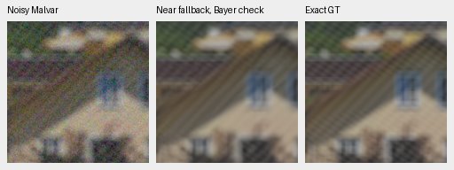
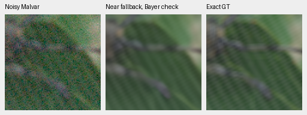

# Closer Bayer donors for curved wire detail

Moving the donor windows closer to the delivery crop recovers two extra
bent-wire captures on two independent photo backgrounds. On those eight
bent backgrounds, adding the near fallback raises weak response by
**3.62 percentage points** and lowers fine-increment RMS by **1.80
DN16**. Weak-wave projection in known gaps rises **0.95 DN16**.
The same fallback delivers no additional correction on a further
24 bent backgrounds. Separate refits shift the coarse standing fence
slightly. The fine cab still lacks complete crossings.

[Machine results](results/bayer-near-donors-v1/publication.json) ·
[Frozen drivers and receipts](results/bayer-near-donors-v1/evidence.tar.xz) ·
[Native crop provenance](images/bayer-near-donors-v1/manifest.json).

## Donor distance and controls

The [far warped spectrum](bayer-warped-spacing.md) uses eight disjoint
64-pixel stations outside the whole 256-pixel query. The near method uses
the same cardinal and diagonal arrangement with offsets −64, 48 and 160
in place of −112, 48 and 208, relative to the visible 160-pixel crop.
The nearer stations stay outside that crop and can use the query halo.
They keep the same nuisance model, spectrum normalization, frequency and
curvature search, bilateral green agreement and camera noise prior.
Near proposals enter only where the primary fit and the earlier
[far proposal with the Bayer agreement check](bayer-cross-evidence.md)
both abstain. The local 64-pixel lift and dose 0.73 are shared.

The crop acceptance cutoff is 4.73453, inherited from the far-proposal
development maximum. Both the far and near eligible controls reject at
that threshold. Using the lower 1.14719 maximum from just five eligible
near development controls would pass one extra present draw on the
24-photo panel and also pass one outside-only draw on each independent
panel. This near-only sample gives a weak estimate of the false-tail
threshold.

The separate near-refit experiment starts with the already admitted
frequency pair. It fits both green lattices in the nearby donor windows.
Per-direction donor checks compare the full fit or half of each green's
fitted adjustment against zero. The crop compares each accepted
direction with the previously delivered geometry using reciprocal held
residual. A refit needs more than 3.01343 units for the full step or
3.0 for the half step. The cutoffs come from the fixed three-unit
minimum and the largest eligible change on the development absent roles.

## Exact-target replay

The panels retain the same 20 development sources, 16 independent
sources split equally between straight and bent fields, and 24 later
bent sources as the cross-green study. All use two independent ISO6400
redraws of each of four roles. The synthetic endpoint uses Corpus 100k
EMA `87b96f3c487b9edaf1c477742b6c38f2a82cc6b20a94716d51cc8cf46a17a760`.
The replay checks the saved far baseline metrics exactly for every
source before measuring the new delivery.

| New near fallback versus checked far fallback | New present draws | Weak response, pp | Fine-increment RMS, DN16 | Absolute gap RMS, DN16 | Weak coherent gap projection, DN16 |
| --- | ---: | ---: | ---: | ---: | ---: |
| Development bent, 10 photos | 2 | +0.588 | +0.026 | +0.141 | +0.028 |
| Development straight, 10 photos | 2 | +1.556 | −0.359 | −0.247 | −0.034 |
| Independent bent, 8 photos | 2 | +3.621 | −1.795 | +0.177 | +0.954 |
| Independent straight, 8 photos | 1 | +0.681 | +0.031 | −0.204 | +0.144 |
| Later bent, 24 photos | 0 | 0 | 0 | 0 | 0 |

The independent bent response difference has a source-bootstrap interval
of [0, 8.47] points. The outside-only, strong-only and exact-flat draws
all keep the far fallback result at the fixed near cutoff. The two new
bent cases both gain target-aligned response, even though one candidate's
second direction differs from the planted center by 0.0264 cycles per
pixel. The latter renders a section of the grid with
softer and more irregular crossings than the exact target. The gap cost
shows that increased alignment elsewhere can coexist with misplaced
detail inside the missing segment.

The two refit variants move mean fine-increment RMS by less than
0.003 DN16 on all five subsets. On the later panel the half-step check
opens on two outside-only draws, raising their panel-average added core
RMS by 0.013 DN16. The full step opens once on a quiet-query draw and its
measured exact-flat core RMS stays at the previous value. This is a
component inference study. The fixed 427-photo and measured-camera
panels remain measures of the frozen full models.

## Native exact-target triplets

These two captures are the newly admitted independent bent sources.
Both use redraw one, shot/read `0.00128/6.5536e-6`, 16-bit ADC, black
0.03, capture exposure 0.33 and display ×2. Each cell comprises the
original `[48,48,160,160]` inside the `[128,128,256,256]` query.
The triplets show noisy Malvar, the checked near fallback and exact GT.

**Villa Elli**, Johann Jaritz, CC BY-SA 4.0. BGGR, source box
`[46,72,512,512]`. The second direction is faint over the roof and
plaster.
[Source](https://commons.wikimedia.org/wiki/File:P%C3%B6rtschach_Hauptstra%C3%9Fe_119_Villa_Elli_09072011_2857.jpg) ·
[All methods](images/bayer-near-donors-v1/independent/case-005-draw1-comparison.png).

**Saperda carcharias**, AfroBrazilian, CC BY-SA 3.0. GBRG, source box
`[206,54,512,512]`. Some crossings return on the green background
and are softer than the exact target.
[Source](https://commons.wikimedia.org/wiki/File:Saperda_carcharias_01.JPG) ·
[All methods](images/bayer-near-donors-v1/independent/case-007-draw1-comparison.png).

## Standing GFX100S comparisons

Nearby donors support the existing right-cab pair more strongly. The
weaker absolute agreement score rises from 1.46 to 15.88 with the nominal
prior and from 2.24 to 22.97 with transferred conditioning. This diagnostic
uses inherited nearby frequencies and overlapping donor support. The
independent near search still fails to nominate a full eligible cab pair.
The half step brings one direction under the donor phase-disagreement
limit in both right crops, then worsens the reserved crop residual by
9.92 and 14.48 units. The crop veto keeps the prior fit.

Both refit variants change the coarse fence by at most one code at the
display transform. Sky is smooth and the thin building and foliage
details stay soft. The four cab crops reproduce the existing mottled
lattice with incomplete intersections. All eight boards were
viewed at native scale. The main crops use display ×4 and the cab uses
×16. The two camera JPEGs and separate ISO100 AHD captures are qualitative
references obtained with different aperture, exposure and motion.
The composed standing fit uses the same local 20k, eight-donor and
distant-gate EMAs as the previous review.
[Standing checkpoint lineage](bayer-shared-phase.md#fitting-and-checking-the-geometry).

[Sky](images/bayer-near-donors-v1/standing/main-overcast-sky-main-overcast-sky.png) ·
[Building](images/bayer-near-donors-v1/standing/main-building-detail-main-building-detail.png) ·
[Foliage](images/bayer-near-donors-v1/standing/main-foliage-main-foliage.png) ·
[Coarse fence](images/bayer-near-donors-v1/standing/main-chain-link-fence-main-chain-link-fence.png).

| Cab shot/read | Left | Right |
| --- | --- | --- |
| Nominal `0.00128/6.5536e-6` | [Native board](images/bayer-near-donors-v1/standing/mesh-nominal-fine-green-mesh-left.png) | [Native board](images/bayer-near-donors-v1/standing/mesh-nominal-fine-green-mesh-right.png) |
| Transferred `0.0014635775921166604/1.0715704128646712e-6` | [Native board](images/bayer-near-donors-v1/standing/mesh-profile3879-fine-green-mesh-left.png) | [Native board](images/bayer-near-donors-v1/standing/mesh-profile3879-fine-green-mesh-right.png) |
