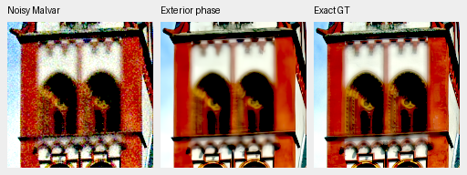
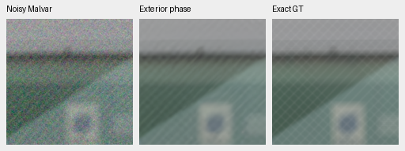

# Measuring phase error beyond the Bayer correction

Disjoint Bayer neighborhoods support a phase correction that raises
planted ISO6400 wire response by **1.23 percentage points**, lowers
intact increment RMS by **2.58 DN16**, and lowers absolute gap RMS by
**1.88 DN16**. Exact-flat RMS rises **0.023 DN16**. Measurements from
the two local Bayer green planes alone select zero gain during calibration.
[Machine results](results/bayer-phase-quadrature-v1/publication.json) ·
[Executed programs and receipts](results/bayer-phase-quadrature-v1/evidence.tar.xz).

## Measuring what the existing correction misses

[Adaptive Bayer blending](bayer-phase-shrinkage.md) recovered nearly all
of its additional ISO6400 wire response through changes parallel to its
original Fourier correction. This diagnostic uses the final eight-donor
correction as the axis in each 32-pixel window and frequency bin. It
projects the exact remaining luminance error onto that axis and onto the
perpendicular axis. Each projection can be synthesized independently
using the existing taper, overlap and achromatic output. Positions with
zero phase correction provide no stable axis and contribute zero.

Perpendicular error accounts for **39.13%** of the squared native Fourier
error across the usable inner-window bins at ISO6400. On the subset where
both donor groups have SNR at least three at the selected frequency, the
share is **41.59%**. These are residual luminance-energy fractions in the
analyzed band. They include background error and any remaining noise in
the reconstruction. The paired present/weak-free role comparison below
isolates the planted increment.

The local estimators measure the noisy Bayer green planes and the model's
reconstructed green on identical physical sites. They subtract the two
site-matched green estimates and take the perpendicular component after
weighting by green cross-power. A second version also requires the signs
of the raw perpendicular projections to agree across planes. A control
keeps this same evidence gate and takes the parallel component. All three
limit the correction to two local green-plane noise standard deviations
in the coefficient domain.

The exterior estimators split the eight donors into cardinal and diagonal
groups. Each group chooses a sub-bin frequency. The other group measures
the complex coefficient at that frequency, transported to the query origin.
Both assignments must have positive signed support above one noise standard
deviation. Their phases must agree. The two held-out amplitudes are averaged,
projected to the original synthesis bin, and compared with the reconstructed
green coefficient there. One arm retains the perpendicular change, another
also requires the query measurement to point in the same direction, and the
amplitude control retains the parallel change. The same two-sigma limit
applies. The frequency checks use disjoint RAW sites. The final correction
and its axis use the frozen reconstruction, which reads the whole query.

## Readout on disjoint sources

The 24 ISO6400 calibration sources include 12 true gaps. The gain sweep
uses increments of 0.01 and allows at most 0.02 DN16 of increase in mean
absolute gap RMS and in mean exact-flat RMS. It minimizes held-out-style
paired increment RMS within the calibration set and transfers the selected
gain unchanged to the 24 separate wire backgrounds at ISO400 and ISO6400.
The fit adjusts scalar gains on the frozen model. The fixed 10% doses below show the effects
of applying each estimator even when calibration selects zero. The two
25% exact-target doses are diagnostic and require the clean target.

| ISO6400 change relative to eight donors | Response, pp | Intact increment RMS, DN16 | Absolute gap RMS, DN16 | Exact-flat RMS, DN16 |
| --- | ---: | ---: | ---: | ---: |
| Local green mean, 10% | −0.059 | +0.083 | +0.156 | +0.154 |
| Local green sign agreement, 10% | +0.002 | +0.020 | +0.028 | +0.033 |
| Local phase-locked control, 10% | +0.031 | +0.090 | +0.028 | −0.007 |
| Exterior phase, calibrated 62% | +1.226 | −2.581 | −1.883 | +0.023 |
| Exterior phase with local veto, calibrated 91% | +0.333 | −1.253 | −0.308 | +0.018 |
| Exterior amplitude, calibrated 39% | +1.529 | −2.290 | −1.803 | +0.023 |
| Exact-target perpendicular phase, 25% | +2.337 | −6.784 | −4.204 | −0.020 |
| Exact-target parallel phase, 25% | +5.161 | −9.671 | −6.328 | −0.105 |

Eight-donor ISO6400 response is 41.153%. Its intact, gap and exact-flat
RMS values are 210.886, 147.958 and 18.343 DN16. The exact-target
perpendicular correction's source-bootstrap interval for intact RMS change
is [−7.884, −5.869] DN16. The local sign-agreement arm's response interval
is [−0.008, +0.013] points. At ISO400 the exact-target perpendicular
change lowers intact RMS by 3.565 DN16. The local sign-agreement dose
reduces response by 0.084 points while changing intact RMS by −0.007 DN16.

The exterior phase gain's 95% source-bootstrap interval is [+0.707, +1.688]
response points. Its intact RMS interval is [−3.188, −1.999] DN16 and gap
RMS interval is [−2.477, −1.362] DN16. A local veto weakens recovery and
saves 0.005 DN16 of exact-flat RMS. The amplitude control gains more
response, with a smaller point estimate for intact error reduction.
At ISO400 the transferred phase dose lowers response by 0.926 points
while lowering intact RMS 1.379 DN16. The exterior phase addition retains
nearly 38% of the intact RMS improvement in the 25% exact-target phase
probe at ISO6400. This ratio describes the two specific tested doses.

## Held-out natural photos

The same doses were applied unchanged to 48 other photo backgrounds with
independent target-role noise draws, each at ISO400 and ISO6400. At ISO6400
the exterior phase changes fine response by **−0.153 points**
[−0.262, −0.034], increment RMS by **+0.221 DN16** [+0.121, +0.334],
and exact-flat RMS by **+0.894 DN16** [+0.627, +1.183] versus eight donors.
Adding the local veto raises flat RMS 0.971 DN16 and loses 0.215 response
points. The amplitude control raises flat RMS 0.553 DN16 and loses 0.090
response points. At ISO400 both exterior phase variants also increase
increment and flat error. Natural fine texture regresses at these doses.

Compared with the recommended V120, the composed exterior-phase path has
0.487 DN16 lower ISO6400 increment RMS, 0.876 DN16 higher flat RMS, and
0.117 dB higher sRGB PSNR on the present role. Compared with Corpus 100k,
it has 0.280 DN16 lower increment RMS [−0.584, +0.024], 1.337 DN16 higher
flat RMS [+0.822, +1.791] and essentially equal PSNR on this panel.
The original eight-donor model leads the exterior-phase path on all four
reported natural-photo measures.

## Native exact-target comparisons

Each cell contains 160 × 160 original pixels at `[48,48,160,160]`
within the native query. All panels use ISO6400 shot/read
`0.00128/6.5536e-6`, capture exposure 0.33, 16-bit ADC and black 0.03.
Reference pixels come from the simulated clean target.
[Native provenance](images/bayer-phase-quadrature-v1/manifest.json).

**Limburg Cathedral**, Berthold Werner, public domain. BGGR query
`[22,250,256,256]`, display ×3.0303 and contrast ×2. Fine spire and
balustrade texture stays soft and decorative edges show similar shaping.
[Source](https://commons.wikimedia.org/wiki/File:Limburger_Dom_BW_1.jpg) ·
[Full comparison](images/bayer-phase-quadrature-v1/exact/001-iso6400-independent-comparison.png).

**St Valentin rail**, GT1976, CC BY-SA 4.0. RGGB query
`[128,128,256,256]` within the original `[376,16,512,512]`, display ×2.
The planted strong diagonals remain visible, while the second wire family
is faint and many fine junctions are missing. The clean target shows
the elliptical gap as well as sharper ends of the diagonal crossings.
[Source](https://commons.wikimedia.org/wiki/File:2018-05-04_(217)_33_53_9332_586-5_at_Bahnhof_St._Valentin.jpg) ·
[Full comparison](images/bayer-phase-quadrature-v1/exact/012-iso6400-comparison.png) ·
[Smooth-dip control](images/bayer-phase-quadrature-v1/exact/014-iso6400-comparison.png).

## Standing GFX100S comparisons

DSCF3879 at ISO6400 uses the nominal profile above and display ×4. Sky
remains smooth. The coarse chain-link fence holds both directions and
already visible crossings. In the building and foliage crops, the slim
cables, brackets and leaf detail stay soft. The separate DSCF3842 cab
uses display ×16, the nominal profile and the transferred shot/read
`0.0014635775921166604/1.0715704128646712e-6`. The right diagonals are
clearer under transferred conditioning. Both sides retain mottling and
incomplete fine junctions across the new phase and amplitude settings.
There is no visibly resolved fine crossing attributable to the new phase
correction. All eight native comparisons were inspected. DSCF3880 and
DSCF3835 AHD views and both cab JPEGs are qualitative references from
the original camera captures, with exposure, aperture and motion differences.

[Sky](images/bayer-phase-quadrature-v1/standing/main-overcast-sky-main-overcast-sky.png) ·
[Building](images/bayer-phase-quadrature-v1/standing/main-building-detail-main-building-detail.png) ·
[Foliage](images/bayer-phase-quadrature-v1/standing/main-foliage-main-foliage.png) ·
[Coarse fence](images/bayer-phase-quadrature-v1/standing/main-chain-link-fence-main-chain-link-fence.png).

| Cab profile | Native crops with both camera JPEGs and ISO100 AHD |
| --- | --- |
| Nominal | [Left](images/bayer-phase-quadrature-v1/standing/mesh-nominal-fine-green-mesh-left.png) · [Right](images/bayer-phase-quadrature-v1/standing/mesh-nominal-fine-green-mesh-right.png) |
| Transferred | [Left](images/bayer-phase-quadrature-v1/standing/mesh-profile3879-fine-green-mesh-left.png) · [Right](images/bayer-phase-quadrature-v1/standing/mesh-profile3879-fine-green-mesh-right.png) |

## Scope

The starting reconstruction is local-only scene 20k EMA
`b892a08c8ebbccb05c000e4f42d1f86c3a7d1d5870721ccd6e1c8fe9e82c3889`
with the eight-donor EMA from
`7b854d681083550de869b06b55d56c2f84224ec4a0545419a2cf34682a38ec68`
and its frozen phase head. The receipts verify that both runs reproduce
the eight-donor baseline on the original inputs. This inference diagnostic
uses scalar calibration and no new trained endpoint. The fixed 427-photo
and camera panels have no new measurements from this study.
[Composed checkpoint and native images](wide-bayer-neighborhood.md).
