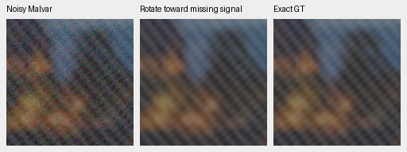
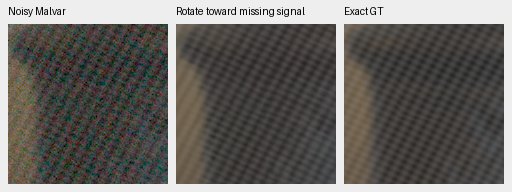

# Targeting the phase of the missing Bayer signal

Rotating toward a local estimate of the missing signal gives almost the
same result as rotating the existing correction by the measured RAW
phase shift. On 24 held-out ISO6400 photo backgrounds with planted
shifts and noisy-only geometry, it adds **0.053 weak-response points**
[−0.080, +0.215] and changes shifted-center RMS by **+0.007 DN16**
[−0.139, +0.153] versus the prior rotation. Both fine cab comparisons
retain incomplete crossings.

[Machine results](results/bayer-phase-residual-v1/publication.json) ·
[Frozen operators and receipts](results/bayer-phase-residual-v1/evidence.tar.xz) ·
[Native crop provenance](images/bayer-phase-residual-v1/manifest.json).

## Same support, different correction direction

The [earlier phase rotation](bayer-local-phase-transfer.md) moves an
existing correction by the phase shift cross-checked in both
directions across the Bayer greens. The frozen neural model may already
follow part of the phase change. A residual correction then needs the
phase of the missing signal.

The new arm keeps the prior frequency, curvature, support gate and
attenuation. In each eligible 32-pixel window, it pools the full-tile
RAW carrier coefficient from both greens, applies the measured local
shift, and subtracts the same local carrier fit in the neural parent's
green output. It rotates the old correction toward that residual by
at most 90°. A half-shift arm uses half the new angle. The per-carrier
coefficient magnitude is shared before window blending. The neural
parent sees both Bayer greens, so these are empirical reconstruction
comparisons. All preceding outputs and metrics reproduce exactly.

The two geometry routes replay the same 24 frozen 512 × 512 captures
and central queries. The parent is Corpus 100k EMA
`87b96f3c487b9edaf1c477742b6c38f2a82cc6b20a94716d51cc8cf46a17a760`.
Each source has a shifted weak center, a continuous same-phase center,
an absent weak center and an exact flat. All conditions use independent
noise draws.

| Noisy-only geometry, ISO6400 | Veto only | Prior rotation | Toward missing signal | Half angle |
| --- | ---: | ---: | ---: | ---: |
| Weak response | 60.672% | 61.597% | 61.651% | 61.259% |
| Fine-increment RMS, DN16 | 163.363 | 162.320 | 162.291 | 162.677 |
| Shifted-center absolute RMS, DN16 | 139.343 | 138.058 | 138.065 | 138.588 |
| Same-phase center RMS, DN16 | 128.961 | 129.058 | 128.938 | 128.944 |
| Gap center RMS, DN16 | 111.721 | 111.679 | 111.677 | 111.705 |

The full residual direction improves shifted-center RMS by 1.278 DN16
[0.046, 3.237] versus the veto. Its −0.030 DN16 fine-increment change
against the prior rotation spans zero [−0.160, +0.092].
The same-phase center also moves −0.120 DN16 [−0.353, +0.012] against
rotation. Exact-flat arrays remain equal. With supplied geometry,
the full residual direction loses 0.405 response points and changes
absolute shifted-center error by −0.002 DN16 versus rotation. The
half-angle arm loses 1.205 response points and increases shifted-center
error by 0.853 DN16 in that supplied diagnostic.

On the 60 archived photo backgrounds with smooth carriers, the later 24
bent scenes show −0.016 response points, +0.011 DN16 increment RMS
and −0.042 DN16 gap RMS versus rotation. On the independent eight
bent scenes, the corresponding changes are −0.007 points, −0.011 DN16
and −0.032 DN16. Exact-flat errors reproduce the preceding scores.
These component comparisons add no fixed 427-photo or measured-camera
scores.

## Why a single carrier is worth checking

The noisy-only route can rotate 10 of the 24 shifted cases. Changing
the rotation cannot recover a candidate that discovery never supplies.
A separate audit permits exactly one of the nearer donor's two
directions to qualify on exterior evidence when existing pair routes
abstain. It keeps that direction's query score if it exceeds 17.963,
the largest score of a mismatched candidate on the 20-photo
development set. The audit checks frequencies within 0.009 cycles
per pixel of a planted direction and treats gaps as absent for the
weak carrier.

The independent 16-photo replay supplies three additional weak
candidates on two photos and four unmatched frequencies on two
photos. The later 24-photo replay supplies six additional weak
candidates on five photos and one unmatched frequency. Neither
replay accepts a weak frequency in a known gap or a candidate in
an exact-flat query. Some unmatched frequencies can be genuine
background texture.

An extra check fits a complex carrier coefficient on one half of the
query and tests its phase direction on the other. It repeats this across
top/bottom and left/right splits. At a worst-fold score of four, the
independent replay keeps all three additional weak candidates and
loses all four unmatched candidates. The later replay keeps four of six
weak candidates and retains the unmatched frequency. This is a threshold
sweep on the same query samples after screening. It measures frequency
eligibility alone. Foliage and the transferred right cab each have one
supported exterior direction in the standing audit. The sky has none.

## Native exact-target triplets

Each cell is a native 160 × 160 crop at `[48,48,160,160]` in the
`[128,128,256,256]` query of the listed cache box. Both use
shot/read `0.00128/6.5536e-6`, 16-bit ADC, black 0.03, capture
exposure ×0.33 and display ×2. The planted intersections remain
softer than their exact targets.

**Wrocław University Library**, Jar.ciurus, CC BY-SA 3.0 PL.
RGGB, cache box `[514,118,512,512]` and a +45° shift.
[Source](https://commons.wikimedia.org/wiki/File:Wroclaw_-_Biblioteka_Uniwersytecka_i_Kosciol_NMP_na_Piasku_02.jpg) ·
[All methods](images/bayer-phase-residual-v1/exact/000-iso6400-comparison.png).

**Fulda Schloss Ofen**, Reinhold Möller Ermell, CC BY-SA 4.0.
RGGB, cache box `[0,246,512,512]` and a +90° shift.
[Source](https://commons.wikimedia.org/wiki/File:Fulda_Schloss_Ofen-20250525-RM-142620.jpg) ·
[All methods](images/bayer-phase-residual-v1/exact/004-iso6400-comparison.png).

## Standing GFX100S comparisons

The local 20k and eight-donor EMAs with the distant Bayer gate, 64-pixel
fit and phase veto define the standing path. Against its prior rotation,
the new direction changes the coarse fence by **0.620 DN16 RMS** and the
right transferred cab by **0.016 DN16 RMS** in camera RGB. The other six
crops reproduce the prior rotation. Sky stays smooth, coarse crossings
stay coherent and fine cab crossings remain soft in all eight viewed
boards. Display exposure is ×4 for the main scene and ×16 for cab.
The independent ISO100 AHD previews and both cab JPEGs are qualitative
references with different aperture, exposure time and subject motion.
[Standing checkpoint lineage](bayer-shared-phase.md#fitting-and-checking-the-geometry).

[Sky](images/bayer-phase-residual-v1/standing/main-overcast-sky-main-overcast-sky.png) ·
[Building](images/bayer-phase-residual-v1/standing/main-building-detail-main-building-detail.png) ·
[Foliage](images/bayer-phase-residual-v1/standing/main-foliage-main-foliage.png) ·
[Coarse fence](images/bayer-phase-residual-v1/standing/main-chain-link-fence-main-chain-link-fence.png).

| Cab shot/read | Left | Right |
| --- | --- | --- |
| Nominal `0.00128/6.5536e-6` | [Native board](images/bayer-phase-residual-v1/standing/mesh-nominal-fine-green-mesh-left.png) | [Native board](images/bayer-phase-residual-v1/standing/mesh-nominal-fine-green-mesh-right.png) |
| Transferred `0.0014635775921166604/1.0715704128646712e-6` | [Native board](images/bayer-phase-residual-v1/standing/mesh-profile3879-fine-green-mesh-left.png) | [Native board](images/bayer-phase-residual-v1/standing/mesh-profile3879-fine-green-mesh-right.png) |

[Single-direction delivery follow-up](bayer-single-direction.md) checks what those accepted candidates add to the restored image.
