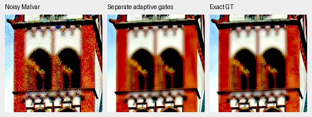
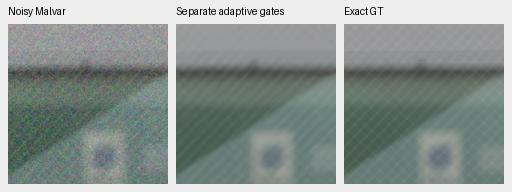

# Blending near and wide Bayer corrections

An adaptive blend recovers **0.20 more ISO6400 wire-response points**
than the learned constant blend. A fixed blend of the same two reconstructions
at similar added gap RMS recovers essentially the same response and gap
accuracy as the adaptive gate.
Nearly all the response change comes from the component parallel to
the original correction. The separate gates leave the fine real cab
crossings incomplete.
[Machine results](results/bayer-phase-shrinkage-v1/publication.json) ·
[Frozen drivers, weights and receipts](results/bayer-phase-shrinkage-v1/evidence.tar.xz) ·
[Native provenance](images/bayer-phase-shrinkage-v1/manifest.json).

## Matched fitting

The EMA checkpoint is
`9a964209f702f78b0c9b900499fe1d90c6da5748f344e71bc603e4f5fb29fca1`.
The operator freezes the local-only 20k EMA
`b892a08c8ebbccb05c000e4f42d1f86c3a7d1d5870721ccd6e1c8fe9e82c3889`,
Bayer phase EMA
`069de3a3d3f18ab0f32cf9b242daa1fb859d03762086ee27244557aced803e54`,
the directional EMA in
`cfc53ece231049d84e75bfc345076e412ba63adad481ca90db50104361990f74`,
and the eight-donor EMA in
`7b854d681083550de869b06b55d56c2f84224ec4a0545419a2cf34682a38ec68`.

For a Fourier coefficient, the wider operator's change is its correction
minus the nearest operator's correction. This change splits into the
component along the nearest correction's complex phase and the orthogonal
component. A scalar control sets the same global blend for both. The shared
adaptive gate gives both components a single weight that varies by window
and frequency. The separate gate gives each component its own weight.
All weights are in `[0,1]`. Separate weights preserve the bound on the
magnitude of the delivered change. The numerical audit verifies reconstruction
of the difference to within 7.5 × 10⁻⁹ across 19,350 tested coefficients.

The gate sees reciprocal reserved scores, cardinal and diagonal
strength and phase agreement, and the differences between the two
frozen corrections. These are empirical inputs to a reconstruction
gate. Each arm trains for 672 updates on the same 448 training photos
and six passes, with 2,688 source visits and 8,064 role queries per arm.
The directional training objective and optimizer schedule are shared.
Feature preparation takes **113.12 s**. The three-arm update loop takes
**22.37 s**. The fitted global blend gives **52.32%** weight to the
wide operator.
[Wider neighborhood recipe](wide-bayer-neighborhood.md) ·
[Directional objective](directional-gap-training.md).

A single 256-pixel railway correction with the stored parent takes
77.5 ms for the nearest operator, 91.5 ms for eight donors and
191.1 ms for separate adaptive gates. These are medians of twelve
interleaved warm calls on one CPU core. Demosaicing by the parent
is outside this timing.

## Held-out reconstruction

| ISO6400 planted wires, 24 sources | Intact response | Intact weak-band RMS, DN16 | Added gap RMS, DN16 | Absolute gap RMS, DN16 |
| --- | ---: | ---: | ---: | ---: |
| V120 | 31.605% | 86.701 | 25.077 | 154.013 |
| Corpus 100k | 33.657% | 84.945 | 16.700 | 152.650 |
| Local-only 20k | 33.413% | 84.771 | 0 | 151.803 |
| Directional, nearest | 40.331% | 78.981 | 22.252 | 147.833 |
| Eight donors | 41.153% | 78.132 | 24.295 | 147.958 |
| Learned constant blend | 40.761% | 78.533 | 23.022 | 147.853 |
| Constant blend with scaled correction | 40.974% | 78.362 | 23.687 | 147.793 |
| Shared adaptive gate | 40.963% | 78.335 | 23.657 | 147.900 |
| Separate adaptive gates | 40.958% | 78.339 | 23.638 | 147.897 |
| Separate gates, shifted evidence | 40.796% | 78.489 | 23.218 | 147.889 |
| Separate gates, parallel component only | 40.954% | 78.342 | 23.633 | 147.896 |
| Separate gates, orthogonal component only | 40.335% | 78.979 | 22.257 | 147.835 |

On the 12 real breaks in these exact targets, the extra adaptive
correction is largely outside the missing weak wave's band. Compared
with the constant blend scaled on separate calibration gaps, the
separate gates change intact response by −0.016 points [−0.086, +0.062]
and absolute gap RMS by +0.105 DN16 [+0.055, +0.170]. The mean gap-change
difference is −0.049 DN16. Shifting the gate evidence reduces response
0.162 points and reduces the added gap change by 0.419 DN16. The
change-weighted parallel gate averages 0.643 in intact windows and
0.652 in true gaps. The parallel-only ablation retains 0.622 of the
0.626-point response gain over the nearest model.

Replacing the shared soft weights with binary decisions at 0.5 raises
the gap correction. At similar correction strength, the soft gate
lowers absolute gap error 0.192 DN16 versus the binary version, with an
intact-response difference near zero.

A second control adjusts only the blend between the same frozen near and
wide reconstructions. On calibration gaps the separate gate's added RMS
matches a **76.52%** wide blend. On the independent wire panel, the
adaptive-minus-fixed difference is **−0.003 response points**
[−0.047, +0.043] and **+0.002 DN16** absolute gap RMS
[−0.017, +0.021]. At ISO400, the adaptive arm gains 0.050 points and
adds 0.132 DN16 more gap correction on held-out data.

On 48 independent ISO6400 natural sources, the separate gate gains
**0.061 response points** [0.045, 0.080] over the stronger fixed blend
at similar added flat RMS. Fine-increment RMS increases 0.010 DN16
[−0.003, +0.021] and flat RMS increases 0.020 DN16
[−0.001, +0.044]. The calibration curve admits two blend weights.
Both the 77.08% and 1.75% controls are archived. The adaptive response
gain increases to 0.120 points when compared with the smaller weight.

These are scoped component results. Fixed427 and measured-camera results
cover the base checkpoints. [Comparable model history](performance-history.md).

## Exact native comparisons

The cells show unchanged 160 × 160 pixels at `[48,48,160,160]` in
the original query. The middle uses the separate-gate EMA. Both use
ISO6400 shot/read `0.00128/6.5536e-6`, capture exposure 0.33, 16-bit
ADC and black 0.03.

**Limburg Cathedral**, Berthold Werner, public domain. BGGR query
`[22,250,256,256]`, display ×3.0303 and contrast ×2. The strong arch
outlines stay clear and brickwork remains soft.
[Source](https://commons.wikimedia.org/wiki/File:Limburger_Dom_BW_1.jpg) ·
[All methods](images/bayer-phase-shrinkage-v1/exact/001-iso6400-independent-comparison.png) ·
[Exact-flat comparison](images/bayer-phase-shrinkage-v1/flat/001-iso6400-independent-flat-comparison.png).

**St Valentin railway**, GT1976, CC BY-SA 4.0. RGGB query
`[128,128,256,256]` inside `[376,16,512,512]`, display ×2.
The gap and adjacent fine lines remain soft.
[Source](https://commons.wikimedia.org/wiki/File:2018-05-04_%28217%29_33_53_9332_586-5_at_Bahnhof_St._Valentin.jpg) ·
[All methods](images/bayer-phase-shrinkage-v1/exact/012-iso6400-comparison.png).

## Standing GFX100S comparisons

The DSCF3879 sky stays smooth at ×4. The coarse fence stays coherent,
with soft building wires and foliage. In both DSCF3842 cab crops at
×16, the adaptive variants retain existing diagonal fragments. The
transferred profile retains much of the right diagonal definition of the
eight-donor model, with soft intersections and uneven texture.
Both cab JPEGs and the independent ISO100 AHD views were inspected.
The reference captures differ in aperture, exposure time and motion.

[Sky](images/bayer-phase-shrinkage-v1/standing/main-overcast-sky-main-overcast-sky.png) ·
[Building](images/bayer-phase-shrinkage-v1/standing/main-building-detail-main-building-detail.png) ·
[Foliage](images/bayer-phase-shrinkage-v1/standing/main-foliage-main-foliage.png) ·
[Coarse fence](images/bayer-phase-shrinkage-v1/standing/main-chain-link-fence-main-chain-link-fence.png).

| Cab noise profile | Native crops |
| --- | --- |
| Nominal `0.00128/6.5536e-6` | [Left](images/bayer-phase-shrinkage-v1/standing/mesh-nominal-fine-green-mesh-left.png) · [Right](images/bayer-phase-shrinkage-v1/standing/mesh-nominal-fine-green-mesh-right.png) |
| Transferred `0.0014635775921166604/1.0715704128646712e-6` | [Left](images/bayer-phase-shrinkage-v1/standing/mesh-profile3879-fine-green-mesh-left.png) · [Right](images/bayer-phase-shrinkage-v1/standing/mesh-profile3879-fine-green-mesh-right.png) |
