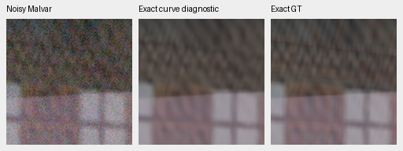
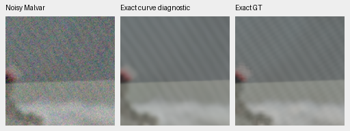

# Shared Bayer phase across 64-pixel windows

Four separate RAW windows provide enough evidence to refine the spacing of
the coarse fence. They offer little support for bending the fine cab mesh.
The checked quadratic fit lowers ISO6400 planted-wire response by
**0.211 percentage points** versus the fixed 64-pixel fit, with essentially
the same measured gap and quiet errors. Supplying the true bend on ten
separate constructed backgrounds does recover **1.50 more weak-response
points** at the same delivery dose. The delivered gain depends on knowing
the geometry more accurately than the four central windows estimate it.
[Machine results](results/bayer-shared-phase-v1/publication.json) ·
[Frozen drivers and receipts](results/bayer-shared-phase-v1/evidence.tar.xz) ·
[Native crop provenance](images/bayer-shared-phase-v1/manifest.json).

The numbers in the conditional synthetic delivery section use the serial
replay. A threaded diagnostic override affected one source in the
original results. The two published exact-bend examples reproduce
exactly on replay. [Correction and original receipt](bayer-exterior-bend.md#serial-replay-of-the-preceding-diagnostic).

## Fitting and checking the geometry

The [64-pixel carrier fit](bayer-carrier-scale.md) supplies the exterior
frequency nominations, blend windows, factor 0.73 and gain checks. Each
green lattice independently estimates shared geometry across four disjoint
64×64 windows within the native 160-pixel crop. Local tone and the complex
coefficient for each direction remain free in each window. A projected
Gauss–Newton fit first permits a linear phase adjustment. The next pass
permits a quadratic wavefront. A constrained variant uses one signed
curvature along each direction's tangent. Each fitted change must improve
prediction on the other lattice by more than three prior-whitened squared
error units in both directions of the split, and phase disagreement
between the two fits must stay below 0.18 cycles within each window.
Quadratic candidates are checked against the fitting lattice's own linear
solution. The full quadratic path also includes an unchecked control.

These are conditional RAW prediction checks. The earlier exterior
nomination and the existing reciprocity tests for delivery stay in place.
For example, frequencies proposed in a building crop reduce the held-green
error after recentering. They fail the exterior mesh qualification,
so the image gets no such correction. On the natural photos in the earlier
study, any site rejected by the original admission still bypasses these
geometry fits. The shot and read model supplies variance weights. The
two cab priors reweight the same capture.

The main replay uses local-only scene 20k EMA
`b892a08c8ebbccb05c000e4f42d1f86c3a7d1d5870721ccd6e1c8fe9e82c3889`,
eight-donor EMA
`7b854d681083550de869b06b55d56c2f84224ec4a0545419a2cf34682a38ec68`
and distant gate EMA
`ca2f3567bc65a3e3f2f8dadf81d97f36b13f0b2b5648ee0412f929be66b0e4c5`.
The frozen phase is bound in the receipt. This inference study covers
paired crops and the two standing scenes. The fixed 427-photo and
known/unseen camera scores belong to their full-model evaluations.

## Exact measured recovery

The main replay holds 24 ISO400 and 24 ISO6400 wire observations fixed,
including twelve true gaps per profile. The preceding 24 calibration
backgrounds also supply a fixed-frequency control matched for mean intact
correction RMS. The fixed-frequency implementation agrees with the
prior 64-pixel numerical scores within 0.002 DN16.

| Change from the fixed 64-pixel fit | Intact response, pp | Intact increment RMS, DN16 | Exact-gap RMS, DN16 | Weak-band gap RMS, DN16 |
| --- | ---: | ---: | ---: | ---: |
| Checked frequency shift, ISO6400 | −0.127 | +0.022 | +0.009 | −0.002 |
| Checked quadratic, ISO6400 | −0.211 | +0.030 | +0.009 | −0.002 |
| Unchecked quadratic, ISO6400 | −0.627 | +0.134 | −0.003 | −0.085 |
| Checked quadratic, ISO400 | +0.003 | +0.001 | +0.007 | +0.023 |

At ISO6400 the checked quadratic response change has a paired source
bootstrap interval of [−0.538, −0.002] points. Its loss is 0.217 points
against the correction-matched control. Flat RMS reproduces the fixed
fit for all three geometry methods at both noise levels. The smaller
unchecked weak-band gap error comes with the largest loss of intact
response.

### How much does correct curvature buy?

A second panel reuses ten straight and ten bent backgrounds from the
[previous curvature study](query-phase-curvature.md), with two independent
ISO6400 draws of each of four roles. All corrected paths receive the
generator's exact center frequencies, so the comparison focuses on
within-window drift. The checked quadratic fit accepts estimated
curvature for the stronger family in 11 of 20 bent present draws, and
for the weaker family in zero. The tangent-only fit accepts eight and
zero. In the weak direction, phase RMS in cycles rises from 0.031 with
fixed centers to 0.036 with either check. Unchecked fitting raises it
to 0.047. The errors remove a free constant phase in each window.

The conditional delivery replay uses the same 64-pixel local RAW
amplitude fit above Corpus 100k EMA
`87b96f3c487b9edaf1c477742b6c38f2a82cc6b20a94716d51cc8cf46a17a760`.
Every corrected arm uses dose 0.73 and the green delivery evidence
test. The supplied-curve diagnostic also receives the generator's exact
curvature. It improves recovery on the bent fields without changing
exact-flat error.

| Bent fields, ISO6400 | Weak response | Increment RMS, DN16 | Total gap RMS, DN16 | Weak-wave gap projection, DN16 |
| --- | ---: | ---: | ---: | ---: |
| Corpus 100k EMA | 28.268% | 184.931 | 141.645 | 3.747 |
| Fixed exact centers | 45.551% | 178.902 | 139.662 | 5.526 |
| Checked frequency shift | 45.330% | 178.876 | 139.600 | 5.369 |
| Checked quadratic | 45.340% | 178.912 | 139.647 | 5.359 |
| Checked tangent | 45.341% | 178.869 | 139.617 | 5.362 |
| Exact centers and curvature | 47.052% | 178.548 | 139.685 | 5.730 |

The exact curvature gains 1.50 response points [0.52, 2.56] and lowers
increment RMS by 0.354 DN16 [0.104, 0.614] over the fixed exact centers.
The point estimate for coherent weak-wave gap projection rises by
0.204 DN16 [−0.039, +0.509]. All 40 exact-flat draws reproduce their
parent. The remaining gap signal and modest upper bound give separate
reasons to retain the fixed-frequency crop fit for photographs.

### Native crops of bent targets

Both triplets show noisy Malvar, the supplied-curve diagnostic and exact
GT. They use 160×160 unchanged pixels at `[48,48,160,160]` inside the
query `[128,128,256,256]`, redraw zero, shot/read `0.00128/6.5536e-6`,
16-bit ADC with black 0.03, capture exposure 0.33 and display ×2.
Fine crossings in the target remain sharper than the supplied-curve
result.

**Shops in Paro**, Bernard Gagnon, CC BY-SA 4.0. BGGR, 512-pixel
source crop `[432,132,512,512]`. The weak weave is still faint near the
strong horizontal edge. [Source](https://commons.wikimedia.org/wiki/File:Shops_in_Paro,_Bhutan_01.jpg) ·
[All methods](images/bayer-shared-phase-v1/bent/bent-001-comparison.png).

**NAS Jacksonville Air Show**, Jonathan Zander, CC BY-SA 3.0.
GBRG, source crop `[76,46,512,512]`. The dominant direction remains
clearer than the weaker crossings. [Source](https://commons.wikimedia.org/wiki/File:NAS_Jacksonville_Air_Show_2403.JPG) ·
[All methods](images/bayer-shared-phase-v1/bent/bent-003-comparison.png).

[Independent photo](images/bayer-shared-phase-v1/exact/001-iso6400-independent-comparison.png) ·
[Planted ellipse gap](images/bayer-shared-phase-v1/exact/012-iso6400-comparison.png) ·
[Continuous contrast dip](images/bayer-shared-phase-v1/exact/014-iso6400-comparison.png).

## Standing GFX100S comparisons

DSCF3879 uses nominal shot/read `0.00128/6.5536e-6` at display ×4.
Both coarse fence directions meet the center-shift check. None meets
the curvature check. The visible crossings remain coherent. Sky,
building and foliage match the fixed carrier path at display precision.
The sky stays smooth, while thin cables and fine foliage remain soft.

DSCF3842 uses display ×16. Only the first direction in the transferred
right crop clears the center-shift check. The checked variants look
like the fixed carrier fit at native scale. Some lattice patches still
look overly regular and fine crossings remain incomplete. The unchecked
candidate changes the modulation in several places. All eight crops
were inspected with the independent ISO100 AHD views and, for the cab,
both camera JPEGs. The lower-ISO views are qualitative references with
aperture, exposure time and motion differences.

[Sky](images/bayer-shared-phase-v1/standing/main-overcast-sky-main-overcast-sky.png) ·
[Building](images/bayer-shared-phase-v1/standing/main-building-detail-main-building-detail.png) ·
[Foliage](images/bayer-shared-phase-v1/standing/main-foliage-main-foliage.png) ·
[Coarse fence](images/bayer-shared-phase-v1/standing/main-chain-link-fence-main-chain-link-fence.png).

| Cab profile | Native comparisons |
| --- | --- |
| Nominal `0.00128/6.5536e-6` | [Left](images/bayer-shared-phase-v1/standing/mesh-nominal-fine-green-mesh-left.png) · [Right](images/bayer-shared-phase-v1/standing/mesh-nominal-fine-green-mesh-right.png) |
| Transferred `0.0014635775921166604/1.0715704128646712e-6` | [Left](images/bayer-shared-phase-v1/standing/mesh-profile3879-fine-green-mesh-left.png) · [Right](images/bayer-shared-phase-v1/standing/mesh-profile3879-fine-green-mesh-right.png) |
