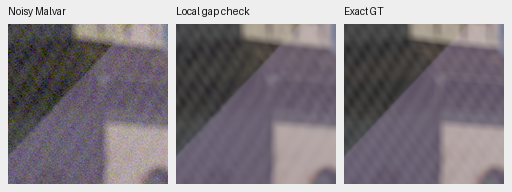
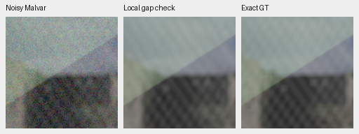

# Delivering one Bayer direction when the pair abstains

On 24 held-out photo backgrounds with planted bent wires, restoring one
locally confirmed direction adds **1.42 weak-response points** and lowers
ISO6400 fine-increment error **0.66 DN16** versus the prior two-direction
route. It also raises weak-pattern residue in true gaps. Local attenuation
recovers part of that cost. The checked fallback changes none of the eight
standing GFX crops and abstains on all 64 photographs with unplanted detail.

[Machine results](results/bayer-single-direction-v1/publication.json) ·
[Frozen drivers and receipts](results/bayer-single-direction-v1/evidence.tar.xz) ·
[Native crop provenance](images/bayer-single-direction-v1/manifest.json).

## From nomination to restored pixels

The prior two-direction logic runs first. The fallback is eligible when
exactly one near exterior direction passes its two-green check and its
native query cross score exceeds 17.963, the cutoff calibrated on the
earlier development set. The tested policies share this candidate and
checkpoint. In each 64-pixel delivery tile the second frequency remains
in the nuisance fit. Only the supported direction contributes a correction,
using the earlier green coefficient fit, FP32 parent subtraction and taper.
The synthetic parent is the Corpus 100k EMA
`87b96f3c487b9edaf1c477742b6c38f2a82cc6b20a94716d51cc8cf46a17a760`.
[Prior phase path](bayer-local-phase-transfer.md) ·
[Single-direction nomination audit](bayer-phase-residual.md#why-a-single-carrier-is-worth-checking).

The spatial check also requires a score above four when the carrier
estimated on each half predicts the other half. It tests both left/right
and top/bottom splits and retains the worst score. The spectra and the
spatial check share the query samples. The edge arm adds a soft step
selected by the discovery green and scored by the other green, keeping the
carrier and edge in the same fit. The local gap arm instead uses the
existing 32-pixel Bayer deficit check with a phase veto. It is compared
with uniform attenuation at the same correction energy per capture.

## Exact-target photo backgrounds

The tables use the same 60 photo backgrounds as the nomination audit.
An initial 20-photo set sets the query cutoff. Separate 16- and 24-photo
groups replay that cutoff. All arms share the same two draws and exact
targets. Source intervals resample entire photos, including both draws.

| Later 24 bent backgrounds | Weak response | Fine-increment RMS, DN16 | Absolute gap RMS, DN16 | Coherent gap residue, DN16 |
| --- | ---: | ---: | ---: | ---: |
| Corpus 100k EMA | 29.995% | 172.111 | 137.862 | 4.031 |
| Prior two-direction route | 36.618% | 169.582 | 136.749 | 4.819 |
| Single direction | 38.402% | 168.824 | 136.586 | 4.952 |
| With disjoint-half check | 38.041% | 168.923 | 136.631 | 5.066 |
| With disjoint-half check and edge nuisance | 38.023% | 168.929 | 136.624 | 5.046 |
| With disjoint-half check and local gap check | 38.029% | 168.927 | 136.628 | 5.026 |

Against the prior route, the disjoint-half arm changes weak response
by +1.422 points [0.181, 3.132] and increment RMS by −0.659 DN16
[−1.512, −0.023]. Its absolute gap RMS change is −0.118 DN16
[−0.339, +0.051]. Coherent gap residue increases by 0.246 DN16
[−0.021, +0.717]. The spatial check rejects four unmatched candidates on
the 16-photo replay and retains one in the later replay. It has higher
mean coherent gap residue than the unguarded single fit on the later
replay. The gap metric measures the absolute projection onto the planted
weak pattern where the exact target has a true break.

The local gap check lowers coherent gap residue by 0.040 DN16
[0.003, 0.093] versus the spatial check and loses 0.012 response points.
Against equal-energy uniform attenuation, the reduction is 0.036 DN16
[0.003, 0.085]. The independent 16-photo group shows a 0.073 DN16
reduction versus equal-energy attenuation. Its increment RMS rises
0.018 DN16 [0.001, 0.039]. On the later 24 photos, the edge arm
changes matched-energy increment RMS by +0.003 DN16 and gap residue by
−0.012 DN16, with both intervals spanning zero. Exact-flat outputs
reproduce the prior route.

## Unplanted fine detail

The same donor and query rules were replayed on the 64 held-out ISO6400
photographs from the matched scene study. Their present queries contain
natural detail, with matched attenuated and exact-flat roles. Fifty-six
have all near donors within the capture, 37 have all far donors and 32
have the primary bank. All 192 role captures abstain, and per-case fine
response, absolute error and quiet scores reproduce Corpus 100k.
The gain applies to the planted periodic carriers in this study.
[Source-bound natural panel](scene-full-epoch-40k.md#checkpoints-and-evaluation).

## Native exact-target triplets

The two triplets use the disjoint-half and local gap checks. Each cell is
an unchanged 160 × 160 crop at `[48,48,160,160]` within the query
`[128,128,256,256]` of the listed 512-pixel source box. Shot/read is
`0.00128/6.5536e-6`, capture exposure ×0.33, display ×2 and 16-bit ADC
black level 0.03.

**Teepavillon an der Obergasse**, Friedrich Haag, CC BY-SA 3.0 DE.
GBRG, source box `[28,8,512,512]`, draw 0. The weak lattice returns
faintly near the dark corner. Crossings remain softer than the exact
target. [Source](https://commons.wikimedia.org/wiki/File:2014_09_23_Teepavillon_an_der_Obergasse_2.jpg) ·
[All methods](images/bayer-single-direction-v1/exact/011-0-comparison.png).

**Erice**, Berthold Werner, CC BY-SA 3.0. GRBG, source box
`[192,8,512,512]`, draw 0. Dark diagonals strengthen slightly.
The edge-aware result looks close to the other checked versions.
[Source](https://commons.wikimedia.org/wiki/File:Erice_BW_2012-10-10_14-16-34.JPG) ·
[All methods](images/bayer-single-direction-v1/exact/014-0-comparison.png).

**Hunefer papyrus**, public domain, photograph as listed in the
provenance. GBRG, source box `[52,18,512,512]`, draw 1. The unmatched
candidate survives the spatial check and adds 8.58 DN16 RMS over the
query. The planted diagonal remains hard to see, and the added direction
gives no clear native improvement. [Source](https://commons.wikimedia.org/wiki/File:Livre_des_morts_d%27Houn%C3%A9fer,_2.jpg) ·
[Counterexample](images/bayer-single-direction-v1/exact/007-1-comparison.png).

## Standing GFX100S comparisons

The prior path composes local 20k and eight-donor EMAs with the distant
gate, 64-pixel fit and phase rotation. The unguarded single fallback
changes the foliage crop by **0.927 DN16 camera-RGB RMS**. It looks
similar at native scale. The foliage proposal fails the disjoint-half
check, leaving all eight guarded results bit-identical to the prior
path. The transferred right cab has a single candidate, but it already
has a paired route and the single candidate fails the spatial check.
The optional one-band diagnostic at that location adds 4.43 DN16 RMS
relative to the distant-gate input. It leaves incomplete crossings.
The sky stays smooth and coarse crossings stay visible.

All eight crops were viewed. Main display exposure is ×4 and cab
display is ×16. Both camera JPEGs and independently demosaiced ISO100
captures are qualitative references at different aperture, exposure
time and motion. [Standing checkpoint lineage](bayer-shared-phase.md#fitting-and-checking-the-geometry).

[Sky](images/bayer-single-direction-v1/standing/main-overcast-sky-main-overcast-sky.png) ·
[Building](images/bayer-single-direction-v1/standing/main-building-detail-main-building-detail.png) ·
[Foliage](images/bayer-single-direction-v1/standing/main-foliage-main-foliage.png) ·
[Coarse fence](images/bayer-single-direction-v1/standing/main-chain-link-fence-main-chain-link-fence.png).

| Cab shot/read | Left | Right |
| --- | --- | --- |
| Nominal `0.00128/6.5536e-6` | [Native board](images/bayer-single-direction-v1/standing/mesh-nominal-fine-green-mesh-left.png) | [Native board](images/bayer-single-direction-v1/standing/mesh-nominal-fine-green-mesh-right.png) |
| Transferred `0.0014635775921166604/1.0715704128646712e-6` | [Native board](images/bayer-single-direction-v1/standing/mesh-profile3879-fine-green-mesh-left.png) | [Native board](images/bayer-single-direction-v1/standing/mesh-profile3879-fine-green-mesh-right.png) |

This inference component has no new fixed 427-photo or measured-camera
scores. Its absolute gap error falls slightly on the planted panel, while
coherent residue still increases versus the preceding route.
