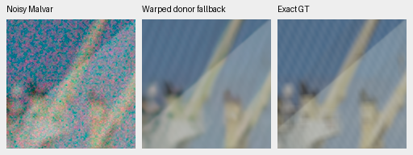
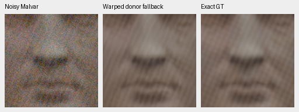

# Aligning exterior Bayer spectra for bending wires

Warping donor spectra to a common center finds seven of twenty bent
ISO6400 captures in the development panel. The preceding spacing check
finds three. A fallback with the warped candidates and a central RAW check
raises weak response **5.24 percentage points** on that panel. It delivers
no bent-field change on a separate eight-source replication subset.
The fallback leaves both standing GFX scene families unchanged.
[Machine results](results/bayer-warped-spacing-v1/publication.json) ·
[Frozen drivers and receipts](results/bayer-warped-spacing-v1/evidence.tar.xz) ·
[Native crop provenance](images/bayer-warped-spacing-v1/manifest.json).
The [cross-green agreement follow-up](bayer-cross-evidence.md) recovers
some of the missed crop checks at the same development false-activation budget.

## Using the donor spectra

The [previous exterior fit](bayer-exterior-bend.md) estimates curvature
from eight 64-pixel RAW windows once it has a plausible center. In a
quadratic phase model, the apparent frequency shifts in opposite
directions across opposite sides of the crop. Averaging a spectrum
without aligning those shifts spreads the weak peak.

Each green lattice now builds its own power spectra for the same eight
exterior windows. For a proposed center frequency and one of seven
tangential curvatures from −0.000075 to +0.000075 cycles per pixel
squared, the algorithm samples each spectrum at the predicted local
frequency. It sums bounded power prominence across the windows. Each
green proposes one peak per oblique direction, then the other green
scores it with separate local tone and phase. A frequency pair needs
positive support in at least three windows on both lattices, more
than 12 summed prior-whitened error units per direction and matching
center and phase estimates. The flat-donor control uses the same
windows with curvature fixed to zero. Both methods allow the constant
phase to vary between windows.

The fallback runs where the preceding spacing check abstains. It uses
the same measured 64-pixel delivery and 0.73 dose. The optional crop
check compares each nominated direction with a nuisance fit on the
other green. It requires more than 12 summed units and two supporting
windows on each lattice. The donor and query control roles therefore
test different claims about the same wavelength. The checkpoint and
display arithmetic match the previous experiment.

## Development and independent replay

Both studies use the same ISO6400 noise profile, two independent draws
per source and four exact-target roles. The development panel has ten
bent and ten straight sources from the [curvature study](bayer-exterior-bend.md).
The fixed algorithm then replays 16 disjoint photo sources, eight bent,
from the [frequency consensus archive](query-frequency-consensus.md).
The thresholds and dose are fixed for the replication. Geometry fitting
uses noisy RAW from each capture. The endpoint is the frozen Corpus 100k EMA
`87b96f3c487b9edaf1c477742b6c38f2a82cc6b20a94716d51cc8cf46a17a760`.

| Bent ISO6400 | Prior checked fit | Flat donor fallback | Warped donor fallback | Warped with crop check |
| --- | ---: | ---: | ---: | ---: |
| Development weak response | 32.11% | 33.44% | 37.36% | 37.36% |
| Development fine-increment RMS, DN16 | 182.840 | 182.660 | 181.219 | 181.244 |
| Development outside-only added RMS, DN16 | 1.613 | 5.522 | 6.434 | 1.613 |
| Independent weak response | 25.99% | 28.77% | 26.81% | 25.99% |
| Independent fine-increment RMS, DN16 | 184.999 | 183.911 | 185.013 | 184.999 |
| Independent outside-only added RMS, DN16 | 0.000 | 3.701 | 1.618 | 0.000 |

The warped crop-checked gain on the development set is 5.244 points
[0.774, 11.880] over the prior fit. The difference versus the flat
donor fallback is less certain. Total gap RMS falls 0.844 DN16,
while projection along the missing weak wave rises 0.814 DN16.
The crop check removes the additional outside-only texture, where the
weak wave exists beyond the crop. The fixed and warped candidate
methods leave the exact-flat cores unchanged.

On the independent bent subset the flat and warped methods each admit
two exterior pairs in 16 present draws. The two warped pairs occur in
one background with different noise. Neither passes the central check.
With exact spacing plus exact curvature supplied, the same check passes
one of the two. Continuous joint refinement of the estimated spacing
and curvature leaves both decisions unchanged. The independent straight
fields gain 0.789 response points with a 0.016 DN16 rise in increment
error. The wider search rescues some proposals, with no repeatable
bent-field delivery gain under the crop check. This is a scoped
inference study with no fixed 427-photo or measured-CFA evaluation.

### Native crop examples

These are the first two development sources with a new warped candidate
in a present draw. Each cell is the original `[48,48,160,160]` ROI
inside the `[128,128,256,256]` query. They use shot/read
`0.00128/6.5536e-6`, 16-bit ADC, black 0.03, capture exposure 0.33 and
display ×2. The triplets show noisy Malvar, the warped fallback and
exact GT. Some weak diagonals return with softer intersections than
the exact target.

**Darya Ganga at Alcoa Jetty**, Calistemon, CC BY-SA 4.0.
GBRG, redraw zero, source box `[140,20,512,512]`.
[Source](https://commons.wikimedia.org/wiki/File:Bulk_carrier_Darya_Ganga_at_Alcoa_Jetty,_November_2022_16.jpg) ·
[All methods](images/bayer-warped-spacing-v1/initial/bent-011-comparison.png).

**Chénier sculpture**, photograph by Selbymay, CC BY-SA 3.0.
BGGR, redraw one, source box `[50,68,512,512]`.
[Source](https://commons.wikimedia.org/wiki/File:David_d%27Angers_-_Chenier.jpg) ·
[All methods](images/bayer-warped-spacing-v1/initial/bent-013-comparison.png).

[Independent Krak des Chevaliers crop](images/bayer-warped-spacing-v1/replication/bent-001-comparison.png).

## Standing GFX100S comparisons

No new pair qualifies in the eight fixed crops. Every fallback reproduces
the prior joint-checked output bit for bit. The overcast sky stays smooth
and both coarse fence directions remain coherent. Thin building wires and
foliage stay soft. In the second scene, both cab ROIs retain faint
diagonals, some mottling and incomplete crossings under both priors.
The standing path composes local 20k EMA, eight-donor EMA and distant
gate EMA, with exact checkpoint bindings in the previous report and the
new manifest. Main crops use display ×4 and cab crops ×16. All eight
were viewed with the independent ISO100 AHD and both cab JPEG references.
Those views differ in exposure, aperture and motion.
[Standing checkpoint composition](bayer-shared-phase.md#fitting-and-checking-the-geometry).

[Sky](images/bayer-warped-spacing-v1/standing/main-overcast-sky-main-overcast-sky.png) ·
[Building](images/bayer-warped-spacing-v1/standing/main-building-detail-main-building-detail.png) ·
[Foliage](images/bayer-warped-spacing-v1/standing/main-foliage-main-foliage.png) ·
[Coarse fence](images/bayer-warped-spacing-v1/standing/main-chain-link-fence-main-chain-link-fence.png).

| Cab profile | Native comparisons |
| --- | --- |
| Nominal `0.00128/6.5536e-6` | [Left](images/bayer-warped-spacing-v1/standing/mesh-nominal-fine-green-mesh-left.png) · [Right](images/bayer-warped-spacing-v1/standing/mesh-nominal-fine-green-mesh-right.png) |
| Transferred `0.0014635775921166604/1.0715704128646712e-6` | [Left](images/bayer-warped-spacing-v1/standing/mesh-profile3879-fine-green-mesh-left.png) · [Right](images/bayer-warped-spacing-v1/standing/mesh-profile3879-fine-green-mesh-right.png) |
