# Bounded spectral support: V167 final quality

**A quarter support floor recovers some mesh response, with higher quiet-region error.**
Compared with exact V166 routed-common controls, V167 raises mean constructed
mesh response **47.33% raw / 47.55% EMA**, reaching **3.239% / 3.248% of GT
amplitude**. Present-image RMS falls **1.153% / 1.094%**. This is useful measured
response recovery from the almost closed V166 path. V161's 4.83–5.24% and V164's
4.30–4.43% remain stronger learned responses. Real fine cab crossings are still
incomplete. Quiet RMS rises **2.84–3.74%**, spatial error rises **2.26–2.60%** on
all32 quiet inputs, and standalone full-flat means rise **0.189–0.382%** versus
V166. The requested fine-detail recovery with reliable flat fields remains open.

The only intervention is the shifted quarter-floor support mapping at identical
124,909-parameter heads, initial weights, cache, losses, common backward routing
and optimizer. A positive floor prevents support from approaching zero but does
not force the frequency proposal to recover signal. All256 present-mesh mean
supports lie within1e-4 of the floor at both candidate endpoints. Their
pre-support coefficient RMS falls from control8.4502e-5/8.4363e-5 to
5.8498e-5/5.9512e-5; direct RGB correction RMS is0.3620/0.3160 DN16 versus
0.3335/0.3162. These archived scalar observations describe adaptation, not an
isolated explanation of the quality change. Full support maps were not retained.
[Recorded bounds, activity and ADC identity checks](results/v167-archived-support-summary-v1.json).

Mesh present RMS is8.981523/8.994781 DN16. Actual blank-region RMS rises
0.793%/0.953% and wholly absent-image RMS rises0.686%/0.836% versus control.
Absent-image means are0.050%/0.411% above V143. An additional diagnostic, frozen
after launch but before V167 scores or completed review existed, groups every
recipe by zero/one/two nominal periods<=10 native pixels. There are26/29/9
distinct recipes, with related CFA/noise variants rather than independent scene
replications. For the nine both-fine recipes, response changes from
-0.000810/-0.000762 to0.011309/0.011392; present RMS falls from
10.208917/10.217452 to10.075513/10.087129 DN16. Blank error rises there too.
This remains only about1.13% of constructed GT amplitude. Nominal periods do not
measure post-geometry spectral peaks.
[Additional declaration](results/v167-mesh-period-strata-preparation-v1.json) ·
[All period strata and per-recipe means](results/v167-mesh-period-strata-v1.json).

Native512 full-flat RMS means are18.481399/23.981424 raw and
18.505695/24.031410 EMA for ISO6400/12800. Against control,42/48 raw and41/48 EMA
inputs worsen, with maximum increases0.237933/0.312141 DN16. Coarse32 means
improve0.135–0.153% raw and0.0137–0.0238% EMA;47/48 raw and28/48 EMA inputs
improve, with individual maximum costs0.006020/0.011248 DN16. All48 coarse errors
remain below V143; full-flat means remain0.168–0.376% below V143 even though
12 raw and25 EMA individual full errors exceed it. Coarse and total flat error
therefore give different conclusions.

Quiet RMS is4.221290/6.728466 raw and4.141840/6.547331 EMA,6.23–9.36% above
V143. Against V166,25/32 raw and29/32 EMA quiet total errors worsen, with
maximum increases0.851428/0.452393 DN16. All32 spatial errors worsen at both
endpoints; their maximum increases are0.220952/0.220428 DN16. Quiet DC bias rises
4.61–6.56% versus V166 and14.29–30.86% versus V143. Whole mixed-image means
remain below V143, which does not establish accurate quiet neighbors. The
original-pixel decomposition separately checks spatial error and DC bias.

Natural-photo full-RMS means improve in two of four cohorts and worsen in two,
at each endpoint: changes range-0.0203% to+0.0253% versus control. All four
cohort band-response means decline at both endpoints. Retained-photo band
errors improve slightly, while organic-photo band errors worsen. ADC-only photo
full RMS improves0.0164% raw/0.0104% EMA versus control; all eight outputs now
differ from V143. Their mean displacement is only0.04479/0.04298 DN16 RMS,
with maximum absolute differences2.29489/2.26754 DN16. This is displacement,
not target error. All192 reviewed constant-field endpoint outputs stay exactly
at V143. ADC slope full error rises0.0700–0.0717% versus control while coarse
error falls0.184–0.186%.
[Post-hoc ADC displacement size audit](results/v167-adc-photo-displacement-v1.json).

All72 native figures, including24 noisy/restored/exact-GT triplets, were
actually viewed in18 original-detail sheets. The two fixed procedural mesh
crops still lose a crossing family or nearly all faint wires; periodic detail
recovers more lattice with directional/support defects. The protected GFX cab
windows under both priors retain weak incomplete diagonal strands; changes are
subtle and do not establish new complete crossings. Main-scene coarse fence
and building geometry survive, foliage stays soft, and sky looks smooth at+2EV.
The ISO100 AHD/JPEG views differ in aperture, shutter, movement and processing;
they are qualitative references, not GT. Amplified standalone and quiet crops
show broad color mottle and added fine texture. Smooth unamplified contexts do
not override those measured quiet costs. Natural bird, butterfly, bark and
vegetation retain substantial fine-texture softness.

Retain the bounded variant as an implementation that restores some delivered
response and modest coarse-flat improvement relative to V166. Preserve V166's
quiet-color strength, V165's grain/total-flat strength, V161/V164 stronger detail,
V158 quiet accuracy and V157 coarse correction. V120 remains the broad model
recommendation. The [training-coverage audit](results/mesh-training-coverage-20261107-v1.json)
finds only13/614 noisy training pairs with both carriers in the real reference's
dominant7.12–9.40 pixel interval and median actual signal RMS2.48 DN16. This
supports testing better fine-family coverage across a contrast/noise ladder
with matched empty scenes; simply reducing already weak contrast is not an
established solution. It does not establish a cause of these model tradeoffs.

[Final evidence and immutable sources](results/v167-bounded-support-final-v1.json) · [Native pixels, source ROIs, conditioning, exposure and checkpoint hashes](images/v167-bounded-support-v1/manifest-v1.json).

## Response and actual blank error

RMS values are camera-RGB DN16. Response1 means the exact constructed mesh amplitude. Blank error measures actual target error; added blank RMS measures displacement from V143.

| Method | Present full RMS | Response | Actual blank RMS | Blank spatial RMS | Added blank RMS |
| --- | ---: | ---: | ---: | ---: | ---: |
|V143|9.111243|0.02202090|5.523323|5.343113|0.00000000|
|Routed ctrl raw|9.086327|0.02198277|5.488693|5.310917|0.33322959|
|Routed ctrl EMA|9.094270|0.02201508|5.498850|5.314341|0.31587994|
|Bounded support raw|8.981523|0.03238742|5.532231|5.356251|0.87262459|
|Bounded support EMA|8.994781|0.03248398|5.551259|5.366688|0.85880048|
|Existing periodic detail|8.586126|0.07089755|5.523328|5.343118|0.00063557|

## Quiet neighbors and coarse fields

| Prior | Method | Whole RMS | Quiet RMS | Quiet spatial RMS |
| --- | --- | ---: | ---: | ---: |
|ISO6400|V143|27.105631|3.898845|3.268502|
|ISO6400|Routed ctrl raw|27.227403|4.077825|3.268534|
|ISO6400|Routed ctrl EMA|27.167656|3.992425|3.263686|
|ISO6400|Bounded support raw|27.054526|4.221290|3.348955|
|ISO6400|Bounded support EMA|26.989986|4.141840|3.348572|
|ISO12800|V143|36.747466|6.152652|5.341833|
|ISO12800|Routed ctrl raw|36.909905|6.542553|5.323613|
|ISO12800|Routed ctrl EMA|36.814849|6.350538|5.321692|
|ISO12800|Bounded support raw|36.139329|6.728466|5.444060|
|ISO12800|Bounded support EMA|36.028569|6.547331|5.447253|

Quiet bias is averaged per RGB channel before its Euclidean RMS. The independent pixel audit verifies total squared = spatial squared + DC squared per case; means of RMS values do not share that identity.

| Prior | Method | Quiet DC RMS DN16 |
| --- | --- | ---: |
| iso6400-prior | parent | 2.016074 |
| iso6400-prior | routed-control-raw-step1000 | 2.305193 |
| iso6400-prior | routed-control-EMA-step1000 | 2.162425 |
| iso6400-prior | bounded-support-raw-step1000 | 2.434560 |
| iso6400-prior | bounded-support-EMA-step1000 | 2.304264 |
| iso12800-prior | parent | 2.849060 |
| iso12800-prior | routed-control-raw-step1000 | 3.564040 |
| iso12800-prior | routed-control-EMA-step1000 | 3.240171 |
| iso12800-prior | bounded-support-raw-step1000 | 3.728242 |
| iso12800-prior | bounded-support-EMA-step1000 | 3.426662 |

|Flat test|V143|Routed ctrl raw|Routed ctrl EMA|Bounded support raw|Bounded support EMA|
| --- | ---: | ---: | ---: | ---: | ---: |
|Native512 ISO6400 full RMS|18.546808|18.446607|18.470735|18.481399|18.505695|
|Native512 ISO6400 spatial RMS|18.235130|18.156755|18.168298|18.181950|18.211357|
|Native512 ISO6400 block32 RMS|13.440561|13.390446|13.399955|13.372303|13.398120|
|Native512 ISO12800 full RMS|24.071890|23.906790|23.939929|23.981424|24.031410|
|Native512 ISO12800 spatial RMS|23.596861|23.481979|23.497030|23.541824|23.583390|
|Native512 ISO12800 block32 RMS|17.932544|17.865669|17.876290|17.838301|17.872030|
|Older native256 ISO12800 full RMS|27.233548|27.091806|27.110646|27.124481|27.169922|
|Older native256 ISO12800 spatial RMS|26.017191|25.897830|25.912015|25.938711|25.982845|
|Older native256 ISO12800 block32 RMS|19.539875|19.470894|19.480622|19.436470|19.473692|

## Natural detail and ADC controls

|Photo test|V143|Routed ctrl raw|Routed ctrl EMA|Bounded support raw|Bounded support EMA|
| --- | ---: | ---: | ---: | ---: | ---: |
|Retained512 faint full RMS|33.963754|33.958839|33.961352|33.962135|33.961565|
|Retained512 faint band error|0.824639|0.824704|0.824694|0.824631|0.824609|
|Retained512 faint band response|0.298560|0.297886|0.297918|0.297603|0.297758|
|Retained512 dark full RMS|29.097715|29.100272|29.100222|29.098939|29.094325|
|Retained512 dark band error|0.661447|0.661448|0.661449|0.661319|0.661311|
|Retained512 dark band response|0.531446|0.530654|0.530644|0.530130|0.530287|
|Organic384 faint full RMS|37.469061|37.471202|37.471776|37.480662|37.477363|
|Organic384 faint band error|0.924117|0.924130|0.924123|0.924699|0.924657|
|Organic384 faint band response|0.150701|0.150274|0.150298|0.149338|0.149460|
|Organic384 dark full RMS|33.685796|33.694728|33.692042|33.693790|33.687892|
|Organic384 dark band error|0.781612|0.781589|0.781586|0.781642|0.781640|
|Organic384 dark band response|0.398945|0.398350|0.398339|0.397488|0.397611|

|ADC test|V143|Routed ctrl raw|Routed ctrl EMA|Bounded support raw|Bounded support EMA|
| --- | ---: | ---: | ---: | ---: | ---: |
|Photo full RMS|18.149871|18.149871|18.149871|18.146890|18.147987|
|Photo band error|0.101855|0.101855|0.101855|0.101834|0.101842|
|Photo band response|0.968329|0.968329|0.968329|0.968332|0.968325|
|Sloped512 full RMS|3.771369|3.771474|3.771478|3.774112|3.774182|
|Sloped512 spatial RMS|3.397249|3.397373|3.397378|3.399834|3.399888|
|Sloped512 block32 RMS|0.574652|0.574632|0.574631|0.573566|0.573573|
|Sloped512 crop block32 RMS|0.088145|0.088145|0.088145|0.088146|0.088145|
|Sloped512 worst absolute DC|11.176981|11.176578|11.176570|11.181840|11.181765|

## Fixed native comparisons

Every cell is native 160×160; crop pixels are never resized. All RAW methods within each board share source coordinates, camera display transform, exposure and contrast. JPEG cells retain native sRGB8 without exposure/contrast changes. Both final raw/EMA endpoints of both heads are shown, with eight retained V156/V157/V158/V159/V160 ordinary/V160 paired/V161/V162 columns.

The main scene is DSCF3879 ISO6400 versus DSCF3880 ISO100 f/5.6. The fine cab mesh uses DSCF3842 versus DSCF3835 and both camera JPEGs. Aperture, shutter, moving subjects and processing differ: ISO100 views are qualitative references, not exact GT. All30 real score rows stay unscored.

### Mesh and exact absence

mesh-seed2026112302-present-iso6400-prior-RGGB; ROI `[176, 176, 160, 160]`, RAW exposure 8, contrast 1.

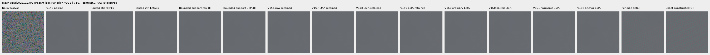

mesh-seed2026112302-present-iso6400-prior-RGGB; ROI `[176, 176, 160, 160]`, RAW exposure 8, contrast 40.

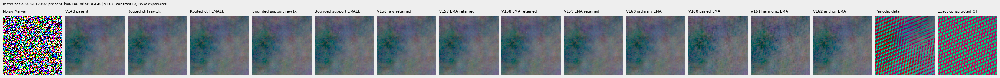

mesh-seed2026112309-present-iso6400-prior-RGGB; ROI `[176, 176, 160, 160]`, RAW exposure 8, contrast 1.

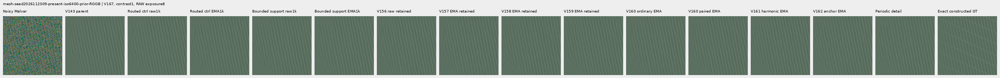

mesh-seed2026112309-present-iso6400-prior-RGGB; ROI `[176, 176, 160, 160]`, RAW exposure 8, contrast 40.

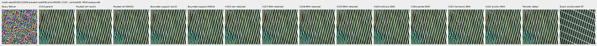

mesh-seed2026112304-absent-iso6400-prior-RGGB; ROI `[165, 0, 160, 160]`, RAW exposure 8, contrast 40.

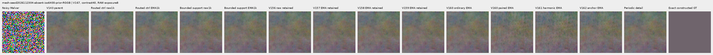

### Quiet neighbors beside edges

mixed-vertical-step-iso6400-prior-RGGB; ROI `[80, 176, 160, 160]`, RAW exposure 8, contrast 40.

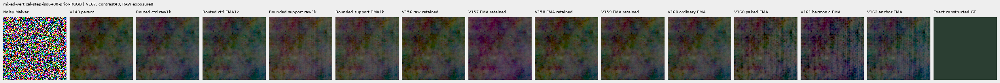

mixed-vertical-step-iso6400-prior-RGGB; ROI `[240, 176, 160, 160]`, RAW exposure 8, contrast 1.

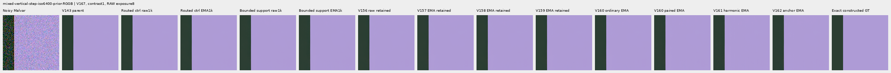

mixed-vertical-step-iso12800-prior-RGGB; ROI `[80, 176, 160, 160]`, RAW exposure 8, contrast 40.

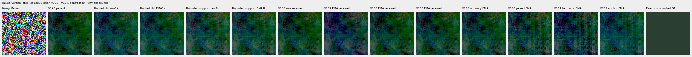

mixed-vertical-step-iso12800-prior-RGGB; ROI `[240, 176, 160, 160]`, RAW exposure 8, contrast 1.

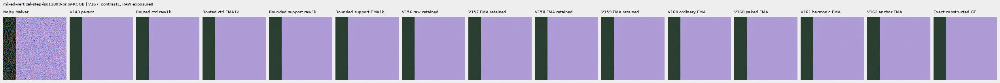

mixed-narrow-bar-iso6400-prior-RGGB; ROI `[80, 176, 160, 160]`, RAW exposure 8, contrast 40.

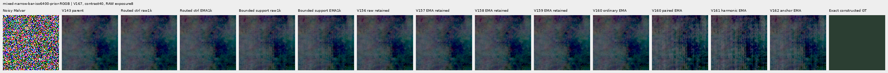

mixed-narrow-bar-iso6400-prior-RGGB; ROI `[240, 176, 160, 160]`, RAW exposure 8, contrast 1.

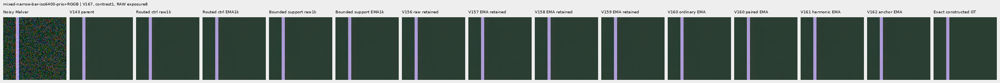

mixed-narrow-bar-iso12800-prior-RGGB; ROI `[80, 176, 160, 160]`, RAW exposure 8, contrast 40.

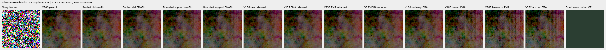

mixed-narrow-bar-iso12800-prior-RGGB; ROI `[240, 176, 160, 160]`, RAW exposure 8, contrast 1.

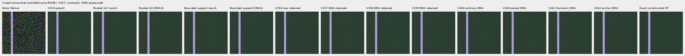

mixed-slanted-step-iso6400-prior-RGGB; ROI `[80, 176, 160, 160]`, RAW exposure 8, contrast 40.

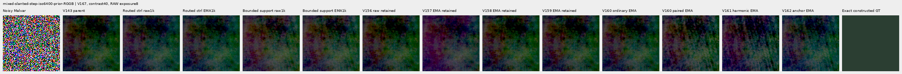

mixed-slanted-step-iso6400-prior-RGGB; ROI `[240, 176, 160, 160]`, RAW exposure 8, contrast 1.

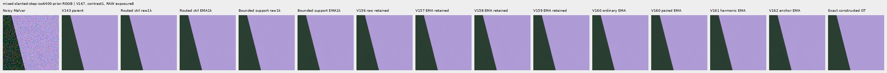

mixed-slanted-step-iso12800-prior-RGGB; ROI `[80, 176, 160, 160]`, RAW exposure 8, contrast 40.

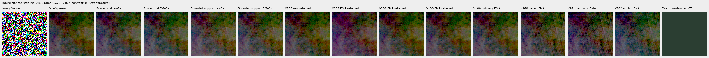

mixed-slanted-step-iso12800-prior-RGGB; ROI `[240, 176, 160, 160]`, RAW exposure 8, contrast 1.

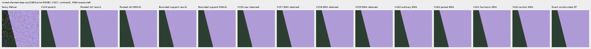

mixed-striped-patch-iso6400-prior-RGGB; ROI `[80, 176, 160, 160]`, RAW exposure 8, contrast 40.

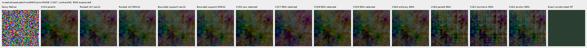

mixed-striped-patch-iso6400-prior-RGGB; ROI `[240, 176, 160, 160]`, RAW exposure 8, contrast 1.

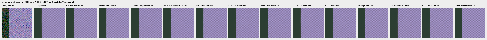

mixed-striped-patch-iso12800-prior-RGGB; ROI `[80, 176, 160, 160]`, RAW exposure 8, contrast 40.

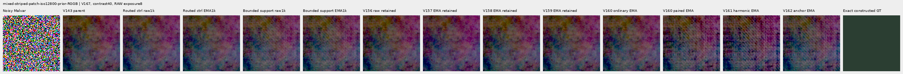

mixed-striped-patch-iso12800-prior-RGGB; ROI `[240, 176, 160, 160]`, RAW exposure 8, contrast 1.

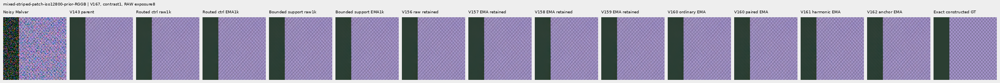

### Standalone flats and slopes

gray-l0.02-adc-only-RGGB; ROI `[48, 48, 160, 160]`, RAW exposure 4, contrast 40.

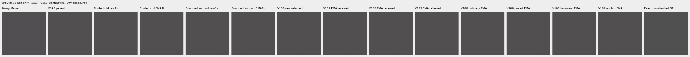

gray-l0.02-iso12800-prior-RGGB; ROI `[48, 48, 160, 160]`, RAW exposure 4, contrast 40.

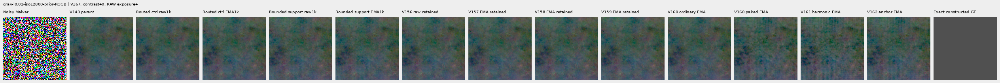

flat512-gray-l0.02-adc-only-RGGB; ROI `[176, 176, 160, 160]`, RAW exposure 4, contrast 40.

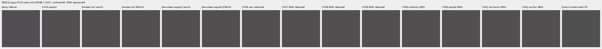

flat512-gray-l0.02-iso6400-prior-RGGB; ROI `[176, 176, 160, 160]`, RAW exposure 4, contrast 40.

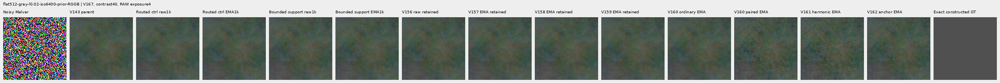

flat512-gray-l0.02-iso12800-prior-RGGB; ROI `[176, 176, 160, 160]`, RAW exposure 4, contrast 40.

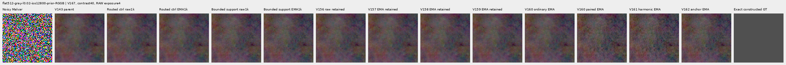

flat512-h210-s0.50-l0.02-iso6400-prior-RGGB; ROI `[176, 176, 160, 160]`, RAW exposure 4, contrast 40.

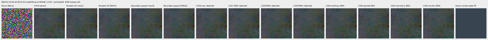

flat512-gray-l0.18-iso12800-prior-RGGB; ROI `[176, 176, 160, 160]`, RAW exposure 1, contrast 8.

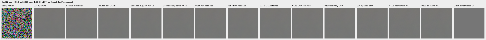

flat512-gray-l0.90-iso12800-prior-RGGB; ROI `[176, 176, 160, 160]`, RAW exposure 1, contrast 4.

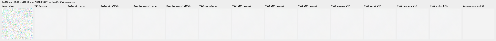

V150-control-ADC-plane0-RGGB; ROI `[176, 176, 160, 160]`, RAW exposure 45, contrast 8.

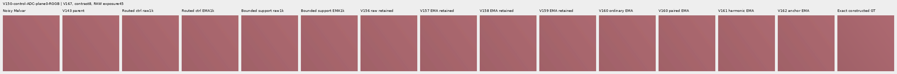

V150-control-ADC-plane1-RGGB; ROI `[176, 176, 160, 160]`, RAW exposure 9, contrast 8.

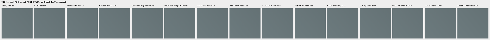

V150-control-ADC-plane2-RGGB; ROI `[176, 176, 160, 160]`, RAW exposure 1, contrast 8.

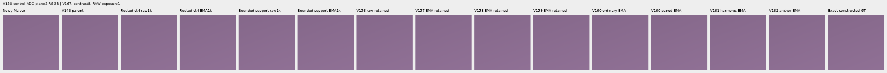

V150-control-ADC-plane3-RGGB; ROI `[176, 176, 160, 160]`, RAW exposure 0.24, contrast 8.

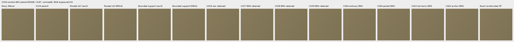

### Natural photographic detail

organic-02a76fd33b5e1414a0504f0b3f0aeb03a569b6f4-photo-faint-RGGB; ROI `[112, 112, 160, 160]`, RAW exposure 14.3883, contrast 8.

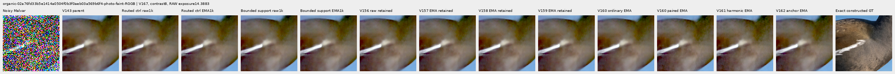

organic-dabacecd4780a1c230f8e9fce6ca1a604bdeab4c-photo-dark-RGGB; ROI `[112, 112, 160, 160]`, RAW exposure 102.758, contrast 1.

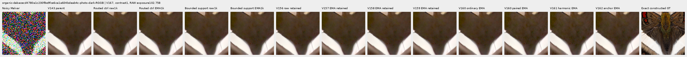

organic-6b3920bceba82d95ecf9351d47f6f94267694bd0-photo-dark-RGGB; ROI `[112, 112, 160, 160]`, RAW exposure 64.0491, contrast 1.

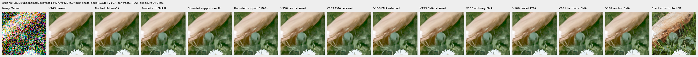

photo-3e638bbb56ed80abc88939468783e3bf9b92ee77-photo-faint-RGGB; ROI `[176, 176, 160, 160]`, RAW exposure 12.1494, contrast 8.

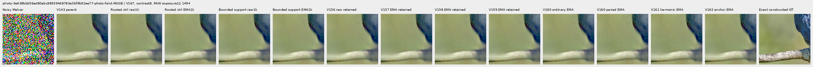

photo-3e638bbb56ed80abc88939468783e3bf9b92ee77-photo-dark-RGGB; ROI `[176, 176, 160, 160]`, RAW exposure 80.9959, contrast 1.

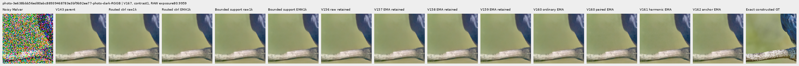

V150-control-bark-contrast0p025-adc-RGGB; ROI `[48, 48, 160, 160]`, RAW exposure 1, contrast 40.

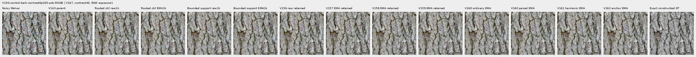

V150-control-raccoon-fur-contrast0p025-adc-RGGB; ROI `[48, 48, 160, 160]`, RAW exposure 1, contrast 40.

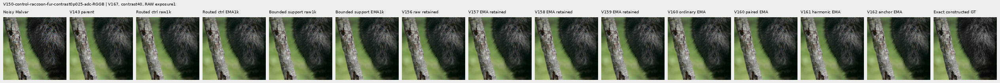

### Protected real GFX scenes

main-overcast-sky; ROI `[176, 176, 160, 160]`, RAW exposure 4, contrast 1.

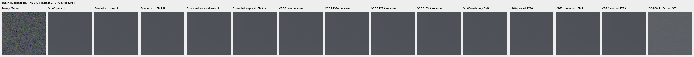

main-building-detail; ROI `[176, 176, 160, 160]`, RAW exposure 4, contrast 1.

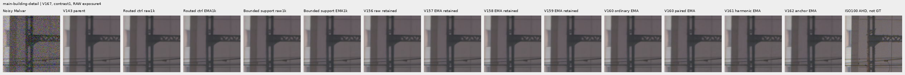

main-foliage; ROI `[176, 176, 160, 160]`, RAW exposure 4, contrast 1.

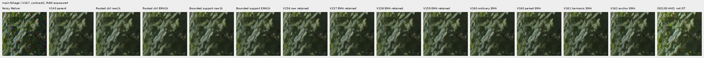

main-chain-link-fence; ROI `[176, 176, 160, 160]`, RAW exposure 4, contrast 1.

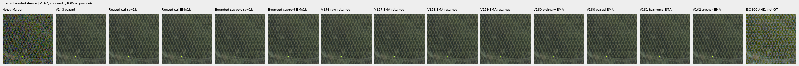

mesh-nominal; ROI `[206, 229, 160, 160]`, RAW exposure 16, contrast 1.

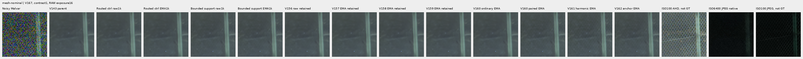

mesh-nominal; ROI `[426, 189, 160, 160]`, RAW exposure 16, contrast 1.

mesh-profile3879; ROI `[206, 229, 160, 160]`, RAW exposure 16, contrast 1.

mesh-profile3879; ROI `[426, 189, 160, 160]`, RAW exposure 16, contrast 1.

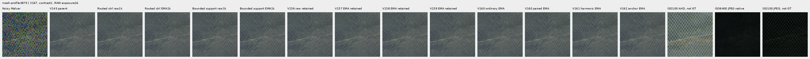

### Noisy, restored, exact constructed GT triplets

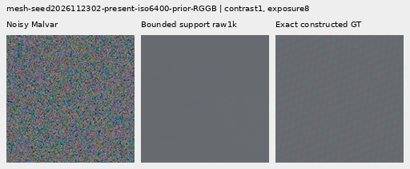

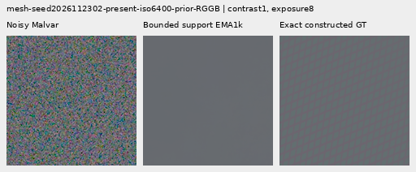

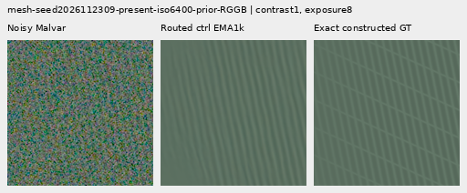

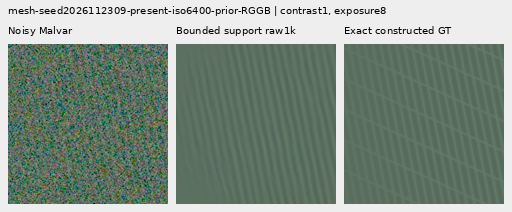

## Training, architecture and validation

Two fresh identical 124,909-parameter / 47-tensor weight sets use the same 1,000 retained V160 batches and V166 routed-common loss recipe. Both common-loss backward routes hold actual support fixed,with weight1/unit16 DN16;pair-difference weight1/floor2 DN16/epsilon.003,flat anchor.25,base losses,initial weights,LR,AdamW,clipping and EMA match.

Only the local support mapping differs:the control uses the original sigmoid;the candidate uses f+(1-f)sigmoid(logit+log(1-2f)),with f=.25. Both initialize at support.5 and exact parent output. The new logit derivative at zero is1/6 versus1/4. Positive support limits local attenuation,but frequency gains can vanish and direct RGB can cancel a correction. This is an architecture constraint,not calibrated confidence or a guarantee of delivered detail or safe noisy flats.

The isolated LateBoundedSupportDetail variant preserves all89 prior neural source files byte-exact and adds one module,for90 total. It keeps all47 weight tensors and124909 parameters. The inference forward has one spectral synthesis,one Malvar and one direct RGB evaluation. Existing fixed-support common routing separately replays FFT/fixed Malvar on691 paired batches per head,including71 zero-weight ADC batches. Constructor metadata explicitly stores the support floor in candidate checkpoints and exports. No target,pair or ISO100 reference metadata enters inference.

All266 relevant CPU checks pass,including28 new independent value/adjoint,bound,initializer,RNG/state,zero-floor whole-head output/auxiliary/parameter-gradient compatibility across all four CFAs,and zero-variance constant-RAW checks. GPU compatibility compares the zero-floor candidate with the frozen trained V166 head and original arrays on28 contexts/allCFAs/native256/384/512/768:56 actual roots.24 additional CUDA leaf checks comprise10anchor,6pair-unit,4common and4new support-floor scalar checks. These do not establish noisy-flat quality. [Motivation,algebra and exact sources](results/v167-bounded-support-motivation-v1.json).

Genuine8+2 model/EMA/Adam/RNG restoration passes. The first ten complete smoke/train rows match,and the control exactly reproduces all1000 V166 routed-common trace rows and final raw/EMA/Adam state. All1644 actual control predictions replay bit-exact before archive storage adoption. Four strict CPU endpoint loads and94 finite final Adam states pass. Actual support minima/maxima are recorded and the configured floor checked on every smoke/train/review forward;these recorded extrema do not independently reconstruct a full gate map.

The retained cache has4000 frames:1382 present/background pairs and1236 ordinary frames from2618 scene/patch instances. Its486 photo pairs visit268 free-photo IDs;234 reduce contrast and245 use reviewed ROIs. Geometry precedes area2 after bin4;optical blur is zero. All18 held-out IDs and protected captures/JPEGs/siblings remain excluded. No new scenes,noise,parent or DINO predictions are constructed. [V160 construction evidence](paired-response.md).

Only the current contrast holds the training recipe and weight initializer fixed. Historical comparisons mix interventions. CFA placements,reused procedural recipes and this adaptive cohort are related,not independent scene replications or blind generalization evidence. [V166 quiet-color result](common-support-routing.md) remains a useful separate option regardless of this support-floor outcome.

`routed-control`: 460/900 supervised batches clip; pre-clip norm median 1.071287, maximum 479.207886.

`bounded-support`: 459/900 supervised batches clip; pre-clip norm median 1.017819, maximum 479.207886.

The 100 zero-gradient ADC batches advance Adam/EMA clocks. Gradient norms describe optimization pressure; they do not isolate the cause of a quality change.

The independent audit checks 40,210 scalars across 4,686 rows and 476 Decimal reductions; maximum scalar difference is 4.55e-13. All 72 native images / 24 triplets were actually viewed in 18 original-detail sheets; 61,824,000 RGB channels were independently checked.

Actual scientific work totals5364 root calls /11424 head images:56 compatibility,20 discarded smoke,2000 training and3288 review forwards.24 CUDA leaf checks and CPU tests are separate;there is no additional motivation inference. All10 original scientific owners are terminal,with zero stage failure or full-training restart. All1644 new candidate arrays /4.421GiB remain external. Local/external reserves are56/120GiB plus.5GiB projection margin and.25GiB remaininglocal artifact bound. All earlier receipts and evidence remain intact. Original RAW files and /mnt/dataz remain unused.

## Actual training objectives, units and inherited masks

Independent FP32 recombination of the recorded components reproduces all 2,000 actual weighted total losses bit-exactly, including zero ADC totals. This checks weights and conditional routing; it does not recompute training targets or losses from full training predictions, which were not retained. Output-level semantics are checked separately in the CPU/CUDA and retained-prefix diagnostic. The recorded common loss can be positive on ADC pairs even though its total supervision is zero.

| Domain | ADC only | Arm | Batches | Pairs | Common supervised batches | Mean recorded common loss |
| --- | --- | --- | ---: | ---: | ---: | ---: |
| mesh | False | routed-control | 307 | 614 | 307 | 0.092407 |
| mesh | False | bounded-support | 307 | 614 | 307 | 0.092576 |
| photo | False | routed-control | 214 | 428 | 214 | 1.033080 |
| photo | False | bounded-support | 214 | 428 | 214 | 1.033419 |
| flat | True | routed-control | 12 | 0 | 0 | 0.000000 |
| flat | True | bounded-support | 12 | 0 | 0 | 0.000000 |
| mixed | False | routed-control | 139 | 0 | 0 | 0.000000 |
| mixed | False | bounded-support | 139 | 0 | 0 | 0.000000 |
| weak | False | routed-control | 99 | 198 | 99 | 0.152790 |
| weak | False | bounded-support | 99 | 198 | 99 | 0.150966 |
| flat | False | routed-control | 141 | 0 | 0 | 0.000000 |
| flat | False | bounded-support | 141 | 0 | 0 | 0.000000 |
| mesh | True | routed-control | 34 | 68 | 0 | 0.001152 |
| mesh | True | bounded-support | 34 | 68 | 0 | 0.001152 |
| photo | True | routed-control | 29 | 58 | 0 | 0.300847 |
| photo | True | bounded-support | 29 | 58 | 0 | 0.300806 |
| mixed | True | routed-control | 17 | 0 | 0 | 0.000000 |
| mixed | True | bounded-support | 17 | 0 | 0 | 0.000000 |
| weak | True | routed-control | 8 | 16 | 0 | 0.000619 |
| weak | True | bounded-support | 8 | 16 | 0 | 0.000616 |

An independent NumPy reconstruction verifies all 1,000 actual records / 2,000 fingerprints: both arms use identical 2 DN16-floor pair-difference units derived from original retained mean shot-increment variances. The original 16 DN16 cached arrays are reconstructed separately. These are increment training proxies rather than post-ADC or restored-RGB covariance. All 1,000 actual masks replay the already independent V162 oracle on identical targets and unchanged mask code through V166; no new independent mask computation is claimed.

| Domain | ADC only | Pairs | Median difference unit DN16 | P90 unit | Maximum unit |
| --- | --- | ---: | ---: | ---: | ---: |
| mesh | False | 614 | 8.604690 | 25.789597 | 88.750217 |
| photo | False | 428 | 61.038446 | 270.123829 | 853.877535 |
| weak | False | 198 | 17.108980 | 58.000702 | 110.375437 |
| mesh | True | 68 | 2.000000 | 2.000000 | 2.000000 |
| photo | True | 58 | 2.000000 | 2.000000 | 2.000000 |
| weak | True | 16 | 2.000000 | 2.000000 | 2.000000 |

The unchanged detached flat-target mask requires per-channel truncated 17×17 range at most 1 DN16. Eligible weak gradients retain their actual targets. Its pseudo-Huber uses 16 DN16 units and a whole-image denominator, so coverage controls term weight. Mean batch fraction reflects that denominator; pixel-weighted fraction accounts for mixed context sizes. ADC masks remain recorded despite zero total supervision. Coverage does not establish inference flatness.

| Domain | ADC only | Batches | Mean batch eligible fraction | Pixel-weighted eligible fraction |
| --- | --- | ---: | ---: | ---: | ---: |
| mesh | False | 307 | 0.699702 | 0.699702 |
| mesh | True | 34 | 0.667894 | 0.667894 |
| weak | False | 99 | 0.502555 | 0.502555 |
| weak | True | 8 | 0.500000 | 0.500000 |
| photo | False | 214 | 0.522321 | 0.522321 |
| photo | True | 29 | 0.507665 | 0.507665 |
| flat | False | 141 | 0.688589 | 0.688589 |
| flat | True | 12 | 0.646564 | 0.646564 |
| mixed | False | 139 | 0.907641 | 0.907641 |
| mixed | True | 17 | 0.907094 | 0.907094 |

[Original protocol](results/v167-bounded-support-v1/original-protocol.md) · [Immutable preparation](results/v167-bounded-support-preparation-v1.json) · [Independent publication verification](results/v167-bounded-support-publication-verification-v1.json).

## Photographic credits

Derived native targets/crops retain the respective source licenses; transformations include linearization, area binning and exposure/contrast changes. Source IDs and ROIs are in the manifest.

| Source | Author | License |
| --- | --- | --- |
| [File:Emamzadeh Esmaeil roof.jpg](https://commons.wikimedia.org/wiki/File:Emamzadeh_Esmaeil_roof.jpg) | مانفی | [CC BY-SA 4.0](https://creativecommons.org/licenses/by-sa/4.0) |
| [File:HP-85-IMG 0439.jpg](https://commons.wikimedia.org/wiki/File:HP-85-IMG_0439.jpg) | Rama & Musée Bolo | [CC BY-SA 2.0 fr](https://creativecommons.org/licenses/by-sa/2.0/fr/deed.en) |
| [File:Spangled Drongo - AndrewMercer - DSC00966.jpg](https://commons.wikimedia.org/wiki/File:Spangled_Drongo_-_AndrewMercer_-_DSC00966.jpg) | Andrew Mercer (www.baldwhiteguy.co.nz) | [CC BY-SA 4.0](https://creativecommons.org/licenses/by-sa/4.0) |
| [File:Naxos Chora 2025-06-14 0505.jpg](https://commons.wikimedia.org/wiki/File:Naxos_Chora_2025-06-14_0505.jpg) | Tsui | [CC BY-SA 4.0](https://creativecommons.org/licenses/by-sa/4.0) |
| [File:Castelo Novo April 2015-2a.jpg](https://commons.wikimedia.org/wiki/File:Castelo_Novo_April_2015-2a.jpg) | Alvesgaspar | [CC BY-SA 4.0](https://creativecommons.org/licenses/by-sa/4.0) |
| [File:RX50 -5 ¼” dual floppy disk drive 02.jpg](https://commons.wikimedia.org/wiki/File:RX50_-5_%C2%BC%E2%80%9D_dual_floppy_disk_drive_02.jpg) | Mister rf | [CC BY-SA 4.0](https://creativecommons.org/licenses/by-sa/4.0) |
| [File:DSC00752 San Salvator Laur.jpg](https://commons.wikimedia.org/wiki/File:DSC00752_San_Salvator_Laur.jpg) | Rione Colonna | [CC BY 4.0](https://creativecommons.org/licenses/by/4.0) |
| [File:Regierungsgebäude, Vaduz.jpg](https://commons.wikimedia.org/wiki/File:Regierungsgeb%C3%A4ude,_Vaduz.jpg) | AuHaidhausen | [CC BY 4.0](https://creativecommons.org/licenses/by/4.0) |
| [File:Common moorhen (Gallinula chloropus) France.jpg](https://commons.wikimedia.org/wiki/File:Common_moorhen_(Gallinula_chloropus)_France.jpg) | Alexis Lours | [CC BY 4.0](https://creativecommons.org/licenses/by/4.0) |
| [File:Dried platanus leaves on rain puddle, Quinta das Conchas e dos Lilases, Lisbon, Portugal julesvernex2.jpg](https://commons.wikimedia.org/wiki/File:Dried_platanus_leaves_on_rain_puddle,_Quinta_das_Conchas_e_dos_Lilases,_Lisbon,_Portugal_julesvernex2.jpg) | Jules Verne Times Two | [CC BY-SA 4.0](https://creativecommons.org/licenses/by-sa/4.0) |
| [File:Close wing pudding position of Lethe visrava (Moore, 1866) - White-edged Woodbrown WLB IMG 0997.jpg](https://commons.wikimedia.org/wiki/File:Close_wing_pudding_position_of_Lethe_visrava_(Moore,_1866)_-_White-edged_Woodbrown_WLB_IMG_0997.jpg) | Thamblyok | [CC BY-SA 4.0](https://creativecommons.org/licenses/by-sa/4.0) |
| [File:Daisies near Cockspur coral tree (Erythrina crista-galli) roots, Jardim da Praça de Londres, Lisbon, Portugal julesvernex2.jpg](https://commons.wikimedia.org/wiki/File:Daisies_near_Cockspur_coral_tree_(Erythrina_crista-galli)_roots,_Jardim_da_Pra%C3%A7a_de_Londres,_Lisbon,_Portugal_julesvernex2.jpg) | Jules Verne Times Two | [CC BY-SA 4.0](https://creativecommons.org/licenses/by-sa/4.0) |
| [File:Apples on tree 2021 G1.jpg](https://commons.wikimedia.org/wiki/File:Apples_on_tree_2021_G1.jpg) | George Chernilevsky | [CC BY-SA 4.0](https://creativecommons.org/licenses/by-sa/4.0) |
| [File:Close wing Nectering of Pseudozizeeria maha (Kollar, 1844) - Pale Grass Blue WLB.jpg](https://commons.wikimedia.org/wiki/File:Close_wing_Nectering_of_Pseudozizeeria_maha_(Kollar,_1844)_-_Pale_Grass_Blue_WLB.jpg) | Anitava Roy | [CC BY-SA 4.0](https://creativecommons.org/licenses/by-sa/4.0) |
| [File:Grey heron (Ardea cinerea) head.jpg](https://commons.wikimedia.org/wiki/File:Grey_heron_(Ardea_cinerea)_head.jpg) | Alexis Lours | [CC BY 4.0](https://creativecommons.org/licenses/by/4.0) |
| [File:Openwing position of Parasarpa dudu (Westwood, -1850-) - White Commodore.jpg](https://commons.wikimedia.org/wiki/File:Openwing_position_of_Parasarpa_dudu_(Westwood,_-1850-)_-_White_Commodore.jpg) | MaheshBaruahwildlife | [CC BY-SA 4.0](https://creativecommons.org/licenses/by-sa/4.0) |
| [File:Kentucky Coffee-tree Gymnocladus dioicus 3264px.jpg](https://commons.wikimedia.org/wiki/File:Kentucky_Coffee-tree_Gymnocladus_dioicus_3264px.jpg) | Photo (c)2007 Derek Ramsey (Ram-Man) | [CC BY-SA 2.5](https://creativecommons.org/licenses/by-sa/2.5) |
| [File:Racoon clinging to a tree.JPG](https://commons.wikimedia.org/wiki/File:Racoon_clinging_to_a_tree.JPG) | Korall | [CC BY 3.0](https://creativecommons.org/licenses/by/3.0) |

## Fixed component checkpoints

- `routed-control-raw-step1000`: `065f37719318a42ee74b238fd51494f458dc0f84342bf282459f35f555a87dfe`.
- `routed-control-EMA-step1000`: `317da76f0614cd291b9fab05ef3f95c25799cd99b97ec3e8f1b02e3fbe2ea1c0`.
- `bounded-support-raw-step1000`: `db7a078ba2b4aaca4156663f4f986e21085614322476988eba60ae57f393ed71`.
- `bounded-support-EMA-step1000`: `3ab3975e79386e4f50f71d18af21cafbe9444c48020e040d3dfe87e9ac11c509`.
