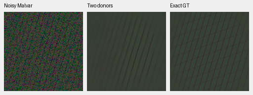
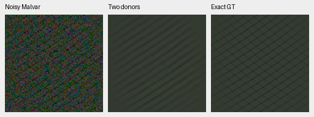

# Fitting weak wire geometry from opposite RAW donors

Two stronger RAW patches on opposite sides of the query improve
ISO400 far weak response from **9.38% to 12.13%** over the same
fixed center frequencies with a planar phase model. Weak-increment
RMS falls from **11.189 to 11.172 DN16** at equal quiet error.
The prior single-donor fit reaches 8.54%. The largest benefit is
on curved wires. The real cab mesh still lacks clear fine crossings.
[Bound results and native viewing](results/bracket-phase-geometry-v2/publication.json).

## Geometry and evidence

A shared quadratic phase field fits two disjoint donor regions at
once, allowing a separate nuisance background, sine and cosine
coefficients, and phase offset for each donor. Local spectral
estimates initialize the carrier gradients and Hessian. The
difference between donor-center frequencies supplies an additional
initialization for the Hessian along their center line. The fit
estimates the query-center frequency inside the bracket, which
reduces reliance on extrapolating the shape from either donor alone.

The two discovery folds fit geometry independently on both donors.
In each direction, held-out error must improve on each donor,
with a reduction above 16 whitened squared-error units across the
pair. The revised check compares the shared curved field with
both a shared planar field and a separate planar fit for each donor.
The two discovery fits must also agree on the query-center gradient
and Hessian. The query receives the agreed geometry. Its own Bayer
measurements determine amplitude, phase, color and local support.

The 32 query groups and predictions are exact replays of the
[single-donor comparison](donor-phase-geometry.md). They cover
three curved sources, three spacing changes and two straight
controls, crossed with two noise levels and near/far placements.
The right donor is reused. The new left donor extends the same
underlying phase field and uses an independent noise draw. The
synthetic donor setup provides appreciably stronger wire contrast
than the query. The native camera comparison uses actual nearby
128-pixel RAW fields above and below the query, with a left/right
placement check.

## Weak recovery and false curvature

Values are weak response / weak-increment RMS in DN16 at the
common observed quiet RMS, capped by the tighter frozen operating
point.

| Noise and geometry | Guarded guide | Single donor | Fixed planar | Two donors | Quiet RMS |
| --- | ---: | ---: | ---: | ---: | ---: |
| ISO400 far, all | 8.807% / 11.1991 | 8.543% / 11.1925 | 9.385% / 11.1893 | 12.130% / 11.1718 | 2.34372 |
| ISO400 far, curved | 3.700% / 11.0630 | 4.390% / 11.0430 | 4.765% / 11.0392 | 11.556% / 10.9923 | 2.20867 |
| ISO400 far, spacing changes | 1.631% / 12.0980 | 1.552% / 12.0920 | 2.162% / 12.0943 | 3.100% / 12.0839 | 2.54122 |
| ISO400 near, all | 3.875% / 14.1221 | 3.604% / 14.1225 | 3.695% / 14.1225 | 3.818% / 14.1218 | 6.31827 |
| ISO6400 far, all | 2.051% / 22.9546 | 2.113% / 22.9477 | 2.019% / 22.9477 | 2.091% / 22.9603 | 6.42100 |
| ISO6400 near, all | 3.007% / 30.2445 | 2.872% / 30.2439 | 2.872% / 30.2452 | 2.931% / 30.2451 | 14.97646 |

Both versions accept 14 of 32 donor direction/profile combinations
on the main panel. The adopted check retains all 160 main-panel
prediction arrays bit for bit. In four additional stress cases,
both donors are straight, with the left periods scaled by 0.94
and 1.06 for the two families. The shared-planar check falsely
accepts curvature in all four. The individual-planar check rejects
all four. These examples keep the same straight query and use one
changed donor. The added check distinguishes local curvature
from a change in pitch between separate surfaces in these cases.
[Independent reductions](results/bracket-phase-geometry-v2/independent-audit.json) ·
[Stress and retained prediction audit](results/bracket-phase-geometry-v2/guard-and-horizontal-audit.json).

## Native comparisons

The synthetic 160×160 triplets use sources 81 and 85, BGGR at
ISO400, native coordinates `[176,176,160,160]`, shot/read
`8e-5 / 2.56e-8`, exposure 2 and a common contrast factor of 5
around the target mean for display. Delivery uses threshold 2 and
scale 0.82212 on V143 EMA checkpoint
`96d146d017c54196288c585f8b7eddcf030e8a235061049c31e985b9380b7ce4`.
The restored images show the stronger wire family. Many weak
intersections in the exact targets remain hard to see.

On camera inputs, the two-donor component uses V120 EMA checkpoint
`a9d9b6b4f974e24a6b11e5e740aab32314233a7f53c056cf37c7d2aac1c589fb`.
It falls back to the existing guarded fit. Above/below donors leave
all eight crops unchanged. The left/right
check changes one, the left cab crop under the transferred noise
profile, by 2.687 DN16 linear RMS. It accepts a broad carrier near a
45-pixel period and gives a small change in modulation without
visible new fine crossings. Sky stays smooth in both checks. The
surrounding crop view shows rail and cab structures interrupting
the lattice in the vertical donor patches. The ISO100 AHD and
JPEG images are independent qualitative references.

[Sky](images/bracket-phase-geometry-v2/main-overcast-sky.png) ·
[Building](images/bracket-phase-geometry-v2/main-building-detail.png) ·
[Foliage](images/bracket-phase-geometry-v2/main-foliage.png) ·
[Coarse fence](images/bracket-phase-geometry-v2/main-chain-link-fence.png) ·
[Cab left](images/bracket-phase-geometry-v2/mesh-nominal-left.png) ·
[Cab right](images/bracket-phase-geometry-v2/mesh-nominal-right.png) ·
[Transferred left](images/bracket-phase-geometry-v2/mesh-profile3879-left.png) ·
[Transferred right](images/bracket-phase-geometry-v2/mesh-profile3879-right.png) ·
[Changed horizontal comparison](images/bracket-phase-geometry-v2/horizontal-mesh-profile3879-left.png) ·
[Donor neighborhoods](images/bracket-phase-geometry-v2/nearby-regions.png) ·
[Native provenance and viewing](images/bracket-phase-geometry-v2/manifest.json).

The 18 main and horizontal boards were inspected at native crop
size. The experiment reuses saved restorations with zero new neural
calls. Full427 and standard known/unseen camera scores are unavailable
for this component.
