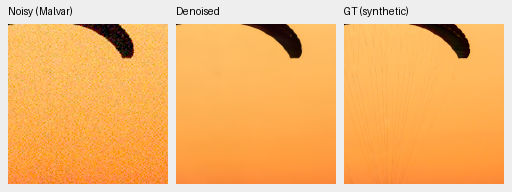
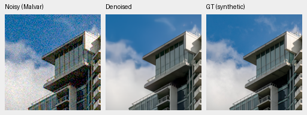
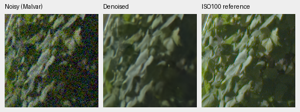
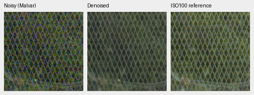

# Camera centering fails its matched quality gate

**Stop both arms at1000 updates. V48 is not promoted.** Centering the camera
matrix lowers known/unseen measured-CFA PSNR and photographic/procedural sRGB
PSNR versus its matched V47 control. All four source-bootstrap intervals are
negative. The current V43 step2000 photographic experimental reference remains
fixed. [Complete results and20 verified native triplets](results/camera-centering-v47-v48-review.json).

The [centering implementation](camera-matrix-centering.md) preserves the exact
initial trainable tensors and predictions, retaining all WB/matrix information.
V48 changes only matrix optimization coordinates, with a fixed parent diagonal
reference. Both arms start from V43 first1000 EMA, fresh AdamW/EMA, seed50,
batch16, LR3e-5/planned3000 and1000 updates. The Commons4/native128/paired mix,
augmentation, frozen genuine DINO, full-resolution CNN and precision remain
fixed. All41 shared logged input/target hashes match. Optimizers reach1000;
V48's fixed reference survives exactly in model and EMA. There is one training
seed; evaluation-source intervals do not measure training-seed uncertainty.

| Panel | Model | Measured-CFA PSNR | AHD RGB PSNR | AHD SSIM |
| --- | --- | ---: | ---: | ---: |
| Known4 | V47 control | 54.25486 | 40.01602 | 0.930912 |
| Known4 | V48 centered | 54.24101 | 40.00623 | 0.930864 |
| Unseen5 | V47 control | 53.73204 | 38.49569 | 0.920479 |
| Unseen5 | V48 centered | 53.65842 | 38.43880 | 0.920659 |

V48−V47 primary PSNR: known **-0.01385 [-0.02544, -0.00615]**;
unseen **-0.07362 [-0.10800, -0.04182]** dB. Known4 has8 pairs/72 crops;
unseen5 has10 pairs/90 crops. Registered low-noise measured CFA is primary.
Independent AHD RGB is auxiliary, **not exact RGB GT**. Protected-final model
scoring remains untouched.

| Model | 427-photo PSNR | SSIM | 16-procedural PSNR | SSIM |
| --- | ---: | ---: | ---: | ---: |
| V47 control | 34.91128 | 0.956664 | 33.56462 | 0.965209 |
| V48 centered | 34.87575 | 0.956375 | 33.21754 | 0.965290 |

V48−V47 photo sRGB PSNR **-0.03553 [-0.04994, -0.01978]** dB;
procedural **-0.34709 [-0.72602, -0.03472]** dB. Brackets are95%
source-bootstrap intervals. The full suite has443 sources, seven noise conditions,
four CFAs and62,020 cases across two neural and three classical methods. Photo
linear PSNR increases slightly, and procedural SSIM increases slightly; neither
offsets the paired and display-space PSNR losses. These are new matched controls,
not a causal comparison to the earlier continued V43 step2000 optimizer history.

V47 SHA256 `ebfe1cc8af4a2dbfd83105b82da81b782c46007282a4de50a0be0215ab5238c4`.
V48 SHA256 `d6275396175814738d0a02cbccd75081477a38d8eb7509f7cdcc3dd9921a3f8f`.
Both training source bundles are
`bc4c1569be539e86902e9c20b5c9a0edd811b733b751363debf119c01807504c`,
from frozen7cd1f12. Exact inference source/data/checkpoint hashes and native
crop source/ROI/noise/display identities remain in the receipt.

## Native exact-GT crops

Noisy Malvar → restored → exact synthetic GT, native160×160 per panel, never
resized. Shared ROI[48,48,160,160], RGGB/ISO12800 prior `shot=.00256`,
`read=.0000262144`, display×1, WB[2,1,1.5], fixed protocol camera matrix.
Noisy and reference panel pixels verify identical between methods. PNGs are
8-bit previews; metrics use unquantized predictions.

Sources: [Roy Egloff](https://commons.wikimedia.org/wiki/File:CH.VD.Villeneuve_2007-08-25_Vertigo-Swiss-Riviera_2392_3x2-R_4K.jpg)
and [Dietmar Rabich](https://commons.wikimedia.org/wiki/File:Vancouver_(BC,_Canada),_Coal_Harbour_Seaside_Park,_Blick_in_den_Himmel_--_2022_--_2158.jpg),
[CC BY-SA4.0](https://creativecommons.org/licenses/by-sa/4.0/). Modified by binning,
cropping, simulated noise, restoration and rendering; previews retain that
license. Paired images by Benoit Brummer and Christophe De Vleeschouwer,
[RawNIND](https://doi.org/10.14428/DVN/DEQCIM), per-scene CC BY-SA4.0/CC0 in source
receipts. GFX images by the project owner.

## Standing GFX test

Full102MP DSCF3879 ISO6400 → restored → separate DSCF3880 ISO100 f/5.6.
Native160px foliage[8890,5570], fence[2240,6000] (reference x2241), sky and
building crops included in the receipt. Shared+2EV/WB/matrix, input-only
`shot=.0014635775921166604`, `read=.0000010715704128646712`.
Time/aperture/motion differ; the final panel is a qualitative reference,
**not GT**. No reference fitting or pixelwise GFX reference scoring.

Native inspection finds no decisive visual gain from centering. Fine fabric
strands remain smoothed in both arms, while the building reconstruction and
GFX foliage/fence look very similar. The separate ISO100 exposure has more
leaf and wire detail, with the aperture and exposure differences noted above.

All20 PNGs verify hashes, dimensions and common panel bytes/ROI/display metadata.
All four8746×11662×3 RGB16 TIFFs independently verify complete-file SHA/size,
uint16 dtype, dimensions,16-bit tags,>256 sampled codes and sRGB ICC profiles.
Successive shared-machine full restoration times are35.48s/34.46s with512px
tiles,64px overlap,batch4,FP16 CNN/FP32 physical paths, excluding loading,
decoding, rendering and encoding. These are not a repeated speed comparison or
a10-second result. Complete outputs remain under
`/mnt/external/demosaic/evaluation/gfx-3879-3880-camera-centering-v47-v48-1k-full/`.
